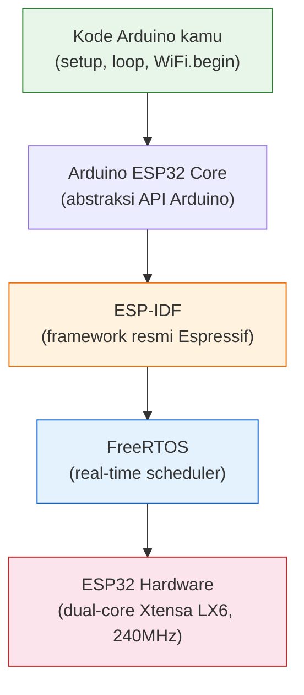
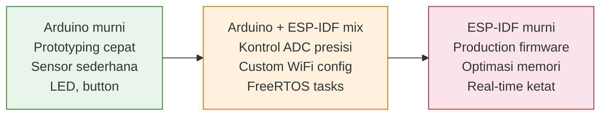

_Artikel ini adalah bagian dari series eksplorasi embedded system. Artikel sebelumnya membahas [arsitektur OS dari microkernel sampai RTOS](/blog/os-architecture-microkernel-monolith-iot). Di sini kita mulai dari yang paling familiar — Arduino — dan membedah apa yang sebenarnya ada di baliknya._

---

## Ketika Orang Bilang "Arduino"

Coba tanya ke sepuluh orang berbeda: "Arduino itu apa?"

Orang awam akan bilang: papan elektronik kecil yang bisa diprogram, biasanya warna biru atau hijau, sering dipakai untuk proyek lampu LED atau robot sederhana.

Developer embedded akan bilang: framework pemrograman dengan API yang menyederhanakan akses ke hardware — `digitalWrite()`, `analogRead()`, `Serial.begin()`.

Keduanya benar. Dan justru di sinilah kebingungan sering terjadi — karena "Arduino" adalah dua hal sekaligus: **sebuah produk hardware** dan **sebuah ekosistem software**, dan keduanya bisa hidup terpisah satu sama lain.

---

## Arduino sebagai Produk: Papan yang Melahirkan Gerakan

**Arduino** sebagai produk adalah lini papan mikrokontroler yang dibuat oleh Arduino LLC, lahir dari proyek riset di Interaction Design Institute Ivrea, Italia, pada 2003. Tujuan awalnya sederhana: membuat hardware yang bisa diprogram oleh desainer dan seniman yang tidak punya latar belakang teknik elektronika.

Papan Arduino original menggunakan mikrokontroler **AVR** dari Atmel (sekarang Microchip) — chip 8-bit yang sederhana, murah, dan mudah dipahami. Arduino Uno, yang menjadi ikon gerakan ini, menggunakan ATmega328P dengan clock 16MHz dan RAM 2KB.

```
Arduino Uno (hardware):
┌─────────────────────────────────────┐
│  ATmega328P                         │
│  ├── Clock: 16 MHz                  │
│  ├── Flash: 32 KB (program storage) │
│  ├── RAM: 2 KB (runtime memory)     │
│  ├── EEPROM: 1 KB                   │
│  └── I/O pins: 14 digital, 6 analog │
└─────────────────────────────────────┘
```

2KB RAM. Untuk konteks: satu emoji di WhatsApp bisa berukuran lebih dari 2KB. Tapi dengan constraint itu, orang berhasil membuat synthesizer musik, kontroler robot, sistem irigasi otomatis, dan ribuan proyek lainnya. Constraint yang ketat justru melahirkan kreativitas.

Yang membuat Arduino berhasil bukan hardware-nya — chip AVR sudah ada jauh sebelum Arduino. Yang berhasil adalah **ekosistemnya**: IDE yang sederhana, dokumentasi yang ramah pemula, dan komunitas yang sangat aktif berbagi proyek dan library.

---

## "Bahasa Arduino" yang Sebenarnya Tidak Ada

Ini salah satu kesalahpahaman yang paling umum, bahkan di kalangan yang sudah cukup lama bersentuhan dengan Arduino.

Banyak orang melihat kode Arduino dan berpikir: _"Oh, ini bahasa Arduino."_ Padahal tidak ada yang namanya "bahasa Arduino". Yang mereka lihat adalah **C++** — dengan beberapa tambahan yang membuat ia terlihat lebih sederhana.

```cpp
// Ini terlihat seperti "bahasa Arduino"...
void setup() {
    pinMode(13, OUTPUT);
}

void loop() {
    digitalWrite(13, HIGH);
    delay(1000);
    digitalWrite(13, LOW);
    delay(1000);
}
```

Tapi kalau kita buka file header di baliknya, yang kita temukan adalah C++ biasa:

```cpp
// Arduino.h — ini yang di-include secara otomatis
// pinMode, digitalWrite, delay — semuanya hanya fungsi C++ biasa

void pinMode(uint8_t pin, uint8_t mode);
void digitalWrite(uint8_t pin, uint8_t val);
void delay(unsigned long ms);
```

`setup()` dan `loop()` pun bukan keyword khusus — keduanya hanya fungsi C++ biasa yang dipanggil oleh `main()` yang sudah ditulis oleh Arduino Core:

```cpp
// main.cpp di Arduino Core — ini yang sebenarnya berjalan
int main(void) {
    init();        // inisialisasi hardware
    setup();       // panggil setup() yang kita tulis
    for (;;) {
        loop();    // panggil loop() terus-menerus
    }
    return 0;
}
```

Jadi ketika kita "belajar Arduino", kita sebenarnya sedang belajar C++ — hanya dengan library yang menyembunyikan kompleksitas hardware di balik nama fungsi yang lebih ramah. Ini bukan hal yang buruk, tapi penting untuk disadari karena artinya semua yang berlaku di C++ juga berlaku di Arduino: pointer, struct, class, template, semua ada dan bisa digunakan.

Konsekuensi praktisnya: kalau kamu sudah bisa menulis kode Arduino, kamu sudah menulis C++. Jarak antara "programmer Arduino" dan "programmer C++ embedded" jauh lebih kecil dari yang kebanyakan orang bayangkan.

---

## Arduino sebagai Library: Abstraksi di Balik Dua Baris Kode

Di sinilah makna kedua yang lebih penting secara teknis.

**Arduino Core** adalah kumpulan library C++ yang mengabstraksi akses ke hardware menjadi API yang konsisten dan mudah dipahami. Alih-alih menulis register manipulation langsung:

```c
// Cara "raw" menyalakan LED di AVR — kamu harus tahu
// nama register, bit mana yang harus di-set, dan artinya
DDRB |= (1 << PB5);   // set pin sebagai output
PORTB |= (1 << PB5);  // set pin HIGH
```

Dengan Arduino API:

```cpp
// Cara Arduino — bisa dipahami bahkan tanpa tahu hardware-nya
pinMode(13, OUTPUT);
digitalWrite(13, HIGH);
```

Dua baris yang bisa dipahami bahkan oleh orang yang baru belajar pemrograman. Tapi di baliknya, `digitalWrite()` tetap melakukan hal yang sama — memanipulasi register hardware. Abstraksi tidak menghilangkan kompleksitas, ia hanya menyembunyikannya sampai kita siap untuk melihatnya.

**Yang penting dipahami:** Arduino API ini bukan milik hardware Arduino. Ia adalah _spesifikasi interface_ yang bisa diimplementasikan untuk hardware apapun. Dan inilah yang membuka pintu ke sesuatu yang jauh lebih besar.

---

## Arduino Core untuk ESP32: Hardware Murah, Stack yang Tidak Sederhana

**ESP32** adalah chip WiFi+Bluetooth buatan Espressif Systems, perusahaan asal Shanghai. Dibandingkan ATmega328P di Arduino Uno:

```
Perbandingan:

ATmega328P (Arduino Uno)    ESP32
─────────────────────────   ──────────────────────────
Clock: 16 MHz               Clock: 240 MHz (dual core)
RAM: 2 KB                   RAM: 520 KB
Flash: 32 KB                Flash: 4 MB (eksternal)
WiFi: ❌                    WiFi: ✅ 802.11 b/g/n
Bluetooth: ❌               Bluetooth: ✅ BT + BLE
Harga: ~$3                  Harga: ~$2-5
```

ESP32 jauh lebih powerful, dan harganya bahkan lebih murah. Tapi ia punya SDK sendiri yang kompleks: **ESP-IDF** (Espressif IoT Development Framework), yang dibangun di atas FreeRTOS dan membutuhkan pemahaman yang lebih dalam untuk digunakan langsung.

Solusinya: **arduino-esp32** — implementasi Arduino Core untuk ESP32, yang dibuat dan dikelola oleh Espressif sendiri. Dengan ini, kita bisa menulis kode Arduino yang familiar, tapi berjalan di atas hardware yang jauh lebih powerful.

```cpp
// Kode ini berjalan di ESP32 dengan arduino-esp32
// Terlihat seperti Arduino biasa...
#include <WiFi.h>

void setup() {
    Serial.begin(115200);
    WiFi.begin("nama_wifi", "password");

    while (WiFi.status() != WL_CONNECTED) {
        delay(500);
        Serial.print(".");
    }

    Serial.println("\nTerhubung! IP: " + WiFi.localIP().toString());
}

void loop() {
    // lakukan sesuatu
}
```

Tapi di bawahnya, ada stack yang jauh lebih dalam:



`WiFi.begin()` yang kita tulis di sketch Arduino pada akhirnya memanggil `esp_wifi_set_config()` dan `esp_wifi_start()` dari ESP-IDF. `delay(500)` adalah `vTaskDelay()` dari FreeRTOS. `loop()` itu sendiri adalah sebuah FreeRTOS task yang dibuat oleh Arduino Core dan berjalan terus-menerus.

---

## Apa yang Disembunyikan Abstraksi

Abstraksi Arduino sangat berguna untuk memulai, tapi ada harga yang dibayar — beberapa kapabilitas hardware tidak di-expose karena API Arduino dirancang untuk kesederhanaan, bukan kelengkapan.

Contoh nyata: `analogRead()` di Arduino ESP32 bekerja, tapi ia menggunakan konfigurasi default ADC yang tidak selalu optimal. Kalau kita butuh presisi tinggi untuk sensor — misalnya sensor suhu yang butuh resolusi 12-bit dengan attenuation yang tepat — kita perlu bypass Arduino dan panggil ESP-IDF langsung:

```cpp
#include <Arduino.h>
#include "esp_adc/adc_oneshot.h"

adc_oneshot_unit_handle_t adc_handle;

void setup() {
    Serial.begin(115200);

    // Konfigurasi ADC via ESP-IDF langsung
    adc_oneshot_unit_init_cfg_t init_config = {
        .unit_id = ADC_UNIT_1,
    };
    adc_oneshot_new_unit(&init_config, &adc_handle);

    adc_oneshot_chan_cfg_t chan_config = {
        .atten = ADC_ATTEN_DB_12,     // range 0-3.3V penuh
        .bitwidth = ADC_BITWIDTH_12,  // resolusi 12-bit
    };
    adc_oneshot_config_channel(adc_handle, ADC_CHANNEL_6, &chan_config);
}

void loop() {
    int raw;
    adc_oneshot_read(adc_handle, ADC_CHANNEL_6, &raw);
    Serial.println(raw);
    delay(100);
}
```

Ini adalah salah satu kekuatan arduino-esp32 yang sering tidak disadari: kita tidak harus memilih antara Arduino atau ESP-IDF. Keduanya bisa digunakan dalam satu project yang sama, di file yang sama, bahkan di fungsi yang sama.

---

## FreeRTOS di Balik loop()

Ini bagian yang paling mengejutkan bagi banyak orang yang baru tahu.

Ketika kita menulis `loop()` di Arduino ESP32, kita sebenarnya menulis isi dari sebuah **FreeRTOS task**. Arduino Core membuat task ini secara otomatis saat startup, dan task itu memanggil `setup()` sekali lalu `loop()` berulang-ulang selamanya.

Karena ESP32 punya dua core, Arduino Core secara default menjalankan `loop()` di core 1, sementara WiFi dan Bluetooth stack berjalan di core 0. Kamu bisa membuat FreeRTOS task tambahan dan menentukan di core mana ia berjalan:

```cpp
#include <Arduino.h>

// Task yang berjalan di core 0, paralel dengan WiFi stack
void backgroundTask(void *parameter) {
    for (;;) {
        // Baca sensor setiap 10ms — presisi timing terjaga
        int sensor = analogRead(34);
        vTaskDelay(pdMS_TO_TICKS(10));
    }
}

void setup() {
    Serial.begin(115200);

    // Pin task ke core 0
    xTaskCreatePinnedToCore(
        backgroundTask,  // fungsi
        "BgTask",        // nama (untuk debugging)
        4096,            // stack size dalam bytes
        NULL,            // parameter
        1,               // prioritas
        NULL,            // handle
        0                // core 0
    );
}

void loop() {
    // Ini berjalan di core 1
    // Handle komunikasi, display, logika utama
    delay(1000);
}
```

Dengan ini, kita bisa membaca sensor di core 0 dengan interval yang presisi, sementara core 1 menangani komunikasi WiFi atau update display — tanpa satu task mengganggu yang lain.

---

## Ekosistem yang Lebih Luas: Bukan Hanya ESP32

Karena Arduino adalah spesifikasi interface, bukan hardware spesifik, ia diimplementasikan untuk puluhan platform berbeda:

```
Platform yang support Arduino Core:

Espressif:
├── ESP32, ESP32-S2, S3, C3, C6 (arduino-esp32)
└── ESP8266 (arduino-esp8266)

STMicroelectronics:
└── STM32 (Arduino_Core_STM32)

Nordic Semiconductor:
└── nRF52840 (Arduino Nano 33 BLE)

Raspberry Pi:
└── RP2040 (arduino-pico)

Teensy (PJRC):
└── ARM Cortex-M (Teensyduino)

RISC-V:
└── Berbagai chip (arduino-riscv)
```

Kode Arduino yang kita tulis untuk ESP32 bisa — dengan modifikasi minimal — berjalan di STM32 atau RP2040. Abstraksi bekerja ke dua arah: ia menyembunyikan kompleksitas hardware, tapi juga memberikan portabilitas yang tidak bisa kita dapat kalau menulis langsung ke hardware.

---

## Kapan Tetap di Arduino, Kapan Turun ke ESP-IDF

Ini bukan pilihan yang hitam-putih. Lebih tepat dipandang sebagai spektrum berdasarkan kebutuhan:



| Situasi                             | Pilihan                |
| ----------------------------------- | ---------------------- |
| Baru belajar embedded               | Arduino murni          |
| Prototyping ide baru                | Arduino murni          |
| Butuh WiFi/BLE sederhana            | Arduino + WiFi library |
| Butuh kontrol ADC/DAC presisi       | Mix Arduino + ESP-IDF  |
| Butuh multiple task paralel         | Mix Arduino + FreeRTOS |
| Production firmware, optimasi ketat | ESP-IDF murni          |

---

## Pintu Masuk, Bukan Batas

Ini yang paling penting untuk dipahami: Arduino bukan batas dari apa yang bisa kita lakukan di embedded. Ia adalah **pintu masuk**.

Banyak developer embedded profesional yang memulai dari Arduino — bukan karena Arduino adalah tools terbaik untuk production, tapi karena ia adalah cara tercepat untuk memahami konsep dasar: bagaimana GPIO bekerja, bagaimana komunikasi serial bekerja, bagaimana interrupt bekerja, bagaimana timing bekerja.

Setelah konsep-konsep itu dipahami, turun ke ESP-IDF atau bahkan ke register manipulation langsung menjadi jauh lebih mudah — karena kita sudah tahu _apa_ yang ingin kita capai, dan tinggal belajar _bagaimana_ cara yang lebih langsung untuk mencapainya.

Jalur yang sering direkomendasikan:

```
Arduino Uno + LED + sensor sederhana
        ↓ (pahami GPIO, analog, serial)
ESP32 + arduino-esp32 + WiFi + MQTT
        ↓ (pahami networking, protokol IoT)
ESP32 + ESP-IDF + FreeRTOS tasks
        ↓ (pahami RTOS, concurrency, memory)
Zephyr atau bare-metal RTOS lainnya
        ↓ (pahami arsitektur embedded lebih dalam)
Kontribusi ke project open source embedded
```

Setiap langkah membangun di atas yang sebelumnya. Pemahaman tentang `digitalWrite()` akan membantu kamu memahami mengapa `gpio_set_level()` di ESP-IDF bekerja seperti yang ia lakukan. Tidak ada yang terbuang.

---

_Artikel berikutnya akan membahas lebih dalam tentang ESP-IDF, FreeRTOS, dan bagaimana mengelola lingkungan development embedded yang reproducible dengan Nix._

_Untuk konteks arsitektur yang lebih dalam, baca [Arsitektur Sistem Operasi: Dari Microkernel ke Monolith](/blog/os-architecture-microkernel-monolith-iot)._
