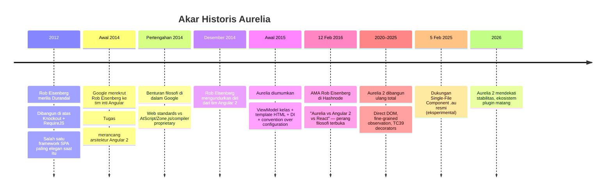
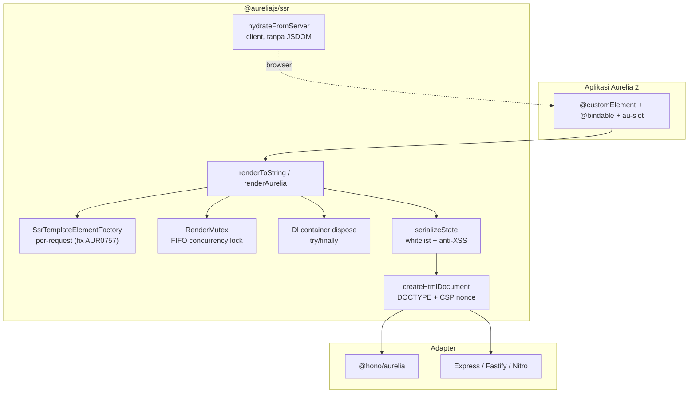
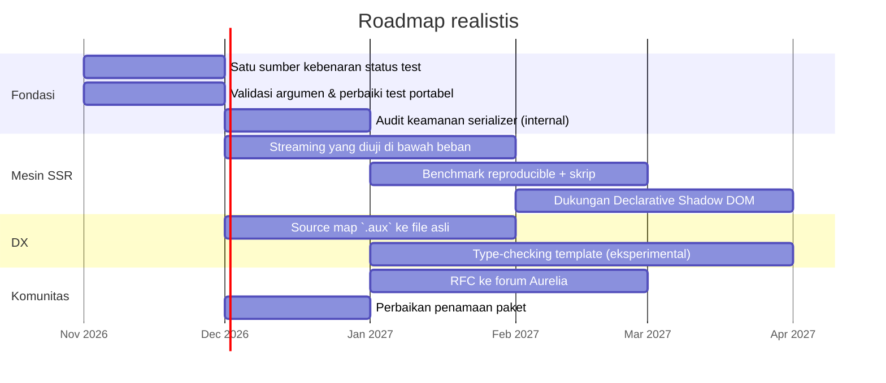

## Satu komponen, dua file

Komponen pertama yang saya buka di lima hari itu terdiri dari dua file: `user-card.ts` dan `user-card.html`.

Di dalam `user-card.ts` ada kelas biasa, `@customElement`, `@bindable`, dan `resolve()`. Tidak ada JSX, tidak ada `<script setup>`, tidak ada runes, tidak ada `useState`, tidak ada `export let`. Template-nya HTML yang benar-benar HTML, dengan `${name}` dan `repeat.for` di dalamnya.

Kesan pertama saya: ini seperti kode enterprise tahun 2016 yang belum sempat migrasi. Kesimpulan itu tidak bertahan lama.

Yang berubah kemudian adalah cara saya membaca framework ini. Saya memakai kamus React untuk sebuah framework yang tidak disusun dengan asumsi React, dan pertanyaan seperti "kenapa tidak ada VDOM" tidak bisa dijawab selama VDOM saya anggap syarat, bukan pilihan.

Artikel ini mencatat lima hari setelah titik itu: membaca source `@aurelia/runtime-html`, membangun mesin SSR yang belum ada di npm, menulis plugin SFC eksperimental, dan mengukur hasilnya. Ada bagian yang berhasil, ada yang belum selesai, dan beberapa klaim di README saya sendiri ternyata tidak cocok dengan kode yang ada.

> [!NOTE]
> Seluruh kode yang dibahas ada di [github.com/sandikodev/aureliajs](https://github.com/sandikodev/aureliajs). Dua paket yang paling banyak saya kerjakan adalah `@aureliajs/ssr`, mesin render dan hydration untuk Aurelia 2, dan `@hono/aurelia`, adapter Hono di atasnya. Sisanya eksperimen pendukung dan satu aplikasi SaaS multi-tenant yang memakai keduanya.

---

## Modal awal: lima ekosistem dan satu pertemuan yang terlalu awal

Aurelia pertama kali saya lihat tahun 2017, di SMK, beberapa saat setelah versi pertamanya dirilis. Saya tidak paham apa yang sedang saya lihat.

Waktu itu dunia frontend yang saya kenal cuma punya satu rivalitas besar: React melawan Vue. jQuery masih jadi cara wajar untuk menyusun halaman, dan bagi saya pertanyaannya sederhana — mau menulis DOM sendiri, atau menyerahkan pekerjaan itu ke framework. Angular hanya nama samar yang terdengar dari proyek-proyek besar, bukan sesuatu yang saya bandingkan secara filosofis dengan React. Perpecahan desain antara keduanya, yang justru menjadi akar Aurelia, tidak masuk ke kepala saya sama sekali.

Jadi saya menilai Aurelia dengan pertanyaan yang salah. Template HTML terpisah dan kelas ViewModel terlihat seperti Angular yang lebih ramah, atau jQuery yang lebih rapi. Saya tidak tahu bahwa kombinasi itu adalah pilihan sadar, hasil pertengkaran di dalam Google yang baru saya baca sembilan tahun kemudian.

Lima hari di artikel ini terjadi setelah saya akhirnya membaca sejarah itu. Tapi intuisi saya sudah terbentuk jauh sebelumnya, dari lima ekosistem yang masing-masing mengajarkan hal yang sama:

| Ekosistem   | Paradigma inti            | Yang saya bawa ke kepala saya                                                                                                                         |
| ----------- | ------------------------- | ----------------------------------------------------------------------------------------------------------------------------------------------------- |
| **React**   | `UI = f(state)`           | Render ulang adalah mekanisme utama. Setiap perubahan state memicu rekonsiliasi Virtual DOM. `useEffect`, `useMemo`, `useCallback`, dependency array. |
| **Vue**     | SFC + reactivity proxy    | Template dan logic dalam satu file. Reactivity otomatis lewat proxy. `ref()`, `computed()`, `watch()`.                                                |
| **Svelte**  | Compile-time reactivity   | Tidak ada runtime diffing. Assignment itu sendiri adalah sinyal. Runes (`$state`, `$derived`, `$effect`).                                             |
| **Astro**   | Islands + zero-JS default | HTML dulu, JavaScript hanya di tempat yang butuh. Hydration directive eksplisit.                                                                      |
| **Flutter** | Imperative widget tree    | Widget dibangun ulang, tapi identitas elemen dijaga oleh framework.                                                                                   |

Kelima ekosistem itu berbeda dalam banyak hal, tapi punya satu asumsi yang sama, dan asumsi itu tidak pernah saya pertanyakan:

> Komponen adalah fungsi yang dijalankan ulang. State adalah input-nya, UI adalah output-nya.

Aurelia tidak memakai asumsi tersebut. Ketika saya akhirnya menyadari itu, hampir semua intuisi saya berhenti berlaku.

### Daftar kebingungan minggu pertama

1. Kenapa template terpisah dari logic? Bukankah SFC sudah terbukti lebih nyaman, seperti di Vue, Svelte, Astro, dan React dengan JSX?
2. Kenapa kelas? Bukankah kelas di JavaScript disebut sebagai sisa OOP yang harus dihindari? Setidaknya itu yang saya dengar bertahun-tahun di komunitas React.
3. Kenapa `@bindable` dan bukan props? Kenapa sesuatu yang seharusnya implisit harus dideklarasikan?
4. Kenapa `repeat.for` dan bukan `.map()`? Di React, list adalah ekspresi JavaScript. Di Aurelia, list adalah atribut di template.
5. Kenapa `click.trigger` dan bukan `onClick`? Apa bedanya `trigger` dan `bind`?
6. Kenapa `resolve(IService)` dan bukan `useContext`? Dependency Injection terasa seperti membawa Spring Boot ke frontend.
7. Kenapa tidak ada VDOM? Bagaimana UI bisa berubah tanpa diffing?

Ketujuh pertanyaan itu punya jawaban. Jawabannya tidak masuk akal selama saya membaca Aurelia dengan kamus React.

---

## Akar: Durandal, Google, dan Desember 2014

Membaca dokumentasi tidak cukup untuk memahami sebuah framework. Saya perlu membaca sejarahnya, dan sejarah Aurelia berawal dari sebuah perpisahan.



### Apa yang terjadi di dalam Google

Rob Eisenberg sudah punya reputasi sebelum Google. Durandal, framework SPA yang ia rilis 2012, pada masanya lebih bersih daripada kebanyakan alternatifnya. Ketika Google merekrutnya, ekspektasinya jelas: bawa pemikiran segar ke Angular 2.

Yang terjadi kemudian adalah benturan dua cara merancang framework:

| Isu                  | Posisi Rob Eisenberg                                            | Posisi yang akhirnya diambil Angular 2                                           |
| -------------------- | --------------------------------------------------------------- | -------------------------------------------------------------------------------- |
| **Bahasa**           | JavaScript/TypeScript standar, minim tooling proprietary        | AtScript (kemudian dilebur ke TypeScript), dekorator berat                       |
| **Template**         | HTML yang benar-benar HTML, case-insensitive sesuai spesifikasi | Sintaks case-sensitive (`ngFor`, `ngModel`) yang butuh parser markup proprietary |
| **Change detection** | Observasi properti yang presisi                                 | Zone.js yang mem-patch seluruh API async browser                                 |
| **Konfigurasi**      | Convention over configuration                                   | Metadata deklaratif eksplisit + `NgModule`                                       |
| **Filosofi**         | Unobtrusive, framework sesedikit mungkin terlihat               | Framework hadir secara eksplisit di seluruh kode                                 |

Rob keluar pada Desember 2014. Beberapa bulan kemudian Aurelia lahir, dan Aurelia pada dasarnya adalah jawaban atas satu pertanyaan: bagaimana kalau Angular 2 dibangun dengan cara yang ia yakini?

Dari situ, tujuh kebingungan di bagian sebelumnya mulai bisa dijelaskan:

- Kelas dengan template terpisah adalah MVVM, warisan langsung Durandal dan AngularJS.
- `@bindable` adalah `@Input()` versi Aurelia.
- `repeat.for` adalah `*ngFor` tanpa parser proprietary.
- `resolve()` adalah DI hierarkis yang ada sejak awal.
- Tidak adanya VDOM adalah penolakan atas asumsi bahwa diffing itu perlu.

> [!IMPORTANT]
> Aurelia memilih jalur yang secara historis kalah populer. Kekalahan itu di pasar tidak otomatis berarti keputusan teknisnya buruk, dan sebagian besar kebingungan saya berasal dari mencampur dua hal tersebut.

### Enam bacaan yang mengubah cara saya membaca kode

Enam artikel ini menemani minggu-minggu awal saya. Tanggalnya saya sertakan karena konteks waktu mengubah arti isinya.

1. **"Rob Eisenberg on Aurelia and how it stacks up against Angular 2 and React"**, Hashnode, 12 Februari 2016. AMA mentah dari masa Angular 2 masih beta. Rob membeberkan argumen standar web, ukuran bundle (~350k vs ~750k), performa di benchmark `dbmonster`, dan rencana isomorphic, termasuk PAL (Platform Abstraction Layer) yang sekarang menjadi `@aurelia/platform`. Bagian yang paling saya ingat adalah soal SSR: pada 2016 ia sudah menyebut pre-compilation, server render, dan _"client continue from server render"_. Rencana itu sudah ada sepuluh tahun sebelum saya mulai, dan belum ada paket yang mengerjakannya.

2. **"Aurelia vs Angular(2+): Why I prefer Aurelia over Angular"**, Medium, Krishan Kataria, 25 November 2018. Artikel ini menerjemahkan hal-hal filosofis menjadi perbandingan harian: boilerplate `@Component` + `NgModule` vs konvensi nama file, `[(ngModel)]` vs `value.two-way`, dan routing yang bisa dideklarasikan di child component. Setelah membaca ini, keanehan Aurelia mulai terasa masuk akal.

3. **"Aurelia 2: A Fresh Take on JavaScript Frameworks"**, DEV.to, Almir Hodzic, 11 Januari 2025 (diedit 13 Januari 2025). Pengantar praktis: Event Aggregator, DI container, `<au-compose>`, dan pemisahan View/ViewModel/Model. Kolom komentarnya juga berguna, terutama kritik bahwa Event Aggregator sebaiknya dipakai di level Model, bukan untuk broadcast antar ViewModel.

4. **"Experimental Single File Components Support For Aurelia 2 + Vite"**, blog resmi Aurelia, Dwayne Charrington, 5 Februari 2025. Baseline resmi untuk SFC `.au`. Eksperimen `.aux` saya nanti harus dibaca sebagai respons terhadap artikel ini, bukan sebagai penemuan dari nol.

5. **"I Built Server-Side Rendering for Aurelia 2"**, I Like Kill Nerds, Dwayne Charrington, 4 Mei 2026. Artikel ini mendokumentasikan realitas praktis: paket komunitas `aurelia2-ssr` versi `0.0.3`, isolasi `window`/`document` per request, `prepareSsrHostForTakeover` dengan mode `remount`, preboot untuk input yang diketik sebelum JavaScript hidup, dan serialisasi Shadow DOM. Dari sini kelihatan bahwa core Aurelia punya fondasinya, sementara glue untuk aplikasi belum ada.

6. **"Aurelia 2 in 2026: The Framework That Refused to Die Is Thriving"**, I Like Kill Nerds, Dwayne Charrington, 4 Januari 2026. Artikel momentum: dialog system berbasis `<dialog>` native, state middleware, router-lite yang matang, SFC support, Storybook, dan dokumentasi yang membaik. Tesisnya sederhana dan saya setuju: framework ini tidak mati, hanya tidak ramai.

Dari keenam artikel itu ada satu benang merah yang membuat saya akhirnya membuka editor dan menulis kode:

> Aurelia punya fondasi teknis yang bersih (Direct DOM, fine-grained observation, DI bawaan, standar W3C), tetapi lapisan pengalaman developer dan lapisan fullstack-nya masih tipis. Ruang kontribusi ada di sana.

---

## Menerjemahkan Angular ke Aurelia

Sebelum bisa menulis satu baris kode Aurelia yang benar, saya harus bisa menerjemahkan kebiasaan saya. Tabel dan potongan kode di bagian ini saya susun sendiri dan saya tempel di samping monitor.

### Deklarasi komponen

**Angular:**

```typescript
import { Component, Input } from "@angular/core";

@Component({
  selector: "app-user-card",
  templateUrl: "./user-card.component.html",
  styleUrls: ["./user-card.component.css"],
})
export class UserCardComponent {
  @Input() name = "";
  @Input() role = "member";
}
```

**Aurelia 2:**

```typescript
import { bindable, customElement } from 'aurelia';

@customElement({ name: 'user-card', template: /* ... */ })
export class UserCard {
  @bindable name = '';
  @bindable role = 'member';
}
```

Di Aurelia, `template` bisa dihilangkan sepenuhnya karena konvensi: file `user-card.html` di sebelah `user-card.ts` akan ditemukan otomatis. Tidak ada `selector`, tidak ada `styleUrls`, tidak ada registrasi `NgModule`.

### Template

**Angular:**

```html
<div class="card">
  <h3>{{ name }}</h3>
  <p>{{ role }}</p>
  <ul>
    <li *ngFor="let item of items">{{ item.title }}</li>
  </ul>
  <button (click)="select()">Select</button>
  <input [(ngModel)]="query" />
</div>
```

**Aurelia 2:**

```html
<div class="card">
  <h3>${name}</h3>
  <p>${role}</p>
  <ul>
    <li repeat.for="item of items">${item.title}</li>
  </ul>
  <button click.trigger="select()">Select</button>
  <input value.two-way="query" />
</div>
```

Perbedaannya terlihat sepele, tapi dua di antaranya mengubah cara saya menulis kode setiap hari:

| Konsep      | Angular                   | Aurelia 2                        | Catatan                                                                     |
| ----------- | ------------------------- | -------------------------------- | --------------------------------------------------------------------------- |
| Interpolasi | `{{ value }}`             | `${value}`                       | Aurelia memakai sintaks template literal JavaScript                         |
| Event       | `(click)="fn()"`          | `click.trigger="fn()"`           | Aurelia eksplisit soal _command_                                            |
| Property    | `[value]="x"`             | `value.bind="x"`                 | Sama, beda posisi                                                           |
| Two-way     | `[(ngModel)]="x"`         | `value.two-way="x"`              | Aurelia tidak butuh directive khusus untuk input                            |
| Loop        | `*ngFor="let i of items"` | `repeat.for="i of items"`        | Aurelia adalah atribut biasa, bukan structural directive dengan microsyntax |
| Kondisional | `*ngIf="cond"`            | `if.bind="cond"`                 | —                                                                           |
| Class       | `[class.active]="x"`      | `class.bind="x ? 'active' : ''"` | —                                                                           |
| Style       | `[style.color]="c"`       | `style.bind="c"`                 | —                                                                           |

### Kenapa sintaks binding penting

Sintaks `target.command="expression"` bukan soal selera. Setiap command punya konsekuensi lifecycle sendiri:

- `value.bind` menghubungkan properti satu arah dari ViewModel ke View.
- `value.two-way` menyinkronkan dua arah.
- `value.one-time` mengevaluasi sekali dan tidak pernah memperbarui.
- `click.trigger` memasang listener pada elemen itu sendiri.
- `click.delegate` memasang listener di level document dan menangkap lewat bubbling, sehingga lebih hemat listener.
- `if.bind` merender atau menghancurkan elemen beserta komponennya.
- `show.bind` menyembunyikan dengan CSS dan tidak menghancurkan apa pun.

Di React, semua perbedaan itu disatukan oleh satu mekanisme: render ulang. Di Aurelia, saya harus tahu command mana yang saya pakai, karena pilihan itu menentukan apakah komponen anak ikut dihancurkan atau tidak.

---

## Empat asumsi yang harus dibongkar

### Komponen dijalankan ulang

Di React:

```jsx
function Counter() {
  const [count, setCount] = useState(0);
  console.log("render"); // jalan setiap perubahan state
  return <button onClick={() => setCount(count + 1)}>{count}</button>;
}
```

Fungsi `Counter` berjalan ulang setiap kali state berubah. Variabel lokal dibuat ulang, closure dibuat ulang, seluruh body dieksekusi lagi.

Di Aurelia:

```typescript
export class Counter {
  count = 0;

  increment(): void {
    this.count++;
    // Tidak ada render ulang. Tidak ada body fungsi yang dieksekusi lagi.
    // Observer menyentuh satu text node dan mengganti nilainya.
  }
}
```

Kelas diinstansiasi sekali. Instance hidup selama komponen hidup, dan `this` adalah tempat state berada secara literal. Ketika `this.count` berubah, sistem observasi Aurelia yang bekerja dengan `Proxy` dan binding yang sudah terpasang mengubah node DOM spesifik yang terikat ke ekspresi itu.

Konsekuensinya cukup jauh:

| Pertanyaan                              | React                          | Aurelia 2                                   |
| --------------------------------------- | ------------------------------ | ------------------------------------------- |
| Apakah state hilang saat re-render?     | Tidak (disimpan di hook slot)  | Tidak (disimpan di `this`)                  |
| Apakah closure bisa basi?               | Ya, sumber bug klasik          | Tidak, karena tidak ada closure per-render  |
| Apakah saya perlu `useCallback`?        | Sering                         | Tidak                                       |
| Apakah urutan pemanggilan hook penting? | Ya, fatal kalau salah          | Tidak ada hook                              |
| Apakah komponen anak ikut re-render?    | Tergantung memo                | Tidak, kecuali binding-nya berubah          |
| Di mana efek samping diletakkan?        | `useEffect` + dependency array | Lifecycle (`attached`, `detached`, `bound`) |
| Kapan cleanup dilakukan?                | Return function di `useEffect` | `detached()` / `dispose()`                  |

### Template adalah ekspresi JavaScript

Di React, list adalah `.map()`. Di Aurelia, `repeat.for` adalah bagian dari template compiler yang tahu tentang identitas item, index, dan lifecycle komponen anak. Ketika array berubah, Aurelia tahu item mana yang ditambah, dihapus, atau dipindah, tanpa `key` prop dan tanpa mendiffing seluruh tree.

Contoh yang membuat saya paham:

```html
<!-- Setiap item punya komponen anak dengan state sendiri -->
<todo-item repeat.for="todo of todos" model.bind="todo"></todo-item>
```

Kalau `todos` berubah dari 10 item menjadi 11, hanya satu `<todo-item>` yang dibuat. Sembilan lainnya tidak di-dispose, dan state mereka tetap. Di React hal yang sama terjadi kalau `key` benar; kalau `key` salah, state bisa nyasar ke item lain. Di Aurelia identitas melekat pada objek item itu sendiri.

### Dependency Injection itu berat

Asumsi ini yang paling jauh dari kenyataan, dan saya baru tahu setelah membaca kode Aurelia sendiri.

```typescript
import { resolve } from "aurelia";
import { IHttpClient } from "./services/http.js";

export class UserList {
  private readonly http = resolve(IHttpClient);

  async load(): Promise<void> {
    this.users = await this.http.get("/api/users");
  }
}
```

Yang terjadi di balik layar:

- Container bersifat hierarkis: root container, container aplikasi, lalu container komponen.
- Registrasi bisa per kelas, per interface lewat token, atau per instance.
- Lifetime bisa singleton, transient, atau scoped.
- Karena semuanya eksplisit, testing jadi mudah: daftarkan implementasi palsu, selesai.

Tidak ada `providers` array di setiap komponen, tidak ada `@Injectable({ providedIn: 'root' })`, tidak ada module. Ini DI yang saya kenal dari backend, berjalan di browser, dengan overhead yang jauh lebih kecil dari bayangan saya.

### SSR itu cuma render ke string

Asumsi ini yang paling mahal, dan yang membuat saya menghabiskan sisa waktunya di paket SSR.

Di React, `renderToString` sudah bagian dari paket resmi sejak lama. Di Vue ada `@vue/server-renderer`. Di Svelte ada `svelte/server`. Di Aurelia 2, waktu saya periksa, tidak ada paket resminya. Fondasinya ada, pembungkusnya tidak.

---

## Dari membaca ke menulis kode

Ada titik di mana membaca berhenti membantu. Dokumentasi, artikel, dan diskusi sudah saya baca, dan saya masih belum paham. Cara yang tersisa adalah menulis kode yang menyentuh bagian paling rapuh dari framework: siklus render dan hydration.

Prinsip yang saya pegang sepanjang eksperimen ini adalah _reverence through exploration_: saya tidak mencoba memperbaiki Aurelia, saya menguji batasnya dan menawarkan kembali apa yang menurut saya berguna.

### Angka repositori

Klaim tanpa bukti tidak berguna, jadi ini datanya, diambil langsung dari repositori:

| Metrik                     | Nilai                                           |
| -------------------------- | ----------------------------------------------- |
| Total commit               | **103** (semuanya oleh `sandikodev`)            |
| Rentang waktu              | **12 – 16 November 2026** (5 hari)              |
| Distribusi commit per hari | 12 Nov: 5 · 13 Nov: 55 · 14 Nov: 2 · 16 Nov: 39 |
| Baris ditambahkan          | **~59.750**                                     |
| Baris dihapus              | **~12.797**                                     |
| Paket di `packages/`       | 6 (termasuk 2 submodule)                        |
| Aplikasi di `apps/`        | 2 (`web`, `api`)                                |
| File `.ts` non-generated   | 84                                              |
| File `.aux`                | 21                                              |
| Dokumen riset di `docs/`   | 6                                               |

Tanggal 13 November berisi 55 commit dalam satu hari. Saya tidak membacanya sebagai tanda produktivitas; itu tanda saya mencoba banyak jalan sekaligus karena belum paham akar masalahnya. Rinciannya ada di bagian kegagalan.

### Peta monorepo

```
aureliajs/
├── packages/
│   ├── aurelia-ssr/          # @aureliajs/ssr — mesin SSR & hydration (core)
│   ├── hono-aurelia/     # @hono/aurelia — adapter Hono (submodule)
│   ├── vite-plugin-aux/      # @aureliajs/vite-plugin-aux — compiler .aux SFC
│   ├── vscode-aux/           # @aureliajs/vscode-aux — ekstensi editor
│   ├── ssr-playground/       # @aureliajs/ssr-playground — laboratorium & inspector
│   ├── shared/               # @aureliajs/shared — skema Zod & entitlement
│   └── skills/               # submodule: agent skills
├── apps/
│   ├── web/                  # Aurelia Ops — SPA multi-tenant (Aurelia 2 + Tailwind 4)
│   └── api/                  # Aurelia Ops API (Hono + Drizzle + Stripe)
├── examples/
│   └── fullstack-ssr/        # contoh end-to-end
├── docs/                     # 6 dokumen riset & manifesto
└── e2e/                      # Playwright
```

---

## `@aureliajs/ssr`: mengisi lubang di npm

### Masalahnya

Pencarian paket SSR resmi untuk Aurelia 2 berakhir di 404. Yang tersedia hanya fondasi tingkat rendah:

- `@aurelia/platform` — abstraksi platform (PAL) yang memungkinkan runtime berjalan di luar browser.
- `@aurelia/kernel` — container DI dan utilitas.
- `@aurelia/runtime-html` — runtime DOM, termasuk dukungan untuk dokumen yang disuntikkan.

Fondasi ini cukup untuk membangun SSR, tapi tidak ada yang membungkusnya menjadi API yang bisa dipakai.

| Framework     | Paket SSR resmi        | Status                            |
| ------------- | ---------------------- | --------------------------------- |
| React         | `react-dom/server`     | Bagian dari paket inti            |
| Vue           | `@vue/server-renderer` | Paket resmi terpisah              |
| Svelte        | `svelte/server`        | Bagian dari paket inti            |
| **Aurelia 2** | **tidak ada**          | **fondasi ada, pembungkus tidak** |

Jadi saya membangunnya.

### Arsitektur



### Empat solusi inti

#### `SsrTemplateElementFactory` dan `AUR0757`

Gejalanya: ketika dua request HTTP datang bersamaan, salah satunya gagal dengan `AUR0757: Element template compilation failed`. Kalau request dijalankan berurutan, semuanya normal.

Penyebabnya ada di factory global yang meng-cache elemen template DOM. Di browser itu optimasi yang benar, karena hanya ada satu dokumen. Di server, setiap request punya dokumen JSDOM sendiri. Ketika request A selesai dan dokumennya dibuang, cache masih menyimpan elemen dari dokumen mati itu. Request B mengambil elemen tersebut, lalu gagal.

Solusinya: daftarkan factory khusus untuk setiap siklus render.

```typescript
// packages/aurelia-ssr/src/render.ts (ringkasan)
class SsrTemplateElementFactory {
  private readonly cache = new Map<string, HTMLTemplateElement>();

  createTemplate(markup: string): HTMLTemplateElement {
    const cached = this.cache.get(markup);
    if (cached) return cached;

    const template = this.document.createElement("template");
    template.innerHTML = markup;
    this.cache.set(markup, template);
    return template;
  }
}
```

Isi cache-nya tidak istimewa. Yang menentukan adalah ruang lingkupnya: satu instance per request, dibuang bersama dokumennya.

> [!TIP]
> Setiap cache global di dalam framework adalah asumsi bahwa hanya ada satu dunia. Server-side rendering memecah asumsi itu, dan bug seperti `AUR0757` akan muncul di titik-titik tersebut.

#### Disposal container DI

Setiap request membuat container DI baru. Container menyimpan metadata, instance, dan closure. Tanpa teardown eksplisit, sisa itu menumpuk seiring jumlah request.

```typescript
// packages/aurelia-ssr/src/render.ts (ringkasan)
const container = DI.createContainer();
try {
  const app = Aurelia.app({ host, component, container });
  await app.start();
  // ... ambil HTML dari host ...
} finally {
  await app?.dispose();
  await container.dispose();
}
```

Blok `finally` di atas terlihat seperti formalitas. Tanpa itu, container yang sudah selesai tetap memegang instance dan metadata-nya, dan memori proses naik terus selama server hidup.

#### `RenderMutex`

Walaupun factory sudah per-request, ada bagian runtime Aurelia yang masih menyentuh state proses-level, misalnya registrasi platform dan beberapa singleton. Solusinya kasar tapi efektif: serialisasi render dalam satu proses.

```typescript
class RenderMutex {
  private tail: Promise<unknown> = Promise.resolve();

  run<T>(task: () => Promise<T>): Promise<T> {
    const next = this.tail.then(task, task);
    this.tail = next.catch(() => undefined);
    return next;
  }
}
```

Trade-off-nya perlu saya sebut:

| Pendekatan          | Kelebihan                                     | Kekurangan                                                   |
| ------------------- | --------------------------------------------- | ------------------------------------------------------------ |
| Serialisasi (mutex) | Benar secara pasti, sederhana, tidak ada race | Throughput terbatas 1 render per proses                      |
| Paralel penuh       | Throughput tinggi                             | Butuh isolasi state yang sempurna di seluruh runtime Aurelia |
| Worker per request  | Isolasi total                                 | Overhead proses/thread besar                                 |

Saya memilih serialisasi karena itu satu-satunya opsi yang bisa saya buktikan benar tanpa mengubah runtime Aurelia. Keterbatasan throughput-nya saya tulis di README sebagai keterbatasan, bukan disembunyikan.

#### Serializer anti-XSS

Menyuntikkan state ke dalam HTML adalah operasi berbahaya, dan bagian ini yang paling sering dilewatkan saat orang membangun SSR.

Ada tiga lapisan di `serializeState()`.

Lapisan pertama, proyeksi whitelist. Hanya field yang secara eksplisit diizinkan yang boleh keluar dari server.

```typescript
const ALLOWED_USER_FIELDS = new Set(["id", "email", "name", "avatarUrl"]);
const ALLOWED_WORKSPACE_FIELDS = new Set([
  "id",
  "name",
  "slug",
  "plan",
  "role",
]);

function projectObject<T>(source: unknown, allowed: Set<string>): T | null {
  if (!source || typeof source !== "object") return null;
  const out: Record<string, unknown> = {};
  for (const key of allowed) {
    const value = (source as Record<string, unknown>)[key];
    if (
      value === null ||
      ["string", "number", "boolean"].includes(typeof value)
    ) {
      out[key] = value;
    }
  }
  return out as T;
}
```

Field yang di-whitelist pun hanya boleh bertipe primitif. Objek bersarang tidak lolos, sehingga relasi tersembunyi di objek ORM tidak ikut terbawa.

Lapisan kedua, escaping konteks script. Karakter `<`, `>`, `&`, `\u2028`, dan `\u2029` di-escape menjadi `\u003c`, `\u003e`, `\u0026`, dan seterusnya, sehingga `</script>` di dalam string tidak bisa memutus blok script.

Lapisan ketiga, CSP nonce. `createHtmlDocument()` menerima `nonce` dan menyuntikkannya ke setiap tag `<script>`, sehingga CSP yang ketat tetap bisa diberlakukan.

> [!WARNING]
> Dalam aplikasi multi-tenant, satu field yang bocor berarti data tenant lain bisa dibaca dari `window.__HYDRATION__` di browser. Whitelist di atas menjaga batas itu.

### Permukaan API

Paket server (`@aureliajs/ssr/server`):

| Fungsi                 | Signature                                                     | Kegunaan                                                    |
| ---------------------- | ------------------------------------------------------------- | ----------------------------------------------------------- |
| `renderToString()`     | `(options: RenderOptions) => Promise<string>`                 | Merender komponen menjadi string HTML                       |
| `renderAurelia()`      | `(options: RenderOptions) => Promise<string>`                 | Alias langsung untuk `renderToString()`                     |
| `serializeState()`     | `(context, initialData?, componentName?) => HydrationPayload` | Proyeksi state dengan whitelist dan escaping                |
| `createHtmlDocument()` | `(bodyHtml, payload?, options?) => string`                    | Dokumen HTML5 lengkap dengan DOCTYPE, script, dan CSP nonce |
| `createFallbackHtml()` | `(componentName, options?) => string`                         | Shell minimal untuk mode fallback client-side               |
| `createErrorHtml()`    | `(statusCode, message, error?, options?) => string`           | Dokumen error yang rapi                                     |

Paket client (`@aureliajs/ssr/client`):

| Fungsi / Kelas           | Signature                                        | Kegunaan                                        |
| ------------------------ | ------------------------------------------------ | ----------------------------------------------- |
| `hydrateFromServer<T>()` | `(options?) => HydrationResult<T> \| null`       | Mengambil dan memvalidasi payload dari `window` |
| `isHydrationAvailable()` | `(payloadKey?) => boolean`                       | Cek keberadaan payload valid                    |
| `peekHydrationPayload()` | `(payloadKey?) => HydrationPayload \| undefined` | Baca tanpa menghapus                            |
| `clearHydration()`       | `(payloadKey?) => void`                          | Bersihkan payload dari global                   |
| `HydrationCache`         | `class`                                          | Cache in-memory dengan TTL                      |

Pemisahan `/server` dan `/client` menjaga bundel client tetap bersih dari JSDOM. Hasilnya, bagian client di bawah 2KB gzipped karena isinya hanya pembacaan state dan validasi.

### Contoh pemakaian

Server:

```typescript
import {
  renderToString,
  serializeState,
  createHtmlDocument,
} from "@aureliajs/ssr/server";
import { UserProfile } from "./components/user-profile.js";

export async function handleRequest(req: Request): Promise<Response> {
  const user = { id: "u_1", name: "Sandiko", email: "sandiko@example.com" };
  const initialData = { followers: 1240, posts: 42 };

  // 1. Render komponen ke string
  const bodyHtml = await renderToString({
    component: UserProfile,
    props: { activeTab: "overview" },
    context: { user, role: "Admin" },
  });

  // 2. Serialisasi state (whitelist + escaping)
  const payload = serializeState(
    { user, role: "Admin" },
    initialData,
    "user-profile",
  );

  // 3. Dokumen HTML5 lengkap
  const html = createHtmlDocument(bodyHtml, payload, {
    title: "User Profile — Aurelia 2 SSR",
    cssBundle: "/dist/bundle.css",
    jsBundle: "/dist/client.js",
    nonce: "rAnd0mN0nc3",
  });

  return new Response(html, {
    headers: { "Content-Type": "text/html; charset=utf-8" },
  });
}
```

Client:

```typescript
import Aurelia from "aurelia";
import { hydrateFromServer } from "@aureliajs/ssr/client";
import { UserProfile } from "./components/user-profile.js";

const host = document.querySelector("app-root");
if (host) {
  const hydration = hydrateFromServer<{ followers: number; posts: number }>();

  await Aurelia.app({
    host,
    component: new UserProfile(hydration?.initialData),
  }).start();
}
```

### Status pengujian

Saya menjalankan suite-nya sendiri sebelum menulis artikel ini:

```
✓ test/html.test.ts        (24 tests)
✓ test/hydrate.test.ts     (34 tests)
✓ test/render.test.ts      (14 tests)
✓ test/serialize.test.ts   (10 tests)
✓ test/multi-request.test.ts (1 test)

Test Files  5 passed (5)
     Tests  83 passed (83)
  Duration  2.08s
```

Dari kelimanya, `multi-request` yang paling penting. Isinya dua render paralel, lalu memastikan keduanya menghasilkan HTML yang benar dan tidak saling merusak. Test itu akan menangkap regresi `AUR0757` di masa depan.

> [!NOTE]
> README paket ini sempat menampilkan badge "81 tests" karena saya lupa memperbarui angkanya setelah menambah test. Angka saat ini 83. Selisih dua test terlihat kecil, tapi README adalah tempat orang pertama kali menilai apakah proyek ini bisa dipercaya.

---

## `@hono/aurelia`: adapter untuk Hono

Mesin SSR tanpa adapter hanya library. Yang membuatnya berguna adalah bagaimana ia bertemu dengan server nyata.

### Mengapa Hono

Hono cocok untuk eksperimen ini karena alasan teknis, bukan karena popularitas:

- Web-standard `Request`/`Response`, tanpa abstraksi server proprietary.
- Ringan, sekitar 14KB, tanpa dependensi berat.
- Multi-runtime: Cloudflare Workers, Deno, Bun, Node, Fastly.
- Composable, karena middleware adalah fungsi, bukan kelas dengan decorator.
- Type-safe lewat generic `Context` untuk path parameter dan binding.

Yang paling berpengaruh ke desain adapter adalah alasan keempat dan kelima. Middleware sebagai fungsi berarti adapter tidak perlu menyediakan sistem plugin sendiri, dan `Context` yang generik berarti tipe data dari middleware auth bisa ikut sampai ke handler.

### Satu handler, satu halaman

```typescript
import { Hono } from "hono";
import { aurelia } from "@hono/aurelia";
import { DashboardPage } from "./pages/index.js";

const app = new Hono();

app.get(
  "/dashboard",
  aurelia({
    component: DashboardPage,
    title: "Dashboard",
    requiresAuth: true,
    loaders: {
      stats: async (c) => await fetchStats(c.get("user").id),
      activity: async (c) => await fetchActivity(c.get("user").id, 10),
    },
  }),
);
```

Urutan yang terjadi di dalam handler:

1. Auth diperiksa karena `requiresAuth`.
2. Loader dijalankan paralel di server.
3. Hasil loader diserialisasi bersama konteks.
4. Komponen dirender dengan data tersebut.
5. HTML lengkap dikirim dengan script hydration.
6. Di client, `hydrateFromServer()` mengambil data yang sama tanpa fetch ulang.

Langkah keenam itu alasan SSR dipakai sama sekali. Data yang sudah diambil di server tidak diambil lagi di browser, jadi pengguna tidak melihat konten berkedip dari kosong ke terisi, dan API tidak menerima dua request untuk halaman yang sama.

### Loader di dekat komponen

Versi pertama adapter mengharuskan loader ditulis di route. Data yang dibutuhkan sebuah komponen jelas milik komponen itu, jadi menaruhnya di route terasa salah.

Saya menambahkan metadata pada komponen:

```typescript
import { customElement } from "aurelia";

@customElement({ name: "dashboard-page" })
export class DashboardPage {
  // Metadata deklaratif, dibaca oleh adapter, tidak mengotori route
  static title = "Dashboard";
  static requiresAuth = true;

  static async loader(c: Context) {
    const user = c.get("user");
    return { stats: await fetchStats(user.id) };
  }

  // ...
}
```

Route-nya jadi sesingkat ini:

```typescript
app.get("/dashboard", aurelia(DashboardPage));
```

Signature `aurelia(Component, Title)` adalah gula sintaksis untuk kasus paling umum. Bentuk objek tetap tersedia kalau butuh kontrol lebih. Pola ini saya pinjam dari file-system routing modern, tanpa meninggalkan eksplisitisme.

### Action di dekat komponen

Loader menangani GET. Aplikasi nyata juga butuh POST, PUT, PATCH, dan DELETE, dan menulis route terpisah untuk setiap mutasi membuat form handling kembali berantakan.

Solusinya: komponen bisa mengekspos action bernama.

```typescript
export class ProjectsPage {
  static actions = {
    create: async (c: Context) => {
      const body = await c.req.parseBody();
      const project = await db.projects.create(body);
      return c.json({ ok: true, project });
    },
    archive: async (c: Context) => {
      const { id } = await c.req.json();
      await db.projects.archive(id);
      return c.json({ ok: true });
    },
  };
}
```

Adapter mendaftarkan endpoint otomatis:

| Action    | Method                | Path                        |
| --------- | --------------------- | --------------------------- |
| `create`  | `POST`                | `/projects`                 |
| `archive` | `PATCH` atau `DELETE` | `/projects/actions/archive` |

Detail endpoint-nya bisa berbeda per konfigurasi. Idenya tetap: template, logic, loader, dan action tinggal di satu tempat. Ini pendekatan yang mirip Server Actions, tanpa compiler tambahan.

### Helper pendukung

Tiga utilitas yang saya tambahkan karena saya sendiri lelah menulis hal yang sama berulang kali:

```typescript
// 1. Default global untuk semua route
app.use(
  "*",
  aureliaDefaults({
    document: { titleSuffix: " — Aurelia Ops" },
    streaming: false,
    fallback: "error",
  }),
);

// 2. Sajikan aset statis dengan cache header yang benar
app.use(
  "/public/*",
  serveAureliaAssets({
    root: "./public",
    prefix: "/public",
    maxAge: 86400,
  }),
);

// 3. Grup route dengan konfigurasi bersama
const protectedPages = createAureliaRouteGroup({
  requiresAuth: true,
  fallback: "error",
});
```

`serveAureliaAssets()` yang paling terasa manfaatnya. Sebelum ada helper itu, setiap contoh menulis handler statis sendiri, dan semuanya lupa `Content-Type` atau `Cache-Control`.

### Auth middleware

Alih-alih mengikat adapter ke satu sistem auth, saya membuat kontrak:

```typescript
app.use(
  "*",
  createAuthMiddleware({
    getUserFromToken: async (token) => await verifyJWT(token),
    getWorkspaceFromRequest: async (c) =>
      await getWorkspace(c.req.header("x-workspace-id")),
    getRoleForUser: (user, workspace) =>
      user.id === workspace.owner_id ? "admin" : "member",
  }),
);
```

Setelah middleware terpasang, route dengan `requiresAuth: true` otomatis mendapat `c.get('user')`, `c.get('workspace')`, dan `c.get('role')` yang sudah terverifikasi.

Kontrak ini memindahkan pemeriksaan auth dari ingatan developer ke middleware. Kalau sebuah halaman lupa memeriksa, halaman itu tidak mendapat data, bukan diam-diam terbuka.

### Content negotiation

Satu route, dua representasi:

```bash
# Browser
curl http://localhost:3000/dashboard
# -> <html>...</html>

# API client
curl -H "Accept: application/json" http://localhost:3000/dashboard
# -> { "component": "DashboardPage", "context": {...}, "initialData": {...} }
```

Berguna untuk debugging dan untuk memakai satu endpoint bagi halaman dan API. Fitur ini juga bisa membingungkan kalau dipakai tanpa sadar, jadi saya menandainya opsional dan tidak menyalakannya secara default.

### Eksekusi dan streaming

`clientOnly` dan `serverOnly` pada metadata komponen menentukan di mana sebuah komponen dijalankan:

```typescript
export class LiveClock {
  static clientOnly = true; // jam yang bergantung pada timezone browser
}
```

Untuk halaman besar, `streaming: true` mengirim shell lebih dulu lalu menyusul konten. Fitur ini masih eksperimental. Saya belum menguji cukup banyak skenario backpressure untuk mengklaimnya stabil.

### Status pengujian di dua runner

Suite ini saya jalankan dengan dua runner, dan hasilnya berbeda.

Dengan Bun:

```
63 pass
0 fail
113 expect() calls
Ran 63 tests across 2 files. [315.00ms]
```

Dengan Vitest:

```
Test Files  1 failed | 1 passed (2)
     Tests  1 failed | 62 passed (63)
```

Kegagalannya:

```
FAIL test/adapter.test.ts > serves static assets via serveAureliaAssets middleware
TypeError: The "paths[0]" argument must be of type string. Received undefined
 ❯ serveAureliaAssets src/adapter.ts:100:19
```

Penyebabnya ada di test, bukan di logika adapter. Test itu mengambil direktori fixture lewat `import.meta.dirname`, yang tersedia di Bun dan `undefined` di Vitest dengan konfigurasi saat ini. Dari situ muncul dua masalah:

1. Test bergantung pada API runtime yang tidak portabel.
2. `serveAureliaAssets()` menerima `root: undefined` tanpa validasi, lalu meledak di `path.resolve`.

Masalah kedua bug nyata di library. Kalau `root` wajib, ia harus divalidasi dengan pesan yang jelas, bukan `TypeError` dari dalam Node.

Saya tidak memperbaikinya sebelum menulis artikel ini, dan itu keputusan yang perlu saya tanggung: 62 dari 63 test lulus di Vitest, 63 dari 63 di Bun, dan ada satu bug validasi argumen yang masih terbuka.

> [!WARNING]
> README root repositori menyebut "133 / 133 Passing" untuk paket ini. Angka itu tidak cocok dengan hasil yang saya ukur, yaitu 63 test. Kemungkinan besar angka tersebut berasal dari hitungan assertion atau dari versi suite yang lebih besar yang sudah dipecah. Saya sebutkan karena README yang salah akan terus dipakai orang lain sebagai rujukan.

### Angka performa di README

README adapter menyebut TTFB 45ms, FCP 180ms, dan perbandingan langsung dengan Next.js 15.

Angka itu saya catat dari contoh `examples/fullstack-ssr` di mesin lokal, pada satu waktu, dengan satu dataset. Itu bukan benchmark independen, bukan hasil Lighthouse di jaringan nyata, dan bukan perbandingan setara dengan Next.js yang punya image optimization, ISR, dan RSC.

Kalau kamu mencari angka untuk mengambil keputusan produksi, jangan pakai angka saya. Ukur sendiri.

---

## `.aux`: SFC eksperimental

### Konteks resmi yang harus dihormati

Pada 5 Februari 2025, tim Aurelia mempublikasikan dukungan Single-File Component `.au` lewat `@aurelia/sfc-vite`. Statusnya eksperimental, opt-in, dan format lama tetap berjalan.

Saya membaca artikel itu berulang kali sebelum menulis satu baris plugin. Empat hal yang saya ambil sebagai batasan:

- SFC adalah lapisan ergonomi opsional, bukan pengganti struktur yang ada.
- Scoping CSS dilakukan dengan atribut data unik (`data-v-*` di versi mereka).
- Keterbatasan diumumkan di depan: registrasi manual, template single-root, belum ada type-checking template.
- Backward compatibility tidak boleh dikorbankan.

Tim inti sudah mengerjakan ini lebih dulu. Eksperimen saya adalah eksplorasi paralel dengan asumsi yang sedikit berbeda, bukan penemuan.

### Kenapa `.aux`, bukan `.au`

`.au` adalah ekstensi resmi. Memakai ekstensi yang sama dengan implementasi berbeda akan menciptakan kebingungan, jadi saya pilih `.aux` dan memberi ruang eksperimen tanpa mengklaim nama.

Nama file adalah bagian dari kontrak publik. Kalau orang melihat `.au`, mereka berhak mengira itu implementasi tim Aurelia.

### Anatomi

```html
<!-- button.aux -->
<template>
  <button
    type.bind="type"
    class.bind="classes"
    disabled.bind="disabled || loading"
    click.trigger="handleClick($event)"
  >
    <svg if.bind="loading" class="spinner" viewBox="0 0 24 24">
      <circle
        cx="12"
        cy="12"
        r="10"
        stroke="currentColor"
        stroke-width="3"
        opacity="0.25"
      ></circle>
    </svg>
    <au-slot></au-slot>
  </button>
</template>

<script lang="ts">
  import { bindable } from "aurelia";
  import { cva, type VariantProps } from "class-variance-authority";
  import { cn } from "@/lib/utils";

  export const buttonVariants = cva(
    "inline-flex items-center justify-center rounded-md font-medium transition-colors",
    {
      variants: {
        variant: {
          default: "bg-primary text-primary-foreground hover:bg-primary/90",
          destructive: "bg-destructive text-destructive-foreground",
        },
      },
      defaultVariants: { variant: "default" },
    },
  );

  export class UiButton {
    @bindable variant: VariantProps<typeof buttonVariants>["variant"] =
      "default";
    @bindable type: "button" | "submit" = "button";
    @bindable disabled = false;
    @bindable loading = false;

    get classes(): string {
      return cn(buttonVariants({ variant: this.variant }));
    }

    handleClick(event: MouseEvent): void {
      if (this.disabled || this.loading) {
        event.preventDefault();
      }
    }
  }
</script>

<style scoped>
  button {
    user-select: none;
  }
  .spinner {
    animation: spin 1s linear infinite;
  }
  @keyframes spin {
    to {
      transform: rotate(360deg);
    }
  }
</style>
```

Isi `<script>` di atas adalah Aurelia kanonik. Tidak ada API baru dan tidak ada runtime baru. Plugin hanya mengubah bentuk file menjadi kelas yang dipahami Aurelia.

Prinsip yang saya pegang: `.aux` adalah transformasi sintaks. Kalau format ini hilang besok, kode yang dihasilkannya tetap kode Aurelia yang valid.

### Komponen tanpa script

Fitur ini yang paling sering saya pakai untuk primitif UI:

```html
<!-- separator.aux -->
<template containerless>
  <div class="h-px w-full bg-border" role="separator"></div>
</template>
```

Tidak ada `<script>`. Compiler membuat kelas anonim, menyimpulkan nama tag dari nama file (`separator.aux` menjadi `<au-separator>`), dan mendaftarkannya. Untuk komponen seperti `badge`, `skeleton`, dan `label`, ini menghilangkan boilerplate yang memang tidak berguna.

### `<script setup>`

Bagian ini yang paling berani dan paling kontroversial:

```html
<template>
  <au-card>
    <h3>${title}</h3>
    <p>Count: ${count}</p>
    <button click.trigger="increment()">Tambah</button>
  </au-card>
</template>

<script setup lang="ts">
  const title = "Counter";
  let count = 0;

  function increment() {
    count++;
  }
</script>
```

Compiler melakukan lima transformasi:

1. Binding top-level yang dipakai di template diubah menjadi `@bindable`.
2. Variabel lokal menjadi properti kelas.
3. Fungsi menjadi method.
4. Import di-hoist ke module scope.
5. `defineProps` didukung untuk deklarasi props eksplisit.

Pengaruh Vue di sini jelas dan saya tidak menyembunyikannya. Pertanyaan yang lebih berguna adalah apakah hasil transformasinya tetap kode Aurelia yang benar dan bisa di-debug.

Karena transformasi ini menyentuh AST, saya menulis test khusus di `packages/vite-plugin-aux/test/setup.test.ts` untuk parsing `<script setup>` dengan bindable otomatis, `defineProps`, getter, setter, type alias, dan konstanta yang diekspor.

### Scoped styles

Dua mode:

| Mode       | Mekanisme                                                                         | Kapan dipakai                                         |
| ---------- | --------------------------------------------------------------------------------- | ----------------------------------------------------- |
| Atribut    | Setiap selector diberi `data-au-[hash]`, atribut disuntik ke elemen root template | Default, kompatibel dengan light DOM dan SSR          |
| Shadow DOM | `<template shadow>` menggunakan shadow root native                                | Isolasi total, tapi butuh perhatian pada styling host |

Mode atribut lebih aman untuk SSR karena bisa diserialisasi sebagai HTML biasa. Shadow DOM butuh perlakuan khusus saat server render, dan itu salah satu topik yang saya bahas panjang di dokumen riset.

### Skala nyata

- 21 file `.aux` di repositori, mayoritas di `apps/web/src/ui/` sebagai port primitif bergaya shadcn.
- 29 unit test untuk plugin, sementara README menyebut 21. Test-nya mencakup parsing `<template>` bersarang termasuk `<template if.bind="...">`, ekstraksi `<script lang="ts">`, transpile decorator, rewrite selector CSS, injeksi atribut scope, penamaan custom element sesuai spesifikasi W3C, dan hook Vite (`resolveId`, `load`, `transform`, `handleHotUpdate`).

Hasil pengukuran saya sendiri:

```
# Bun
29 pass · 0 fail · 122 expect() calls · 5 files

# Vitest (Node)
Test Files  1 failed | 4 passed (5)
     Tests  1 failed | 28 passed (29)
```

Kegagalannya berasal dari test compiler yang meng-`import()` hasil transpilasi lewat `data:` URL. Di Bun itu bekerja; di Node resolusi modul dari `data:` URL dengan specifier path absolut gagal dengan `Invalid relative URL or base scheme is not hierarchical`. Ini masalah portabilitas test, bukan bukti compiler-nya salah. Tetap harus dibereskan, karena artinya suite ini tidak bisa dijalankan di CI Node standar.

### Dukungan editor

Eksperimen tanpa tooling akan mati, jadi saya membuat tiga lapis dukungan:

| Editor      | Mekanisme                                                                                                                 |
| ----------- | ------------------------------------------------------------------------------------------------------------------------- |
| **VS Code** | Ekstensi `@aureliajs/vscode-aux`: syntax highlighting, completion directive, dukungan decorator Stage 3, ikon file kustom |
| **Neovim**  | Mapping filetype `aux = html` + Tree-sitter injection untuk `<script>` dan `<style>`                                      |
| **Zed**     | `file_types: { "HTML": ["*.aux"] }`                                                                                       |

Ekstensi VS Code punya satu trik yang menentukan: blok `<script lang="ts">` dievaluasi oleh TypeScript Language Server, bukan validator JavaScript. Tanpa itu, setiap anotasi tipe memunculkan peringatan palsu _"Type annotations can only be used in TypeScript files"_. Satu detail tooling seperti ini menentukan apakah sebuah format terasa hidup atau terasa mainan.

### Garis demarkasi

Pernyataan ini ada di README plugin, di README ekstensi, di dokumen riset, dan saya ulangi di sini:

> [!IMPORTANT]
> Proyek `.aux` adalah inisiatif riset komunitas independen. Ini bukan rilis resmi tim inti Aurelia maupun Aurelia Foundation. Otoritas kanonikal atas Aurelia sepenuhnya berada pada Rob Eisenberg, Aurelia Core Team, dan maintainer resmi di `aurelia.io` dan `github.com/aurelia`. Kalau eksperimen ini terbukti matang, hasilnya akan diajukan sebagai RFC atau kontribusi, bukan diklaim sebagai arah resmi.

---

## `ssr-playground`: alat ukur untuk SSR

Test unit membuktikan sebuah fungsi mengembalikan nilai yang diharapkan. Test itu tidak membuktikan bahwa HTML yang dihasilkan punya marker hydration yang utuh, bahwa payload tidak membocorkan token, atau bahwa ukuran wire-nya masuk akal. Untuk tiga hal itu saya butuh alat yang bisa saya jalankan berulang dan saya bandingkan hasilnya.

Playground dibangun untuk mengukur, dan kebetulan juga bisa dipakai sebagai demo.

### Dua antarmuka

TUI untuk CI dan inspeksi cepat:

```bash
bun run --cwd packages/ssr-playground inspect
bun run --cwd packages/ssr-playground inspect --fixture data-table
bun run --cwd packages/ssr-playground inspect --fixture data-table --json
```

Web GUI untuk eksplorasi visual:

```bash
bun run --cwd packages/ssr-playground serve --port 4700
```

### Enam kemampuan inspeksi

| #   | Kemampuan                         | Yang diukur                                                                                                         |
| --- | --------------------------------- | ------------------------------------------------------------------------------------------------------------------- |
| 1   | **Server rendering breakdown**    | Waktu render vs waktu serialisasi, total TTFB, delta alokasi memori                                                 |
| 2   | **Network transfer**              | Byte HTML mentah vs gzip, byte payload hydration vs gzip, rasio overhead state                                      |
| 3   | **Marker & whitelist audit**      | Integritas pasangan `<!--au-start-->` / `<!--au-end-->`, pemindaian DTO whitelist, escaping konteks script          |
| 4   | **Client hydration & reactivity** | Hydration di JSDOM, assertion zero DOM thrashing (pencegahan `AUR0757`), hitungan listener, verifikasi mutasi state |
| 5   | **Estimasi Core Web Vitals**      | FCP, LCP, TBT, risiko CLS, grade keseluruhan                                                                        |
| 6   | **AST & compiler**                | Inspeksi output TypeScript, jumlah node AST                                                                         |

Nomor 4 yang paling berguna. Playground benar-benar menjalankan hydration di JSDOM dan membandingkan struktur DOM sebelum dan sesudah. Kalau ada node yang dihancurkan lalu dibuat ulang padahal seharusnya dipakai ulang, itu terdeteksi sebagai kegagalan, bukan sebagai selisih visual yang lolos dari mata.

### 16 contoh kanonik

```
01-introduction          09-value-converters
02-reactivity            10-conditional-flow
03-aux-component         11-contextual-scoping
04-props-context         12-component-basics
05-logic-loops           13-dependency-injection
06-resumable-hydration   14-content-projection
07-two-way-forms         15-aux-template-only
08-binding-behaviors     16-resumable-todo
```

Setiap contoh adalah direktori berisi file nyata di disk, bukan string di dalam kode. Contoh harus bisa dibuka di editor, di-diff, dan di-copy.

### Status pengujian

```
35 pass
0 fail
387 expect() calls
Ran 35 tests across 4 files. [1.64s]
```

Empat file test:

- `hydration-reactivity.test.ts` — memastikan komponen yang dihidrasi benar-benar reaktif.
- `compiler-pipeline.test.ts` — memastikan pipeline kompilasi `.aux` dan TypeScript menghasilkan output yang valid.
- `headless-diagnostics.test.ts` — menjalankan seluruh fixture secara headless dan memeriksa diagnostik.
- `examples-render.test.ts` — memastikan ke-16 contoh bisa dirender.

387 assertion untuk 35 test berarti rata-rata 11 assertion per test, dan test dengan cakupan sedalam itu jarang lolos karena kebetulan.

> [!NOTE]
> Root README menyebut "24 / 24 Passing" untuk playground. Angka yang saya ukur sekarang 35 test dengan 387 assertion. Drift lagi, dan penyebabnya bukan angka yang salah. Penyebabnya tidak ada satu sumber kebenaran untuk status test di repositori saya sendiri. Itu masuk daftar perbaikan.

---

## Aurelia Ops: satu aplikasi untuk menguji klaimnya sendiri

Sampai titik ini semuanya masih bisa disebut library eksperimen. Pertanyaan yang selalu muncul pada proyek open source kecil adalah apakah kode ini pernah dipakai untuk sesuatu yang nyata. Jadi saya membangun sesuatu yang nyata.

### Isinya

Dashboard admin SaaS multi-tenant:

| Lapisan    | Teknologi                          | Catatan                                     |
| ---------- | ---------------------------------- | ------------------------------------------- |
| Frontend   | Aurelia 2 + Tailwind CSS 4         | SPA, port shadcn-style primitives ke `.aux` |
| Backend    | Hono + Drizzle ORM                 | REST API, tenancy middleware                |
| Database   | PostgreSQL 16                      | 8 tabel                                     |
| Auth       | Argon2id + HttpOnly cookie session | Token sesi di-hash SHA-256                  |
| Pembayaran | Stripe Checkout + Customer Portal  | Webhook idempoten dengan `stripe_events.id` |
| Testing    | Vitest + Playwright                | E2E untuk aksesibilitas dan alur            |

### Model data

Delapan tabel: `users`, `workspaces`, `memberships`, `sessions`, `projects`, `invites`, `audit_logs`, `stripe_events`.

Seed data 1.000 proyek. Angka itu tidak dipilih untuk kosmetik: tanpa seribu baris, pagination dan server-side filtering tidak bisa dibuktikan bekerja, dan performa tabel tidak bisa dinilai.

### Isolasi tenant

Semua akses data melewati satu seam:

```typescript
// apps/api/src/middleware/tenant.ts (konsep)
app.use("/api/*", async (c, next) => {
  const session = await resolveSession(c);
  const workspace = await resolveWorkspace(c, session);
  const role = await resolveRole(session.user, workspace);

  c.set("tenant", { user: session.user, workspace, role });
  await next();
});

// Di handler:
const { workspace, role } = tenantOf(c);
```

Handler tidak pernah menerima `workspaceId` mentah dari client. Yang diterimanya tenant yang sudah diverifikasi, dan itu memotong seluruh kelas bug IDOR (Insecure Direct Object Reference) yang biasanya muncul di aplikasi multi-tenant.

### Port shadcn ke Aurelia

Tidak ada shadcn/ui untuk Aurelia, jadi saya mem-port anatominya:

| Komponen                                 | File                               |
| ---------------------------------------- | ---------------------------------- |
| Button                                   | `button.aux`                       |
| Input                                    | `input.aux`                        |
| Textarea                                 | `textarea.aux`                     |
| Select                                   | `select.aux`                       |
| Card (+ header/title/description/footer) | `card.aux`, `card-header.aux`, ... |
| Badge                                    | `badge.aux`                        |
| Avatar                                   | `avatar.aux`                       |
| Skeleton                                 | `skeleton.aux`                     |
| Separator                                | `separator.aux`                    |
| Label                                    | `label.aux`                        |
| Alert                                    | `alert.aux`                        |
| Toaster                                  | `toaster.aux`                      |
| Icon                                     | `icon.aux`                         |

Ini validasi paling keras untuk `.aux`. Kalau format SFC saya tidak nyaman dipakai untuk 13+ komponen primitif yang muncul berulang di seluruh aplikasi, format itu gagal. Hasilnya berhasil dengan catatan: template-only component sangat membantu untuk primitif sederhana, sementara untuk komponen dengan banyak varian (button dengan CVA) `<script lang="ts">` klasik lebih jelas dibaca daripada `<script setup>` yang di-transform.

### Yang belum selesai

Saya menulis `docs/case-study.md` sebagai versi panjang dari daftar ini. Isinya termasuk:

- Milestone M0–M5 selesai, M6 sebagian.
- i18n sudah berjalan tapi belum semua string tercakup.
- Aksesibilitas sudah melewati axe-core, tapi belum diaudit manual dengan screen reader.
- Belum ada rate limiting pada endpoint auth.
- Belum ada observability (tracing/metrics) di API.
- Fallback ke mock data saat API offline bagus untuk demo, dan berbahaya kalau tanpa sengaja aktif di produksi.

Menyebut ini di artikel yang mempromosikan proyeknya sendiri terasa kontraproduktif. Tapi proyek yang mengklaim production-grade tanpa daftar seperti ini sedang menyembunyikan sesuatu.

---

## Enam kegagalan yang mengajari saya paling banyak

Bagian ini yang paling ingin saya tulis, karena di sini perubahan pemahaman saya terjadi.

### 1. `AUR0757` dan state global

Mekanismenya sudah saya jelaskan di bagian `@aureliajs/ssr`. Yang belum saya ceritakan adalah urutan menemukannya:

1. Saya melihat error di log dan tidak tahu artinya.
2. Saya mencari di source `@aurelia/runtime-html` sampai menemukan tempat error itu dilempar.
3. Saya membaca ke atas, menemukan pemanggilan factory.
4. Saya menyadari factory itu singleton.
5. Saya menulis test yang mereproduksi: dua render paralel, gagal.
6. Saya memperbaiki, dan test itu menjadi regression guard permanen.

Waktu yang habis untuk menemukannya jauh lebih besar daripada jumlah baris yang akhirnya berubah. Rasio seperti itu normal dalam kerja sistem, dan itu alasan saya tidak lagi mengukur kemajuan dari ukuran diff.

### 2. Parser regex yang saya tulis sendiri

Ini yang paling memalukan, dan saya menuliskannya di pesan commit:

```
fix(ssr-playground): replace fake regex parser with genuine TypeScript
Compiler AST and fix SSR interpolation and blank table
```

Versi pertama playground mem-parsing `<script setup>` dengan regex. Terlihat berhasil untuk contoh sederhana, lalu gagal pada:

- generic di TypeScript (`function identity<T>(x: T): T`),
- template literal bersarang,
- arrow function dengan destructuring,
- komentar yang mengandung `}`,
- dekorator dengan argumen objek.

Regex tidak bisa mem-parsing bahasa kontekstual. Itu kesalahan kategori, bukan bug implementasi. Penggantinya TypeScript Compiler API yang sesungguhnya, dan pelajarannya saya tulis di commit message supaya tidak lupa.

### 3. "Hapus flicker" dan 20 commit berikutnya

Riwayat commit tanggal 13 November berisi pola yang menyedihkan:

```
fix: hapus flicker - clean SPA tanpa session cache
fix: sidebar tidak muncul setelah login redirect
fix: theme toggle tidak bekerja
fix: select dropdown background tidak mengikuti tema
fix: ui-card padded attribute tidak terevaluasi sebagai true
fix: table header tidak rounded - tambah overflow-hidden ke ui-card
fix: hapus h-full dari ui-card - menyebabkan card stretch berlebihan
fix: ui-card-content hapus padding-top, hanya px dan pb
```

Itu tanda seseorang yang membangun UI tanpa design system yang jelas, lalu menambal satu per satu.

Akar masalahnya ada di semantik framework. Saya belum memahami bagaimana Aurelia menangani:

- transisi lifecycle komponen saat route berubah,
- kapan `attached()` dipanggil relatif terhadap paint,
- kenapa custom element default-nya `display: inline`, bukan `block`,
- bagaimana `@bindable` bertipe boolean diperlakukan saat atribut ditulis tanpa nilai.

Setiap commit itu satu pelajaran kecil tentang semantik framework. Membaca dokumentasi lebih teliti di awal mungkin menghemat 15 commit, tapi saya juga tidak akan benar-benar paham tanpa mengalami urutannya.

### 4. Dual-package hazard

```
fix(framework): resolve client hydrator container activation and
eliminate dual-package hazards
```

Gejalanya hydration gagal tanpa error yang jelas. Penyebabnya dua salinan `@aurelia/kernel` di dalam bundel: satu dari `node_modules` root, satu dari `node_modules` paket. Token DI berbeda identitas, sehingga `resolve()` mengembalikan `undefined`.

Bug ini tidak bisa ditemukan dengan membaca kode. Ia hanya muncul saat dijalankan, saat bundel diinspeksi, dan saat saya menyadari `instanceof` gagal karena kelasnya memang dua kelas berbeda. Solusinya dedupe eksplisit di konfigurasi bundler, ditambah pemisahan entrypoint `/server` dan `/client` yang tegas.

### 5. Test yang lulus di satu runner, gagal di runner lain

Ini terjadi dua kali, di dua paket berbeda, karena alasan yang mirip tapi tidak sama.

**Kasus 1, `@hono/aurelia`.** Test mengambil direktori fixture lewat `import.meta.dirname`. Di Bun tersedia; di Vitest dengan konfigurasi saat ini `undefined`. Efek berantainya: `serveAureliaAssets()` menerima `root: undefined`, lalu meledak di `path.resolve` dengan `TypeError` dari dalam Node, bukan pesan validasi yang berguna.

**Kasus 2, `@aureliajs/vite-plugin-aux`.** Test compiler meng-`import()` hasil transpilasi lewat `data:` URL yang mengimpor modul dengan specifier path absolut. Di Bun berhasil; di Node gagal dengan `Invalid relative URL or base scheme is not hierarchical`.

Keduanya mengajarkan hal yang sama: test suite adalah bagian dari kontrak portabilitas, bukan hanya bukti kebenaran. Kalau test bergantung pada API runtime tertentu, test itu hanya membuktikan kode bekerja di runtime itu. Dan kalau saya hanya menjalankan satu runner, saya akan mengira semuanya hijau.

### 6. Klaim yang tidak bisa saya pertahankan

Ini yang paling tidak nyaman.

Di beberapa README ada angka dan label yang terlalu percaya diri:

- "133 / 133 Passing" yang tidak cocok dengan suite saat ini.
- "Official Hono SSR & Client Hydration Engine". Kata "official" di situ salah; ini adapter komunitas.
- Tabel perbandingan dengan Next.js 15 yang ditulis seolah keduanya setara.
- "24 / 24 Passing" vs 35 test aktual.

Tidak ada niat menyesatkan. Yang terjadi: README ditulis di puncak optimisme, kode berubah, README tidak ikut berubah. Itu drift, dan drift adalah bentuk hutang teknis yang paling sering diabaikan karena tidak pernah menggagalkan build.

Saya mencantumkannya di sini karena artikel yang hanya menampilkan sisi bersih tidak berguna untuk siapa pun, termasuk untuk saya enam bulan lagi.

---

## Enam dokumen riset yang tidak bisa dijalankan

Di `docs/` ada enam dokumen panjang yang tidak bisa dieksekusi sebagai kode, tapi jadi alasan mengapa kodenya ditulis dengan cara tertentu.

| Dokumen                               | Isi                                                                                                                                 | Kenapa penting                                                                                           |
| ------------------------------------- | ----------------------------------------------------------------------------------------------------------------------------------- | -------------------------------------------------------------------------------------------------------- |
| **`the-angular-aurelia-heritage.md`** | Sejarah Rob Eisenberg di Google, dekomposisi mental model React/Vue/Flutter vs Angular/Aurelia, perbandingan sintaksis head-to-head | Menjelaskan mengapa saya butuh berhari-hari untuk memahami hal yang bagi developer Angular terasa sepele |
| **`the-resumable-frontier.md`**       | Manifesto `.aux` + Hono + resumability ala Qwik, tiga lapisan tanggung jawab, etika komunitas                                       | Menjelaskan arah jangka panjang: dari hydration menuju resumability                                      |
| **`the-reactive-continuum.md`**       | Matriks perbandingan React, Vue, Solid, Angular, Svelte, Astro, Qwik, dan Aurelia 2 di sepanjang spektrum runtime tax dan lifecycle | Menempatkan Aurelia dalam peta evolusi reaktivitas, bukan sebagai outlier                                |
| **`the-javascript-fallacy.md`**       | Kritik terhadap kelahiran prematur JavaScript, ilusi TypeScript, dan kerendahan hati terhadap Go/Rust/Zig                           | Alasan mengapa saya memilih strict TypeScript di seluruh monorepo                                        |
| **`architecture.md`**                 | Spesifikasi teknis multi-tenant, isolasi, hydration state, Stripe                                                                   | Dokumen yang membuat `apps/api` bisa diaudit                                                             |
| **`case-study.md`**                   | Narasi pengembangan Aurelia Ops, termasuk yang belum selesai                                                                        | Work sample, bukan brosur                                                                                |

Dokumen-dokumen ini bukan pelengkap. Menulis adalah cara saya berpikir, dan saya tidak bisa membangun mesin SSR tanpa lebih dulu menuliskan mengapa SSR itu ada, apa yang salah dengan pendekatan lain, dan di mana batas etika eksperimen ini.

### Dari hydration ke resumability

Ini bagian paling ambisius dan paling belum terbukti, jadi saya tulis dengan hati-hati.

Hydration konvensional bekerja seperti ini:

1. Server mengirim HTML.
2. Browser menampilkan HTML, terlihat selesai.
3. JavaScript dimuat.
4. Framework membangun ulang seluruh pohon komponen di memori.
5. Framework mencocokkan pohon itu dengan DOM yang sudah ada.
6. Baru setelah itu halaman interaktif.

Langkah 4 sampai 6 adalah biaya yang tidak terlihat sebagai loading, tapi terasa sebagai jeda sebelum tombol bisa diklik. Itulah yang disebut _uncanny valley_.

Resumability, pendekatan yang dipakai Qwik, menghapus langkah 4 sampai 6:

1. Server mengirim HTML plus informasi tentang handler mana yang terpasang di node mana.
2. Browser menampilkan HTML.
3. Saat pengguna mengklik, hanya handler itu yang dimuat dan dijalankan.
4. Tidak ada rekonstruksi pohon komponen.

Aurelia punya prasyarat yang membuat ini menarik: tidak ada VDOM untuk direkonstruksi, binding sudah terpasang eksplisit di DOM, dan sistem observasinya fine-grained. Masalah besarnya satu: state komponen hidup di instance kelas, dan instance itu tidak ada di browser sampai JavaScript berjalan.

Menjembatani itu berarti memindahkan atau merekonstruksi state secara lazy. Itu masalah riset, bukan masalah implementasi, dan saya belum menyelesaikannya. `examples/06-resumable-hydration` dan `16-resumable-todo` adalah eksplorasi awal, bukan solusi.

> [!CAUTION]
> Jangan membaca `the-resumable-frontier.md` sebagai klaim bahwa resumability sudah berjalan. Dokumen itu blueprint dan manifesto, ditulis untuk mengundang kritik. Bagian implementasinya masih hidrasi yang dioptimalkan, bukan resumability sejati.

---

## Batas klaim dan nama paket

Bagian ini saya buat eksplisit karena batas antara "saya membangun ini" dan "ini bagian dari Aurelia resmi" mudah kabur, terutama saat ditulis di README.

### Yang saya klaim

- Saya membangun `@aureliajs/ssr`, mesin SSR dan hydration untuk Aurelia 2 yang berjalan, punya test, dan dipakai oleh aplikasi contoh di repositori yang sama.
- Saya membangun `@hono/aurelia`, adapter Hono di atas mesin tersebut.
- Saya bereksperimen dengan format `.aux` SFC, terinspirasi SFC `.au` resmi dan SFC Vue/Svelte.
- Saya membangun playground, ekstensi editor, dan aplikasi SaaS sebagai validasi.

### Yang tidak saya klaim

- Saya bukan bagian dari Aurelia Core Team.
- `.aux` bukan standar resmi dan bukan arah resmi Aurelia.
- `@aureliajs/ssr` bukan pengganti paket resmi, karena paket resmi itu belum ada. Kalau nanti ada, saya akan mengarahkan orang ke sana.
- Proyek ini belum production-ready untuk beban besar. Belum ada audit keamanan eksternal, belum ada uji beban, dan mutex SSR membatasi throughput.

### Soal nama

Ini hal kecil yang perlu diselesaikan sebelum publikasi:

- Nama `@aureliajs/*` menyiratkan afiliasi dengan ekosistem Aurelia. Sebaiknya didiskusikan terbuka, atau diganti ke scope pribadi sampai ada restu.
- Nama `@hono/aurelia` berada di scope `@hono` yang bukan milik saya. Secara praktis paket ini tidak bisa dipublikasikan ke npm tanpa izin pemilik scope, jadi untuk sementara ia hidup sebagai submodule git.

Saya menuliskan ini di artikel publik karena kesalahan seperti ini, kalau dibiarkan, akan merusak kredibilitas seluruh proyek. Lebih baik saya yang menyebutkannya lebih dulu daripada orang lain menemukannya.

### Jalur kontribusi yang benar

Kalau eksperimen ini menghasilkan sesuatu yang berharga, jalurnya:

1. Dokumentasikan apa yang berhasil dan apa yang tidak.
2. Buka diskusi di forum Aurelia (`discourse.aurelia.io`) atau GitHub Discussions.
3. Ajukan RFC dengan bukti: test, benchmark yang bisa direproduksi, dan perbandingan dengan pendekatan resmi.
4. Terima keputusan maintainer, termasuk "tidak sekarang".

Bukan dengan mengumumkan "ini cara baru menggunakan Aurelia" lalu berharap orang mengikuti.

---

## Status per paket

Saya susun sebagai tabel yang bisa diverifikasi, bukan narasi.

### `@aureliajs/ssr`

| Status   | Item                                                   |
| -------- | ------------------------------------------------------ |
| Selesai  | Render ke string dengan isolasi per request            |
| Selesai  | Hydration client di bawah 2KB gzipped                  |
| Selesai  | Serializer dengan whitelist dan CSP nonce              |
| Selesai  | Perbaikan `AUR0757` dengan regression test             |
| Selesai  | 83 test lulus                                          |
| Dibatasi | Mutex membatasi throughput ke 1 render per proses      |
| Belum    | Streaming render yang benar-benar diuji di bawah beban |
| Belum    | Declarative Shadow DOM untuk komponen yang memakainya  |
| Belum    | Benchmark yang bisa direproduksi pihak lain            |
| Belum    | Audit keamanan eksternal                               |

### `@hono/aurelia`

| Status   | Item                                                                             |
| -------- | -------------------------------------------------------------------------------- |
| Selesai  | Handler `aurelia()` dengan loaders, actions, auth, fallback                      |
| Selesai  | Co-located loaders dan actions                                                   |
| Selesai  | `aureliaDefaults`, `serveAureliaAssets`, `createAureliaRouteGroup`               |
| Selesai  | Content negotiation HTML/JSON                                                    |
| Selesai  | 63 test lulus di Bun                                                             |
| Dibatasi | 1 test gagal di Vitest karena `import.meta.dirname`, dan `root` tidak divalidasi |
| Belum    | Nama paket `@hono/*` belum beres secara legal maupun teknis                      |
| Belum    | Angka performa di README bukan benchmark independen                              |
| Belum    | Uji beban                                                                        |

### `.aux` dan tooling

| Status   | Item                                                                          |
| -------- | ----------------------------------------------------------------------------- |
| Selesai  | Parser `<template>` bersarang, `<script>`, `<script setup>`, `<style scoped>` |
| Selesai  | Template-only component, penamaan tag sesuai W3C                              |
| Selesai  | Dukungan VS Code, Neovim, Zed                                                 |
| Selesai  | 29 unit test lulus di Bun                                                     |
| Dibatasi | 1 test gagal di Vitest karena resolusi `data:` URL pada test compiler         |
| Dibatasi | Type-checking template belum ada                                              |
| Dibatasi | `<script setup>` belum menangani semua kasus edge TypeScript                  |
| Belum    | Source map yang sempurna ke file `.aux` asli                                  |
| Belum    | HMR yang mulus untuk perubahan `<script>`                                     |

### Playground

| Status   | Item                                                          |
| -------- | ------------------------------------------------------------- |
| Selesai  | 16 contoh, TUI + Web GUI, audit marker/whitelist/gzip/CWV     |
| Selesai  | 35 test, 387 assertion                                        |
| Dibatasi | Estimasi Core Web Vitals bersifat heuristik, bukan Lighthouse |
| Belum    | Mode perbandingan antar framework                             |

### Aurelia Ops

| Status   | Item                                             |
| -------- | ------------------------------------------------ |
| Selesai  | Multi-tenant, auth, Stripe, 1.000 seed projects  |
| Selesai  | 13+ primitif UI berbasis `.aux`                  |
| Dibatasi | i18n belum lengkap                               |
| Dibatasi | Aksesibilitas lolos otomatis, belum audit manual |
| Belum    | Observability di API                             |
| Belum    | Rate limiting di endpoint auth                   |

### Dokumentasi

| Status   | Item                                                                                         |
| -------- | -------------------------------------------------------------------------------------------- |
| Dibatasi | Angka test di README root drift (133 vs 63, 24 vs 35) dan di README plugin `.aux` (21 vs 29) |
| Dibatasi | Label "official" perlu dihapus                                                               |
| Belum    | Satu file `STATUS.md` sebagai sumber kebenaran                                               |
| Belum    | CI yang menjalankan suite di lebih dari satu runtime                                         |

---

## Roadmap yang realistis

Saya sengaja tidak menulis roadmap ambisius. Isinya hal-hal yang sudah jelas cara mengerjakannya, hanya belum sempat dikerjakan.



Yang paling mendesak adalah membereskan fondasi kebenaran: satu file status, test yang portabel, dan README yang cocok dengan kode.

---

## Untuk siapa artikel ini berguna

Artikel ini tidak ditulis untuk meyakinkan orang bahwa Aurelia lebih baik dari React. Perdebatan itu tidak ada habisnya dan tidak menghasilkan kode.

### Kalau kamu developer React, Vue, atau Svelte yang penasaran dengan Aurelia

Mulailah dari memahami bahwa kamu sedang belajar paradigma berbeda, bukan sintaks berbeda. Baca `the-angular-aurelia-heritage.md`, terima bahwa kelas dengan template terpisah adalah pilihan desain dengan trade-off sendiri, lalu tulis satu komponen kecil tanpa VDOM dan rasakan bedanya.

### Kalau kamu developer Angular

Kamu akan merasa di rumah. Yang perlu dilepas: `NgModule`, Zone.js, dan parser template proprietary. Yang perlu diterima: banyak hal yang di Angular eksplisit, di Aurelia jadi konvensi, dan konvensi berarti kamu harus tahu di mana "sihirnya" berada.

### Kalau kamu tertarik pada SSR dan hydration

Baca `packages/aurelia-ssr/src/render.ts`. Di sana ada semua masalah nyata SSR: state global, cache lintas request, disposal container, escaping, dan konkurensi. Masalahnya sama di framework apa pun, jadi kode itu bisa dibaca sebagai daftar hal yang akan kamu temui.

### Kalau kamu ingin berkontribusi ke Aurelia

Lubang terbesar bukan di core. Lubang terbesar ada di lapisan fullstack dan DX: SSR resmi, adapter server, tooling editor, contoh produksi, dokumentasi yang bisa diikuti. Semuanya bisa dikerjakan tanpa jadi anggota tim inti.

### Kalau kamu sedang membangun proyek open source sendirian

Bagian enam kegagalan di atas lebih berguna daripada bagian keberhasilannya. Setidaknya itu yang saya rasakan saat membaca catatan orang lain yang lebih dulu kena masalah serupa.

---

## Penutup

Lima hari, 103 commit, sekitar 60.000 baris ditambahkan, dan sekitar 13.000 dihapus. Angka itu bukan rekor yang layak dibanggakan. Isinya rekaman seseorang yang belajar dengan cara paling mahal: mencoba, gagal, membaca source, mencoba lagi.

Library-nya bisa ditinggal kapan saja. Yang saya bawa pulang cara membaca framework:

1. Cari akar sejarahnya. Sintaks yang terasa aneh hampir selalu punya alasan historis.
2. Bongkar asumsimu lebih dulu, bukan kodenya. Bug tersulit saya berasal dari model mental yang salah, bukan dari logika yang salah.
3. Ukur, jangan kira. Playground ada karena intuisi saya terbukti salah berkali-kali.
4. Tulis batasannya. Proyek yang tidak menyebutkan kelemahannya belum diuji, bukan kuat.
5. Hormati yang lebih dulu. `.aux` bukan pengganti `.au`. `@aureliajs/ssr` bukan pengganti paket resmi. Saya menumpang di atas kerja orang lain, dan itu harus terlihat jelas.

Aurelia 2 adalah framework yang selama bertahun-tahun dianggap sudah mati oleh orang-orang yang tidak pernah memakainya. Setelah masuk ke dalamnya, saya paham kenapa ia bertahan: fondasinya benar. Direct DOM, fine-grained observation, DI bawaan, standar W3C, dan komitmen jangka panjang yang tidak mengorbankan pengguna lamanya.

Fondasinya sudah ada. Yang belum ada adalah lapisan di atasnya, dan itu bisa dibangun bersama.

Kalau kamu membaca ini dan menemukan sesuatu yang bisa diperbaiki, ditambahkan, atau dibantah, silakan. Repositorinya terbuka:

- **Repositori:** [github.com/sandikodev/aureliajs](https://github.com/sandikodev/aureliajs)
- **Adapter Hono:** [github.com/sandikodev/hono-aurelia](https://github.com/sandikodev/hono-aurelia)
- **Aurelia resmi:** [aurelia.io](https://aurelia.io)
- **Forum Aurelia:** [discourse.aurelia.io](https://discourse.aurelia.io)

---

## Referensi

### Artikel komunitas (dengan tanggal publikasi terverifikasi)

1. Dwayne Charrington, _"Rob Eisenberg on Aurelia and how it stacks up against Angular 2 and React"_, Hashnode via Medium — **12 Februari 2016**.
2. Krishan Kataria, _"Aurelia vs Angular(2+): Why I prefer Aurelia over Angular"_, Medium — **25 November 2018**.
3. Almir Hodzic, _"Aurelia 2: A Fresh Take on JavaScript Frameworks"_, DEV.to — **11 Januari 2025** (diedit 13 Januari 2025).
4. Dwayne Charrington, _"Experimental Single File Components Support For Aurelia 2 + Vite"_, blog resmi Aurelia — **5 Februari 2025**.
5. Dwayne Charrington, _"Aurelia 2 in 2026: The Framework That Refused to Die Is Thriving"_, I Like Kill Nerds — **4 Januari 2026**.
6. Dwayne Charrington, _"I Built Server-Side Rendering for Aurelia 2"_, I Like Kill Nerds — **4 Mei 2026**.

### Dokumentasi internal repositori

- `docs/the-angular-aurelia-heritage.md`
- `docs/the-resumable-frontier.md`
- `docs/the-reactive-continuum.md`
- `docs/the-javascript-fallacy.md`
- `docs/architecture.md`
- `docs/case-study.md`
- `packages/aurelia-ssr/README.md`
- `packages/hono-aurelia/README.md`
- `packages/vite-plugin-aux/README.md`
- `packages/ssr-playground/README.md`
- `packages/vscode-aux/README.md`

### Spesifikasi dan standar

- [MDN — Declarative Shadow DOM](https://developer.mozilla.org/en-US/docs/Web/HTML/Element/template#declarative_shadow_dom)
- [TC39 — Decorators (Stage 3)](https://github.com/tc39/proposal-decorators)
- [WHATWG — HTML Standard](https://html.spec.whatwg.org/)
- [Google Search — JavaScript SEO](https://developers.google.com/search/docs/guides/rendering)
