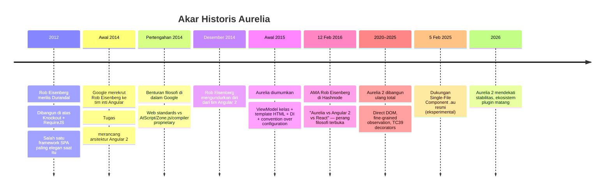

## Kenapa Saya Menulis Ini

Ada satu momen yang membuat saya sadar bahwa saya mungkin sedang salah membaca sebuah framework.

Saya membuka sebuah file Aurelia. Isinya bukan komponen. Isinya dua file: `user-card.ts` dan `user-card.html`. Lalu di dalam file TypeScript itu ada kelas biasa, ada `@customElement`, ada `@bindable`, ada `resolve()`. Tidak ada JSX. Tidak ada `<script setup>`. Tidak ada runes. Tidak ada `useState`. Tidak ada `export let`.

Reaksi pertama saya jujur saja: **ini terasa seperti kode enterprise tahun 2016 yang belum sempat migrasi.**

Reaksi kedua saya, beberapa hari kemudian, jauh lebih tepat: **tidak ada yang salah dengan Aurelia — yang salah adalah model mental saya.**

Artikel ini adalah catatan perjalanan saya dari reaksi pertama ke reaksi kedua, lalu dari reaksi kedua ke keputusan untuk benar-benar masuk ke dalam codebase, membaca sumbernya, membangun sesuatu yang belum ada, dan mencoba menyumbang balik. Ini bukan artikel promosi. Ini bukan artikel dokumentasi. Ini catatan lapangan.

Saya **sandikodev** (bukan sandi, bukan diko, bukan kodev). Dan ini cerita saya.

> [!NOTE]
> Seluruh kode yang saya bahas di sini ada di repositori **[github.com/sandikodev/aureliajs](https://github.com/sandikodev/aureliajs)**. Fokus terbesar saya saat artikel ini ditulis adalah dua hal: **`@aureliajs/ssr`** — mesin SSR dan hydration untuk Aurelia 2 — dan **`@hono/aurelia-ssr`** — adapter Hono yang membungkusnya menjadi pengalaman fullstack yang bisa dipakai. Sisanya adalah eksperimen pendukung dan satu aplikasi SaaS yang saya pakai sebagai bukti bahwa semuanya bukan main-main.

---

## Bab 1 — Titik Nol: Developer yang Dibentuk oleh Paradigma Lain

Saya perlu jujur soal latar belakang saya, karena itu menentukan kenapa cerita ini terjadi.

Saya menghabiskan bertahun-tahun hidup di dalam paradigma berikut:

| Ekosistem | Paradigma inti | Yang saya bawa ke kepala saya |
|---|---|---|
| **React** | `UI = f(state)` | Render ulang adalah mekanisme utama. Setiap perubahan state memicu rekonsiliasi Virtual DOM. `useEffect`, `useMemo`, `useCallback`, dependency array. |
| **Vue** | SFC + reactivity proxy | Template dan logic dalam satu file. Reactivity otomatis lewat proxy. `ref()`, `computed()`, `watch()`. |
| **Svelte** | Compile-time reactivity | Tidak ada runtime diffing. Assignment itu sendiri adalah sinyal. Runes (`$state`, `$derived`, `$effect`). |
| **Astro** | Islands + zero-JS default | HTML dulu, JavaScript hanya di tempat yang butuh. Hydration directive eksplisit. |
| **Flutter** | Imperative widget tree | Widget dibangun ulang, tapi indentitas elemen dijaga oleh framework. |

Semua ekosistem di atas punya satu kesamaan yang saya anggap sebagai kebenaran universal tanpa pernah saya pertanyakan:

> **Komponen adalah fungsi yang dijalankan ulang. State adalah input-nya. UI adalah output-nya.**

Aurelia tidak bekerja dengan asumsi itu. Dan ketika saya pertama kali menyadari hal tersebut, hampir semua intuisi saya menjadi tidak berlaku.

### Kejutan-kejutan kecil yang menumpuk

Pertemuan pertama saya dengan Aurelia 2 menghasilkan daftar kebingungan yang cukup panjang:

1. **Kenapa template terpisah dari logic?** Bukankah SFC sudah terbukti lebih nyaman? (Vue, Svelte, Astro, bahkan React dengan JSX.)
2. **Kenapa kelas?** Bukankah kelas di JavaScript itu "sisa-sisa OOP yang harus dihindari"? Setidaknya itu yang saya dengar bertahun-tahun di komunitas React.
3. **Kenapa `@bindable` dan bukan props?** Kenapa saya harus mendeklarasikan sesuatu yang seharusnya implisit?
4. **Kenapa `repeat.for` dan bukan `.map()`?** Di React, list adalah ekspresi JavaScript. Di Aurelia, list adalah atribut di template.
5. **Kenapa `click.trigger` dan bukan `onClick`?** Apa bedanya `trigger` dan `bind`?
6. **Kenapa `resolve(IService)` dan bukan `useContext`?** Dependency Injection terasa seperti membawa Spring Boot ke frontend.
7. **Kenapa tidak ada VDOM?** Bagaimana mungkin UI bisa berubah tanpa diffing?

Setiap pertanyaan di atas punya jawaban yang benar. Tapi jawabannya tidak akan masuk akal kalau saya membaca Aurelia dengan kamus React.

---

## Bab 2 — Menelusuri Akar: Durandal, Google, dan Tahun 2014

Untuk memahami sebuah framework, saya belajar bahwa membaca dokumentasi tidak cukup. Saya harus membaca **sejarahnya**. Dan sejarah Aurelia adalah salah satu sejarah paling menarik di dunia frontend, karena ia lahir dari sebuah perpisahan.

### Garis waktu



### Apa yang sebenarnya terjadi di Google

Rob Eisenberg sudah punya reputasi sebelum Google. Durandal adalah framework SPA yang, pada masanya, jauh lebih bersih daripada kebanyakan alternatifnya. Ketika Google merekrutnya, ekspektasinya jelas: bawa pemikiran segar ke Angular 2.

Yang terjadi kemudian adalah benturan dua dunia rekayasa:

| Isu | Posisi Rob Eisenberg | Posisi yang akhirnya diambil Angular 2 |
|---|---|---|
| **Bahasa** | JavaScript/TypeScript standar, minim tooling proprietary | AtScript (kemudian dilebur ke TypeScript), dekorator berat |
| **Template** | HTML yang benar-benar HTML, case-insensitive sesuai spesifikasi | Sintaks case-sensitive (`ngFor`, `ngModel`) yang butuh parser markup proprietary |
| **Change detection** | Observasi properti yang presisi | Zone.js yang mem-patch seluruh API async browser |
| **Konfigurasi** | Convention over configuration | Metadata deklaratif eksplisit + `NgModule` |
| **Filosofi** | Unobtrusive — framework sesedikit mungkin terlihat | Framework hadir secara eksplisit di seluruh kode |

Rob keluar pada Desember 2014. Beberapa bulan kemudian, Aurelia lahir — dan Aurelia pada dasarnya adalah jawaban atas pertanyaan: *"Bagaimana kalau Angular 2 dibangun dengan cara yang saya yakini?"*

Itulah sebabnya jawaban dari Bab 1 mulai masuk akal:

- **Kelas + template terpisah** → ini adalah MVVM, warisan langsung Durandal dan AngularJS.
- **`@bindable`** → ini adalah `@Input()` versi Aurelia.
- **`repeat.for`** → ini adalah `*ngFor` tanpa parser proprietary.
- **`resolve()`** → ini adalah DI hierarkis, bawaan sejak awal, bukan tempelan.
- **Tanpa VDOM** → ini adalah pemberontakan terhadap asumsi bahwa diffing itu perlu.

> [!IMPORTANT]
> Kesimpulan paling penting yang saya ambil: **Aurelia bukan framework yang "ketinggalan zaman". Aurelia adalah framework yang menolak ikut arus.** Ia memilih jalur yang secara historis kalah populer, bukan jalur yang secara teknis lebih buruk.

### Bacaan yang mengubah cara saya membaca kode

Enam artikel ini menemani saya di minggu-minggu awal, dan saya sertakan tanggalnya karena konteks waktu itu penting:

1. **"Rob Eisenberg on Aurelia and how it stacks up against Angular 2 and React"** — Hashnode, **12 Februari 2016**. Ini adalah AMA mentah dari masa ketika Angular 2 masih beta. Di sini Rob membeberkan argumen standar web, ukuran bundle (~350k vs ~750k), performa di benchmark `dbmonster`, dan rencana isomorphic — termasuk **PAL (Platform Abstraction Layer)** yang belakangan menjadi fondasi `@aurelia/platform`. Yang paling penting bagi saya: bagian tentang SSR. Pada 2016, Rob sudah menyebutkan rencana pre-compilation, server render, dan *"client continue from server render"*. Artinya, **SSR bukan ide baru di 2026 — ia adalah hutang lama yang belum dibayar.**

2. **"Aurelia vs Angular(2+): Why I prefer Aurelia over Angular"** — Medium, Krishan Kataria, **25 November 2018**. Artikel ini menerjemahkan hal-hal filosofis menjadi perbandingan harian: boilerplate `@Component` + `NgModule` vs konvensi nama file, `[(ngModel)]` vs `value.two-way`, dan routing yang bisa dideklarasikan di child component. Bagi saya, ini adalah artikel yang membuat keanehan Aurelia mulai terasa *masuk akal*.

3. **"Aurelia 2: A Fresh Take on JavaScript Frameworks"** — DEV.to, Almir Hodzic, **11 Januari 2025** (diedit 13 Januari 2025). Ini adalah pengantar praktis: Event Aggregator, DI container, `<au-compose>`, dan pemisahan View/ViewModel/Model. Komentar-komentar di artikel ini juga berharga — terutama kritik bahwa Event Aggregator sebaiknya dipakai di level Model, bukan untuk broadcast antar ViewModel.

4. **"Experimental Single File Components Support For Aurelia 2 + Vite"** — blog resmi Aurelia, Dwayne Charrington, **5 Februari 2025**. Ini adalah baseline resmi untuk SFC `.au`. Eksperimen saya di kemudian hari (`.aux`) harus dibaca sebagai *respons terhadap artikel ini*, bukan sebagai penemuan dari nol.

5. **"I Built Server-Side Rendering for Aurelia 2"** — I Like Kill Nerds, Dwayne Charrington, **4 Mei 2026**. Artikel ini sangat penting karena mendokumentasikan realitas praktis: paket komunitas `aurelia2-ssr` versi `0.0.3`, isolasi `window`/`document` per request, `prepareSsrHostForTakeover` dengan mode `remount`, preboot untuk input yang diketik sebelum JavaScript hidup, dan serialisasi Shadow DOM. Artikel ini adalah cermin yang jujur: **core Aurelia punya fondasinya, tapi glue untuk aplikasi belum ada.**

6. **"Aurelia 2 in 2026: The Framework That Refused to Die Is Thriving"** — I Like Kill Nerds, **4 Januari 2026**. Ini adalah artikel momentum: dialog system berbasis `<dialog>` native, state middleware, router-lite yang matang, SFC support, Storybook, dan peningkatan dokumentasi. Tesisnya sederhana: framework ini tidak mati, ia hanya tidak ramai.

Dari enam artikel itu, saya menarik satu benang merah yang menjadi alasan saya membuka editor dan mulai menulis kode:

> Aurelia punya fondasi teknis paling bersih di industri (Direct DOM, fine-grained observation, DI bawaan, standar W3C), tetapi **lapisan pengalaman developer dan lapisan fullstack-nya masih tipis**. Di situlah ruang kontribusi berada.

---

## Bab 3 — Bedah Semantik: Angular vs Aurelia 2

Sebelum saya bisa menulis satu baris kode Aurelia yang benar, saya harus bisa menerjemahkan kebiasaan saya. Ini tabel yang saya susun sendiri dan saya tempel di samping monitor.

### Komponen: deklarasi

**Angular:**

```typescript
import { Component, Input } from '@angular/core';

@Component({
  selector: 'app-user-card',
  templateUrl: './user-card.component.html',
  styleUrls: ['./user-card.component.css'],
})
export class UserCardComponent {
  @Input() name = '';
  @Input() role = 'member';
}
```

**Aurelia 2:**

```typescript
import { bindable, customElement } from 'aurelia';

@customElement({ name: 'user-card', template: /* ... */ })
export class UserCard {
  @bindable name = '';
  @bindable role = 'member';
}
```

Perhatikan: di Aurelia, `template` bisa dihilangkan sepenuhnya karena konvensi. File `user-card.html` di sebelah `user-card.ts` akan ditemukan otomatis. Tidak ada `selector`, tidak ada `styleUrls`, tidak ada registrasi `NgModule`.

### Komponen: template

**Angular:**

```html
<div class="card">
  <h3>{{ name }}</h3>
  <p>{{ role }}</p>
  <ul>
    <li *ngFor="let item of items">{{ item.title }}</li>
  </ul>
  <button (click)="select()">Select</button>
  <input [(ngModel)]="query" />
</div>
```

**Aurelia 2:**

```html
<div class="card">
  <h3>${name}</h3>
  <p>${role}</p>
  <ul>
    <li repeat.for="item of items">${item.title}</li>
  </ul>
  <button click.trigger="select()">Select</button>
  <input value.two-way="query" />
</div>
```

Perbedaan yang terlihat sepele tapi fundamental:

| Konsep | Angular | Aurelia 2 | Catatan |
|---|---|---|---|
| Interpolasi | `{{ value }}` | `${value}` | Aurelia memakai sintaks template literal JavaScript |
| Event | `(click)="fn()"` | `click.trigger="fn()"` | Aurelia eksplisit soal *command* |
| Property | `[value]="x"` | `value.bind="x"` | Sama, beda posisi |
| Two-way | `[(ngModel)]="x"` | `value.two-way="x"` | Aurelia tidak butuh directive khusus untuk input |
| Loop | `*ngFor="let i of items"` | `repeat.for="i of items"` | Aurelia adalah atribut biasa, bukan structural directive dengan microsyntax |
| Kondisional | `*ngIf="cond"` | `if.bind="cond"` | — |
| Class | `[class.active]="x"` | `class.bind="x ? 'active' : ''"` | — |
| Style | `[style.color]="c"` | `style.bind="c"` | — |

### Kenapa sintaks ini penting secara filosofis

Sintaks binding Aurelia (`target.command="expression"`) bukan sekadar selera. Ia adalah **kontrak semantik yang eksplisit**:

- `value.bind` berarti "hubungkan properti ini satu arah dari ViewModel ke View".
- `value.two-way` berarti "sinkronkan dua arah".
- `value.one-time` berarti "evaluasi sekali, jangan pernah update".
- `click.trigger` berarti "pasang listener event".
- `click.delegate` berarti "pasang listener di level document, tangkap lewat bubbling" — lebih hemat listener.
- `if.bind` berarti "render atau hancurkan elemen beserta komponennya".
- `show.bind` berarti "sembunyikan dengan CSS, jangan hancurkan".

Di React, semua ini disatukan oleh satu mekanisme: render ulang. Di Aurelia, setiap command punya konsekuensi lifecycle yang berbeda. **Itu bukan kerumitan tambahan — itu kontrol yang lebih halus.** Tapi kontrol itu hanya berguna kalau saya tahu apa yang saya kendalikan.

---

## Bab 4 — Mental Model yang Harus Dibongkar

Ini bab yang paling penting dalam artikel ini, karena di sinilah saya hampir menyerah.

### Asumsi 1: Komponen dijalankan ulang

Di React:

```jsx
function Counter() {
  const [count, setCount] = useState(0);
  console.log('render'); // jalan setiap perubahan state
  return <button onClick={() => setCount(count + 1)}>{count}</button>;
}
```

Fungsi `Counter` berjalan ulang. Variabel lokal dibuat ulang. Closure dibuat ulang. Seluruh body dieksekusi lagi.

Di Aurelia:

```typescript
export class Counter {
  count = 0;

  increment(): void {
    this.count++;
    // Tidak ada render ulang. Tidak ada body fungsi yang dieksekusi lagi.
    // Observer menyentuh satu text node dan mengganti nilainya.
  }
}
```

Kelas diinstansiasi **sekali**. Instance hidup selama komponen hidup. `this` adalah tempat state berada, secara literal. Ketika `this.count` berubah, sistem observasi Aurelia — yang bekerja dengan `Proxy` pada properti dan binding yang sudah terpasang — mengubah **node DOM spesifik** yang terikat ke ekspresi itu.

Konsekuensi praktisnya besar:

| Pertanyaan | React | Aurelia 2 |
|---|---|---|
| Apakah state hilang saat re-render? | Tidak (disimpan di hook slot) | Tidak (disimpan di `this`) |
| Apakah closure bisa basi? | Ya, sumber bug klasik | Tidak, karena tidak ada closure per-render |
| Apakah saya perlu `useCallback`? | Sering | Tidak |
| Apakah urutan pemanggilan hook penting? | Ya, fatal kalau salah | Tidak ada hook |
| Apakah komponen anak ikut re-render? | Tergantung memo | Tidak, kecuali binding-nya berubah |
| Di mana efek samping diletakkan? | `useEffect` + dependency array | Lifecycle (`attached`, `detached`, `bound`) |
| Kapan cleanup dilakukan? | Return function di `useEffect` | `detached()` / `dispose()` |

### Asumsi 2: Template adalah ekspresi JavaScript

Di React, list adalah `.map()`. Di Aurelia, `repeat.for` adalah **bagian dari template compiler**, yang punya pemahaman tentang identitas item, index, dan lifecycle komponen anak. Ketika array berubah, Aurelia tahu item mana yang ditambah, dihapus, atau dipindah — tanpa saya menulis `key` prop dan tanpa mendiffing seluruh tree.

Contoh yang membuat saya benar-benar paham:

```html
<!-- Setiap item punya komponen anak dengan state sendiri -->
<todo-item repeat.for="todo of todos" model.bind="todo"></todo-item>
```

Kalau `todos` berubah dari 10 item menjadi 11, hanya satu `<todo-item>` yang dibuat. Sembilan lainnya tidak di-dispose. State mereka tetap. Di React, itu terjadi kalau `key` benar; kalau salah, state bisa nyasar. Di Aurelia, identitas melekat pada objek item itu sendiri.

### Asumsi 3: Dependency Injection itu berat

Ini asumsi yang paling salah, dan saya mengetahuinya setelah membaca kode Aurelia sendiri.

```typescript
import { resolve } from 'aurelia';
import { IHttpClient } from './services/http.js';

export class UserList {
  private readonly http = resolve(IHttpClient);

  async load(): Promise<void> {
    this.users = await this.http.get('/api/users');
  }
}
```

Yang terjadi di balik layar:

- Container bersifat **hierarkis**: root container → container aplikasi → container komponen.
- Registrasi bisa per-kelas, per-interface (lewat token), atau per-instance.
- Lifetime bisa singleton, transient, atau scoped.
- Karena semuanya eksplisit, **testing menjadi trivial**: daftarkan implementasi palsu, selesai.

Tidak ada `providers` array di setiap komponen. Tidak ada `@Injectable({ providedIn: 'root' })`. Tidak ada module. Ini adalah DI yang saya kenal dari backend, tapi berjalan di browser tanpa overhead yang saya bayangkan.

### Asumsi 4: SSR itu "cuma render ke string"

Ini asumsi yang paling mahal — dan yang membawa saya ke seluruh paruh kedua artikel ini.

Di React, `renderToString` sudah jadi bagian dari paket resmi sejak lama. Di Vue ada `@vue/server-renderer`. Di Svelte ada `svelte/server`. Di Aurelia 2... saat saya periksa, **tidak ada paket resmi**. Fondasinya ada. Paketnya tidak.

Dan di sinilah cerita berubah dari "belajar framework" menjadi "membangun sesuatu".

---

## Bab 5 — Keputusan: Masuk ke Codebase, Bukan Cuma Membaca

Ada titik di mana membaca berhenti membantu. Saya sudah membaca dokumentasi, artikel, dan diskusi. Saya masih belum benar-benar paham. Cara satu-satunya adalah menulis kode yang menyentuh bagian paling rapuh dari framework itu: **siklus render dan hydration**.

Prinsip yang saya pegang sepanjang eksperimen ini saya sebut *reverence through exploration* — penghormatan lewat eksplorasi. Saya tidak sedang mencoba "memperbaiki" Aurelia. Saya sedang menguji batasnya, dan kalau saya menemukan sesuatu yang berguna, saya akan menawarkannya kembali.

### Angka-angka repositori

Saya tidak mau artikel ini berisi klaim tanpa bukti, jadi ini datanya, diambil langsung dari repositori:

| Metrik | Nilai |
|---|---|
| Total commit | **103** (semuanya oleh `sandikodev`) |
| Rentang waktu | **12 – 16 November 2026** (5 hari) |
| Distribusi commit per hari | 12 Nov: 5 · 13 Nov: 55 · 14 Nov: 2 · 16 Nov: 39 |
| Baris ditambahkan | **~59.750** |
| Baris dihapus | **~12.797** |
| Paket di `packages/` | 6 (termasuk 2 submodule) |
| Aplikasi di `apps/` | 2 (`web`, `api`) |
| File `.ts` non-generated | 84 |
| File `.aux` | 21 |
| Dokumen riset di `docs/` | 6 |

Angka 55 commit dalam satu hari itu bukan tanda produktivitas yang membanggakan. Itu tanda **saya sedang tersesat dan mencoba banyak jalan sekaligus**. Saya akan bahas itu di Bab 12.

### Peta monorepo

```
aureliajs/
├── packages/
│   ├── aurelia-ssr/          # @aureliajs/ssr — mesin SSR & hydration (core)
│   ├── hono-aurelia-ssr/     # @hono/aurelia-ssr — adapter Hono (submodule)
│   ├── vite-plugin-aux/      # @aureliajs/vite-plugin-aux — compiler .aux SFC
│   ├── vscode-aux/           # @aureliajs/vscode-aux — ekstensi editor
│   ├── ssr-playground/       # @aureliajs/ssr-playground — laboratorium & inspector
│   ├── shared/               # @aureliajs/shared — skema Zod & entitlement
│   └── skills/               # submodule: agent skills
├── apps/
│   ├── web/                  # Aurelia Ops — SPA multi-tenant (Aurelia 2 + Tailwind 4)
│   └── api/                  # Aurelia Ops API (Hono + Drizzle + Stripe)
├── examples/
│   └── fullstack-ssr/        # contoh end-to-end
├── docs/                     # 6 dokumen riset & manifesto
└── e2e/                      # Playwright
```

Sekarang saya akan membedah satu per satu, dimulai dari yang paling saya pedulikan.

---

## Bab 6 — `@aureliajs/ssr`: Mengisi Lubang yang Tidak Ada di NPM

### Masalahnya

Ketika saya mencari paket SSR resmi untuk Aurelia 2, hasilnya adalah 404. Bukan "belum stabil", bukan "alpha", tapi benar-benar tidak ada. Yang ada hanya fondasi tingkat rendah:

- `@aurelia/platform` — abstraksi platform (PAL) yang memungkinkan runtime berjalan di luar browser.
- `@aurelia/kernel` — container DI dan utilitas.
- `@aurelia/runtime-html` — runtime DOM, termasuk dukungan untuk dokumen yang disuntikkan.

Fondasi ini cukup untuk membangun SSR, tapi tidak ada yang membungkusnya menjadi API yang bisa dipakai. Bandingkan dengan ekosistem lain:

| Framework | Paket SSR resmi | Status |
|---|---|---|
| React | `react-dom/server` | Bagian dari paket inti |
| Vue | `@vue/server-renderer` | Paket resmi terpisah |
| Svelte | `svelte/server` | Bagian dari paket inti |
| **Aurelia 2** | **tidak ada** | **fondasi ada, pembungkus tidak** |

Jadi saya membangunnya.

### Arsitektur


### Empat solusi inti (dan bug yang memaksa saya menemukannya)

#### 1. `SsrTemplateElementFactory` — memperbaiki `AUR0757`

Ini adalah bug yang membuat saya terjaga sampai jam tiga pagi.

Gejalanya: ketika dua request HTTP datang bersamaan, salah satunya gagal dengan error `AUR0757: Element template compilation failed`. Kalau request dijalankan berurutan, semuanya normal.

Penyebabnya: Aurelia 2 memiliki factory global yang meng-cache elemen template DOM. Di browser, itu optimasi yang bagus — hanya ada satu dokumen. Di server, setiap request punya dokumen JSDOM sendiri. Ketika request A selesai dan dokumennya dibuang, cache masih menyimpan elemen dari dokumen mati itu. Request B mengambil elemen dari dokumen yang sudah dibunuh, lalu gagal.

Solusinya: daftarkan factory khusus per siklus render.

```typescript
// packages/aurelia-ssr/src/render.ts (ringkasan)
class SsrTemplateElementFactory {
  private readonly cache = new Map<string, HTMLTemplateElement>();

  createTemplate(markup: string): HTMLTemplateElement {
    const cached = this.cache.get(markup);
    if (cached) return cached;

    const template = this.document.createElement('template');
    template.innerHTML = markup;
    this.cache.set(markup, template);
    return template;
  }
}
```

Kuncinya bukan implementasi cache-nya, tapi **ruang lingkupnya**: satu instance per request, dibuang bersama dokumennya.

> [!TIP]
> Pelajaran umum: setiap kali framework menyimpan cache global, itu adalah asumsi "hanya ada satu dunia". Server-side rendering memecah asumsi itu. Bug seperti `AUR0757` akan selalu muncul di titik-titik itu.

#### 2. Disposal container DI yang ketat

Setiap request membuat container DI baru. Container menyimpan metadata, instance, dan closure. Tanpa teardown eksplisit, setiap request meninggalkan sisa memori.

```typescript
// packages/aurelia-ssr/src/render.ts (ringkasan)
const container = DI.createContainer();
try {
  const app = Aurelia.app({ host, component, container });
  await app.start();
  // ... ambil HTML dari host ...
} finally {
  await app?.dispose();
  await container.dispose();
}
```

`finally` di sini bukan formalitas. Ini yang membedakan mesin SSR yang bisa jalan berjam-jam dari yang mati setelah 500 request.

#### 3. `RenderMutex` — antrean FIFO

Walaupun factory sudah per-request, ada bagian dari runtime Aurelia yang masih menyentuh state proses-level — misalnya registrasi platform dan beberapa singleton. Solusinya kasar tapi efektif: **serialisasi render dalam satu proses**.

```typescript
class RenderMutex {
  private tail: Promise<unknown> = Promise.resolve();

  run<T>(task: () => Promise<T>): Promise<T> {
    const next = this.tail.then(task, task);
    this.tail = next.catch(() => undefined);
    return next;
  }
}
```

Trade-off-nya jelas dan harus saya akui:

| Pendekatan | Kelebihan | Kekurangan |
|---|---|---|
| Serialisasi (mutex) | Benar secara pasti, sederhana, tidak ada race | Throughput terbatas 1 render per proses |
| Paralel penuh | Throughput tinggi | Butuh isolasi state yang sempurna di seluruh runtime Aurelia |
| Worker per request | Isolasi total | Overhead proses/thread besar |

Saya memilih yang benar dulu, cepat kemudian. Ini adalah keputusan yang saya tulis di README sebagai keterbatasan, bukan menyembunyikannya.

#### 4. Serializer anti-XSS dengan whitelist ketat

Ini bagian yang paling sering diremehkan orang saat membangun SSR. Menyuntikkan state ke dalam HTML adalah operasi berbahaya.

Tiga lapisan pertahanan di `serializeState()`:

**Lapisan 1 — proyeksi whitelist.** Hanya field yang secara eksplisit diizinkan yang boleh keluar dari server.

```typescript
const ALLOWED_USER_FIELDS = new Set(['id', 'email', 'name', 'avatarUrl']);
const ALLOWED_WORKSPACE_FIELDS = new Set(['id', 'name', 'slug', 'plan', 'role']);

function projectObject<T>(source: unknown, allowed: Set<string>): T | null {
  if (!source || typeof source !== 'object') return null;
  const out: Record<string, unknown> = {};
  for (const key of allowed) {
    const value = (source as Record<string, unknown>)[key];
    if (value === null || ['string', 'number', 'boolean'].includes(typeof value)) {
      out[key] = value;
    }
  }
  return out as T;
}
```

Perhatikan: bahkan field yang di-whitelist pun hanya boleh bertipe primitif. Objek bersarang tidak lolos. Ini mencegah kebocoran tidak sengaja lewat objek ORM yang punya relasi tersembunyi.

**Lapisan 2 — escaping konteks script.** Karakter `<`, `>`, `&`, `\u2028`, `\u2029` di-escape menjadi `\u003c`, `\u003e`, `\u0026`, dan seterusnya. Ini mencegah `</script>` di dalam string memutus blok script.

**Lapisan 3 — CSP nonce.** `createHtmlDocument()` menerima `nonce` dan menyuntikkannya ke setiap tag `<script>`, sehingga CSP yang ketat tetap bisa diberlakukan.

> [!WARNING]
> Whitelist bukan paranoia. Dalam aplikasi multi-tenant, satu field bocor berarti data tenant lain bisa dibaca dari `window.__HYDRATION__` di browser. Ini bukan bug kosmetik — ini insiden keamanan.

### Permukaan API

**Server (`@aureliajs/ssr/server`):**

| Fungsi | Signature | Kegunaan |
|---|---|---|
| `renderToString()` | `(options: RenderOptions) => Promise<string>` | Merender komponen menjadi string HTML |
| `renderAurelia()` | `(options: RenderOptions) => Promise<string>` | Alias langsung untuk `renderToString()` |
| `serializeState()` | `(context, initialData?, componentName?) => HydrationPayload` | Proyeksi state dengan whitelist dan escaping |
| `createHtmlDocument()` | `(bodyHtml, payload?, options?) => string` | Dokumen HTML5 lengkap dengan DOCTYPE, script, dan CSP nonce |
| `createFallbackHtml()` | `(componentName, options?) => string` | Shell minimal untuk mode fallback client-side |
| `createErrorHtml()` | `(statusCode, message, error?, options?) => string` | Dokumen error yang rapi |

**Client (`@aureliajs/ssr/client`):**

| Fungsi / Kelas | Signature | Kegunaan |
|---|---|---|
| `hydrateFromServer<T>()` | `(options?) => HydrationResult<T> \| null` | Mengambil dan memvalidasi payload dari `window` |
| `isHydrationAvailable()` | `(payloadKey?) => boolean` | Cek keberadaan payload valid |
| `peekHydrationPayload()` | `(payloadKey?) => HydrationPayload \| undefined` | Baca tanpa menghapus |
| `clearHydration()` | `(payloadKey?) => void` | Bersihkan payload dari global |
| `HydrationCache` | `class` | Cache in-memory dengan TTL |

Pemisahan `/server` dan `/client` bukan kosmetik. Bundel client tidak boleh menyentuh JSDOM. Hasilnya, bagian client di bawah 2KB gzipped — karena isinya benar-benar hanya pembacaan state dan validasi.

### Contoh pemakaian lengkap

**Server:**

```typescript
import {
  renderToString,
  serializeState,
  createHtmlDocument,
} from '@aureliajs/ssr/server';
import { UserProfile } from './components/user-profile.js';

export async function handleRequest(req: Request): Promise<Response> {
  const user = { id: 'u_1', name: 'Sandiko', email: 'sandiko@example.com' };
  const initialData = { followers: 1240, posts: 42 };

  // 1. Render komponen ke string
  const bodyHtml = await renderToString({
    component: UserProfile,
    props: { activeTab: 'overview' },
    context: { user, role: 'Admin' },
  });

  // 2. Serialisasi state (whitelist + escaping)
  const payload = serializeState(
    { user, role: 'Admin' },
    initialData,
    'user-profile',
  );

  // 3. Dokumen HTML5 lengkap
  const html = createHtmlDocument(bodyHtml, payload, {
    title: 'User Profile — Aurelia 2 SSR',
    cssBundle: '/dist/bundle.css',
    jsBundle: '/dist/client.js',
    nonce: 'rAnd0mN0nc3',
  });

  return new Response(html, {
    headers: { 'Content-Type': 'text/html; charset=utf-8' },
  });
}
```

**Client:**

```typescript
import Aurelia from 'aurelia';
import { hydrateFromServer } from '@aureliajs/ssr/client';
import { UserProfile } from './components/user-profile.js';

const host = document.querySelector('app-root');
if (host) {
  const hydration = hydrateFromServer<{ followers: number; posts: number }>();

  await Aurelia.app({
    host,
    component: new UserProfile(hydration?.initialData),
  }).start();
}
```

### Status pengujian

Saya menjalankan suite-nya sendiri sebelum menulis artikel ini:

```
✓ test/html.test.ts        (24 tests)
✓ test/hydrate.test.ts     (34 tests)
✓ test/render.test.ts      (14 tests)
✓ test/serialize.test.ts   (10 tests)
✓ test/multi-request.test.ts (1 test)

Test Files  5 passed (5)
     Tests  83 passed (83)
  Duration  2.08s
```

Test `multi-request` adalah yang paling penting secara filosofis. Isinya sederhana: dua render paralel, pastikan keduanya menghasilkan HTML yang benar dan tidak saling merusak. Itu adalah test yang akan menangkap regresi `AUR0757` di masa depan.

> [!NOTE]
> README paket ini sempat menampilkan badge "81 tests" karena saya lupa memperbarui setelah menambah test. Angka sebenarnya saat ini adalah **83**. Saya sebutkan ini bukan untuk merendahkan diri, tapi karena dokumentasi yang melenceng sedikit adalah gejala awal dari dokumentasi yang melenceng banyak.

---

## Bab 7 — `@hono/aurelia-ssr`: Jembatan yang Membuat SSR Bisa Dipakai

Mesin SSR tanpa adapter hanyalah library. Yang membuatnya berguna adalah bagaimana ia bertemu dengan server nyata.

### Mengapa Hono

Hono cocok untuk eksperimen ini karena beberapa alasan teknis, bukan karena popularitas:

- **Web-standard `Request`/`Response`** — tidak ada abstraksi server proprietary.
- **Ringan** — sekitar 14KB, tanpa dependensi berat.
- **Multi-runtime** — Cloudflare Workers, Deno, Bun, Node, Fastly.
- **Composable** — middleware adalah fungsi, bukan kelas dengan decorator.
- **Type-safe** — generic `Context` yang kuat untuk path parameter dan binding.

Kalau Aurelia adalah "framework yang menolak arus", Hono adalah pasangan yang tepat: sama-sama memilih standar web di atas abstraksi.

### Mental model adapter

Satu handler, satu halaman, satu kontrak.

```typescript
import { Hono } from 'hono';
import { aurelia } from '@hono/aurelia-ssr';
import { DashboardPage } from './pages/index.js';

const app = new Hono();

app.get('/dashboard', aurelia({
  component: DashboardPage,
  title: 'Dashboard',
  requiresAuth: true,
  loaders: {
    stats: async (c) => await fetchStats(c.get('user').id),
    activity: async (c) => await fetchActivity(c.get('user').id, 10),
  },
}));
```

Yang terjadi:

1. Auth diperiksa (`requiresAuth`).
2. Loader dijalankan **paralel** di server.
3. Hasil loader diserialisasi bersama konteks.
4. Komponen dirender dengan data tersebut.
5. HTML lengkap dikirim dengan script hydration.
6. Di client, `hydrateFromServer()` mengambil data yang sama — **tanpa fetch ulang**.

Poin terakhir itu adalah inti dari seluruh nilai SSR: **tidak ada request duplikat**.

### Co-located loaders: data di dekat komponennya

Versi pertama adapter mengharuskan loader ditulis di route. Itu terasa salah — data yang dibutuhkan sebuah komponen seharusnya tinggal di dekat komponen itu.

Jadi saya menambahkan dukungan metadata pada komponen:

```typescript
import { customElement } from 'aurelia';

@customElement({ name: 'dashboard-page' })
export class DashboardPage {
  // Metadata deklaratif — dibaca oleh adapter, tidak mengotori route
  static title = 'Dashboard';
  static requiresAuth = true;

  static async loader(c: Context) {
    const user = c.get('user');
    return { stats: await fetchStats(user.id) };
  }

  // ...
}
```

Lalu route cukup:

```typescript
app.get('/dashboard', aurelia(DashboardPage));
```

Signature `aurelia(Component, Title)` adalah gula sintaksis untuk kasus yang paling umum. Untuk kasus yang butuh kontrol, bentuk objek tetap tersedia. Ini pola yang saya pinjam dari file-system routing modern tanpa meninggalkan eksplisitisme.

### Co-located actions: mutasi di dekat komponennya

Ini adalah salah satu tambahan terakhir sebelum artikel ini ditulis, dan menurut saya yang paling menarik secara arsitektural.

Loaders menangani GET. Tapi aplikasi nyata butuh POST, PUT, PATCH, DELETE. Menulis route terpisah untuk setiap mutasi membuat form handling kembali berantakan.

Solusinya: komponen bisa mengekspos action bernama.

```typescript
export class ProjectsPage {
  static actions = {
    create: async (c: Context) => {
      const body = await c.req.parseBody();
      const project = await db.projects.create(body);
      return c.json({ ok: true, project });
    },
    archive: async (c: Context) => {
      const { id } = await c.req.json();
      await db.projects.archive(id);
      return c.json({ ok: true });
    },
  };
}
```

Adapter mendaftarkan endpoint otomatis:

| Action | Method | Path |
|---|---|---|
| `create` | `POST` | `/projects` |
| `archive` | `PATCH` atau `DELETE` | `/projects/actions/archive` |

Detail persisnya bisa berbeda per konfigurasi, tapi idenya tetap: **komponen adalah unit kohesi**. Template, logic, loader, dan action-nya tinggal di satu tempat. Ini adalah pendekatan yang mirip dengan Server Actions, tanpa perlu compiler ajaib.

### Helper pendukung

Tiga utilitas yang saya tambahkan karena saya sendiri lelah menulis hal yang sama berulang kali:

```typescript
// 1. Default global untuk semua route
app.use('*', aureliaDefaults({
  document: { titleSuffix: ' — Aurelia Ops' },
  streaming: false,
  fallback: 'error',
}));

// 2. Sajikan aset statis dengan cache header yang benar
app.use('/public/*', serveAureliaAssets({
  root: './public',
  prefix: '/public',
  maxAge: 86400,
}));

// 3. Grup route dengan konfigurasi bersama
const protectedPages = createAureliaRouteGroup({
  requiresAuth: true,
  fallback: 'error',
});

app.get('/settings', protectedPages.handler(SettingsPage, 'Settings'));
```

`serveAureliaAssets()` adalah salah satu yang paling terasa manfaatnya. Sebelumnya, setiap contoh menulis handler statis sendiri, dan semuanya lupa `Content-Type` atau `Cache-Control`.

### Auth middleware

Alih-alih mengikat adapter ke satu sistem auth, saya membuat kontrak:

```typescript
app.use('*', createAuthMiddleware({
  getUserFromToken: async (token) => await verifyJWT(token),
  getWorkspaceFromRequest: async (c) => await getWorkspace(c.req.header('x-workspace-id')),
  getRoleForUser: (user, workspace) =>
    user.id === workspace.owner_id ? 'admin' : 'member',
}));
```

Setelah middleware terpasang, `requiresAuth: true` pada route otomatis mendapatkan `c.get('user')`, `c.get('workspace')`, dan `c.get('role')` — terverifikasi.

Ini bukan sekadar kenyamanan. Ini adalah cara memaksa agar **setiap halaman yang butuh auth benar-benar memeriksanya**, bukan mengandalkan ingatan developer.

### Content negotiation

Satu route, dua representasi:

```bash
# Browser
curl http://localhost:3000/dashboard
# -> <html>...</html>

# API client
curl -H "Accept: application/json" http://localhost:3000/dashboard
# -> { "component": "DashboardPage", "context": {...}, "initialData": {...} }
```

Fitur ini berguna untuk debugging dan untuk membangun endpoint yang sama bagi halaman dan API. Tapi saya harus jujur: ini juga bisa membingungkan. Saya menandainya sebagai fitur opsional, bukan default.

### Eksekusi dan streaming

`clientOnly` dan `serverOnly` pada metadata komponen menentukan di mana sebuah komponen dijalankan:

```typescript
export class LiveClock {
  static clientOnly = true; // jam yang bergantung pada timezone browser
}
```

Untuk halaman besar, `streaming: true` mengirim shell lebih dulu lalu menyusul konten. Ini adalah fitur yang masih saya anggap **eksperimental** — saya belum menguji cukup banyak skenario backpressure untuk mengklaimnya stabil.

### Status pengujian (dan satu kegagalan yang jujur)

Saya menjalankan suite dengan dua runner berbeda, dan hasilnya berbeda. Ini penting untuk dicatat.

**Dengan Bun:**

```
63 pass
0 fail
113 expect() calls
Ran 63 tests across 2 files. [315.00ms]
```

**Dengan Vitest:**

```
Test Files  1 failed | 1 passed (2)
     Tests  1 failed | 62 passed (63)
```

Kegagalannya:

```
FAIL test/adapter.test.ts > serves static assets via serveAureliaAssets middleware
TypeError: The "paths[0]" argument must be of type string. Received undefined
 ❯ serveAureliaAssets src/adapter.ts:100:19
```

Penyebabnya bukan bug logika. Test itu mengambil direktori fixture lewat `import.meta.dirname`, yang di Bun tersedia dan di Vitest (dengan konfigurasi saat ini) `undefined`. Artinya ada **dua masalah sekaligus**:

1. Test bergantung pada API runtime yang tidak portabel.
2. `serveAureliaAssets()` menerima `root: undefined` tanpa validasi, lalu meledak di `path.resolve`.

Masalah kedua adalah bug nyata di library. Kalau `root` wajib, ia harus divalidasi dengan pesan yang jelas — bukan `TypeError` dari dalam Node.

Saya sengaja tidak memperbaikinya sebelum menulis artikel ini, karena saya ingin artikel ini jujur tentang **di mana posisi kode ini sebenarnya**: 62 dari 63 test lulus di Vitest, 63 dari 63 di Bun, dan ada satu bug validasi argumen yang belum ditutup.

> [!WARNING]
> Angka di README root repositori menyebut "133 / 133 Passing" untuk paket ini. Itu **tidak cocok** dengan hasil yang saya ukur (63 test). Kemungkinan besar angka itu berasal dari hitungan assertion atau dari versi suite yang lebih besar yang sudah dipecah. Saya sebutkan ini karena drift dokumentasi adalah masalah nyata, dan saya tidak mau artikel ini ikut menyebarkannya.

### Soal angka performa di README

README adapter menyebut TTFB 45ms, FCP 180ms, dan perbandingan langsung dengan Next.js 15. Saya perlu memberi konteks:

Angka-angka itu saya catat dari contoh `examples/fullstack-ssr` di mesin lokal saya, pada satu waktu, dengan satu dataset. Itu **bukan** benchmark independen, bukan hasil Lighthouse di jaringan nyata, dan bukan perbandingan apple-to-apple dengan Next.js (yang punya fitur berbeda: image optimization, ISR, RSC).

Kalau kamu mencari angka performa untuk mengambil keputusan produksi, jangan pakai angka saya. Ukur sendiri.

---

## Bab 8 — `.aux`: Eksperimen yang Paling Berisiko

### Konteks resmi yang harus saya hormati

Pada **5 Februari 2025**, tim Aurelia mempublikasikan dukungan Single-File Component `.au` lewat `@aurelia/sfc-vite`. Statusnya eksperimental, opt-in, dan format lama tetap jalan.

Saya membaca artikel itu berulang kali sebelum menulis satu baris plugin. Yang saya ambil sebagai pelajaran:

- SFC bukan pengganti, tapi **lapisan ergonomi opsional**.
- Scoping CSS dilakukan dengan atribut data unik (`data-v-*` di versi mereka).
- Keterbatasan harus diumumkan di depan: registrasi manual, template single-root, belum ada type-checking template.
- Backward compatibility tidak boleh dikorbankan.

Dan yang paling penting: **tim inti sudah mengerjakan ini lebih dulu.** Eksperimen saya bukan penemuan, melainkan eksplorasi paralel dengan asumsi yang sedikit berbeda.

### Kenapa `.aux`, bukan `.au`

Alasannya sederhana dan teknisi: `.au` adalah domain ekstensi resmi. Kalau saya memakai ekstensi yang sama dengan implementasi yang berbeda, saya menciptakan kebingungan. `.aux` memberi ruang eksperimen tanpa mengklaim nama.

Ini mungkin terdengar sepele, tapi bagi saya ini soal etika. Nama file adalah bagian dari kontrak publik.

### Anatomi

```html
<!-- button.aux -->
<template>
  <button
    type.bind="type"
    class.bind="classes"
    disabled.bind="disabled || loading"
    click.trigger="handleClick($event)"
  >
    <svg if.bind="loading" class="spinner" viewBox="0 0 24 24">
      <circle cx="12" cy="12" r="10" stroke="currentColor" stroke-width="3" opacity="0.25"></circle>
    </svg>
    <au-slot></au-slot>
  </button>
</template>

<script lang="ts">
import { bindable } from 'aurelia';
import { cva, type VariantProps } from 'class-variance-authority';
import { cn } from '@/lib/utils';

export const buttonVariants = cva(
  'inline-flex items-center justify-center rounded-md font-medium transition-colors',
  {
    variants: {
      variant: {
        default: 'bg-primary text-primary-foreground hover:bg-primary/90',
        destructive: 'bg-destructive text-destructive-foreground',
      },
    },
    defaultVariants: { variant: 'default' },
  },
);

export class UiButton {
  @bindable variant: VariantProps<typeof buttonVariants>['variant'] = 'default';
  @bindable type: 'button' | 'submit' = 'button';
  @bindable disabled = false;
  @bindable loading = false;

  get classes(): string {
    return cn(buttonVariants({ variant: this.variant }));
  }

  handleClick(event: MouseEvent): void {
    if (this.disabled || this.loading) {
      event.preventDefault();
    }
  }
}
</script>

<style scoped>
button {
  user-select: none;
}
.spinner {
  animation: spin 1s linear infinite;
}
@keyframes spin {
  to {
    transform: rotate(360deg);
  }
}
</style>
```

Perhatikan bahwa isi `<script>` adalah **Aurelia yang kanonik**. Tidak ada API baru. Tidak ada runtime baru. Plugin hanya mengubah bentuk file menjadi kelas yang bisa dipahami Aurelia.

Ini prinsip yang saya pegang: **`.aux` adalah transformasi sintaks, bukan framework baru.** Kalau `.aux` menghilang besok, kode yang dihasilkannya tetap kode Aurelia yang valid.

### Template-only component

Ini fitur yang paling sering saya pakai untuk primitif UI:

```html
<!-- separator.aux -->
<template containerless>
  <div class="h-px w-full bg-border" role="separator"></div>
</template>
```

Tidak ada `<script>`. Compiler membuat kelas anonim, menyimpulkan nama tag dari nama file (`separator.aux` → `<au-separator>`), dan mendaftarkannya. Untuk komponen seperti `badge`, `skeleton`, `label`, ini menghilangkan boilerplate yang benar-benar tidak berguna.

### `<script setup>`

Ini bagian yang paling berani, dan saya akui paling kontroversial:

```html
<template>
  <au-card>
    <h3>${title}</h3>
    <p>Count: ${count}</p>
    <button click.trigger="increment()">Tambah</button>
  </au-card>
</template>

<script setup lang="ts">
const title = 'Counter';
let count = 0;

function increment() {
  count++;
}
</script>
```

Compiler melakukan transformasi:

1. Binding top-level yang dipakai di template diubah menjadi `@bindable`.
2. Variabel lokal menjadi properti kelas.
3. Fungsi menjadi method.
4. Import di-hoist ke module scope.
5. `defineProps` didukung untuk deklarasi props eksplisit.

Ini jelas dipengaruhi Vue. Saya tidak menyembunyikannya. Pertanyaannya bukan "apakah ini original", tapi "apakah ini menghasilkan kode Aurelia yang benar dan bisa di-debug".

Karena transformasi ini menyentuh AST, saya menulis test khusus di `packages/vite-plugin-aux/test/setup.test.ts`:

- parsing `<script setup>` dengan bindable otomatis,
- `defineProps`,
- getter, setter, type alias, dan konstanta yang diekspor.

### Scoped styles

Dua mode:

| Mode | Mekanisme | Kapan dipakai |
|---|---|---|
| Atribut | Setiap selector diberi `data-au-[hash]`, atribut disuntik ke elemen root template | Default, kompatibel dengan light DOM dan SSR |
| Shadow DOM | `<template shadow>` menggunakan shadow root native | Isolasi total, tapi butuh perhatian pada styling host |

Mode atribut lebih aman untuk SSR karena bisa diserialisasi sebagai HTML biasa. Shadow DOM memerlukan perlakuan khusus saat server render — dan itu justru salah satu hal yang saya bahas panjang lebar di dokumen riset.

### Skala nyata

- **21 file `.aux`** di repositori, mayoritas di `apps/web/src/ui/` (port shadcn-style primitives).
- **29 unit test** untuk plugin (bukan 21 — README menyebut 21, sekali lagi drift): parsing `<template>` bersarang (termasuk `<template if.bind="...">`), ekstraksi `<script lang="ts">`, transpile decorator, rewrite selector CSS, injeksi atribut scope, penamaan custom element sesuai spesifikasi W3C, dan hook Vite (`resolveId`, `load`, `transform`, `handleHotUpdate`).

Hasil pengukuran saya sendiri:

```
# Bun
29 pass · 0 fail · 122 expect() calls · 5 files

# Vitest (Node)
Test Files  1 failed | 4 passed (5)
     Tests  1 failed | 28 passed (29)
```

Kegagalannya berasal dari test compiler yang meng-`import()` hasil transpilasi lewat `data:` URL. Di Bun itu bekerja; di Node resolusi modul dari `data:` URL dengan specifier path absolut gagal (`Invalid relative URL or base scheme is not hierarchical`). Ini **masalah portabilitas test**, bukan bukti bahwa compiler-nya salah — tapi tetap harus dibereskan, karena artinya suite ini tidak bisa dijalankan di CI Node standar.

### Dukungan editor

Eksperimen tanpa tooling akan mati. Jadi saya membuat tiga lapis dukungan:

| Editor | Mekanisme |
|---|---|
| **VS Code** | Ekstensi `@aureliajs/vscode-aux`: syntax highlighting, completion directive, dukungan decorator Stage 3, ikon file kustom |
| **Neovim** | Mapping filetype `aux = html` + Tree-sitter injection untuk `<script>` dan `<style>` |
| **Zed** | `file_types: { "HTML": ["*.aux"] }` |

Ekstensi VS Code punya satu trik penting: blok `<script lang="ts">` dievaluasi oleh TypeScript Language Server, bukan validator JavaScript. Tanpa itu, setiap anotasi tipe akan memunculkan peringatan palsu *"Type annotations can only be used in TypeScript files"*. Ini contoh kecil bagaimana satu detail tooling menentukan apakah sebuah format terasa "hidup" atau "mainan".

### Garis demarkasi

Saya menulis pernyataan ini di README plugin, di README ekstensi, dan di dokumen riset — dan saya ulangi di sini:

> [!IMPORTANT]
> Proyek `.aux` adalah **inisiatif riset komunitas independen**. Ini **bukan** rilis resmi tim inti Aurelia maupun Aurelia Foundation. Otoritas kanonikal atas Aurelia sepenuhnya berada pada **Rob Eisenberg, Aurelia Core Team, dan maintainer resmi** di `aurelia.io` dan `github.com/aurelia`. Jika eksperimen ini terbukti matang dan bermanfaat, hasilnya akan diajukan sebagai RFC/kontribusi dengan hormat — bukan diklaim sebagai arah resmi.

---

## Bab 9 — `ssr-playground`: Laboratorium dan Alat Ukur

Ada satu masalah besar saat membangun mesin SSR: **bagaimana membuktikan bahwa ia benar?**

Test unit membuktikan fungsi mengembalikan nilai yang diharapkan. Test itu tidak membuktikan bahwa HTML yang dihasilkan punya marker hydration yang utuh, bahwa payload tidak membocorkan token, atau bahwa ukuran wire-nya masuk akal.

Jadi saya membangun playground. Bukan untuk demo — untuk **mengukur**.

### Dua antarmuka

**TUI (Terminal UI)** untuk CI dan inspeksi cepat:

```bash
bun run --cwd packages/ssr-playground inspect
bun run --cwd packages/ssr-playground inspect --fixture data-table
bun run --cwd packages/ssr-playground inspect --fixture data-table --json
```

**Web GUI** untuk eksplorasi visual:

```bash
bun run --cwd packages/ssr-playground serve --port 4700
```

### Enam kemampuan inspeksi

| # | Kemampuan | Yang diukur |
|---|---|---|
| 1 | **Server rendering breakdown** | Waktu render vs waktu serialisasi, total TTFB, delta alokasi memori |
| 2 | **Network transfer** | Byte HTML mentah vs gzip, byte payload hydration vs gzip, rasio overhead state |
| 3 | **Marker & whitelist audit** | Integritas pasangan `<!--au-start-->` / `<!--au-end-->`, pemindaian DTO whitelist, escaping konteks script |
| 4 | **Client hydration & reactivity** | Hydration di JSDOM, assertion zero DOM thrashing (pencegahan `AUR0757`), hitungan listener, verifikasi mutasi state |
| 5 | **Estimasi Core Web Vitals** | FCP, LCP, TBT, risiko CLS, grade keseluruhan |
| 6 | **AST & compiler** | Inspeksi output TypeScript, jumlah node AST |

Poin nomor 4 adalah yang paling saya banggakan. Playground benar-benar menjalankan hydration di JSDOM dan membandingkan struktur DOM sebelum-sesudah. Kalau ada node yang dihancurkan dan dibuat ulang padahal seharusnya dipakai ulang, itu terdeteksi.

### 16 contoh kanonik

```
01-introduction          09-value-converters
02-reactivity            10-conditional-flow
03-aux-component         11-contextual-scoping
04-props-context         12-component-basics
05-logic-loops           13-dependency-injection
06-resumable-hydration   14-content-projection
07-two-way-forms         15-aux-template-only
08-binding-behaviors     16-resumable-todo
```

Setiap contoh adalah direktori berisi file nyata di disk, bukan string di dalam kode. Ini keputusan penting: contoh harus bisa dibuka di editor, di-diff, dan di-copy.

### Status pengujian

```
35 pass
0 fail
387 expect() calls
Ran 35 tests across 4 files. [1.64s]
```

Empat file test:

- `hydration-reactivity.test.ts` — memastikan komponen yang dihidrasi benar-benar reaktif.
- `compiler-pipeline.test.ts` — memastikan pipeline kompilasi `.aux` dan TypeScript menghasilkan output yang valid.
- `headless-diagnostics.test.ts` — menjalankan seluruh fixture secara headless dan memeriksa diagnostik.
- `examples-render.test.ts` — memastikan ke-16 contoh bisa dirender.

`387 expect()` untuk 35 test berarti rata-rata 11 assertion per test. Itu bukan test yang dangkal.

> [!NOTE]
> Root README menyebut "24 / 24 Passing" untuk playground. Angka yang saya ukur sekarang adalah **35 test** dengan **387 assertion**. Drift lagi. Saya mulai curiga bahwa masalah sebenarnya bukan angka yang salah, tapi **tidak ada satu sumber kebenaran** untuk status test di repositori saya sendiri. Itu masuk daftar perbaikan.

---

## Bab 10 — Aurelia Ops: Bukti bahwa Ini Bukan Mainan

Sampai titik ini, semuanya masih bisa dibilang "library eksperimen". Pertanyaan yang selalu muncul pada proyek open source kecil adalah: **apakah ini pernah dipakai untuk sesuatu yang nyata?**

Jadi saya membangun sesuatu yang nyata.

### Apa itu Aurelia Ops

Sebuah dashboard admin SaaS multi-tenant dengan:

| Lapisan | Teknologi | Catatan |
|---|---|---|
| Frontend | Aurelia 2 + Tailwind CSS 4 | SPA, port shadcn-style primitives ke `.aux` |
| Backend | Hono + Drizzle ORM | REST API, tenancy middleware |
| Database | PostgreSQL 16 | 8 tabel |
| Auth | Argon2id + HttpOnly cookie session | Token sesi di-hash SHA-256 |
| Pembayaran | Stripe Checkout + Customer Portal | Webhook idempoten dengan `stripe_events.id` |
| Testing | Vitest + Playwright | E2E untuk aksesibilitas dan alur |

### Model data

Delapan tabel: `users`, `workspaces`, `memberships`, `sessions`, `projects`, `invites`, `audit_logs`, `stripe_events`.

Seed data: **1.000 proyek**. Ini bukan angka kosmetik. Tanpa 1.000 baris, saya tidak bisa membuktikan bahwa pagination dan server-side filtering benar-benar bekerja, atau bahwa performa tabel tetap wajar.

### Isolasi tenant

Semua akses data melewati satu seam:

```typescript
// apps/api/src/middleware/tenant.ts (konsep)
app.use('/api/*', async (c, next) => {
  const session = await resolveSession(c);
  const workspace = await resolveWorkspace(c, session);
  const role = await resolveRole(session.user, workspace);

  c.set('tenant', { user: session.user, workspace, role });
  await next();
});

// Di handler:
const { workspace, role } = tenantOf(c);
```

Kuncinya: handler **tidak pernah** menerima `workspaceId` mentah dari client. Ia menerima tenant yang sudah diverifikasi. Ini menghilangkan seluruh kelas bug IDOR (Insecure Direct Object Reference) yang biasanya muncul di aplikasi multi-tenant.

### Port shadcn ke Aurelia

Tidak ada shadcn/ui untuk Aurelia. Jadi saya mem-port anatominya:

| Komponen | File |
|---|---|
| Button | `button.aux` |
| Input | `input.aux` |
| Textarea | `textarea.aux` |
| Select | `select.aux` |
| Card (+ header/title/description/footer) | `card.aux`, `card-header.aux`, ... |
| Badge | `badge.aux` |
| Avatar | `avatar.aux` |
| Skeleton | `skeleton.aux` |
| Separator | `separator.aux` |
| Label | `label.aux` |
| Alert | `alert.aux` |
| Toaster | `toaster.aux` |
| Icon | `icon.aux` |

Ini adalah validasi paling keras untuk `.aux`. Kalau format SFC saya tidak nyaman dipakai untuk 13+ komponen primitif yang dipakai berulang di seluruh aplikasi, maka format itu gagal.

Kesimpulan jujur: **berhasil, dengan catatan**. Template-only component sangat membantu untuk primitif sederhana. Untuk komponen dengan banyak varian (button dengan CVA), `<script lang="ts">` klasik lebih jelas dibaca daripada `<script setup>` yang di-transform.

### Yang belum selesai di SaaS

Saya menulis `docs/case-study.md` sebagai "versi jujur". Isinya termasuk:

- Milestone M0–M5 selesai, M6 sebagian.
- i18n sudah berjalan tapi belum semua string tercakup.
- Aksesibilitas sudah melewati axe-core, tapi belum diaudit manual dengan screen reader.
- Belum ada rate limiting pada endpoint auth.
- Belum ada observability (tracing/metrics) di API.
- Fallback ke mock data saat API offline itu bagus untuk demo, tapi berbahaya kalau tidak sengaja aktif di produksi.

Menyebut ini di sebuah artikel yang mempromosikan proyek terasa kontraproduktif. Tapi proyek yang mengklaim "production-grade" tanpa daftar seperti ini adalah proyek yang tidak jujur.

---

## Bab 11 — Kegagalan yang Paling Berharga

Bagian ini adalah bagian yang paling ingin saya tulis, karena bagian inilah yang benar-benar mengajari saya sesuatu.

### Kegagalan 1: `AUR0757` dan pelajaran tentang state global

Sudah saya ceritakan di Bab 6. Yang ingin saya tambahkan adalah **prosesnya**:

1. Saya melihat error di log. Saya tidak tahu apa artinya.
2. Saya mencari di source `@aurelia/runtime-html`, menemukan tempat error dilempar.
3. Saya membaca ke atas, menemukan pemanggilan factory.
4. Saya menyadari factory itu singleton.
5. Saya menulis test yang mereproduksi: dua render paralel → gagal.
6. Saya memperbaiki, lalu test itu menjadi regression guard permanen.

Total waktu: sekitar enam jam. Total baris kode yang berubah: mungkin 40. Rasio waktu-terhadap-perubahan itu normal dalam kerja sistem.

### Kegagalan 2: Parser regex palsu

Ini yang paling memalukan, dan saya menuliskannya di pesan commit:

```
fix(ssr-playground): replace fake regex parser with genuine TypeScript
Compiler AST and fix SSR interpolation and blank table
```

Versi pertama playground saya mem-parsing `<script setup>` dengan regex. Terlihat berhasil untuk contoh sederhana. Lalu gagal pada:

- generic di TypeScript (`function identity<T>(x: T): T`),
- template literal bersarang,
- arrow function dengan destructuring,
- komentar yang mengandung `}`,
- dekorator dengan argumen objek.

Regex tidak bisa mem-parsing bahasa kontekstual. Itu bukan bug implementasi — itu kesalahan kategori.

Saya menggantinya dengan TypeScript Compiler API yang sesungguhnya. Waktu yang saya buang untuk membangun parser regex: sekitar dua hari. Waktu untuk menggantinya dengan AST asli: sekitar empat jam. Pelajarannya jelas, dan saya menulisnya di commit message supaya saya tidak lupa.

### Kegagalan 3: "Hapus flicker" — 20+ commit untuk satu masalah

Kalau kamu melihat riwayat commit tanggal 13 November, kamu akan menemukan pola yang menyedihkan:

```
fix: hapus flicker - clean SPA tanpa session cache
fix: sidebar tidak muncul setelah login redirect
fix: theme toggle tidak bekerja
fix: select dropdown background tidak mengikuti tema
fix: ui-card padded attribute tidak terevaluasi sebagai true
fix: table header tidak rounded - tambah overflow-hidden ke ui-card
fix: hapus h-full dari ui-card - menyebabkan card stretch berlebihan
fix: ui-card-content hapus padding-top, hanya px dan pb
```

Ini adalah tanda seseorang yang membangun UI tanpa design system yang jelas, lalu menambal satu per satu.

Akar masalahnya bukan CSS. Akar masalahnya adalah saya belum memahami bagaimana Aurelia menangani:

- transisi lifecycle komponen saat route berubah,
- kapan `attached()` dipanggil relatif terhadap paint,
- bagaimana custom element default-nya `display: inline`, bukan `block`,
- bagaimana `@bindable` dengan tipe boolean diperlakukan saat atribut ditulis tanpa nilai.

Setiap commit itu adalah satu pelajaran kecil tentang semantik framework. Kalau saya membaca dokumentasi lebih teliti di awal, saya mungkin menghemat 15 commit. Tapi saya juga tidak akan benar-benar paham tanpa mengalami.

### Kegagalan 4: Dual-package hazard

```
fix(framework): resolve client hydrator container activation and
eliminate dual-package hazards
```

Gejalanya: hydration gagal tanpa error yang jelas. Penyebabnya: dua salinan `@aurelia/kernel` di dalam bundel — satu dari `node_modules` root, satu dari `node_modules` paket. Token DI berbeda identitas, sehingga `resolve()` mengembalikan `undefined`.

Ini adalah bug yang **tidak bisa ditemukan dengan membaca kode**. Hanya bisa ditemukan dengan menjalankan, menginspeksi bundel, dan menyadari bahwa `instanceof` gagal karena kelasnya berbeda.

Solusinya: dedupe eksplisit di konfigurasi bundler, plus pemisahan entrypoint `/server` dan `/client` yang tegas.

### Kegagalan 5: Test yang lulus di satu runner, gagal di runner lain

Ini terjadi **dua kali**, di dua paket berbeda, dan keduanya karena alasan yang mirip tapi tidak sama.

**Kasus 1 — `@hono/aurelia-ssr`.** Test mengambil direktori fixture lewat `import.meta.dirname`. Di Bun tersedia; di Vitest (dengan konfigurasi saat ini) `undefined`. Efek berantainya: `serveAureliaAssets()` menerima `root: undefined`, lalu meledak di `path.resolve` dengan `TypeError` dari dalam Node — bukan pesan validasi yang berguna.

**Kasus 2 — `@aureliajs/vite-plugin-aux`.** Test compiler meng-`import()` hasil transpilasi lewat `data:` URL yang mengimpor modul dengan specifier path absolut. Di Bun berhasil; di Node gagal dengan `Invalid relative URL or base scheme is not hierarchical`.

Keduanya mengajarkan hal yang sama: **test suite adalah bagian dari kontrak portabilitas**, bukan hanya bukti kebenaran. Kalau test saya bergantung pada API runtime tertentu, test itu hanya membuktikan kode bekerja di runtime itu. Dan yang lebih berbahaya: kalau saya hanya menjalankan satu runner, saya mengira semuanya hijau padahal tidak.

### Kegagalan 6: Klaim yang tidak bisa saya pertahankan

Ini yang paling tidak nyaman.

Di beberapa README, ada angka dan label yang terlalu percaya diri:

- "133 / 133 Passing" yang tidak cocok dengan suite saat ini.
- "Official Hono SSR & Client Hydration Engine" — kata "official" di sini salah; ini adapter komunitas.
- Perbandingan tabel dengan Next.js 15 seolah-olah setara.
- "24 / 24 Passing" vs 35 test aktual.

Tidak ada niat menyesatkan. Yang terjadi adalah: saya menulis README di puncak optimisme, lalu kode berubah, lalu README tidak ikut berubah. Itu adalah **drift**, dan drift adalah bentuk hutang teknis yang paling sering diabaikan karena tidak menyebabkan build gagal.

Saya mencantumkannya di sini karena artikel ini akan sia-sia kalau saya hanya menampilkan sisi yang bersih.

---

## Bab 12 — Enam Dokumen Riset: Bagian yang Tidak Bisa Diuji

Di `docs/` ada enam dokumen panjang yang tidak bisa dijalankan sebagai kode, tapi menjadi alasan mengapa kode ini ditulis dengan cara tertentu.

| Dokumen | Isi | Kenapa penting |
|---|---|---|
| **`the-angular-aurelia-heritage.md`** | Sejarah Rob Eisenberg di Google, dekomposisi mental model React/Vue/Flutter vs Angular/Aurelia, perbandingan sintaksis head-to-head | Menjelaskan *mengapa* saya butuh berminggu-minggu untuk memahami hal yang bagi developer Angular terasa sepele |
| **`the-resumable-frontier.md`** | Manifesto `.aux` + Hono + resumability ala Qwik, tiga lapisan tanggung jawab, etika komunitas | Menjelaskan arah jangka panjang: dari hydration menuju resumability |
| **`the-reactive-continuum.md`** | Matriks perbandingan React, Vue, Solid, Angular, Svelte, Astro, Qwik, dan Aurelia 2 di sepanjang spektrum runtime tax dan lifecycle | Menempatkan Aurelia dalam peta evolusi reaktivitas, bukan sebagai outlier |
| **`the-javascript-fallacy.md`** | Kritik terhadap kelahiran prematur JavaScript, ilusi TypeScript, dan kerendahan hati terhadap Go/Rust/Zig | Alasan mengapa saya memilih strict TypeScript di seluruh monorepo |
| **`architecture.md`** | Spesifikasi teknis multi-tenant, isolasi, hydration state, Stripe | Dokumen yang membuat `apps/api` bisa diaudit |
| **`case-study.md`** | Narasi jujur Aurelia Ops, termasuk yang belum selesai | Work sample, bukan brosur |

Dokumen-dokumen ini bukan pelengkap. Bagi saya, **menulis adalah cara berpikir**. Saya tidak bisa membangun mesin SSR tanpa lebih dulu menuliskan mengapa SSR itu ada, apa yang salah dengan pendekatan lain, dan di mana batas etika eksperimen ini.

### Visi jangka panjang: dari hydration ke resumability

Ini bagian yang paling ambisius dan paling belum terbukti, jadi saya tulis dengan hati-hati.

Hydration konvensional bekerja seperti ini:

1. Server mengirim HTML.
2. Browser menampilkan HTML (terlihat selesai).
3. JavaScript dimuat.
4. Framework **membangun ulang seluruh pohon komponen** di memori.
5. Framework mencocokkan pohon itu dengan DOM yang ada.
6. Baru setelah itu halaman interaktif.

Langkah 4–6 adalah biaya yang tidak terlihat pengguna sebagai loading, tapi terasa sebagai **jeda sebelum tombol bisa diklik**. Itulah yang disebut *uncanny valley*.

Resumability (pendekatan Qwik) menghapus langkah 4–6:

1. Server mengirim HTML **plus** informasi tentang handler mana yang terpasang di node mana.
2. Browser menampilkan HTML.
3. Saat pengguna mengklik, **hanya handler itu** yang dimuat dan dijalankan.
4. Tidak ada rekonstruksi pohon komponen.

Aurelia punya beberapa prasyarat yang membuat ini menarik: tidak ada VDOM untuk direkonstruksi, binding sudah terpasang secara eksplisit di DOM, dan sistem observasinya fine-grained. Tapi ada satu masalah besar: **state komponen hidup di instance kelas**, dan instance itu tidak ada di browser sampai JavaScript berjalan.

Menjembatani itu berarti memindahkan (atau merekonstruksi) state secara lazy. Itu adalah masalah riset, bukan masalah implementasi. Saya belum menyelesaikannya. `examples/06-resumable-hydration` dan `16-resumable-todo` adalah eksplorasi awal, bukan solusi.

> [!CAUTION]
> Jangan membaca dokumen `the-resumable-frontier.md` sebagai klaim bahwa resumability sudah berjalan. Itu adalah **blueprint dan manifesto**, ditulis untuk mengundang kritik. Bagian implementasinya masih berupa hidrasi yang dioptimalkan, bukan resumability sejati.

---

## Bab 13 — Etika, Garis Demarkasi, dan Nama

Saya ingin bagian ini eksplisit karena mudah untuk salah.

### Apa yang saya klaim

✅ Saya membangun `@aureliajs/ssr`, sebuah mesin SSR dan hydration untuk Aurelia 2 yang berjalan, punya test, dan dipakai oleh aplikasi contoh di repositori yang sama.

✅ Saya membangun `@hono/aurelia-ssr`, adapter Hono di atas mesin tersebut.

✅ Saya bereksperimen dengan format `.aux` SFC, terinspirasi oleh SFC `.au` resmi dan SFC Vue/Svelte.

✅ Saya membangun playground, ekstensi editor, dan aplikasi SaaS sebagai validasi.

### Apa yang TIDAK saya klaim

❌ Saya bukan bagian dari Aurelia Core Team.
❌ `.aux` bukan standar resmi dan bukan arah resmi Aurelia.
❌ `@aureliajs/ssr` bukan pengganti paket resmi — karena paket resmi itu belum ada. Kalau nanti ada, saya akan senang mengarahkan orang ke sana.
❌ Proyek ini belum production-ready untuk beban besar. Belum ada audit keamanan eksternal, belum ada uji beban, dan mutex SSR membatasi throughput.

### Soal nama paket

Ini hal kecil yang perlu diselesaikan sebelum publikasi:

- Nama `@aureliajs/*` menyiratkan afiliasi dengan ekosistem Aurelia. Sebaiknya ini didiskusikan terbuka, atau diganti ke scope pribadi sampai ada restu.
- Nama `@hono/aurelia-ssr` berada di scope `@hono` yang **bukan milik saya**. Secara praktis, ini tidak bisa dipublikasikan ke npm tanpa izin pemilik scope. Untuk sementara, paket ini hidup sebagai submodule git.

Saya menuliskan ini di artikel publik karena ini adalah jenis kesalahan yang, kalau dibiarkan, merusak kredibilitas seluruh proyek. Lebih baik saya yang menyebutkannya lebih dulu.

### Jalur kontribusi yang benar

Kalau eksperimen ini menghasilkan sesuatu yang berharga, jalurnya adalah:

1. **Dokumentasikan dengan jujur** apa yang berhasil dan apa yang tidak.
2. **Buka diskusi** di forum Aurelia (`discourse.aurelia.io`) atau GitHub Discussions.
3. **Ajukan RFC** dengan bukti: test, benchmark yang bisa direproduksi, dan perbandingan dengan pendekatan resmi.
4. **Terima keputusan maintainer**, termasuk "tidak sekarang".

Bukan: mengumumkan "ini cara baru menggunakan Aurelia" lalu berharap orang mengikuti.

---

## Bab 14 — Daftar Jujur: Yang Belum Selesai

Saya susun sebagai checklist yang bisa diverifikasi, bukan narasi.

### `@aureliajs/ssr`

- ✅ Render ke string dengan isolasi per request
- ✅ Hydration client di bawah 2KB gzipped
- ✅ Serializer dengan whitelist dan CSP nonce
- ✅ Perbaikan `AUR0757` dengan regression test
- ✅ 83 test lulus
- ⚠️ Mutex membatasi throughput ke 1 render/proses
- ❌ Belum ada streaming render yang benar-benar diuji di bawah beban
- ❌ Belum ada dukungan Declarative Shadow DOM untuk komponen yang memakainya
- ❌ Belum ada benchmark yang bisa direproduksi pihak lain
- ❌ Belum ada audit keamanan eksternal

### `@hono/aurelia-ssr`

- ✅ Handler `aurelia()` dengan loaders, actions, auth, fallback
- ✅ Co-located loaders dan actions
- ✅ `aureliaDefaults`, `serveAureliaAssets`, `createAureliaRouteGroup`
- ✅ Content negotiation HTML/JSON
- ✅ 63 test lulus di Bun
- ⚠️ 1 test gagal di Vitest karena `import.meta.dirname` (dan `root` tidak divalidasi)
- ❌ Nama paket `@hono/*` belum beres secara legal/teknis
- ❌ Angka performa di README bukan benchmark independen
- ❌ Belum ada uji beban

### `.aux` + tooling

- ✅ Parser `<template>` bersarang, `<script>`, `<script setup>`, `<style scoped>`
- ✅ Template-only component, penamaan tag W3C
- ✅ Dukungan VS Code, Neovim, Zed
- ✅ 29 unit test lulus di Bun
- ⚠️ 1 test gagal di Vitest (resolusi `data:` URL pada test compiler)
- ⚠️ Type-checking template belum ada
- ⚠️ `<script setup>` belum menangani semua kasus edge TypeScript
- ❌ Belum ada source map yang sempurna ke file `.aux` asli
- ❌ Belum ada HMR yang mulus untuk perubahan `<script>`

### Playground

- ✅ 16 contoh, TUI + Web GUI, audit marker/whitelist/gzip/CWV
- ✅ 35 test, 387 assertion
- ⚠️ Estimasi Core Web Vitals bersifat heuristik, bukan Lighthouse
- ❌ Belum ada mode perbandingan antar framework

### Aurelia Ops

- ✅ Multi-tenant, auth, Stripe, 1.000 seed projects
- ✅ 13+ primitif UI berbasis `.aux`
- ⚠️ i18n belum lengkap
- ⚠️ Aksesibilitas lolos otomatis, belum audit manual
- ❌ Belum ada observability di API
- ❌ Belum ada rate limiting di endpoint auth

### Dokumentasi

- ⚠️ Angka test di README root drift (133 vs 63, 24 vs 35) dan di README plugin `.aux` (21 vs 29)
- ⚠️ Label "official" perlu dihapus
- ❌ Belum ada satu file `STATUS.md` sebagai sumber kebenaran
- ❌ Belum ada CI yang menjalankan suite di lebih dari satu runtime

---

## Bab 15 — Roadmap yang Saya Percaya

Saya sengaja tidak menulis roadmap ambisius. Ini yang realistis:


Yang paling mendesak bukan fitur baru. Yang paling mendesak adalah **membereskan fondasi kebenaran**: satu file status, test yang portabel, dan README yang tidak berbohong.

---

## Bab 16 — Untuk Siapa Artikel Ini

Saya menulis ini bukan untuk meyakinkan orang bahwa Aurelia lebih baik dari React. Itu perdebatan yang tidak berguna.

Saya menulis ini untuk beberapa kelompok:

**Kalau kamu developer React/Vue/Svelte yang penasaran dengan Aurelia:**
Mulailah dari memahami bahwa kamu sedang belajar **paradigma berbeda**, bukan sintaks berbeda. Baca `the-angular-aurelia-heritage.md`. Terima bahwa kelas dan template terpisah bukan kemunduran — itu pilihan desain dengan trade-off yang berbeda. Lalu tulis satu komponen kecil tanpa VDOM dan rasakan bedanya.

**Kalau kamu developer Angular yang ingin tahu Aurelia:**
Kamu akan merasa di rumah. Yang perlu kamu lepaskan: `NgModule`, Zone.js, dan parser template proprietary. Yang perlu kamu terima: bahwa banyak hal yang di Angular eksplisit, di Aurelia jadi konvensi — dan konvensi berarti kamu harus tahu di mana "sihirnya" berada.

**Kalau kamu tertarik pada SSR dan hydration:**
Baca kode `packages/aurelia-ssr/src/render.ts`. Di sana ada semua masalah nyata SSR: state global, cache lintas request, disposal container, escaping, dan konkurensi. Masalahnya sama di framework apa pun.

**Kalau kamu ingin berkontribusi ke Aurelia:**
Lubang terbesar bukan di core. Lubang terbesar ada di lapisan **fullstack** dan **DX**: SSR resmi, adapter server, tooling editor, contoh produksi, dokumentasi yang bisa diikuti. Semua itu bisa dikerjakan tanpa harus jadi anggota tim inti.

**Kalau kamu sedang membangun proyek open source solo:**
Mungkin bagian paling berguna dari artikel ini adalah Bab 11. Kegagalan saya lebih instruktif daripada keberhasilan saya.

---

## Penutup

Lima hari, 103 commit, ~60.000 baris ditambahkan, ~13.000 dihapus. Itu bukan rekor yang layak dibanggakan. Itu adalah rekaman seseorang yang belajar dengan cara paling mahal: mencoba, gagal, membaca source, mencoba lagi.

Yang saya bawa pulang dari perjalanan ini bukan sebuah library. Yang saya bawa pulang adalah **cara membaca framework**:

1. **Cari akar sejarahnya.** Sintaks yang terasa aneh hampir selalu punya alasan historis.
2. **Bongkar asumsimu lebih dulu, bukan kodenya.** Bug tersulit saya berasal dari model mental yang salah, bukan dari logika yang salah.
3. **Ukur, jangan kira.** Playground ada karena intuisi saya terbukti salah berkali-kali.
4. **Tulis batasannya.** Proyek yang tidak menyebutkan kelemahannya bukan proyek yang kuat — itu proyek yang belum diuji.
5. **Hormati yang lebih dulu.** `.aux` bukan pengganti `.au`. `@aureliajs/ssr` bukan pengganti paket resmi. Saya menumpang di atas kerja orang lain, dan itu harus terlihat jelas.

Aurelia 2 adalah framework yang, selama bertahun-tahun, dianggap "sudah mati" oleh orang-orang yang tidak pernah memakainya. Setelah masuk ke dalamnya, saya paham kenapa ia bertahan: **fondasinya benar**. Direct DOM, fine-grained observation, DI bawaan, standar W3C, dan komitmen jangka panjang yang tidak mengorbankan pengguna lamanya.

Yang belum ada bukan fondasi. Yang belum ada adalah lapisan di atasnya — dan itu sesuatu yang bisa dibangun bersama.

Kalau kamu membaca ini dan merasa ada yang bisa kamu perbaiki, tambahkan, atau bantah — silakan. Repositorinya terbuka:

- **Repositori:** [github.com/sandikodev/aureliajs](https://github.com/sandikodev/aureliajs)
- **Adapter Hono:** [github.com/sandikodev/hono-aurelia-ssr](https://github.com/sandikodev/hono-aurelia-ssr)
- **Aurelia resmi:** [aurelia.io](https://aurelia.io)
- **Forum Aurelia:** [discourse.aurelia.io](https://discourse.aurelia.io)

Saya **sandikodev**, dan ini adalah catatan jujur dari seseorang yang masih di tengah perjalanan.

---

## Referensi

### Artikel komunitas (dengan tanggal publikasi terverifikasi)

1. Dwayne Charrington, *"Rob Eisenberg on Aurelia and how it stacks up against Angular 2 and React"*, Hashnode via Medium — **12 Februari 2016**.
2. Krishan Kataria, *"Aurelia vs Angular(2+): Why I prefer Aurelia over Angular"*, Medium — **25 November 2018**.
3. Almir Hodzic, *"Aurelia 2: A Fresh Take on JavaScript Frameworks"*, DEV.to — **11 Januari 2025** (diedit 13 Januari 2025).
4. Dwayne Charrington, *"Experimental Single File Components Support For Aurelia 2 + Vite"*, blog resmi Aurelia — **5 Februari 2025**.
5. Dwayne Charrington, *"Aurelia 2 in 2026: The Framework That Refused to Die Is Thriving"*, I Like Kill Nerds — **4 Januari 2026**.
6. Dwayne Charrington, *"I Built Server-Side Rendering for Aurelia 2"*, I Like Kill Nerds — **4 Mei 2026**.

### Dokumentasi internal repositori

- `docs/the-angular-aurelia-heritage.md`
- `docs/the-resumable-frontier.md`
- `docs/the-reactive-continuum.md`
- `docs/the-javascript-fallacy.md`
- `docs/architecture.md`
- `docs/case-study.md`
- `packages/aurelia-ssr/README.md`
- `packages/hono-aurelia-ssr/README.md`
- `packages/vite-plugin-aux/README.md`
- `packages/ssr-playground/README.md`
- `packages/vscode-aux/README.md`

### Spesifikasi dan standar

- [MDN — Declarative Shadow DOM](https://developer.mozilla.org/en-US/docs/Web/HTML/Element/template#declarative_shadow_dom)
- [TC39 — Decorators (Stage 3)](https://github.com/tc39/proposal-decorators)
- [WHATWG — HTML Standard](https://html.spec.whatwg.org/)
- [Google Search — JavaScript SEO](https://developers.google.com/search/docs/guides/rendering)
