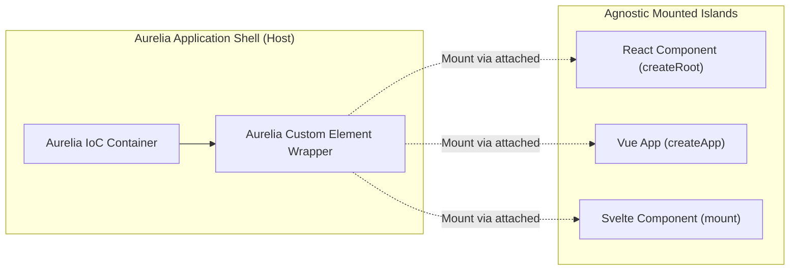
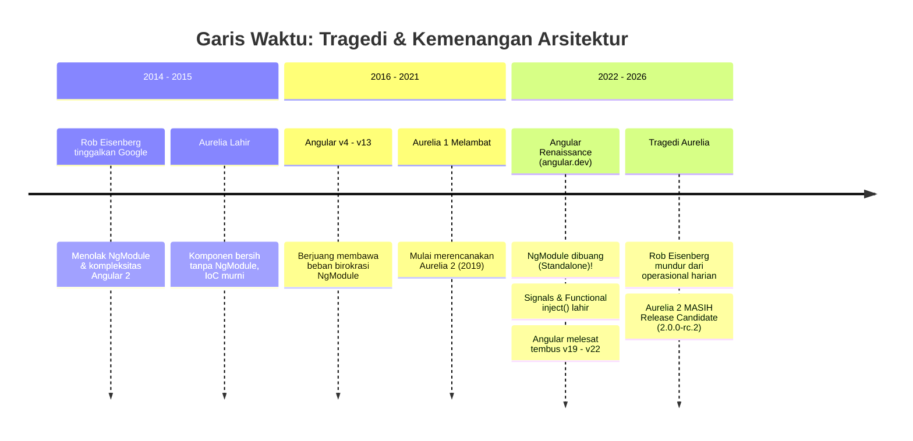

Dalam hampir setiap forum teknologi, grup pengembang, dan linimasa media sosial, ada satu perdebatan klasik yang tak pernah usai: *"Mana yang lebih baik: React, Vue, atau Angular?"* 

Bagi mereka yang sekadar melihat permukaan—bahwa ketiganya sama-sama merender elemen ke DOM browser—pertanyaan ini terdengar masuk akal. Namun bagi para insinyur yang telah menyelami arsitektur perangkat lunak lintas paradigma, perdebatan ini sesungguhnya cacat sejak premis awalnya. Ini adalah bentuk nyata dari apa yang dalam logika formal disebut sebagai **category mistake** (kesalahan kategori): membandingkan entitas yang berdiri di atas fondasi, filosofi desain, dan tujuan rekayasa yang sama sekali tidak *apple-to-apple*.

Artikel ini adalah sebuah catatan reflektif dan investigasi teknis mendalam tentang dinamika tersebut. Kita akan membedah bagaimana budaya *enterprise engineering* dari dunia Java Spring, C# .NET, dan NestJS merasuki browser lewat **AngularJS** dan **Aurelia**, mengapa membandingkan React dengan mereka adalah ilusi, bagaimana **Vue** dan **Svelte** sebenarnya berdiri di spektrum yang sangat berbeda, hingga salah satu plot twist sejarah paling dramatis dalam dunia open-source: **bagaimana Aurelia yang sebenarnya merupakan "Proto-Astro" justru tertinggal dalam ironi peradaban, sementara Angular di [angular.dev](https://angular.dev/) melesat memenangkan 'the long game'.**

---

## 1. Kesalahan Kategori: Mengapa Membandingkan React dengan Angular Itu Keliru

Mari kita mulai dari hal yang paling fundamental. Ketika seseorang bertanya, *"Pilih React atau Angular untuk project saya?"*, ia sering kali menganggap keduanya adalah dua produk dari etalase yang sama. Padahal, secara taksonomi rekayasa perangkat lunak:

* **React adalah UI Runtime / View Library.**  
  React tidak pernah memproklamirkan dirinya sebagai sebuah *framework*. Pada intinya, React adalah mesin penilai state fungsional, penjadwal rekonsiliasi VDOM, dan pipa transformasi data satu arah (*unidirectional data flow*). Di React, tidak ada konsep *Inversion of Control (IoC) Container*, tidak ada *Dependency Injection (DI)* sejati, tidak ada lapisan *Service Provider*, dan tidak ada batasan arsitektural tentang bagaimana logika bisnis harus ditata. Anda bebas membuang logika ke hook, Redux, Zustand, atau sekadar fungsi pembantu murni.

* **AngularJS, Angular, dan Aurelia adalah Enterprise Application Frameworks.**  
  Framework-framework ini tidak hanya peduli bagaimana sebuah tombol dirender di layar. Mereka peduli tentang **arsitektur aplikasi berskala besar**: bagaimana dependensi diinjeksikan, bagaimana siklus hidup (*lifecycle*) diatur secara formal, bagaimana pemisahan tanggung jawab (*Separation of Concerns*) ditegakkan antara tampilan (*View*) dan model presentasi (*ViewModel*), serta bagaimana sebuah tim yang terdiri dari ratusan insinyur dapat bekerja dengan konvensi yang seragam tanpa menciptakan anarki kode.

Membandingkan React dengan Angular/Aurelia sama kelirunya dengan membandingkan **Express.js** dengan **Java Spring Boot**, atau membandingkan **Pug/Handlebars** dengan **NestJS**. Keduanya beroperasi pada kedalaman abstraksi yang berbeda.

```mermaid
graph TD
    subgraph Enterprise["Enterprise Paradigm (Spring / .NET / NestJS Mindset)"]
        DI["IoC Container & Dependency Injection"]
        VM["Class-based ViewModel & Decorators"]
        SOC["Strict Separation of Concerns"]
        DI --> VM --> SOC
    end

    subgraph Mainstream["Mainstream UI Runtime (React-like)"]
        Fn["Pure Functional Composition"]
        JSX["JSX / JS-First Runtime"]
        Recon["Virtual DOM / Reconciler Engine"]
        Fn --> JSX --> Recon
    end

    subgraph Progressive["HTML-First & Natural Web (Vue / Svelte)"]
        SFC["Single-File Components"]
        NatHTML["Native HTML Template Syntax"]
        ReactComp["Direct Reactivity / Compiler"]
        SFC --> NatHTML --> ReactComp
    end
```



---

## 2. Budaya Java Spring dan C# .NET di Dalam Browser

Jika Anda pernah membangun backend monolitik atau *microservices* enterprise menggunakan **Java Spring Boot**, **C# ASP.NET Core**, atau kembarannya di Node.js, **NestJS**, Anda pasti sangat mengenali pola-pola ini:
1. **Inversion of Control (IoC) Container**: Objek tidak diinstansiasi secara manual dengan `new Service()`, melainkan dikelola dan disediakan oleh *container*.
2. **Dependency Injection (DI)**: Kelas hanya mendeklarasikan dependensi yang ia butuhkan lewat constructor atau anotasi (`@Autowired`, `@Injectable()`).
3. **Class-based Architecture & Annotations/Decorators**: Setiap modul, controller, dan repository memiliki batas tanggung jawab yang tegas.

Pola pikir inilah yang dibawa oleh **AngularJS** pada tahun 2012 dan disempurnakan oleh **Aurelia** pada tahun 2015 ke dalam browser.

### Evolusi AngularJS: Dari '$scope Soup' Menuju Pure Component Architecture

Banyak developer mengira AngularJS (1.x) hanyalah masa lalu yang berantakan dengan polusi `$scope` di mana-mana. Namun di akhir masa hidupnya (v1.5 hingga v1.8.x), AngularJS telah berevolusi menjadi arsitektur komponen murni (*Pure Component Architecture*):

```typescript
// AngularJS 1.8 — Strict Dependency Injection & Component Architecture
export class CatalogService {
  static $inject: string[] = ['$timeout'];
  constructor(private $timeout: angular.ITimeoutService) {}

  getAll() {
    return [/* enterprise services */];
  }
}

export class AppRootController implements angular.IComponentController {
  static $inject = ['catalogService']; // IoC Token Injection
  services = [];

  constructor(private catalogService: CatalogService) {}

  $onInit(): void {
    // Lifecycle hook formal tanpa ketergantungan $scope
    this.services = this.catalogService.getAll();
  }
}

export const AppRootComponent: angular.IComponentOptions = {
  controller: AppRootController,
  template: `
    <main>
      <service-card 
        ng-repeat="item in $ctrl.services track by item.id"
        item="item" 
        on-remove="$ctrl.removeItem(id)">
      </service-card>
    </main>
  `
};
```

Pola di atas—membuang `$scope`, meniadakan `ng-controller`, menggunakan alur data satu arah (`<` untuk input, `&` untuk output), dan menegakkan `strictDi: true`—adalah jembatan arsitektural yang kemudian menginspirasi lahirnya generasi framework enterprise berikutnya.

---

## 3. Spektrum Desain: React vs Vue Bukan Apple-to-Apple, Vue Sebanding dengan Svelte

Sering kali pengembang juga menyamakan **React** dan **Vue** sebagai rival seimbang dalam satu kategori. Padahal, pendekatan filosofis keduanya sangat bertolak belakang:

### React: JavaScript-First (HTML Adalah JavaScript)
Dalam pandangan React, HTML adalah detail implementasi yang harus tunduk pada JavaScript. Melalui JSX, setiap tag `<div>` atau `<button>` sesungguhnya adalah panggilan fungsi `React.createElement(...)`. Anda harus memikirkan *closures*, immutability array (`[...items]`), dan dependensi hook (`useEffect([a, b])`). Ini adalah dunia pemrograman fungsional murni.

### Vue & Svelte: HTML-First (Memuliakan Standar Web)
Sebaliknya, **Vue** dan **Svelte** menganut prinsip **HTML-First**:
* Anda menulis HTML yang benar-benar terasa seperti HTML, bukan JavaScript berkedok tag XML.
* Templating menggunakan direktif deklaratif yang alami (`v-if` di Vue, `{#if}` di Svelte).
* Keduanya menghormati struktur web tradisional: template, script, dan style terisolasi dalam satu atap (*Single-File Components* / SFC).

Oleh karena itu, **Vue secara jujur paling sebanding (apple-to-apple) dengan Svelte**, bukan dengan React. Keduanya berupaya meminimalkan *ceremony* dan *overhead* kognitif pengembang dengan membiarkan kita menulis kode yang paling mendekati sintaks asli web browser:

| Aspek | React-like (React, Solid) | Vue | Svelte |
|---|---|---|---|
| **Mental Model** | JS-first, JSX fungsional | HTML-first, SFC deklaratif | HTML-first, Compiler murni |
| **Reaktivitas** | VDOM Reconciliation / Signals | Proxy Reactivity Runtime | Compile-time Runes (`$state`) |
| **Rasa Menulis Kode** | Memanipulasi objek JS | Menulis Web Component standar | Menulis HTML/JS native |
| **Kultur Engineering** | Fungsional, Unidirectional | Pragmatis, Progresif | Minimalis, Zero-Runtime |

---

## 4. Plot Twist: Kemampuan Agnostik Aurelia dan Realitas "Proto-Astro"

Di sinilah kita sampai pada bagian paling menarik: **AureliaJS**.

Diciptakan pada tahun 2015 oleh **Rob Eisenberg**—seorang arsitek perangkat lunak terkemuka yang sebelumnya merancang Durandal dan sempat menjadi salah satu perancang awal Angular 2 di Google—Aurelia dibangun dengan sebuah janji: *kepatuhan mutlak pada standar web tanpa kompromi*.

Aurelia tidak menciptakan bahasa template yang aneh. Ia menggunakan standar Web Components, atribut HTML standar, dan class JavaScript/TypeScript murni dengan decorator TC39. 

Karena arsitekturnya yang begitu patuh pada standar DOM dan siklus hidup komponen (`attached`, `detaching`), **Aurelia memiliki kemampuan unik: ia mampu menampung komponen dari library lain (React, Vue, Svelte) secara agnostik di dalam Custom Element-nya!**



Secara konsep, kemampuan ini adalah **cikal bakal dari Islands Architecture** yang di kemudian hari dipopulerkan dan disempurnakan oleh **Astro**! Aurelia sudah mampu melakukan arsitektur pulau ini bertahun-tahun sebelum Astro lahir.

### Namun, Mengapa Aurelia Tidak Meledak Seperti Astro?

Di sinilah letak kritik arsitektural dan sosiologis saya terhadap ekosistem serta maintainer Aurelia:

#### 1. Bloated Glue Code di Dokumentasi
Ketika Anda ingin memasang komponen React di **Astro**, Anda hanya perlu menjalankan:
```bash
npx astro add react
```
Lalu di halaman Astro, Anda cukup menulis:
```astro
---
import ReactCounter from './ReactCounter.jsx';
---
<ReactCounter client:visible />
```
Selesai. Bersih, anggun, tanpa satu baris pun kode sampah (*zero boilerplate*).

Sekarang bandingkan dengan apa yang harus Anda lakukan di **Aurelia**. Dokumentasi resmi dan contoh komunitas Aurelia membiarkan developer menulis *glue code manual* yang sangat bloated:

```typescript
// Glue Code Manual di Aurelia 2 (Agnostic Bridge)
@customElement({
  name: 'react-host-counter',
  template: `<div class="react-mount-node"></div>`
})
export class ReactHostCounter {
  @bindable value: number = 0;
  @bindable onCounterChange?: (val: number) => void;

  private element = resolve(INode) as HTMLElement;
  private reactRoot: ReactDOM.Root | null = null;

  attached(): void {
    const mountPoint = this.element.querySelector('.react-mount-node');
    if (mountPoint && !this.reactRoot) {
      this.reactRoot = ReactDOM.createRoot(mountPoint);
      this.renderReact();
    }
  }

  valueChanged(): void {
    this.renderReact(); // Manual synchronization!
  }

  private renderReact(): void {
    if (!this.reactRoot) return;
    this.reactRoot.render(
      React.createElement(ReactCounter, {
        value: this.value,
        onIncrement: () => {
          this.value++;
          this.onCounterChange?.(this.value);
        }
      })
    );
  }

  detaching(): void {
    this.reactRoot?.unmount(); // Manual cleanup lifecycle!
  }
}
```

Developer dipaksa mengelola siklus hidup DOM secara manual, menangani sinkronisasi `valueChanged()` bolak-balik, dan membersihkan memori saat `detaching`. Tidak ada adapter resmi yang dipoles matang untuk menghapus beban ini dari pundak pengembang.

#### 2. Kelesuan Komunitas dan Siklus Rilis yang Terlalu Panjang
Komunitas **Astro** sangat progresif, agresif, dan memiliki disiplin produk yang luar biasa tinggi. Mereka mengutamakan *Developer Experience (DX)* di atas segalanya. Jika ada gesekan (*friction*) sedikit saja dalam cara developer menulis kode, tim inti Astro akan segera merekayasa compiler untuk memusnahkannya.

Sementara di Aurelia, transisi dari Aurelia 1 menuju Aurelia 2 memakan waktu bertahun-tahun tanpa kejelasan roadmap bagi pasar enterprise. Dokumentasinya sering kali tertinggal dari kode aslinya, plugin pihak ketiga terbengkalai, dan pengembang perlahan mengalami kelelahan (*community fatigue*).

---

## 5. Ironi Terbesar Sejarah: Angular.dev vs Aurelia

Puncak dari seluruh dinamika ini adalah sebuah ironi sejarah yang sangat dramatis ketika kita membandingkan status **Angular di [angular.dev](https://angular.dev/)** dengan **Aurelia di [aurelia.io](https://aurelia.io/)** hari ini.

### 2014: Sang Idealis Meninggalkan Google
Mari mengingat kembali sejarahnya. Pada akhir 2014, **Rob Eisenberg** masuk ke dalam tim Angular di Google untuk merancang Angular 2. Namun, terjadi gesekan visi yang hebat:
* Google menginginkan sebuah ekosistem raksasa yang serba terstruktur dengan `NgModule`, compiler khusus yang kaku, dan dependensi tooling yang berat.
* Rob Eisenberg menginginkan kemurnian: ia tidak ingin ada `NgModule`. Ia ingin komponen dideklarasikan secara mandiri (*standalone*), berbasis kelas ES6/TypeScript standar, dan memanfaatkan web standards tanpa birokrasi framework.

Karena kompromi tidak tercapai, Rob memilih keluar dari Google dengan integritas tinggi dan mendirikan **Aurelia (2015)**. 

Selama bertahun-tahun (2015–2020), para pembela Aurelia dengan bangga menyatakan:  
> *"Lihat Aurelia! Kami tidak butuh NgModule yang rumit seperti Angular 2. Kelas kami bersih, dependency injection kami natural, dan kode kami bebas dari polusi boilerplate Google!"*

### 2026: The Long Game dan Ironi Peradaban
Namun waktu adalah hakim yang paling adil dalam dunia perangkat lunak. Coba periksa apa yang terjadi hari ini di tahun 2026:



1. **Angular Melakukan Renaissance Spektakuler ([angular.dev](https://angular.dev/))**:
   * Google dan tim inti Angular mendengarkan industri. Mereka secara resmi **membuang `NgModule`** dan beralih ke **Standalone Components**—persis seperti yang diinginkan Rob Eisenberg satu dekade lalu!
   * Mereka mengadopsi **Signals** (`signal()`, `computed()`) yang membawa reaktivitas secepat SolidJS dan Vue.
   * Mereka merombak Dependency Injection menjadi fungsional lewat `inject(Service)` yang sangat elegan.
   * Mereka mengganti sintaks kuno `*ngIf` dan `*ngFor` dengan blok compiler modern: `@if`, `@for`, `@switch`, dan `@defer`.
   * Dengan disiplin korporat dan komunitas raksasa, Angular merilis versi mayor baru setiap 6 bulan secara konsisten, melompat dari Angular 2 hingga menembus **Angular v19, v20, hingga v22**!

2. **Sementara Aurelia Terjebak dalam Limbo**:
   * Rob Eisenberg akhirnya mundur dari kepemimpinan harian untuk fokus pada proyek-proyek lain.
   * Proyek Aurelia ditinggalkan kepada segelintir pengembang komunitas yang berjuang keras namun kelelahan.
   * Dan hari ini, Aurelia 2... **masih berstatus Release Candidate (`2.0.0-rc.2`)!** 

Selama hampir satu dekade, saat Angular melahirkan 20 versi mayor dan mentransformasikan dirinya menjadi salah satu framework paling modern dan bersih di industri, Aurelia bahkan belum berhasil menerbitkan rilis versi 2.0.0 yang stabil di npm.

Ini adalah sebuah tragedi arsitektural: **ide yang benar, arsitektur yang jenius, tetapi kalah telak oleh faktor eksekusi, Developer Experience, dan momentum komunitas.**

---

## 6. Pembuktian Kode: Tiga Generasi Arsitektur di Atas Bun + Vite

Untuk membuktikan bahwa seluruh analisis ini bukan sekadar teori di atas kertas, saya telah membangun repositori komparasi hidup di lingkungan modern menggunakan **Bun** dan **Vite**:

### 1. Modern Angular (v19/v22) — Puncak Evolusi Enterprise
```typescript
// Implementasi nyata: /angular/src/main.ts
import { Component, signal, computed, inject } from '@angular/core';

@Component({
  selector: 'app-root',
  standalone: true, // Tanpa NgModule!
  template: `
    <div class="container">
      <h1>Modern Angular (angular.dev)</h1>
      <p>Signal State: {{ counter() }} (Multiplier: {{ multiplier() }})</p>
      
      <!-- Native Control Flow Compiler -->
      @for (item of items(); track item.id) {
        <div class="card">{{ item.name }}</div>
      } @empty {
        <p>Tidak ada data layanan.</p>
      }
    </div>
  `
})
export class AppRoot {
  private catalog = inject(EnterpriseCatalogService); // Clean functional DI
  counter = signal(42);
  multiplier = computed(() => this.counter() * 2.5);
  items = signal(this.catalog.getAll());
}
```

### 2. Aurelia 2 — Keanggunan yang Terperangkap di Release Candidate
```typescript
// Implementasi nyata: /aureliajs/src/my-app.ts
import { customElement, resolve } from 'aurelia';

@customElement({
  name: 'my-app',
  template: `
    <div class="container">
      <h1>Aurelia 2</h1>
      <div repeat.for="item of items" class="card">
        \${item.name}
      </div>
      <!-- Agnostic React Island Wrapper -->
      <react-host-counter value.bind="sharedCounter"></react-host-counter>
    </div>
  `
})
export class MyApp {
  private catalog = resolve(IEnterpriseOrderService); // IoC Token
  public items = this.catalog.getOrders();
  public sharedCounter = 42;
}
```

---

## 7. Refleksi & Pelajaran Berharga bagi Software Engineer

Apa yang bisa kita petik dari seluruh perjalanan arsitektur ini?

1. **Hormati Batas Kategori Desain**: Jangan lagi membandingkan React dengan Angular secara serampangan di media sosial. Pahami bahwa yang satu adalah mesin render fungsional murni (*view runtime*), sedangkan yang lain adalah ekosistem aplikasi enterprise yang membawa filosofi Spring dan .NET ke browser.
2. **Keanggunan Arsitektur Tanpa Disiplin DX Adalah Kesia-siaan**: Aurelia memiliki mesin yang luar biasa bersih dan potensi agnostik sekelas Astro sejak 2015. Namun karena membiarkan pengembang menulis *glue code* yang bloated dan gagal menghadirkan rilis yang stabil, ia ditinggalkan oleh gelombang zaman.
3. **The Long Game Selalu Dimenangkan oleh Eksekusi dan Komunitas**: Angular sempat menjadi bahan cemoohan di era v2 hingga v8 karena birokrasi `NgModule`-nya. Namun dedikasi tim Google dan komunitasnya untuk terus berbenah secara disiplin setiap 6 bulan akhirnya membuahkan hasil: Angular di `angular.dev` hari ini adalah salah satu framework frontend paling modern, kencang, dan bersih yang pernah ada di muka bumi.

Teknologi boleh berganti nama dan versi, tetapi kebijaksanaan dalam memilih arsitektur selalu berakar pada pemahaman kita terhadap **mengapa sebuah teknologi itu diciptakan**.

---
*Kode sumber demonstrasi lengkap untuk AngularJS (1.8), Modern Angular (v19/v22), dan Aurelia 2 dapat ditinjau di repositori studi arsitektur lokal.*
