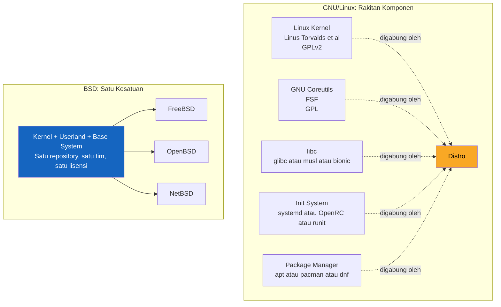
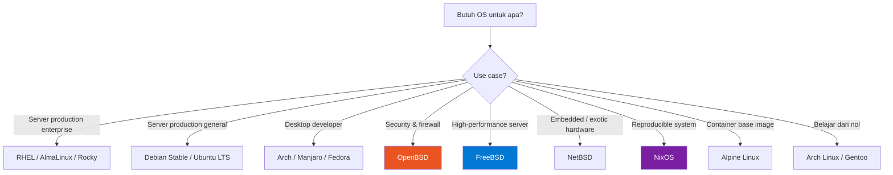

Ada diskusi yang tidak pernah benar-benar selesai di kalangan orang-orang yang serius tentang sistem operasi: **Linux atau BSD?**

Bukan karena salah satunya lebih baik secara absolut. Tapi karena keduanya mewakili dua filosofi yang berbeda secara fundamental tentang bagaimana sebuah sistem operasi seharusnya dibangun, dikelola, dan didistribusikan. Memahami perbedaan ini bukan sekadar trivia teknis — ini adalah cara memahami _mengapa_ sebuah sistem berperilaku seperti yang ia lakukan, dan _mengapa_ komunitas di baliknya berpikir seperti yang mereka pikirkan.

---

## Asal-Usul: Dua Jalur dari Unix yang Sama

Keduanya berakar dari Unix — sistem operasi yang lahir di Bell Labs, AT&T, pada akhir 1960an. Tapi jalur yang mereka tempuh setelah itu sangat berbeda.

**BSD** (Berkeley Software Distribution) lahir dari University of California, Berkeley, pada 1970an. Ketika AT&T mendistribusikan Unix ke universitas-universitas, para peneliti di Berkeley mulai memodifikasi dan menambahkan fitur-fitur baru. Hasilnya adalah BSD — sebuah varian Unix yang dikembangkan secara kohesif oleh satu institusi, dengan satu visi arsitektural yang konsisten.

**Linux** lahir dari jalur yang sama sekali berbeda. Linus Torvalds menulis kernel Linux pada 1991 sebagai proyek pribadi — bukan sebagai pengganti Unix, tapi sebagai eksperimen. Yang membuat Linux menjadi sistem operasi yang lengkap adalah ketika ia digabungkan dengan **GNU** — kumpulan utilitas yang sudah lebih dulu dikembangkan oleh Richard Stallman dan Free Software Foundation sejak 1983.

Di sinilah perbedaan fundamental pertama muncul.

---

## Jubah, Badan, dan Jantung: Anatomi yang Berbeda

Analogi yang paling tepat untuk menggambarkan perbedaan ini adalah:

**Di dunia Linux (GNU/Linux):**

```
┌─────────────────────────────────────────┐
│  JUBAH: Userland / Utilitas             │
│  (GNU coreutils, bash, glibc, atau      │
│   alternatifnya: musl, busybox, dll)    │
├─────────────────────────────────────────┤
│  BADAN: Init system, package manager,  │
│  libc, toolchain                        │
│  (systemd/OpenRC/runit, apt/pacman/dnf) │
├─────────────────────────────────────────┤
│  JANTUNG: Linux Kernel                  │
│  (dikembangkan terpisah oleh komunitas  │
│   global, dipimpin Linus Torvalds)      │
└─────────────────────────────────────────┘
```

Ketiga lapisan ini **dikembangkan secara terpisah** oleh entitas yang berbeda, dengan lisensi yang berbeda, dengan roadmap yang berbeda. Kernel Linux punya lisensi GPLv2. GNU coreutils punya lisensi GPL. Tapi `musl` (alternatif glibc) punya lisensi MIT. `busybox` punya lisensi GPLv2. Setiap distro Linux pada dasarnya adalah **kurasi** dari komponen-komponen ini — memilih kernel versi berapa, init system apa, libc mana, package manager apa, dan seterusnya.

**Di dunia BSD:**

```
┌─────────────────────────────────────────┐
│                                         │
│  SATU PAKET: Kernel + Userland +        │
│  Base System                            │
│                                         │
│  Dikembangkan bersama, dirilis bersama, │
│  didokumentasikan bersama               │
│                                         │
└─────────────────────────────────────────┘
```

Di BSD, kernel dan userland adalah **satu proyek**. FreeBSD mengembangkan kernel FreeBSD _dan_ utilitas dasarnya _dan_ libc-nya _dan_ toolchain-nya dalam satu repository yang sama, dengan satu tim yang sama, dengan satu visi yang sama. Ketika kita install FreeBSD, kita mendapat sistem yang dirancang sebagai satu kesatuan — bukan rakitan dari komponen-komponen yang kebetulan bisa bekerja bersama.



---

## Lisensi: GPL vs BSD License

Ini bukan detail kecil — ini adalah perbedaan filosofis yang sangat dalam.

**GPL (GNU General Public License)** adalah lisensi yang "viral" atau "copyleft". Kalau kita menggunakan kode GPL dalam proyekmu, proyekmu juga harus GPL. Stallman merancang ini dengan sengaja: ia ingin memastikan bahwa software bebas tetap bebas, tidak bisa "diprivatisasi" oleh perusahaan.

**BSD License** adalah lisensi yang jauh lebih permisif. Kita bisa menggunakan kode BSD dalam proyek proprietary tanpa harus membuka source code-mu. Satu-satunya syarat adalah attribution — kita harus mencantumkan kredit ke proyek asalnya.

Implikasinya sangat nyata:

- **Apple macOS dan iOS** menggunakan kernel yang berasal dari BSD (Darwin/XNU, yang berbasis FreeBSD dan Mach). Apple bisa melakukan ini karena lisensi BSD mengizinkannya — mereka tidak perlu membuka source code macOS.
- **Sony PlayStation** menggunakan FreeBSD sebagai basis sistem operasinya.
- **Netflix** menggunakan FreeBSD untuk sebagian besar infrastruktur streaming-nya.
- **WhatsApp** di masa awalnya berjalan di FreeBSD.

Ini tidak mungkin terjadi dengan Linux kernel yang GPL — atau setidaknya, jauh lebih rumit secara legal.

---

## Tiga BSD Utama: Satu Akar, Tiga Karakter

Setelah AT&T menggugat BSD pada awal 1990an (kasus yang akhirnya diselesaikan di luar pengadilan), kode BSD yang "bersih" dari klaim AT&T menjadi basis dari tiga proyek yang masih aktif sampai sekarang.

### FreeBSD: Performa dan Skalabilitas

FreeBSD adalah yang paling populer dan paling banyak digunakan di production. Fokusnya adalah **performa, stabilitas, dan fitur lengkap**.

```
FreeBSD Highlights:
├── ZFS sebagai filesystem default (bukan sekadar opsi)
├── DTrace — dynamic tracing yang sangat powerful
├── Jails — container sebelum Docker ada
├── Ports system — build dari source dengan kontrol penuh
├── pkg — binary package manager yang mature
└── Digunakan oleh: Netflix, PlayStation, WhatsApp, Juniper
```

FreeBSD punya konsep **Jails** yang menarik — ini adalah mekanisme isolasi proses yang lahir jauh sebelum Docker dan container menjadi populer. Setiap jail adalah environment yang terisolasi dengan filesystem, network, dan process space sendiri. Docker pada dasarnya mengimplementasikan konsep yang sama, tapi dengan abstraksi yang lebih tinggi.

### OpenBSD: Keamanan di Atas Segalanya

OpenBSD adalah BSD yang paling opinionated, dan dengan bangga mengakuinya. Motto mereka: **"Only two remote holes in the default install, in a long time!"**

Theo de Raadt, pendiri OpenBSD, memimpin proyek ini dengan filosofi yang sangat jelas: **keamanan bukan fitur tambahan, keamanan adalah fondasi**. Setiap baris kode di-audit secara manual. Setiap fitur yang tidak perlu dihapus. Setiap default dikonfigurasi untuk keamanan maksimal, bukan kenyamanan.

```
OpenBSD Contributions:
├── OpenSSH — hampir semua SSH di dunia menggunakan ini
├── LibreSSL — fork OpenSSL yang lebih bersih
├── pf (Packet Filter) — firewall yang kemudian diadopsi FreeBSD dan macOS
├── OpenBGPD, OpenNTPD, OpenSMTPD
└── pledge() dan unveil() — syscall sandboxing yang elegan
```

OpenSSH adalah kontribusi OpenBSD yang paling berdampak. Hampir setiap server di dunia — Linux, macOS, BSD — menggunakan OpenSSH. Setiap kali kita `ssh` ke server, kita menggunakan kode yang lahir dari proyek yang memprioritaskan keamanan di atas segalanya.

### NetBSD: Portabilitas Ekstrem

NetBSD punya moto yang sederhana: **"Of course it runs NetBSD"**. Fokusnya adalah berjalan di sebanyak mungkin arsitektur hardware yang berbeda.

NetBSD pernah berjalan di lebih dari 57 platform berbeda — dari VAX kuno, Amiga, sampai toaster (secara harfiah, ada yang pernah menjalankan NetBSD di toaster). Ini bukan gimmick — ini adalah bukti dari desain yang sangat bersih dan portabel.

Untuk embedded systems dan hardware eksotis, NetBSD sering menjadi pilihan pertama karena kemudahan porting-nya.

### DragonFly BSD: Concurrency yang Berbeda

DragonFly BSD lahir pada 2003 ketika Matt Dillon fork dari FreeBSD 4.x karena tidak setuju dengan arah pengembangan SMP (Symmetric Multi-Processing) di FreeBSD. Ia mengimplementasikan pendekatan yang sama sekali berbeda untuk concurrency — **LWKT (Light Weight Kernel Threads)** dan **HAMMER/HAMMER2** filesystem yang unik.

DragonFly adalah BSD yang paling "eksperimental" dari keempat yang utama, tapi ide-idenya sering menjadi inspirasi untuk proyek lain.

---

## Dunia Linux: Dari VVIP sampai Komunitas

Di sisi Linux, keragamannya jauh lebih luas — justru karena sifat "jubah terpisah" tadi memungkinkan siapapun merakit sistem sesuai kebutuhan.

### Enterprise Tier: RHEL dan Turunannya

**Red Hat Enterprise Linux (RHEL)** adalah Linux untuk enterprise yang serius. Ia berbayar, ia punya support kontrak, dan ia adalah pilihan default untuk infrastruktur korporat besar di seluruh dunia.

```
RHEL Ecosystem:
├── RHEL (berbayar, support penuh)
├── CentOS Stream (upstream dari RHEL, gratis)
├── AlmaLinux (binary-compatible dengan RHEL, gratis)
├── Rocky Linux (binary-compatible dengan RHEL, gratis)
└── Oracle Linux (binary-compatible dengan RHEL, dengan Unbreakable Kernel)
```

Di balik daftar yang terlihat rapi itu, ada drama yang cukup sengit.

**CentOS lama (sebelum 2021)** adalah "downstream clone" dari RHEL — artinya Red Hat rilis RHEL dulu, lalu komunitas ambil source code-nya (karena GPL, Red Hat wajib mempublikasikannya), buang semua branding Red Hat, compile ulang, dan jadilah CentOS. Hasilnya: RHEL gratis. Persis sama, byte-for-byte kompatibel, cuma tanpa support kontrak. Inilah yang dipakai jutaan server di seluruh dunia selama bertahun-tahun.

Red Hat tentu tidak senang — mereka menjual support RHEL, tapi orang-orang memakai CentOS gratis. Jadi pada 2014, Red Hat mengakuisisi CentOS project, meskipun kebijakannya baru benar-benar berubah pada 2020.

Pengumumannya mengejutkan: **CentOS 8 akan end-of-life Desember 2021** — padahal seharusnya sampai 2029. Dan CentOS ke depannya berubah menjadi **CentOS Stream** — bukan lagi downstream dari RHEL, tapi _upstream_. Artinya CentOS Stream sekarang adalah "preview" dari RHEL berikutnya, bukan clone-nya. Lebih rolling, lebih eksperimental, tidak cocok untuk production server yang butuh stabilitas jangka panjang.

Komunitas marah besar. Bayangkan kita sudah deploy ratusan server dengan CentOS 8 dengan asumsi support sampai 2029, lalu tiba-tiba dikasih tahu bahwa support-nya berakhir tahun ini. Bukan tahun depan — tahun ini.

Reaksinya tidak lama datang:

- **Rocky Linux** — dibuat oleh Gregory Kurtzer, salah satu co-founder CentOS original. Namanya diambil dari Rocky McGaugh, co-founder CentOS lainnya yang sudah meninggal sebelum sempat melihat drama ini.
- **AlmaLinux** — dibuat oleh CloudLinux, perusahaan yang memang sudah lama berkecimpung di ekosistem RHEL untuk hosting provider.

Keduanya mengisi posisi yang sama persis dengan CentOS lama: binary-compatible dengan RHEL, gratis, stabil untuk production. Komunitas pindah massal ke keduanya, dan sampai sekarang keduanya masih aktif dan sehat.

Ini adalah salah satu contoh paling nyata tentang bagaimana lisensi GPL bekerja dalam praktiknya — Red Hat _bisa_ mengubah kebijakan CentOS, tapi mereka tidak bisa mencegah komunitas menggunakan source code RHEL yang sama untuk membuat penggantinya. Itulah kekuatan copyleft yang Stallman maksudkan sejak awal.

**SUSE Linux Enterprise** ceritanya berbeda — ia memang dari awal enterprise berbayar, tidak ada drama seperti CentOS. Kekuatannya di Eropa karena SUSE adalah perusahaan Jerman, dan banyak perusahaan Eropa lebih memilih vendor lokal untuk infrastruktur kritis — ada faktor kepercayaan dan regulasi data yang bermain di sini. Untuk workload SAP khususnya, SUSE punya sertifikasi dan optimasi yang sangat dalam — SAP sendiri merekomendasikan SUSE sebagai platform utama untuk SAP HANA.

### Debian dan Turunannya: Fondasi yang Kokoh

**Debian** adalah salah satu distro tertua yang masih aktif, dan ia adalah fondasi dari ekosistem yang sangat luas:

```
Debian Family:
├── Debian (stable, testing, unstable)
├── Ubuntu (berbasis Debian, siklus rilis lebih cepat)
│   ├── Ubuntu LTS (dukungan 5 tahun)
│   ├── Kubuntu, Xubuntu, Lubuntu (desktop berbeda)
│   └── Ubuntu Server
├── Linux Mint (berbasis Ubuntu, fokus desktop)
├── Pop!_OS (berbasis Ubuntu, dari System76)
├── Kali Linux (berbasis Debian, untuk security)
└── Raspberry Pi OS (berbasis Debian, untuk ARM)
```

Debian punya filosofi yang sangat kuat tentang software freedom — ia punya **Debian Free Software Guidelines (DFSG)** yang mendefinisikan apa yang dianggap "free software" untuk bisa masuk ke repository utama.

### Arch Linux dan Filosofi Rolling Release

**Arch Linux** adalah distro yang memaksa kita memahami sistem dari bawah — tidak ada installer GUI, tidak ada konfigurasi default yang nyaman. Kita membangun sistem dari nol, memilih setiap komponen.

Arch menggunakan model **rolling release** — tidak ada versi "Arch 1.0" atau "Arch 2.0". Sistem selalu diupdate ke versi terbaru dari semua paket. Ini berarti kita selalu punya software terbaru, tapi juga berarti ada risiko breaking changes yang lebih tinggi.

**Manjaro** adalah Arch yang lebih ramah pengguna — ia menggunakan repository Arch tapi dengan delay beberapa minggu untuk memastikan stabilitas.

**Void Linux** adalah distro yang menarik karena ia menggunakan **musl** sebagai libc (bukan glibc) dan **runit** sebagai init system (bukan systemd) — pilihan yang sangat opinionated dan menarik bagi mereka yang ingin sistem yang lebih minimal.

### NixOS: Paradigma yang Berbeda

**NixOS** adalah distro yang paling berbeda dari semua yang ada. Ia menggunakan Nix package manager sebagai fondasinya, yang berarti seluruh sistem dikonfigurasi secara deklaratif dalam satu file:

```nix
# /etc/nixos/configuration.nix
{ config, pkgs, ... }:
{
  boot.loader.grub.device = "/dev/sda";
  networking.hostName = "myserver";

  services.nginx.enable = true;
  services.postgresql.enable = true;

  users.users.dev = {
    isNormalUser = true;
    extraGroups = [ "wheel" "docker" ];
  };

  environment.systemPackages = with pkgs; [
    vim git curl
  ];
}
```

Jalankan `nixos-rebuild switch` dan sistem dikonfigurasi sesuai deklarasi. Rollback ke konfigurasi sebelumnya? Satu command. Ini adalah konsep yang sama dengan yang kita bahas di artikel WSL2 tentang Nix, tapi diterapkan ke seluruh sistem operasi.

### Alpine Linux: Minimal untuk Container

**Alpine Linux** menggunakan musl libc dan busybox — bukan glibc dan GNU coreutils. Hasilnya adalah sistem yang sangat kecil: image Docker Alpine hanya sekitar 5MB, dibanding Ubuntu yang bisa 70MB+.

Alpine adalah pilihan default untuk banyak Docker base image justru karena ukurannya yang kecil. Tapi ia punya trade-off: beberapa software yang mengasumsikan glibc tidak bisa berjalan langsung di Alpine tanpa modifikasi.

---

## Perbandingan Langsung: Kapan Pilih Apa



---

## Perbedaan Teknis yang Sering Diabaikan

### Init System

Di Linux, ini adalah salah satu perdebatan paling panas: **systemd vs yang lainnya**.

**systemd** adalah init system yang sekarang digunakan oleh hampir semua distro Linux besar (Debian, Ubuntu, Fedora, Arch, dll). Ia bukan hanya init system — ia adalah suite lengkap yang mengelola services, logging (journald), networking (networkd), DNS (resolved), dan banyak lagi. Kritiknya: ia melanggar filosofi Unix "do one thing well" dengan menjadi terlalu monolitik.

Alternatifnya: **OpenRC** (digunakan Gentoo dan Alpine), **runit** (digunakan Void Linux), **s6**, **dinit**.

Di BSD, tidak ada perdebatan ini. FreeBSD menggunakan **rc** system yang sederhana dan sudah ada sejak lama. OpenBSD menggunakan **rc.d** yang sangat minimalis. Tidak ada systemd, tidak ada kontroversi.

### Filesystem

**ZFS** adalah salah satu alasan terkuat untuk mempertimbangkan FreeBSD. ZFS adalah filesystem yang menggabungkan volume manager dan filesystem dalam satu sistem, dengan fitur seperti:

- Copy-on-write (tidak ada data corruption saat crash)
- Snapshots yang instan dan efisien
- Checksumming end-to-end (deteksi silent data corruption)
- Compression transparan
- Deduplication
- RAID-Z (RAID yang lebih aman dari RAID-5 tradisional)

ZFS memang tersedia di Linux (via OpenZFS project), tapi di FreeBSD ia adalah first-class citizen — terintegrasi penuh dengan installer dan didukung secara native.

### Ports vs Packages

FreeBSD punya **Ports Collection** — sistem untuk mengkompilasi software dari source code dengan kontrol penuh atas compile-time options. Ini mirip dengan Gentoo's Portage di Linux, tapi lebih mature dan lebih luas.

```bash
# Install nginx dari ports (compile dari source)
cd /usr/ports/www/nginx
make install clean

# Atau install binary package
pkg install nginx
```

Keduanya bisa digunakan bersamaan — kita bisa install sebagian besar software via binary package untuk kecepatan, tapi compile dari source untuk software yang butuh konfigurasi khusus.

---

## Mengapa BSD Kurang Populer di Desktop?

Ini pertanyaan yang sering muncul, dan jawabannya tidak sesederhana "BSD lebih sulit".

**Driver hardware** adalah alasan utama. Linux punya dukungan hardware yang jauh lebih luas karena banyak vendor hardware yang menulis driver untuk Linux. Beberapa driver proprietary (GPU Nvidia, beberapa WiFi card) tidak tersedia untuk BSD atau tersedia dalam bentuk yang lebih terbatas.

**Ekosistem software** juga berperan. Steam, banyak aplikasi komersial, dan beberapa tools developer mengasumsikan Linux. FreeBSD punya Linux compatibility layer yang memungkinkan menjalankan binary Linux, tapi ini bukan solusi yang sempurna.

**Mindshare** — lebih banyak tutorial, lebih banyak Stack Overflow answers, lebih banyak dokumentasi untuk Linux. Ini menciptakan efek snowball yang sulit dilawan.

Tapi untuk **server**, BSD sangat kompetitif. Banyak infrastruktur internet yang berjalan di FreeBSD justru karena stabilitas dan performa jaringannya yang sangat baik.

---

## MINIX: OS yang Melahirkan Linux, dan Hidup di Dalam CPU Kamu

Sebelum bicara warisan BSD, ada satu sistem operasi yang tidak bisa dilewatkan — terutama bagi mahasiswa Computer Science — karena ia adalah bagian dari sejarah yang secara langsung melahirkan Linux, dan secara mengejutkan masih berjalan di dalam hardware kita sampai hari ini.

**MINIX** adalah sistem operasi yang ditulis oleh **Andrew S. Tanenbaum**, profesor ilmu komputer di Vrije Universiteit Amsterdam, pada 1987. Ia menulisnya bukan untuk dipakai di production, tapi untuk **tujuan pendidikan** — sebagai alat bantu mengajar mata kuliah sistem operasi. Kode sumbernya diterbitkan bersama buku _"Operating Systems: Design and Implementation"_, dan mahasiswa bisa membaca, mempelajari, bahkan memodifikasi setiap baris kodenya.

MINIX dirancang sebagai **microkernel** — filosofi arsitektur yang berbeda dari Linux yang monolitik. Dalam microkernel, kernel hanya menangani hal-hal yang paling fundamental: scheduling, IPC (inter-process communication), dan manajemen memori dasar. Semua hal lain — driver, filesystem, networking — berjalan sebagai proses di userspace, terpisah dari kernel.

```
Monolithic Kernel (Linux):
┌─────────────────────────────────────────┐
│  KERNEL SPACE                           │
│  ┌──────┐ ┌──────┐ ┌──────┐ ┌──────┐  │
│  │FS    │ │Net   │ │Driver│ │Sched │  │
│  └──────┘ └──────┘ └──────┘ └──────┘  │
└─────────────────────────────────────────┘

Microkernel (MINIX):
┌─────────────────────────────────────────┐
│  USER SPACE                             │
│  ┌──────┐ ┌──────┐ ┌──────┐           │
│  │FS    │ │Net   │ │Driver│           │
│  └──────┘ └──────┘ └──────┘           │
├─────────────────────────────────────────┤
│  KERNEL SPACE (sangat kecil)            │
│  ┌──────────────────────────────────┐  │
│  │ Scheduling + IPC + Memory        │  │
│  └──────────────────────────────────┘  │
└─────────────────────────────────────────┘
```

### Debat Tanenbaum-Torvalds: Salah Satu Flame War Paling Legendaris

Pada Januari 1992, terjadi pertukaran pesan di newsgroup `comp.os.minix` yang kemudian menjadi salah satu diskusi teknis paling terkenal dalam sejarah computing. Tanenbaum memposting artikel berjudul **"LINUX is obsolete"** — ia berargumen bahwa Linux, dengan desain monolithic kernel-nya, adalah langkah mundur secara arsitektural. Microkernel adalah masa depan, dan Linux sudah ketinggalan zaman bahkan sebelum sempat dewasa.

Linus Torvalds membalas dengan nada yang tidak kalah tajam, mempertahankan pilihan desain monolithic kernel dengan argumen pragmatis: performa, kesederhanaan implementasi, dan kenyataan bahwa microkernel yang "benar secara teori" sering lebih lambat di praktiknya karena overhead IPC.

Debat ini tidak pernah benar-benar selesai secara akademis. Tapi sejarah membuktikan bahwa Linux — dengan segala "ketidaksempurnaan" arsitekturalnya — menjadi sistem operasi yang menggerakkan sebagian besar internet, Android, dan superkomputer di dunia. Sementara MINIX tetap menjadi alat pendidikan yang sangat dihormati, tapi tidak pernah menjadi sistem operasi mainstream.

Yang menarik: Tanenbaum sendiri mengakui dalam sebuah wawancara bahwa ia salah dalam memprediksi masa depan. Bukan karena microkernel adalah ide yang buruk, tapi karena ia meremehkan betapa cepatnya komunitas open source bisa bergerak di sekitar keterbatasan desain monolithic.

### MINIX 3: Reinkarnasi untuk Reliability

Pada 2004, Tanenbaum merilis **MINIX 3** — versi yang jauh lebih serius dari sekadar alat pendidikan. MINIX 3 dirancang untuk **high reliability** dengan konsep yang ia sebut _reincarnation server_: sebuah proses khusus yang terus memantau semua komponen sistem, dan secara otomatis me-restart komponen yang crash tanpa harus reboot seluruh sistem.

Bayangkan driver yang crash tidak mematikan seluruh OS — ia hanya di-restart oleh reincarnation server, dan sistem terus berjalan. Ini adalah properti yang sangat sulit dicapai di monolithic kernel seperti Linux, di mana driver yang crash bisa membawa seluruh kernel bersamanya (kernel panic).

MINIX 3 digunakan dalam beberapa penelitian tentang reliable systems dan menjadi inspirasi untuk beberapa konsep di sistem operasi modern.

### Plot Twist: MINIX Berjalan di Dalam CPU Intel Kamu

Ini bagian yang paling mengejutkan, dan banyak orang — bahkan yang sudah lama di dunia computing — tidak menyadarinya.

Sejak 2008, hampir semua prosesor Intel modern menyertakan **Intel Management Engine (ME)** — sebuah subsistem tersembunyi yang berjalan secara independen dari CPU utama, bahkan saat komputer dalam keadaan "mati" (selama masih ada daya standby). Intel ME punya akses penuh ke memori, jaringan, dan storage — ia bisa membaca RAM, mengakses network interface, dan bahkan menginstall software tanpa sepengetahuan OS utama.

Dan sistem operasi yang berjalan di dalam Intel ME? **MINIX 3**.

Tanenbaum sendiri mengaku tidak tahu bahwa Intel menggunakan MINIX sampai hal ini terungkap secara publik pada 2017. Dalam sebuah tulisan yang ia posting, ia menulis dengan nada yang campuran antara bangga dan tidak nyaman: ia bangga karena MINIX ternyata adalah sistem operasi yang paling banyak diinstall di dunia (ada di setiap PC Intel), tapi tidak nyaman karena ia tidak pernah dikonsultasi dan tidak tahu untuk apa tepatnya Intel menggunakannya.

Lisensi MINIX memang mengizinkan penggunaan seperti ini — MINIX menggunakan BSD license yang permisif. Intel tidak perlu membuka source code modifikasi mereka, dan mereka tidak melakukannya.

Dari perspektif keamanan, Intel ME adalah topik yang sangat kontroversial. Ia adalah "black box" yang berjalan di level yang lebih dalam dari OS, hypervisor, bahkan BIOS — dan tidak ada cara bagi pengguna untuk mematikannya sepenuhnya atau mengaudit apa yang ia lakukan. Beberapa peneliti keamanan menyebutnya sebagai "backdoor by design", meskipun Intel tentu tidak menggunakan framing itu.

```
Lapisan akses di PC Intel modern:
┌─────────────────────────────────────────┐
│  Ring 3: User applications              │
├─────────────────────────────────────────┤
│  Ring 0: OS Kernel (Linux/Windows)      │
├─────────────────────────────────────────┤
│  Ring -1: Hypervisor (VMware/Hyper-V)   │
├─────────────────────────────────────────┤
│  Ring -2: SMM (System Management Mode) │
├─────────────────────────────────────────┤
│  Ring -3: Intel ME (MINIX 3)            │
│  ← Tidak bisa dimatikan, tidak bisa     │
│    diaudit, akses ke semua hardware     │
└─────────────────────────────────────────┘
```

Jadi setiap kali seseorang berargumen "saya tidak pakai Linux, saya pakai Windows" — secara teknis, ada kemungkinan besar MINIX sedang berjalan di dalam CPU mereka, di level yang bahkan Windows tidak bisa sentuh.

### MINIX sebagai Alat Belajar

Terlepas dari semua drama di atas, warisan terpenting MINIX adalah sebagai **alat pendidikan**. Buku Tanenbaum _"Modern Operating Systems"_ dan _"Operating Systems: Design and Implementation"_ adalah referensi standar di banyak program Computer Science di seluruh dunia. Kode MINIX yang bersih, terdokumentasi dengan baik, dan dirancang untuk dibaca — bukan hanya dijalankan — menjadikannya titik masuk yang ideal untuk memahami bagaimana sistem operasi bekerja dari dalam.

Kalau kamu mahasiswa CS yang ingin benar-benar memahami OS, urutan yang sering direkomendasikan adalah:

1. Baca dan eksperimen dengan MINIX (untuk memahami konsep)
2. Baca kode xv6 dari MIT (OS pendidikan yang lebih modern, berbasis Unix)
3. Baca kode Linux kernel (untuk melihat bagaimana konsep itu diimplementasikan di skala production)

---

## Warisan BSD yang Tidak Terlihat

Ini yang sering tidak disadari: **BSD ada di mana-mana**, bahkan oleh orang yang tidak pernah sadar menggunakannya.

- **macOS dan iOS**: Darwin kernel berbasis FreeBSD dan Mach
- **PlayStation 3, 4, 5**: FreeBSD
- **Nintendo Switch**: FreeBSD (sebagian)
- **Juniper JunOS**: FreeBSD
- **Cisco IOS XR**: berbasis QNX (Unix-like)
- **Netflix Open Connect**: FreeBSD
- **WhatsApp servers**: FreeBSD (di masa awal)
- **SSH di seluruh dunia**: OpenSSH dari OpenBSD

Setiap kali kita `ssh` ke server, kita menggunakan warisan OpenBSD. Setiap kali kita pakai iPhone, kita menggunakan warisan FreeBSD. BSD mungkin tidak terlihat di permukaan, tapi ia adalah fondasi dari banyak hal yang kita gunakan setiap hari.

---

## Kesimpulan: Bukan Soal Mana yang Lebih Baik

Perdebatan Linux vs BSD tidak akan pernah selesai, dan memang tidak perlu selesai.

Linux adalah ekosistem yang tumbuh dari banyak tangan — jubah, badan, dan jantung yang dikembangkan terpisah, dikurasi oleh ratusan distro, dengan filosofi yang beragam. Kekuatannya adalah fleksibilitas dan keragaman yang luar biasa. Kelemahannya adalah fragmentasi dan kadang inkonsistensi antar komponen.

BSD adalah sistem yang dirancang sebagai satu kesatuan — kernel, userland, dan base system yang tumbuh bersama, dengan satu visi arsitektural yang konsisten. Kekuatannya adalah koherensi dan kedalaman dokumentasi. Kelemahannya adalah ekosistem yang lebih kecil dan dukungan hardware yang lebih terbatas.

Keduanya adalah warisan dari Unix yang sama. Keduanya punya tempat yang valid di dunia computing. Dan memahami keduanya — bukan hanya menggunakan salah satunya — adalah tanda dari seseorang yang benar-benar memahami sistem yang ia kerjakan.

> Seorang developer yang hanya tahu Linux tapi tidak tahu BSD seperti seorang arsitek yang hanya tahu beton tapi tidak pernah menyentuh kayu. Keduanya adalah material yang valid, dengan karakteristik yang berbeda, untuk tujuan yang berbeda.

---

_Artikel ini adalah bagian dari series [Windows untuk Developer](/blog/windows-developer-setup-series-gateway) — tapi bisa dibaca secara independen sebagai eksplorasi filosofi sistem operasi._
