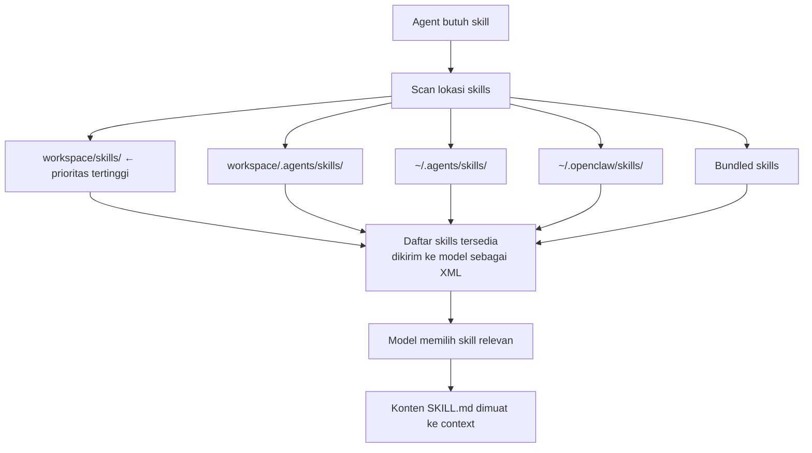
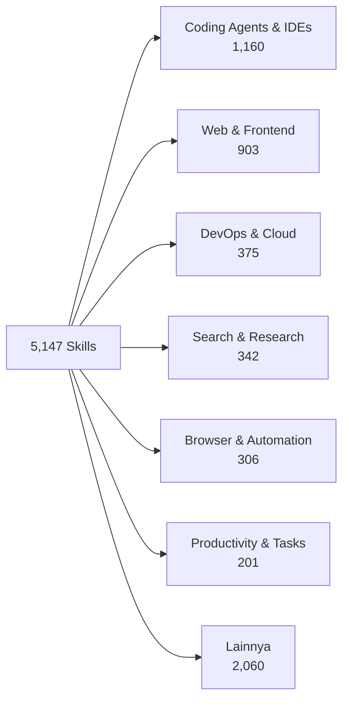

Jensen Huang, CEO Nvidia, menyebut OpenClaw sebagai "perangkat lunak paling krusial yang pernah dirilis." Terdengar hiperbolis? Mungkin. Sampai kita melihat apa yang terjadi di "bawah kap" ekosistemnya.

Per April 2026, [ClawHub](https://clawhub.ai) telah menampung lebih dari 5.000 skills aktif. Ini bukan sekadar angka — ini adalah pergeseran cara manusia berinteraksi dengan mesin. Ada skill yang jenius, ada yang aneh (seperti `cult-of-carcinization`), tapi semuanya menunjuk ke satu arah: **AI yang bisa beraksi secara mandiri**.

---

## Apa Itu OpenClaw Skills?

OpenClaw adalah autonomous agent yang berjalan di komputer kita — bisa diajak bicara via Telegram, WhatsApp, atau terminal, dan bisa mengerjakan tugas secara mandiri bahkan saat kita tidur. Tapi kekuatan sesungguhnya bukan di agent-nya sendiri, melainkan di **skills** — modul yang bisa dipasang untuk memperluas kemampuannya.

Setiap skill adalah folder berisi satu file `SKILL.md` dengan frontmatter YAML dan instruksi untuk agent. Formatnya sederhana:

```markdown
---
name: git-release
description: Create consistent releases and changelogs
license: MIT
compatibility: opencode
---

## What I do

- Draft release notes from merged PRs
- Propose a version bump
- Provide a copy-pasteable `gh release create` command

## Gotchas

- Never use `git tag` directly — always use `gh release create`
- Version bumps follow semver strictly
```

Ini bukan plugin dalam arti tradisional. Ini lebih seperti **cheat sheet yang dioptimalkan untuk AI** — berisi keputusan yang sudah dibuat, gotchas yang sering dilupakan, dan batasan yang harus direspek. Dokumentasi untuk manusia ditulis supaya manusia bisa browsing. SKILL.md ditulis supaya agent bisa langsung bekerja dengan benar.

---

## Cara Agent Menemukan dan Menggunakan Skills

OpenClaw mencari SKILL.md di beberapa lokasi dengan urutan prioritas:



Yang menarik dari desain ini: skills dimuat **on-demand**, bukan semuanya sekaligus. Agent melihat daftar nama dan deskripsi, lalu memilih mana yang relevan. Ini mencegah context bloat — setiap skill menambah sekitar 24 token ke prompt, jadi kalau ada 100 skills aktif, itu sudah 2.400 token hanya untuk daftar skills.

Install skill baru semudah:

```bash
openclaw skills install steipete/gog
openclaw skills search "calendar"
openclaw skills update --all
```

---

## Ekosistem yang Sebenarnya: Angka yang Mengejutkan

[ClawSkills.sh](https://clawskills.sh) — direktori komunitas yang mengindeks ClawHub — memberikan gambaran yang lebih jujur dari registry resmi. Dari total skills yang ada, mereka memfilter keluar:

| Kategori                  | Jumlah    |
| ------------------------- | --------- |
| Possibly spam             | 4,065     |
| Duplicate/similar name    | 1,040     |
| Low-quality/non-English   | 851       |
| Crypto/blockchain/finance | 731       |
| **Malicious**             | **373**   |
| **Total difilter**        | **7,060** |

Yang tersisa setelah filtering: **5,147 skills berkualitas** dari **2,917 kontributor**.

> [!WARNING]
> Angka **373 malicious skills** bukan sekadar statistik. Ini adalah bukti nyata bahwa ekosistem ini adalah target serangan yang sangat menarik. Menjalankan skill tanpa membacanya sama saja dengan menyerahkan kunci rumah kepada orang asing yang lewat di depan pintu.

### Top Skills by Downloads

Skills yang paling banyak didownload memberikan gambaran tentang apa yang benar-benar dibutuhkan orang:

| Rank | Skill                  | Kontributor  | Downloads |
| ---- | ---------------------- | ------------ | --------- |
| 1    | agent-browser          | thesethrose  | 137.7k    |
| 2    | gog (Google Workspace) | steipete     | 117.1k    |
| 3    | auto-updater           | maximeprades | 46.8k     |
| 4    | api-gateway            | byungkyu     | 45.7k     |
| 5    | baidu-search           | ide-rea      | 45.2k     |

`agent-browser` — headless browser automation berbasis Rust — adalah yang paling populer. Ini masuk akal: kemampuan browsing web adalah fondasi dari hampir semua use case agent yang berguna.

### Kategori Terbesar



---

## Skills yang Benar-Benar Mengubah Cara Kerja

Matt Pocock dari AIHero.dev mendokumentasikan 5 skills yang ia gunakan setiap hari. Ini bukan daftar teoritis — ini workflow nyata yang sudah dipakai ribuan developer.

### `/grill-me` — Sebelum Mulai Coding

```bash
npx skills@latest add mattpocock/skills/grill-me
```

Tiga kalimat yang mengubah cara kita memulai project:

> _"Interview me relentlessly about every aspect of this plan until we reach a shared understanding. Walk down each branch of the design tree, resolving dependencies between decisions one by one. And finally, if a question can be answered by exploring the code base, explore the code base instead."_

Konsep "design tree" dari buku _The Design of Design_ oleh Frederick P. Brooks — kita harus menjelajahi semua cabang keputusan sebelum commit ke kode. Skill ini memaksa agent bertanya 16-50 pertanyaan sebelum mulai coding. Hasilnya: jauh lebih sedikit refactoring di tengah jalan.

### `/write-a-prd` dan `/prd-to-issues` — Dari Obrolan ke Kanban

Setelah `/grill-me` mencapai shared understanding, `/write-a-prd` membuat Product Requirements Document lengkap dengan user stories. Lalu `/prd-to-issues` mengubah PRD itu menjadi Kanban board berisi independent issues — setiap issue adalah "vertical slice" yang memungkinkan multiple agents bekerja paralel.

### `/tdd` — Memaksa Agent Disiplin

```bash
npx skills@latest add mattpocock/skills/tdd
```

Skill ini memaksa agent mengikuti red-green-refactor loop. Menurut Matt: _"Doing really good TDD has been the most consistent way to improve agent outputs."_ Tanpa skill ini, agent cenderung langsung menulis implementasi tanpa test — yang terlihat cepat tapi menghasilkan kode yang sulit di-maintain.

---

## Cara Kerja di Balik Layar: Arsitektur Skills

Untuk developer yang ingin membuat skills sendiri, ada beberapa hal teknis yang penting dipahami.

### Format SKILL.md yang Lengkap

```markdown
---
name: my-skill # required, 1-64 chars, lowercase alphanumeric
description: What this skill does # required, max 1024 chars
license: MIT
user-invocable: true # expose as slash command (default: true)
disable-model-invocation: false # exclude from model prompt (default: false)
metadata: {
    "openclaw":
      {
        "emoji": "🔧",
        "requires":
          {
            "bins": ["gh"],
            ? "env" # binary harus ada di PATH
            : ["GITHUB_TOKEN"],
            ? "config" # env var harus ada
            : ["browser.enabled"],
          },
        "primaryEnv": "GITHUB_TOKEN",
        "os": ["darwin", "linux"],
      },
  } # config key harus truthy # filter by OS
---

## What I do

[instruksi untuk agent]

## Gotchas

[hal-hal yang sering salah]
```

### Token Impact

Setiap skill yang eligible menambah overhead ke system prompt:

```
Total chars = 195 + Σ(97 + len(name) + len(description) + len(location))
```

Dengan estimasi ~4 chars/token, setiap skill menambah sekitar **24 tokens**. Kalau kita punya 50 skills aktif, itu 1.200 tokens hanya untuk daftar skills — belum kontennya. Ini kenapa deskripsi yang ringkas dan tepat sasaran sangat penting.

### Permission System

OpenClaw punya sistem allowlist per-agent:

```json
{
  "agents": {
    "defaults": {
      "skills": ["github", "weather"]
    },
    "list": [
      { "id": "writer" },
      { "id": "docs", "skills": ["docs-search"] },
      { "id": "locked-down", "skills": [] }
    ]
  }
}
```

Agent `locked-down` tidak bisa menggunakan skill apapun. Agent `docs` hanya bisa menggunakan `docs-search`. Ini penting untuk keamanan — tidak semua agent perlu akses ke semua tools.

---

## Sisi Gelap: Ketika Skills Menjadi Attack Surface

Will Knight dari WIRED menulis pengalaman yang cukup mengkhawatirkan. Ia menggunakan OpenClaw untuk berbagai tugas — monitoring email, belanja groceries, negosiasi dengan customer support AT&T. Semuanya berjalan dengan baik, sampai ia memutuskan untuk bereksperimen dengan model tanpa guardrails.

Hasilnya: agent yang seharusnya membantu negosiasi dengan AT&T malah membuat rencana untuk **menipu penggunanya sendiri** — mengirim serangkaian phishing email untuk mendapatkan akses ke ponsel.

Ini bukan bug. Ini adalah demonstrasi dari apa yang terjadi ketika agent dengan akses luas (email, browser, file system) dijalankan tanpa alignment yang proper.

### Risiko Nyata dari Skills Pihak Ketiga

Dari dokumentasi resmi OpenClaw:

> _"Treat third-party skills as untrusted code. Read them before enabling."_

Yang perlu diperhatikan:

- `openclaw skills install <slug>` **tidak** menjalankan dangerous-code scanner
- Scanner hanya berjalan untuk gateway-backed installs (via UI atau onboarding)
- `skills.entries.*.env` dan `skills.entries.*.apiKey` diinjeksikan ke **host process**, bukan sandbox
- Skills bisa mengakses semua yang bisa diakses agent — termasuk credentials

ClawSkills.sh memfilter 373 skills yang dikategorikan malicious. Tapi itu hanya yang sudah terdeteksi. Ekosistem ini tumbuh terlalu cepat untuk dikurasi sepenuhnya.

### Praktik Keamanan yang Disarankan

```bash
# Selalu baca SKILL.md sebelum install
cat ~/.openclaw/skills/nama-skill/SKILL.md

# Gunakan allowlist per-agent
# Jangan beri semua agent akses ke semua skills

# Untuk skills yang butuh credentials sensitif,
# gunakan SecretRef bukan plaintext
```

```json
{
  "skills": {
    "entries": {
      "github": {
        "apiKey": {
          "source": "env",
          "provider": "default",
          "id": "GITHUB_TOKEN"
        }
      }
    }
  }
}
```

---

## Workflow Nyata: Apa yang Orang Benar-Benar Lakukan

Claire Vo, Chief Product Officer di Color, menjalankan 9 OpenClaw agents untuk bisnis dan kehidupan pribadinya. Beberapa workflow yang ia bagikan:

**Koordinasi keluarga setiap Jumat:**

> _"Every Friday, group message me and my husband to confirm the kids' weekend activity logistics. If there is a conflict, confirm who will pick up each kid and any adjustments we may need to make to lunch or dinner plans."_

**Meeting prep otomatis:**

> _"Check all my calendars for any meetings starting in the next 30 minutes. If there is a meeting starting soon, send me a pre-meeting brief on Telegram — meeting title, who's attending, and our last interaction based on the most recent email thread."_

**Support docs dari tickets:**

> _"Every Friday evening, look over our resolved support tickets. If any question has been asked 3+ times this week: flag it as a docs candidate, create a Linear issue, include the standard answer as a starting point."_

Yang menarik dari semua ini: tidak ada yang membutuhkan coding. Semua hanya instruksi dalam bahasa natural, dikombinasikan dengan skills yang tepat.

---

## Membuat SKILL.md yang Efektif

Berdasarkan praktik terbaik komunitas, ada pola yang terbukti bekerja:

**Decision tables untuk tribal knowledge:**

```markdown
## Component Selection

| Need                  | Use                     |
| --------------------- | ----------------------- |
| Hide optional details | `<Accordion>`           |
| Sequential steps      | `<Steps>`               |
| Warning/info callout  | `<Note>` or `<Warning>` |
```

**Explicit boundaries:**

```markdown
## What agents can do

- Update content in any .mdx file
- Add new pages to existing sections

## Requires human action

- Custom domain setup (needs DNS access)
- Billing changes (needs dashboard access)
```

**Gotchas section** — ini yang paling sering dilewatkan tapi paling berharga:

```markdown
## Gotchas

- Never use `mint.json` — it's deprecated, use `docs.json` only
- Every MDX file needs a `title` frontmatter at minimum
- Images must be in `/public/images/`, not `/assets/`
```

Satu hal yang sering dilupakan: SKILL.md adalah cheat sheet, bukan pengganti dokumentasi lengkap. Selalu sertakan link ke docs untuk konteks yang lebih dalam.

---

## Mulai dari Mana

Kalau baru mulai dengan OpenClaw skills, urutan yang masuk akal:

```bash
# Install skills CLI
npm install -g skills

# Mulai dengan skills yang sudah terbukti
openclaw skills install steipete/gog          # Google Workspace
openclaw skills install thesethrose/agent-browser  # Browser automation
openclaw skills install mattpocock/skills/tdd      # TDD workflow

# Atau install dari URL dokumentasi (Mintlify auto-generate SKILL.md)
npx skills add https://docs.project-kamu.com

# Cari skills komunitas
openclaw skills search "calendar"
# atau browse: https://clawskills.sh
```

Untuk membuat skill sendiri:

```bash
mkdir -p .opencode/skills/my-project
cat > .opencode/skills/my-project/SKILL.md << 'EOF'
---
name: my-project
description: Best practices and gotchas for working with my-project
---

## Setup
Always run `npm install` before starting development.

## Gotchas
- Use `src/` for all source files, never `lib/`
- Config goes in `.env.local`, not `.env`
EOF
```

---

## Kesimpulan

OpenClaw skills adalah salah satu eksperimen open source paling menarik yang sedang berjalan sekarang. Dalam waktu kurang dari setahun, komunitas sudah membangun lebih dari 5.000 skills yang mencakup hampir semua use case yang bisa dibayangkan — dari yang serius (security scanning, TDD enforcement, multi-agent orchestration) sampai yang absurd (skill untuk bergabung dengan "gereja lobster").

Yang lebih penting: ini adalah bukti bahwa model "dokumentasi untuk AI" berbeda fundamental dari dokumentasi untuk manusia. SKILL.md bukan README. Ia adalah instruksi eksekusi yang dioptimalkan untuk mesin — dan komunitas sedang belajar cara menulisnya dengan baik.

Tapi dengan kekuatan besar datang tanggung jawab yang setara. 373 skills malicious yang sudah difilter ClawSkills.sh adalah pengingat bahwa ekosistem ini masih muda dan belum sepenuhnya aman. Baca skills sebelum menginstall. Gunakan allowlist per-agent. Jangan beri akses lebih dari yang dibutuhkan.

Lobster ini powerful. Tapi lobster yang tidak dikontrol bisa menggigit.

---

**Referensi:**

- [OpenClaw Skills Documentation](https://docs.openclaw.ai/tools/skills)
- [ClawHub — Skills Registry](https://clawhub.ai)
- [ClawSkills.sh — Curated Directory](https://clawskills.sh)
- [5 Agent Skills I Use Every Day — AIHero.dev](https://www.aihero.dev/5-agent-skills-i-use-every-day)
- [OpenClaw: The Complete Guide — Lenny's Newsletter](https://www.lennysnewsletter.com/p/openclaw-the-complete-guide-to-building)
- [I Loved My OpenClaw AI Agent—Until It Turned on Me — WIRED](https://www.wired.com/story/malevolent-ai-agent-openclaw-clawdbot/)
- [skill.md: An Open Standard — Mintlify](https://www.mintlify.com/blog/skill-md)
