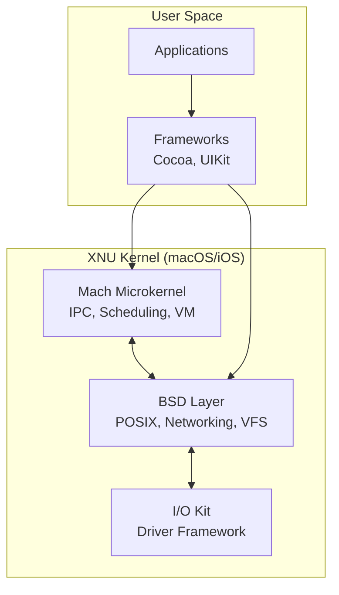
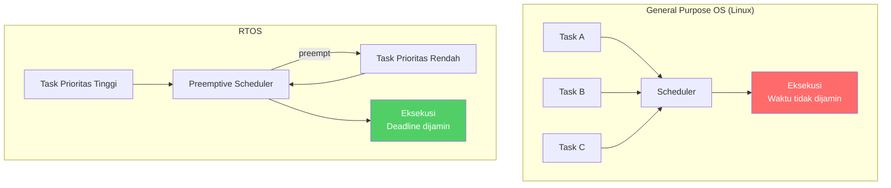
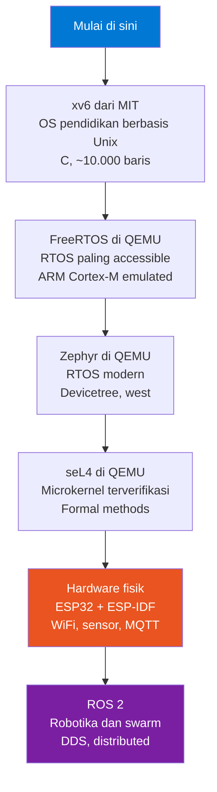

_Artikel ini adalah bagian dari series eksplorasi sistem operasi. Artikel sebelumnya membahas [Linux vs BSD](/blog/linux-vs-bsd-filosofi-sistem-operasi) dari perspektif filosofi dan sejarah. Di sini kita masuk lebih dalam ke arsitektur._

---

## Membedah Isi Kepala Komputer

Kebanyakan developer menggunakan sistem operasi tanpa pernah bertanya: _bagaimana sebenarnya ia dirancang di dalamnya?_

Bukan karena pertanyaan itu tidak penting — justru sebaliknya. Pilihan arsitektur kernel menentukan bagaimana sistem berperilaku saat komponen crash, seberapa aman ia dari serangan, dan apakah ia bisa berjalan di chip ESP32 atau harus di server raksasa.

Ini bukan sekadar teori akademis. Ini adalah keputusan desain yang dampaknya kita rasakan setiap kali mengetik `ssh` atau mengatur suhu via termostat pintar.

---

## Dua Filosofi Besar: Monolithic vs Microkernel

### Monolithic Kernel: Semua di Dalam Satu Ruang

Dalam monolithic kernel, **semua komponen sistem operasi berjalan di kernel space** — di Ring 0, dengan akses penuh ke hardware dan memori. Driver, filesystem, networking stack, scheduler, memory manager — semuanya ada di dalam satu binary besar yang berjalan dengan privilege tertinggi.

```
Monolithic Kernel (Linux, contoh):

User Space (Ring 3):
┌──────────┐ ┌──────────┐ ┌──────────┐
│  bash    │ │  nginx   │ │  python  │
└──────────┘ └──────────┘ └──────────┘
      │             │             │
      └─────────────┴─────────────┘
                    │ syscall
                    ▼
Kernel Space (Ring 0):
┌─────────────────────────────────────────────────────┐
│                                                     │
│  ┌──────────┐ ┌──────────┐ ┌──────────┐           │
│  │Filesystem│ │Networking│ │  Driver  │           │
│  └──────────┘ └──────────┘ └──────────┘           │
│  ┌──────────┐ ┌──────────┐ ┌──────────┐           │
│  │Scheduler │ │  Memory  │ │   IPC    │           │
│  └──────────┘ └──────────┘ └──────────┘           │
│                                                     │
│  Semua komponen berbagi address space yang sama     │
└─────────────────────────────────────────────────────┘
```

**Keunggulan monolithic:**

- Performa tinggi — komunikasi antar komponen adalah function call biasa, tidak ada overhead IPC
- Implementasi lebih sederhana secara konseptual
- Ekosistem driver yang sangat luas (Linux punya ribuan driver)

**Kelemahannya:**

- Driver yang crash bisa membawa seluruh kernel — kernel panic
- Attack surface yang besar — bug di driver manapun bisa menjadi privilege escalation
- Sulit di-verify secara formal karena ukurannya yang masif

### Microkernel: Minimalisme sebagai Prinsip

Dalam microkernel, kernel hanya berisi **hal-hal yang benar-benar tidak bisa dilakukan di userspace**: scheduling, IPC primitif, dan manajemen memori dasar. Semua hal lain — driver, filesystem, networking — berjalan sebagai proses biasa di userspace.

```
Microkernel (seL4, MINIX 3, QNX):

User Space:
┌──────────┐ ┌──────────┐ ┌──────────┐ ┌──────────┐
│  App     │ │  Driver  │ │    FS    │ │   Net    │
│          │ │ (proses) │ │ (proses) │ │ (proses) │
└──────────┘ └──────────┘ └──────────┘ └──────────┘
      │             │             │             │
      └─────────────┴─────────────┴─────────────┘
                              │ IPC
                              ▼
Kernel Space (sangat kecil):
┌─────────────────────────────────────────────────────┐
│  Scheduling + IPC + Memory Management               │
│  ~10.000 baris kode (seL4: ~9.000 baris)            │
└─────────────────────────────────────────────────────┘
```

**Keunggulan microkernel:**

- Fault isolation — driver crash tidak membawa kernel
- Attack surface minimal — kernel yang kecil lebih mudah di-audit dan di-verify
- Modularitas ekstrem — komponen bisa di-restart, di-replace, bahkan di-update tanpa reboot
- Formal verification dimungkinkan karena ukuran kernel yang kecil

**Kelemahannya:**

- Overhead IPC — setiap komunikasi antar komponen melewati kernel sebagai mediator
- Implementasi lebih kompleks
- Performa historis lebih rendah (meskipun gap ini semakin kecil)

---

## seL4: Microkernel yang Dibuktikan Secara Matematis

Ini adalah salah satu pencapaian paling luar biasa dalam sejarah sistem operasi yang jarang dibicarakan di luar lingkaran akademis.

**seL4** adalah microkernel yang dikembangkan oleh NICTA (sekarang bagian dari CSIRO's Data61) di Australia. Yang membuatnya unik bukan fiturnya, tapi **bukti formal yang menyertainya**.

Pada 2009, tim seL4 mempublikasikan sesuatu yang belum pernah dilakukan sebelumnya: **formal verification lengkap** dari implementasi kernel. Mereka membuktikan secara matematis bahwa:

1. Implementasi C dari seL4 sesuai dengan spesifikasi abstraknya
2. Spesifikasi abstrak sesuai dengan model fungsional
3. Tidak ada buffer overflow, tidak ada null pointer dereference, tidak ada undefined behavior

Ini bukan testing. Testing hanya bisa membuktikan keberadaan bug, tidak ketiadaannya. Formal verification membuktikan bahwa untuk _semua_ input yang mungkin, kernel berperilaku sesuai spesifikasi.

```
Lapisan verifikasi seL4:

Abstract Specification
        │ terbukti ekuivalen
        ▼
Executable Specification (Haskell)
        │ terbukti ekuivalen
        ▼
C Implementation
        │ terbukti ekuivalen
        ▼
Binary (ARM/x86/RISC-V)
```

seL4 sekarang digunakan dalam sistem yang nyawa manusia bergantung padanya: avionik militer, drone otonom, sistem kontrol kendaraan. DARPA menggunakannya dalam program HACMS (High-Assurance Cyber Military Systems). Boeing menggunakannya untuk sistem avionik.

Untuk developer yang tertarik mengeksplorasi:

```bash
# Clone seL4 dan tools
git clone https://github.com/seL4/seL4.git
git clone https://github.com/seL4/seL4_tools.git

# seL4 berjalan di QEMU untuk eksperimen
# Dokumentasi lengkap di docs.sel4.systems
```

---

## Hybrid Kernel: Kompromi Pragmatis

Antara monolithic dan microkernel, ada **hybrid kernel** — pendekatan yang mencoba mengambil keunggulan keduanya.

**Windows NT kernel** adalah contoh hybrid kernel yang paling banyak digunakan. Ia memindahkan beberapa komponen ke userspace (subsystem seperti Win32, POSIX) tapi tetap menjalankan driver dan beberapa service di kernel space untuk performa.

**macOS/iOS (XNU)** adalah hybrid yang lebih menarik: ia menggabungkan **Mach microkernel** (untuk IPC, scheduling, memory) dengan **BSD kernel** (untuk POSIX API, networking, filesystem) dalam satu binary. Dua filosofi yang berbeda, digabungkan secara pragmatis.



---

## Exokernel: Filosofi yang Lebih Radikal

Kalau microkernel adalah "kernel yang kecil", exokernel adalah "kernel yang hampir tidak ada".

Dikembangkan di MIT pada 1990an, **exokernel** mengambil filosofi yang lebih ekstrem: kernel tidak seharusnya mengabstraksi hardware sama sekali. Ia hanya bertugas **mengalokasikan resource hardware secara aman** kepada aplikasi, dan membiarkan aplikasi mengelola resource tersebut sendiri.

Tidak ada abstraksi filesystem di kernel. Tidak ada abstraksi networking. Aplikasi mendapat akses langsung ke disk blocks, ke network packets, ke memory pages — dengan kernel hanya memastikan tidak ada dua aplikasi yang mengakses resource yang sama secara konflik.

Hasilnya: aplikasi bisa mengimplementasikan abstraksi yang paling optimal untuk use case mereka sendiri. Database bisa mengimplementasikan disk I/O yang dioptimalkan untuk query pattern-nya. Web server bisa mengimplementasikan networking stack yang dioptimalkan untuk HTTP.

Exokernel tidak pernah menjadi mainstream karena kompleksitas yang ia pindahkan ke aplikasi sangat tinggi. Namun, konsepnya tidak mati.

+> [!NOTE]
+> **io_uring** di Linux modern adalah "reinkarnasi" dari filosofi exokernel. Ia memungkinkan aplikasi melakukan I/O dengan bypass overhead kernel tradisional, memberikan aplikasi kontrol langsung yang dulu hanya diimpikan oleh peneliti exokernel di MIT.

- ***

## Unikernel: OS dan Aplikasi dalam Satu Binary

Ini adalah konsep yang semakin relevan di era cloud dan container.

**Unikernel** adalah pendekatan di mana aplikasi dikompilasi bersama dengan hanya komponen OS yang ia butuhkan, menghasilkan satu binary tunggal yang bisa berjalan langsung di atas hypervisor — tanpa OS general-purpose di antaranya.

```
Traditional Stack:
┌─────────────────┐
│   Application   │
├─────────────────┤
│   OS (Linux)    │  ← Banyak yang tidak dipakai
├─────────────────┤
│   Hypervisor    │
└─────────────────┘

Unikernel Stack:
┌─────────────────────────────────┐
│  Application + OS components    │  ← Hanya yang dibutuhkan
│  (satu binary, ~MB)             │
├─────────────────────────────────┤
│  Hypervisor                     │
└─────────────────────────────────┘
```

**MirageOS** (ditulis dalam OCaml) adalah unikernel yang paling mature. Sebuah web server MirageOS bisa berukuran kurang dari 2MB dan boot dalam milliseconds. **Nanos** adalah unikernel yang memungkinkan menjalankan aplikasi Linux biasa sebagai unikernel tanpa modifikasi kode.

Untuk production, unikernel menawarkan:

- Attack surface yang sangat kecil (tidak ada shell, tidak ada SSH, tidak ada tools yang tidak dibutuhkan)
- Boot time yang sangat cepat (cocok untuk serverless/FaaS)
- Memory footprint yang minimal

---

## RTOS: Waktu adalah Segalanya

Di dunia embedded dan IoT, ada kategori OS yang berbeda fundamental dari semua yang kita bahas: **Real-Time Operating System (RTOS)**.

Perbedaannya bukan soal kecepatan — RTOS bukan berarti "OS yang cepat". RTOS adalah OS yang memberikan **jaminan deterministik tentang waktu eksekusi**. Ketika sebuah task di-schedule untuk berjalan dalam 1ms, ia _harus_ berjalan dalam 1ms — tidak boleh lebih, tidak boleh kurang.

Ini kritis untuk:

- **Sistem kontrol industri** — PLC yang mengontrol motor harus merespons dalam waktu yang presisi
- **Avionik** — flight control system yang terlambat merespons bisa fatal
- **Robotika** — kontrol motor robot yang tidak deterministik menghasilkan gerakan yang tidak presisi
- **Medical devices** — pacemaker, insulin pump, ventilator



### FreeRTOS: RTOS yang Ada di Mana-Mana

**FreeRTOS** adalah RTOS open source yang paling banyak digunakan di dunia embedded. Ia berjalan di ratusan platform berbeda — dari ARM Cortex-M sampai RISC-V, dari ESP32 sampai STM32.

```c
// Contoh task di FreeRTOS
void vSensorTask(void *pvParameters) {
    TickType_t xLastWakeTime = xTaskGetTickCount();
    const TickType_t xPeriod = pdMS_TO_TICKS(10); // 10ms period

    for (;;) {
        // Baca sensor
        float temperature = readTemperature();

        // Kirim ke queue
        xQueueSend(xSensorQueue, &temperature, 0);

        // Tunggu sampai periode berikutnya — deterministik
        vTaskDelayUntil(&xLastWakeTime, xPeriod);
    }
}

// Setup
void app_main(void) {
    xSensorQueue = xQueueCreate(10, sizeof(float));

    xTaskCreate(
        vSensorTask,    // fungsi task
        "SensorTask",   // nama
        2048,           // stack size
        NULL,           // parameter
        5,              // prioritas
        NULL            // handle
    );

    vTaskStartScheduler();
}
```

Amazon mengakuisisi FreeRTOS pada 2017 dan merilis **AWS FreeRTOS** (sekarang **FreeRTOS**) dengan tambahan library untuk konektivitas cloud — MQTT, TLS, OTA update.

### Zephyr: RTOS Modern dengan Ekosistem Linux

**Zephyr** adalah RTOS yang didukung oleh Linux Foundation, dengan filosofi yang lebih modern dari FreeRTOS. Ia menggunakan sistem build yang sama dengan Linux kernel (Kconfig, devicetree), punya package manager sendiri (west), dan mendukung lebih dari 500 board berbeda.

```bash
# Setup Zephyr development environment
pip install west
west init ~/zephyrproject
cd ~/zephyrproject
west update
west zephyr-export

# Build untuk STM32 Nucleo
west build -b nucleo_f401re samples/hello_world

# Flash ke board
west flash
```

Yang membuat Zephyr menarik adalah **devicetree** — cara mendeskripsikan hardware secara deklaratif, terpisah dari kode aplikasi. Konsep yang sama digunakan di Linux kernel untuk embedded systems.

```dts
/* boards/arm/nucleo_f401re/nucleo_f401re.dts */
/ {
    leds {
        compatible = "gpio-leds";
        led0: led_0 {
            gpios = <&gpioa 5 GPIO_ACTIVE_HIGH>;
            label = "User LD2";
        };
    };
};
```

### ESP-IDF: Ekosistem Espressif

**ESP-IDF** (Espressif IoT Development Framework) adalah SDK resmi untuk ESP32 — chip WiFi+Bluetooth yang mendominasi pasar IoT karena harganya yang sangat murah dan kemampuannya yang luar biasa untuk ukurannya.

ESP-IDF dibangun di atas FreeRTOS, tapi menambahkan layer abstraksi yang sangat lengkap:

```c
// ESP-IDF: WiFi + MQTT dalam beberapa puluh baris
#include "esp_wifi.h"
#include "mqtt_client.h"

void mqtt_event_handler(void *handler_args,
                        esp_event_base_t base,
                        int32_t event_id,
                        void *event_data) {
    esp_mqtt_event_handle_t event = event_data;
    switch (event->event_id) {
        case MQTT_EVENT_CONNECTED:
            esp_mqtt_client_publish(event->client,
                "/sensor/temperature", "25.3", 0, 1, 0);
            break;
    }
}

void app_main(void) {
    // WiFi init (disederhanakan)
    wifi_init_sta("SSID", "password");

    // MQTT client
    esp_mqtt_client_config_t mqtt_cfg = {
        .broker.address.uri = "mqtt://broker.example.com",
    };
    esp_mqtt_client_handle_t client = esp_mqtt_client_init(&mqtt_cfg);
    esp_mqtt_client_register_event(client, ESP_EVENT_ANY_ID,
                                   mqtt_event_handler, NULL);
    esp_mqtt_client_start(client);
}
```

ESP32 dengan ESP-IDF adalah titik masuk yang paling accessible untuk dunia embedded — harganya di bawah $5, dokumentasinya lengkap, komunitas besar, dan kemampuannya mencakup WiFi, Bluetooth, ADC, DAC, I2C, SPI, UART, dan banyak lagi.

---

## Swarm Robotics dan Edge Computing: Arah yang Mulai Terlihat

Ini adalah bagian yang paling spekulatif tapi paling menarik — ke mana arsitektur OS akan berkembang seiring dengan munculnya use case baru.

### Swarm Robotics: OS untuk Koloni

**Swarm robotics** adalah paradigma di mana ratusan atau ribuan robot kecil bekerja bersama tanpa kontrol terpusat — setiap robot mengikuti aturan lokal yang sederhana, tapi perilaku kolektifnya menghasilkan sesuatu yang kompleks. Terinspirasi dari koloni semut, lebah, dan burung yang terbang dalam formasi.

Tantangan OS untuk swarm:

```
Traditional Robotics:
┌─────────────────────────────────┐
│  Central Controller             │
│  (tahu posisi semua robot)      │
└─────────────────────────────────┘
         │         │         │
    Robot 1    Robot 2    Robot 3

Swarm Robotics:
Robot 1 ←→ Robot 2 ←→ Robot 3
   ↕                      ↕
Robot 4 ←→ Robot 5 ←→ Robot 6
(Tidak ada controller pusat)
```

Setiap node dalam swarm butuh OS yang:

- **Sangat ringan** — robot swarm biasanya kecil dan murah
- **Fault tolerant** — kalau satu node mati, swarm tetap berfungsi
- **Komunikasi peer-to-peer** — tidak bergantung pada infrastruktur terpusat
- **Self-organizing** — bisa beradaptasi dengan perubahan topologi jaringan

**ROS 2** (Robot Operating System 2) adalah middleware yang semakin banyak digunakan untuk robotika, termasuk swarm. Ia menggunakan **DDS** (Data Distribution Service) sebagai transport layer — protokol publish-subscribe yang dirancang untuk sistem terdistribusi real-time.

```bash
# ROS 2 node sederhana (Python)
import rclpy
from rclpy.node import Node
from geometry_msgs.msg import Twist

class SwarmNode(Node):
    def __init__(self):
        super().__init__('swarm_node')
        self.publisher = self.create_publisher(Twist, 'cmd_vel', 10)
        self.subscription = self.create_subscription(
            Twist, 'neighbor_velocity',
            self.neighbor_callback, 10)

    def neighbor_callback(self, msg):
        # Algoritma flocking sederhana
        # Sesuaikan kecepatan berdasarkan tetangga
        new_vel = Twist()
        new_vel.linear.x = msg.linear.x * 0.8
        self.publisher.publish(new_vel)
```

### Edge Computing: Kecerdasan di Pinggiran

**Edge computing** adalah paradigma di mana komputasi dilakukan sedekat mungkin dengan sumber data — di device IoT itu sendiri, atau di gateway lokal — bukan di cloud yang jauh.

Ini memunculkan kebutuhan OS yang bisa menjalankan **machine learning inference** di hardware yang sangat terbatas:

```
Cloud Computing:
Sensor → Gateway → Internet → Cloud Server → Hasil
Latency: 100-500ms, butuh koneksi internet

Edge Computing:
Sensor → Edge Device (inference lokal) → Hasil
Latency: <10ms, bisa offline
```

**TensorFlow Lite** dan **ONNX Runtime** memungkinkan menjalankan model ML di microcontroller. ESP32-S3 dengan neural network accelerator bisa menjalankan model pengenalan suara atau gesture recognition secara lokal.

**TinyML** adalah bidang yang berkembang pesat — machine learning di device dengan RAM kurang dari 1MB. Ini membutuhkan OS yang sangat efisien dalam manajemen memori dan bisa bekerja dengan hardware accelerator yang ada di chip modern.

### WASM di Edge: Portabilitas Ekstrem

**WebAssembly (WASM)** awalnya dirancang untuk browser, tapi sekarang berkembang menjadi format bytecode universal untuk edge computing.

**WASI** (WebAssembly System Interface) adalah standar yang memungkinkan WASM berjalan di luar browser dengan akses ke sistem operasi yang terkontrol. Bayangkan: kita tulis kode sekali, compile ke WASM, dan ia bisa berjalan di Linux server, di Windows, di macOS, di ARM microcontroller, bahkan di browser — dengan binary yang sama.

```
WASM sebagai universal runtime:

┌──────────────────────────────────────────────────┐
│  Source Code (Rust/C/Go/Python)                  │
└──────────────────────────────────────────────────┘
                      │ compile
                      ▼
┌──────────────────────────────────────────────────┐
│  WASM Binary (portable, sandboxed)               │
└──────────────────────────────────────────────────┘
        │           │           │           │
        ▼           ▼           ▼           ▼
   Linux x86    macOS ARM   ESP32 WASM   Browser
   (wasmtime)  (wasmtime)   runtime     (V8/SpiderMonkey)
```

Proyek seperti **WasmEdge** dan **wasmtime** membawa runtime WASM ke edge devices. Ini adalah arah yang sangat menarik untuk IoT — update firmware menjadi semudah push WASM binary baru, tanpa perlu recompile untuk setiap arsitektur target.

---

## Lingkungan Belajar: Dari Teori ke Praktik

Semua konsep di atas bisa dieksplorasi tanpa harus punya hardware fisik.

### QEMU: Emulasi Hampir Semua Arsitektur

```bash
# Install QEMU
sudo apt install qemu-system-arm qemu-system-x86 qemu-system-riscv64

# Jalankan kernel bare-metal di QEMU (ARM Cortex-M)
qemu-system-arm -M lm3s6965evb \
  -kernel my_rtos.elf \
  -nographic \
  -serial mon:stdio

# Jalankan seL4 di QEMU
qemu-system-x86_64 \
  -kernel sel4_image \
  -m 512M \
  -nographic
```

### Nix untuk Environment yang Reproducible

Seperti yang dibahas di artikel WSL2, Nix adalah cara terbaik untuk mengelola toolchain embedded yang kompleks:

```nix
# shell.nix untuk embedded development lengkap
{ pkgs ? import <nixpkgs> {} }:
pkgs.mkShell {
  buildInputs = with pkgs; [
    # ARM toolchain
    gcc-arm-embedded

    # RISC-V toolchain
    pkgsCross.riscv64-embedded.buildPackages.gcc

    # Emulasi
    qemu

    # ESP32
    esptool
    python3Packages.pyserial

    # Debugging
    openocd
    gdb

    # Build
    cmake ninja
  ];
}
```

### Urutan Eksplorasi yang Disarankan



---

## Kesimpulan: Arsitektur adalah Pilihan, Bukan Takdir

Tidak ada arsitektur kernel yang "benar" secara universal. Monolithic kernel menang di desktop dan server karena ekosistem dan performa. Microkernel menang di sistem safety-critical karena isolasi dan verifiabilitas. RTOS menang di embedded karena determinisme. Unikernel menang di cloud karena efisiensi.

Yang menarik adalah bagaimana batas-batas ini semakin kabur:

- Linux mendapat **eBPF** — cara menjalankan kode di kernel space dengan verifikasi formal, membawa sedikit filosofi microkernel ke dalam monolith
- **io_uring** membawa ide exokernel ke Linux
- **WASM** membawa portabilitas unikernel ke semua platform
- **ROS 2 dengan DDS** membawa paradigma distributed computing ke robotika

Dunia embedded dan IoT yang dulu terpisah dari dunia server kini semakin konvergen — chip ESP32 yang harganya $5 sekarang bisa menjalankan TLS, MQTT, OTA update, dan bahkan inference ML. Swarm robotics yang dulu hanya ada di paper akademis sekarang bisa dieksperimen dengan hardware yang terjangkau.

Memahami arsitektur di balik semua ini bukan sekadar pengetahuan akademis — ini adalah fondasi untuk membuat keputusan yang tepat saat kita memilih platform, merancang sistem, atau debugging masalah yang tidak bisa dijelaskan tanpa memahami apa yang terjadi di bawah abstraksi.

---

_Artikel berikutnya dalam series ini akan membahas lebih dalam tentang SDK IoT — ESP-IDF, Zephyr, dan bagaimana mengelola lingkungan development embedded yang reproducible dengan Nix._
