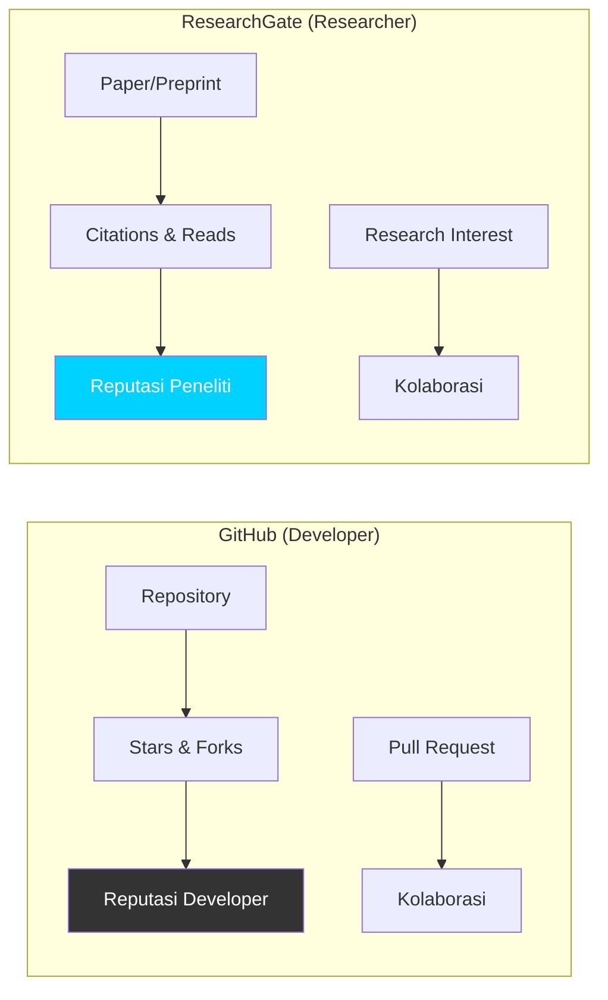
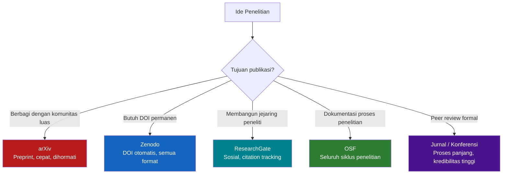

Saya baru menyadari sesuatu yang seharusnya sudah saya sadari lebih awal: semua riset yang selama ini saya kerjakan — eksplorasi arsitektur OS, analisis keamanan sistem, eksperimen dengan toolchain embedded — itu semua bisa dipublikasikan secara formal, bahkan sebelum saya lulus kuliah.

Artikel ini adalah catatan perjalanan saya memahami ekosistem publikasi akademis — dari seseorang yang selama ini hanya menulis di blog, menuju seseorang yang ingin meninggalkan jejak yang bisa dikutip secara ilmiah.

---

## ResearchGate: GitHub-nya Dunia Akademis

Analogi ini ternyata lebih tepat dari yang saya bayangkan pertama kali.

**GitHub** adalah tempat developer berbagi kode, berkolaborasi, mendapat feedback dari komunitas, dan membangun reputasi berdasarkan kontribusi nyata — bukan berdasarkan gelar atau sertifikat.

**ResearchGate** melakukan hal yang sama untuk penelitian. Kita bisa upload paper, mendapat citation, mengikuti peneliti lain, berkolaborasi lintas institusi, dan membangun reputasi akademis berdasarkan kualitas karya — bukan berdasarkan nama kampus di belakang nama kita.



Tapi ada satu perbedaan penting: di GitHub, kode yang kamu push langsung bisa dijalankan dan diverifikasi oleh siapapun. Di dunia akademis, ada lapisan kepercayaan yang lebih kompleks — dan di sinilah etika publikasi menjadi sangat penting.

---

## Ekosistem Platform: Pilih yang Tepat

Sebelum bicara etika, penting untuk memahami bahwa "publikasi akademis" bukan satu platform tunggal. Ada ekosistem yang berbeda dengan tujuan yang berbeda:

### ResearchGate: Jejaring Sosial Akademis

ResearchGate lebih tepat disebut sebagai **jejaring sosial untuk peneliti** daripada platform publikasi murni. Ia memungkinkan:

- Upload dan berbagi paper (termasuk paper yang sudah dipublikasikan di jurnal lain)
- Mendapat "RG Score" — metrik reputasi berdasarkan interaksi komunitas
- Terhubung dengan peneliti lain di bidang yang sama
- Mengajukan dan menjawab pertanyaan penelitian
- Melacak siapa yang mengutip karya kita

Yang perlu dipahami: ResearchGate **bukan** platform peer review. Kita bisa upload apapun di sana, tapi itu tidak otomatis berarti karya tersebut sudah divalidasi secara ilmiah. Reputasi di ResearchGate dibangun dari interaksi komunitas, bukan dari proses review formal.

### arXiv: Preprint Server yang Paling Dihormati

**arXiv** (dibaca "archive") adalah preprint server yang dikelola oleh Cornell University. Ia adalah tempat peneliti mempublikasikan versi draft paper mereka **sebelum** peer review — dan ini adalah praktik yang sangat umum dan diterima di komunitas Computer Science, Physics, dan Mathematics.

Kenapa preprint penting? Karena proses peer review di jurnal formal bisa memakan waktu 6-18 bulan. Dengan upload ke arXiv, peneliti bisa berbagi temuan mereka dengan komunitas jauh lebih cepat, mendapat feedback awal, dan membangun prioritas penemuan (siapa yang pertama kali mempublikasikan ide tersebut).

Untuk Computer Science, kategori yang relevan:

- `cs.OS` — Operating Systems
- `cs.CR` — Cryptography and Security
- `cs.AR` — Hardware Architecture
- `cs.NI` — Networking and Internet Architecture
- `cs.SE` — Software Engineering

arXiv punya proses moderasi ringan — bukan peer review, tapi ada moderator yang memastikan submission memenuhi standar akademis minimal dan relevan dengan kategorinya.

### Zenodo: DOI untuk Semua Orang

**Zenodo** adalah platform open access yang dikelola oleh CERN. Yang membuatnya unik: **setiap upload otomatis mendapat DOI** (Digital Object Identifier) — identifier permanen yang memungkinkan karya kita dikutip secara formal.

DOI adalah seperti permalink yang tidak pernah mati untuk karya akademis. Kalau kita publish di blog biasa, URL bisa berubah atau hilang. DOI dari Zenodo akan selalu mengarah ke karya yang sama, selamanya.

Zenodo menerima hampir semua jenis karya:

- Paper dan preprint
- Dataset penelitian
- Software dan kode
- Presentasi dan poster
- Technical report
- Bahkan video dokumentasi penelitian

### OSF (Open Science Framework): Untuk Penelitian yang Masih Berjalan

**OSF** dari Center for Open Science adalah platform yang paling fleksibel. Ia dirancang untuk mendukung seluruh siklus penelitian — dari perencanaan, pengumpulan data, analisis, sampai publikasi. Kita bisa membuat "project" yang berisi semua artefak penelitian, dan memilih mana yang dipublikasikan dan mana yang tetap private.



---

## Etika Publikasi: Aturan yang Tidak Tertulis (dan yang Tertulis)

Di sinilah perbedaan paling fundamental antara GitHub dan ekosistem akademis. Di GitHub, etika utamanya adalah lisensi dan attribution. Di dunia akademis, ada lapisan etika yang lebih dalam dan lebih kompleks.

### 1. Originalitas dan Plagiarisme

Ini adalah aturan paling fundamental. **Plagiarisme** dalam konteks akademis bukan hanya copy-paste teks — ia mencakup:

- Mengambil ide orang lain tanpa attribution
- Parafrase yang terlalu dekat dengan sumber asli tanpa kutipan
- Self-plagiarism — mempublikasikan ulang karya sendiri yang sudah dipublikasikan sebelumnya tanpa disclosure

Alat seperti **Turnitin** dan **iThenticate** digunakan oleh jurnal untuk mendeteksi plagiarisme. Tapi lebih dari sekadar menghindari deteksi, ini adalah soal integritas — karya akademis dibangun di atas kepercayaan bahwa setiap klaim adalah asli atau dikutip dengan benar.

### 2. Attribution yang Benar: Cara Mengutip

Setiap kali kita menggunakan ide, data, atau temuan orang lain, kita harus mengutipnya. Ada beberapa format kutipan yang umum:

**IEEE** (paling umum di Computer Science dan Engineering):

```
[1] L. Torvalds, "Linux: a Portable Operating System,"
    Master's thesis, University of Helsinki, 1997.

[2] A. S. Tanenbaum, Modern Operating Systems, 4th ed.
    Pearson, 2014.
```

**APA** (lebih umum di social science):

```
Tanenbaum, A. S. (2014). Modern Operating Systems (4th ed.). Pearson.
```

Untuk paper di arXiv:

```
[1] J. Smith, "Title of Paper," arXiv:2301.12345 [cs.OS], Jan. 2023.
```

### 3. Authorship: Siapa yang Berhak Jadi Penulis

Ini adalah area yang sering menimbulkan konflik di dunia akademis. Secara etis, seseorang berhak menjadi penulis (author) hanya kalau ia memberikan **kontribusi substansial** terhadap:

- Konsepsi atau desain penelitian, ATAU
- Pengumpulan, analisis, atau interpretasi data

Sekadar memberikan funding, atau sekadar menjadi supervisor tanpa kontribusi intelektual langsung, secara etis tidak cukup untuk menjadi author — meskipun dalam praktiknya ini sering dilanggar.

Untuk penelitian solo (yang paling relevan untuk kita sebagai independent researcher), ini tidak menjadi masalah.

### 4. Conflict of Interest

Kalau penelitian kita disponsori oleh pihak tertentu, atau kalau kita punya kepentingan finansial dalam hasil penelitian, itu harus di-disclose secara eksplisit. Ini adalah standar transparansi yang sangat dijaga di komunitas akademis.

### 5. Data Integrity

Data yang dilaporkan harus akurat dan tidak dimanipulasi. Ini terdengar obvious, tapi ada banyak kasus retraction (penarikan paper) karena data fabrication atau falsification — dan konsekuensinya sangat serius bagi reputasi peneliti.

### 6. Duplicate Publication

Mempublikasikan paper yang sama (atau sangat mirip) di dua tempat berbeda tanpa disclosure adalah pelanggaran etika. Tapi ada nuansa:

- Upload ke arXiv **sebelum** submit ke jurnal: umumnya diterima dan bahkan dianjurkan
- Upload ke arXiv **setelah** paper diterima jurnal: perlu cek kebijakan jurnal tersebut
- Submit ke dua jurnal berbeda secara bersamaan: tidak etis

---

## Nama Panggung vs Nama Asli: Bolehkah "Sandikodev"?

Ini pertanyaan yang menarik dan jawabannya lebih nuanced dari yang mungkin kita bayangkan.

**Secara teknis:** Platform seperti Zenodo dan OSF memungkinkan kita menggunakan nama apapun. arXiv dan ResearchGate lebih ketat — mereka mengharapkan nama asli karena terkait dengan verifikasi identitas dan akuntabilitas akademis.

**Secara etis:** Komunitas akademis sangat menjaga akuntabilitas. Salah satu alasan nama asli penting adalah agar karya bisa diatribusikan dengan benar, dan agar ada akuntabilitas kalau ada masalah dengan karya tersebut (misalnya perlu retraction atau koreksi).

**Solusi yang umum digunakan:**

Banyak peneliti yang punya nama panjang atau nama yang sulit dieja dalam alfabet Latin menggunakan variasi nama. Yang paling umum dan diterima adalah:

```
Nama asli: [Nama Lengkap Asli]
Nama publikasi: [Nama Asli] (Sandikodev)

Atau:
[Nama Asli], known as Sandikodev
```

Beberapa opsi yang bisa dipertimbangkan:

1. **Gunakan nama asli, tambahkan "Sandikodev" sebagai alias** — ini yang paling aman secara etis dan tetap membangun brand
2. **Gunakan nama asli di paper formal, Sandikodev di blog** — dua jalur yang saling melengkapi
3. **Daftarkan ORCID** — ini adalah identifier unik untuk peneliti yang menghubungkan semua publikasi ke satu identitas, terlepas dari variasi nama

**ORCID** (Open Researcher and Contributor ID) adalah solusi terbaik untuk masalah ini. Ia adalah identifier permanen seperti DOI tapi untuk orang, bukan dokumen. Dengan ORCID, semua publikasi kita — di arXiv, Zenodo, ResearchGate, jurnal manapun — terhubung ke satu profil yang terverifikasi. Gratis, dan sangat direkomendasikan untuk siapapun yang serius di dunia penelitian.

```
ORCID: https://orcid.org/0000-0000-0000-0000
(setiap peneliti punya ID unik)
```

---

## Mulai dari Mana: Jalur Praktis untuk Independent Researcher

Berdasarkan semua yang sudah kita bahas, ini jalur yang paling masuk akal untuk memulai:

### Langkah 1: Daftarkan ORCID

Gratis di [orcid.org](https://orcid.org). Ini adalah fondasi identitas akademis kita — semua platform lain bisa dihubungkan ke ORCID.

### Langkah 2: Buat Akun di Zenodo

[zenodo.org](https://zenodo.org) — bisa login dengan GitHub account. Upload technical report pertama, dapat DOI, dan karya kita sudah bisa dikutip secara formal.

### Langkah 3: Buat Akun di ResearchGate

Isi profil dengan lengkap — afiliasi (bisa "Universitas Amikom Yogyakarta" selama masih mahasiswa aktif, atau "Independent Researcher" kalau lebih nyaman), bidang penelitian, dan link ke ORCID.

### Langkah 4: Tulis Technical Report Pertama

Tidak harus paper penelitian yang kompleks. Technical report yang mendokumentasikan:

- Eksperimen yang sudah kita lakukan
- Analisis komparatif (misalnya: perbandingan arsitektur microkernel vs monolith dalam konteks IoT)
- Survey literatur tentang topik yang kita kuasai

Format minimal untuk technical report:

```
1. Abstract (150-250 kata)
2. Introduction (masalah yang dibahas, mengapa penting)
3. Background / Related Work (apa yang sudah ada)
4. Methodology / Approach (apa yang kita lakukan)
5. Results / Discussion (apa yang kita temukan)
6. Conclusion
7. References
```

### Langkah 5: Pertimbangkan arXiv untuk Paper yang Lebih Serius

Kalau sudah ada paper yang lebih substansial — dengan metodologi yang jelas, data yang dikumpulkan, dan analisis yang mendalam — arXiv adalah tempat yang tepat. Untuk cybersecurity dan OS, kategori `cs.CR` dan `cs.OS` adalah yang paling relevan.

---

## Topik dari "Dapur Sandikodev" yang Layak Dipublikasikan

Melihat semua yang sudah kita eksplorasi, ada beberapa topik yang sudah punya substansi cukup untuk dijadikan technical report atau paper:

| Topik                                                              | Format yang Cocok | Platform      |
| ------------------------------------------------------------------ | ----------------- | ------------- |
| Reproducible Development Environment dengan Nix di WSL2            | Technical Report  | Zenodo        |
| Perbandingan Arsitektur Microkernel vs Monolith untuk IoT          | Survey Paper      | arXiv (cs.OS) |
| Security Implications dari Intel Management Engine                 | Analysis Paper    | arXiv (cs.CR) |
| Arduino ESP32 sebagai Entry Point untuk Embedded Security Research | Tutorial Paper    | Zenodo        |
| Formal Verification dalam Sistem Operasi: seL4 sebagai Studi Kasus | Survey            | arXiv (cs.OS) |

---

## Satu Hal yang Perlu Diingat

Dunia akademis dan dunia open source developer sebenarnya tidak sejauh yang kita bayangkan. Banyak paper terbaik di bidang Computer Science ditulis oleh orang-orang yang juga aktif di komunitas open source. Linus Torvalds menulis thesis tentang Linux. Tanenbaum menulis MINIX sebagai alat pendidikan yang kemudian jadi paper dan buku.

Yang membedakan adalah **dokumentasi yang sistematis** dan **attribution yang jujur**. Kalau kita sudah melakukan itu di blog — mendokumentasikan proses, mengakui sumber, jujur tentang keterbatasan — maka kita sudah melakukan 80% dari apa yang dibutuhkan untuk publikasi akademis.

Sisanya adalah format dan platform.

---

_Artikel ini adalah awal dari perjalanan Sandikodev ke dunia publikasi akademis. Kalau ada yang ingin berdiskusi lebih lanjut tentang topik penelitian atau proses publikasi, bagian komentar terbuka._
