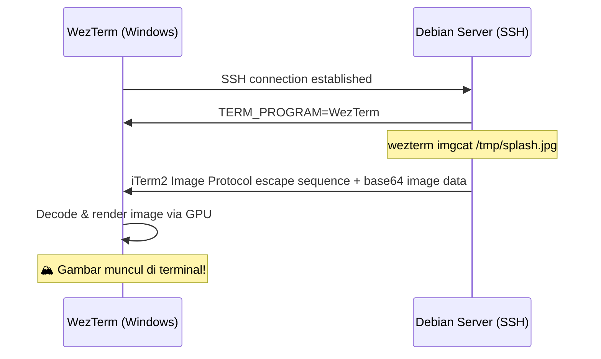

## Masalahnya: Terminal Biasa Itu Membosankan

Kamu punya Windows. Kamu SSH ke server Linux. Kamu buka gambar di terminal... dan yang muncul adalah teks ASCII art yang menyedihkan.

Atau lebih parah: kita pakai terminal bawaan Windows yang tampilannya masih sama sejak Windows XP.

**WezTerm mengubah semua itu.** Dan yang bikin saya makin jatuh cinta — dia dibangun dengan Rust.

---

## Apa Itu WezTerm?

WezTerm (Wez's Terminal Emulator) adalah terminal emulator modern yang ditulis sepenuhnya dalam **Rust** oleh [Wez Furlong](https://github.com/wez). Bukan sekadar terminal cantik — ini adalah terminal yang _sophisticated_ dalam arti sesungguhnya:

- GPU-accelerated rendering
- Multiplexer built-in (seperti tmux, tapi native)
- Support iTerm2 Image Protocol (`imgcat`)
- Cross-platform: Linux, macOS, **Windows**
- Konfigurasi via Lua
- Ligature support untuk font seperti FiraCode

---

## Momen "Wow" Saya: imgcat over SSH

Ini yang bikin saya nulis artikel ini.

Saya lagi SSH dari **Windows** ke **Debian server** saya. Iseng-iseng jalanin:

```bash
TERM_PROGRAM=WezTerm wezterm imgcat /tmp/splash.jpg
```

Yang muncul di terminal saya adalah... **foto pegunungan bersalju dengan langit sunset yang indah**, langsung di dalam terminal. Bukan ASCII art. Bukan path file. Gambar asli, full color, rendered di dalam terminal window.

```
C:\Users\Lenovo> ssh dev@202.162.40.162
Linux server1 6.1.0-44-amd64 ...

dev in 🌐 server1 in ~ via 🐍 v3.11.2
❯ TERM_PROGRAM=WezTerm wezterm imgcat /tmp/splash.jpg
[🏔️ gambar gunung muncul di sini]
```

Yang perlu dipahami: ini bukan magic. WezTerm menggunakan **iTerm2 Image Protocol** — sebuah escape sequence khusus yang dikirim dari server ke terminal client. Karena WezTerm di Windows-nya support protokol ini, gambar bisa dirender meski kamu sedang SSH ke mesin lain.



---

## Setup: Windows ke Linux via SSH

Ini yang perlu kamu lakukan:

### 1. Install WezTerm di Windows

> ⚠️ **Penting: Gunakan Nightly Build, bukan stable release.**
>
> Versi stable terbaru (`20240203-110809-5046fc22`) yang tersedia via `winget` punya bug fatal saat menjalankan `imgcat` over SSH:
>
> ```
> ERROR  env_bootstrap > panic at wezterm/src/main.rs:383:10
> attempt to divide by zero
> ```
>
> Ini adalah Rust panic — divide by zero di `main.rs:383`. Bug ini sudah diperbaiki di nightly build. Pastikan kita install versi nightly:

Download **nightly build** dari [nightly.link/wez/wezterm](https://github.com/wez/wezterm/releases/tag/nightly) atau via winget dengan channel nightly:

```powershell
# Cek versi yang terinstall
wezterm --version
# Harus: wezterm 20260331-040028-577474d8 atau lebih baru

# Install nightly via winget
winget install wez.wezterm.nightly
```

Ya, kamu harus install WezTerm di sisi Windows — karena rendering gambar terjadi di client, bukan server.

### 2. Install WezTerm di Linux Server (untuk imgcat)

```bash
# Debian/Ubuntu
curl -fsSL https://apt.fury.io/wez/gpg.key | sudo gpg --dearmor -o /usr/share/keyrings/wezterm-fury.gpg
echo 'deb [signed-by=/usr/share/keyrings/wezterm-fury.gpg] https://apt.fury.io/wez/ * *' | sudo tee /etc/apt/sources.list.d/wezterm.list
sudo apt update && sudo apt install wezterm-nightly
```

Atau cukup install binary `wezterm` saja untuk akses ke subcommand `imgcat`.

### 3. SSH dan Test

```bash
# Di Windows terminal (WezTerm)
ssh user@your-server

# Di server, test imgcat
TERM_PROGRAM=WezTerm wezterm imgcat /path/to/image.jpg
```

Kenapa perlu `TERM_PROGRAM=WezTerm`? Karena `wezterm imgcat` mengecek environment variable ini untuk memastikan terminal client-nya support protokol gambar. Kalau tidak di-set, dia akan fallback ke mode lain.

---

## Konfigurasi WezTerm: Lua yang Elegan

Salah satu hal yang saya suka dari WezTerm adalah konfigurasinya pakai **Lua** — bukan format config yang kaku seperti TOML atau JSON.

```lua
-- ~/.config/wezterm/wezterm.lua
local wezterm = require 'wezterm'
local config = wezterm.config_builder()

-- Font dengan ligature support
config.font = wezterm.font('FiraCode Nerd Font', { weight = 'Regular' })
config.font_size = 13.0

-- Tokyo Night theme (tentu saja)
config.color_scheme = 'Tokyo Night'

-- GPU rendering
config.front_end = 'WebGpu'

-- Tab bar yang bersih
config.use_fancy_tab_bar = false
config.tab_bar_at_bottom = true

-- Opacity untuk aesthetic
config.window_background_opacity = 0.95

return config
```

---

## WezTerm Dibangun dengan Rust: Kenapa Ini Penting?

Ini bukan sekadar trivia. WezTerm adalah salah satu proyek Rust yang:

1. **Real-world complexity** — bukan toy project, ini terminal emulator production-grade
2. **Cross-platform** — kita bisa lihat bagaimana Rust handle platform differences
3. **Performance-critical** — GPU rendering, text shaping, escape sequence parsing
4. **Active community** — maintainer-nya responsif, PR disambut dengan baik

### Untuk Pemula Rust: Ini Pintu Masuk yang Ideal

Kalau kamu baru belajar Rust dan bingung mau kontribusi ke mana, WezTerm adalah kandidat yang menarik. Kenapa?

```
Belajar Rust dari buku/tutorial
        ↓
Paham ownership, borrowing, lifetimes
        ↓
Butuh "real project" untuk mengasah skill
        ↓
WezTerm: codebase yang besar tapi terstruktur
        ↓
Mulai dari issue berlabel "good first issue"
        ↓
Submit PR → review → merge
        ↓
Skill teknis + etika open source berkembang
```

Kontribusi open source bukan cuma soal nulis kode. Kamu belajar:

- **Cara membaca codebase orang lain** — skill yang underrated
- **Komunikasi teknis** — nulis PR description yang jelas
- **Menerima feedback** — reviewer bisa keras, tapi itu proses belajar
- **Etika komunitas** — cara bertanya yang baik, cara merespons review

Saya pernah nulis lebih detail soal ini di artikel [Etika Kontribusi Open Source untuk Pemula](/blog/etika-kontribusi-open-source-panduan-pemula).

---

## Fitur-Fitur yang Bikin WezTerm "Sophisticated"

### Built-in Multiplexer

Tidak perlu tmux kalau kita mau split pane:

```
Ctrl+Shift+% → Split horizontal
Ctrl+Shift+" → Split vertical
Ctrl+Shift+Z → Zoom pane
```

Tapi kalau kita sudah terbiasa tmux (seperti saya), keduanya bisa hidup berdampingan dengan damai.

### Hyperlinks Otomatis

WezTerm otomatis detect URL di output terminal dan bisa di-klik. Kecil tapi sangat berguna.

### Copy Mode

```
Ctrl+Shift+X → Masuk copy mode (seperti vi mode di tmux)
```

Navigasi dengan keyboard, select teks, copy — tanpa mouse.

### Warp Drive (Multiplexer over SSH)

Ini yang benar-benar sophisticated: WezTerm punya built-in multiplexer yang bisa jalan **over SSH**. Artinya kita bisa punya persistent session di server, diakses dari WezTerm client, dengan semua fitur WezTerm tetap berfungsi.

```bash
# Di server, jalankan wezterm multiplexer daemon
wezterm start --daemonize

# Di client, connect
wezterm connect unix://~/.local/share/wezterm/sock
```

---

## Perbandingan: WezTerm vs Terminal Lain

| Fitur                 | WezTerm | Alacritty | Kitty       | Windows Terminal |
| --------------------- | ------- | --------- | ----------- | ---------------- |
| GPU Rendering         | ✅      | ✅        | ✅          | ✅               |
| imgcat/Image Protocol | ✅      | ❌        | ✅          | ❌               |
| Built-in Multiplexer  | ✅      | ❌        | ✅          | ❌               |
| Konfigurasi           | Lua     | TOML      | Python      | JSON             |
| Dibangun dengan       | Rust    | Rust      | C           | C#               |
| Cross-platform        | ✅      | ✅        | Linux/macOS | Windows only     |
| Ligature Support      | ✅      | ❌        | ✅          | ✅               |

---

## Kesimpulan

WezTerm bukan terminal yang kita install karena ikut-ikutan. Kamu install karena kita butuh:

- Terminal yang **benar-benar cross-platform** (Windows ke Linux, seamless)
- **imgcat** yang jalan over SSH
- Konfigurasi yang **fleksibel via Lua**
- Terminal yang dibangun dengan **Rust** — performa dan keandalan

Kalau kamu sedang belajar Rust, WezTerm adalah proyek yang layak untuk dijadikan "sekolah kedua" — bukan hanya untuk skill teknis, tapi juga untuk memahami bagaimana komunitas open source yang sehat bekerja.

**Next Steps:**

- Install WezTerm: [wezfurlong.org/wezterm](https://wezfurlong.org/wezterm)
- Explore issues di [github.com/wez/wezterm](https://github.com/wez/wezterm)
- Coba `wezterm imgcat` — kamu akan langsung paham kenapa saya excited soal ini
- Baca [Etika Kontribusi Open Source](/blog/etika-kontribusi-open-source-panduan-pemula) sebelum submit PR pertamamu
