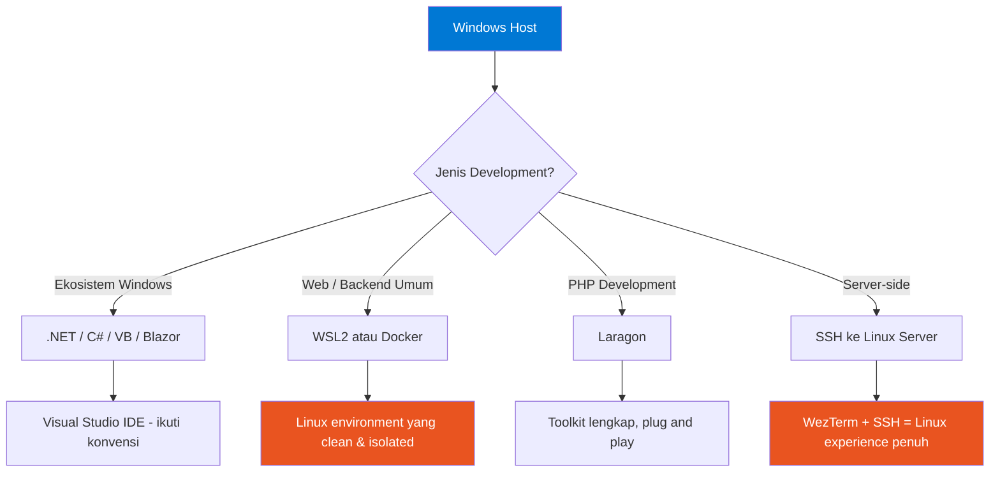
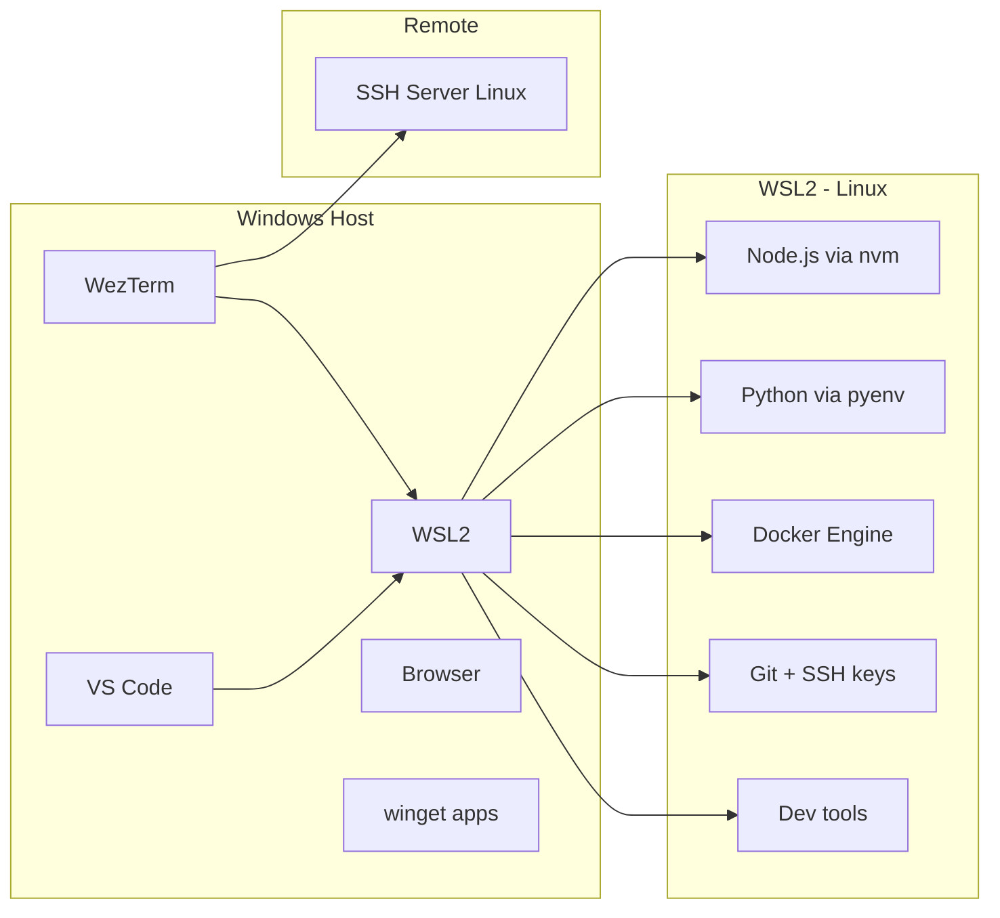
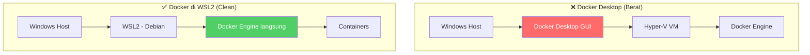
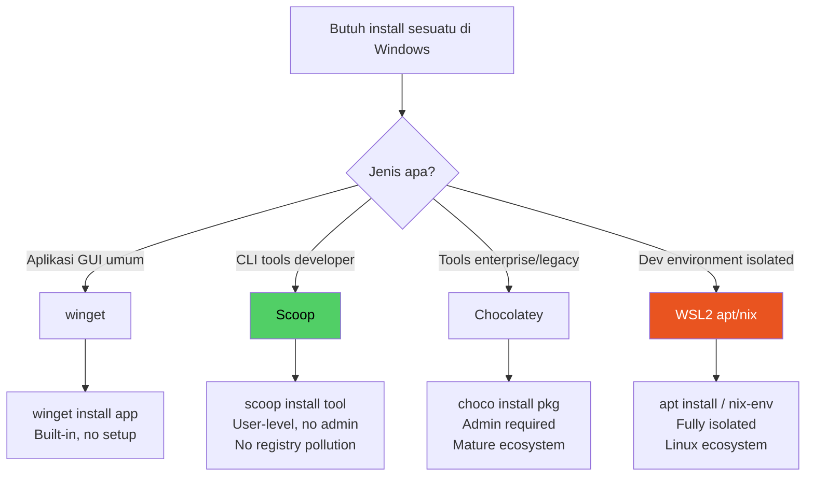
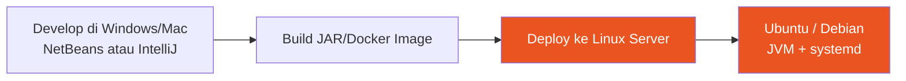
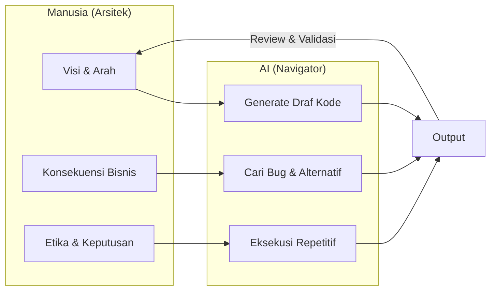
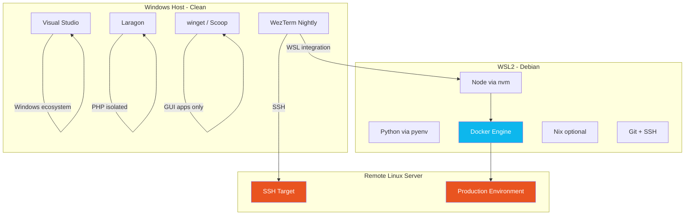

## Pengakuan yang Tidak Populer

Saya seorang developer yang menggunakan Windows. Dan saya tidak malu mengatakannya.

Tapi ada syaratnya.

Bukan Windows yang penuh dengan Node.js terinstall langsung di host, XAMPP berjalan di background, Python 2 dan Python 3 saling bertabrakan di PATH, dan registry yang sudah chaos sejak hari pertama. Itu bukan Windows — itu **Windows yang disiksa**.

Yang saya maksud adalah Windows dengan satu filosofi sederhana: **Keep It Clean, Keep It Simple.**

Filosofi ini bukan lahir dari kemalasan atau ketidaktahuan. Ia lahir dari pengalaman bertahun-tahun — dari Arch Linux, Gentoo, bahkan Linux From Scratch — yang akhirnya membawa saya ke satu kesimpulan: **platform terbaik adalah platform yang kamu hormati batasnya.**

---

## Akar: Dari Linux ke Windows, Bukan Sebaliknya

Sebelum bicara Windows, penting untuk memahami dari mana perspektif ini berasal.

Perjalanan saya dimulai dari Linux — bukan Ubuntu yang sudah jadi, tapi **Arch Linux** dan **Gentoo** yang memaksa kamu memahami setiap layer sistem dari bawah. Bahkan sempat menyentuh **Linux From Scratch (LFS)** — membangun sistem operasi dari source code, satu paket demi satu paket.

```
Timeline OS:
2015 → Arch Linux (belajar internal OS)
2018 → Ubuntu / Debian (produktivitas)
2020 → CentOS (enterprise server)
2022 → Windows 10/11 + WSL2 (era stabilitas)
```

Ini bukan perjalanan dari "tidak tahu" ke "tahu Windows". Ini adalah perjalanan dari **memahami Linux secara mendalam**, lalu memilih Windows secara sadar untuk alasan yang spesifik — bukan karena ikut-ikutan, bukan karena tidak ada pilihan.

Dan justru karena latar belakang Linux itulah saya bisa melihat dengan jelas: **apa yang Windows lakukan dengan baik, dan di mana ia harus dibantu.**

---

## Mengapa Windows Punya Kelemahan Struktural

Sebelum bicara solusi, kita harus jujur dulu soal masalahnya.

Linux dan Unix punya filosofi yang elegan: **everything is a file**. Konfigurasi? File teks di `/etc`. Process? File di `/proc`. Socket? File di `/var/run`. Semua terstruktur, semua bisa di-inspect, semua bisa di-version control.

Windows lahir dari dunia yang berbeda. DOS dirancang untuk **menyerap pasar**, bukan untuk keindahan arsitektur. Hasilnya:

```
Linux/Unix                    Windows
─────────────────────         ─────────────────────
/etc/nginx/nginx.conf    vs   HKEY_LOCAL_MACHINE\SOFTWARE\...
~/.bashrc                vs   %APPDATA%\...\settings.json
/usr/bin/python3         vs   C:\Python311\python.exe (+ PATH chaos)
systemd unit files       vs   Windows Services + Task Scheduler
```

Registry adalah warisan DOS-era yang bertahan karena kompatibilitas, bukan karena ia adalah ide yang bagus. Setiap aplikasi yang kamu install menulis ke sana. Setiap uninstall meninggalkan sisa. Bertahun-tahun kemudian, registry menjadi kuburan konfigurasi yang tidak ada yang berani sentuh.

Dan toh — Windows tetap bertahan di industri. Bahkan mendominasi. Itu bukan kebetulan. Itu adalah bukti bahwa **pragmatisme mengalahkan purisme** di pasar massal.

### Dirty Host vs Sanitized Host

Konsep ini adalah inti dari seluruh filosofi. Setiap keputusan instalasi harus melewati satu pertanyaan: _"Apakah ini mengotori host saya?"_

| Karakteristik | Dirty Host (Tradisional)                      | Sanitized Host (Pendekatan Bersih)            |
| ------------- | --------------------------------------------- | --------------------------------------------- |
| Instalasi     | `.exe` installer global, `pip install` global | WSL2, Docker, atau Nix Shell                  |
| Dampak        | Registry kotor, PATH membengkak               | Sistem induk tetap suci dan cepat             |
| Versioning    | Sulit jalankan dua versi DB sekaligus         | Mudah — setiap proyek punya container sendiri |
| Uninstall     | Selalu meninggalkan residu di `AppData`       | Hapus container/folder, laptop kembali baru   |

**Software adalah teks.** Dan teks yang baik adalah teks yang terstruktur, bisa di-version control, dan bisa dihapus bersih. Filosofi ini berlaku untuk kode, dan seharusnya berlaku juga untuk environment tempat kode itu hidup.

> [!CAUTION]
> Membiarkan host menjadi "Dirty" bukan hanya soal estetika. Satu instalasi global yang korup bisa merusak registry Windows secara permanen, memaksa kamu melakukan re-install OS total hanya untuk memperbaiki error PATH atau DLL yang meleset.

---

## Filosofi Saya: Windows Hanya untuk Windows

Ini adalah aturan yang saya pegang keras:

> **Windows adalah untuk ekosistem Windows. Development lainnya? Isolasi.**



**Larangan keras di host Windows saya:**

- ❌ Node.js langsung di Windows host
- ❌ Python langsung di Windows host (kecuali untuk tools Windows-specific)
- ❌ XAMPP atau stack PHP manual
- ❌ Git bash sebagai primary terminal (pakai WezTerm + WSL)

---

## WSL2: Linux di Dalam Windows, Bukan Kompromi

WSL2 bukan emulasi. Ini adalah **Linux kernel sungguhan** yang berjalan di Hyper-V lightweight VM. Artinya:

```bash
# Di dalam WSL2 — ini Linux asli
uname -r
# 5.15.167.4-microsoft-standard-WSL2

# File system Linux yang proper
ls /etc/
# apt  bash.bashrc  environment  fstab  hosts  ...

# Package manager Linux yang sesungguhnya
sudo apt install ripgrep fzf tmux neovim
```

Filosofi "everything is a file" tetap berlaku di dalam WSL2. Kamu mendapat semua keindahan Linux, tapi tetap bisa buka browser Windows, pakai aplikasi GUI Windows, dan file Windows bisa diakses dari `/mnt/c/`.



**Aturan saya untuk WSL2:**

- Semua toolchain development ada di sini
- Gunakan `nvm` untuk Node.js versioning
- Gunakan `pyenv` untuk Python versioning
- Docker Engine di WSL2, bukan Docker Desktop di Windows (lebih ringan)

---

## WSL2 Distro Management: Lebih dari Sekedar Ubuntu

Kebanyakan tutorial WSL2 hanya mengajarkan install Ubuntu lalu selesai. Tapi WSL2 bisa jauh lebih powerful dari itu.

### Multiple Distro, Multiple Purpose

```powershell
# Lihat semua distro yang tersedia
wsl --list --online

# Install distro spesifik
wsl --install -d Debian
wsl --install -d Ubuntu-24.04
wsl --install -d openSUSE-Leap-15.6

# Lihat distro yang terinstall
wsl --list --verbose
# NAME              STATE           VERSION
# Ubuntu-24.04      Running         2
# Debian            Stopped         2
# docker-desktop    Running         2
```

Saya personally pakai **Debian** untuk development — lebih minimal dari Ubuntu, tidak ada snap packages yang tidak diminta, dan lebih dekat ke production server yang biasanya juga Debian.

### Kali Linux di WSL: Ada, Tapi Bukan untuk Sembarangan

Tim Kali Linux sudah melakukan porting resmi ke WSL — kamu bisa `wsl --install -d kali-linux` dan dalam hitungan menit punya akses ke ratusan tools penetration testing langsung dari Windows.

Tetapi, ada catatan penting: **Kali Linux lebih tepat berjalan di mesin virtual (VM) yang benar-benar terisolasi**, bukan di WSL yang berbagi kernel dengan host Windows.

> [!WARNING]
> Menjalankan tools pentest di WSL yang terintegrasi dengan host meningkatkan risiko "kecelakaan" yang berdampak ke sistem utama. Isolasi yang proper adalah bentuk tanggung jawab etis seorang security professional, bukan sekadar paranoia teknis.

| Hypervisor         | Lisensi                       | Performa | Catatan                                           |
| ------------------ | ----------------------------- | -------- | ------------------------------------------------- |
| Hyper-V            | Gratis (built-in Windows Pro) | Baik     | Enable via "Turn Windows features on or off"      |
| VMware Workstation | Berbayar                      | Terbaik  | Paling mature untuk enterprise                    |
| VirtualBox         | Open source, gratis           | Laggy    | Cocok untuk belajar, kurang ideal untuk daily use |

Pilih sesuai kebutuhan dan trade-off yang kamu pahami sepenuhnya.

---

## Etika Digital: Lebih dari Sekadar Pragmatisme

Di sinilah diskusi tentang setup developer harus naik ke level yang lebih tinggi.

Semua yang kita bahas — WSL2, isolasi environment, sanitized host, GPG signing — bukan hanya soal efisiensi teknis. Di balik semua itu ada sesuatu yang lebih fundamental: **etika dan tanggung jawab**.

Ini yang sejak lama digembor-gemborkan oleh **Richard Stallman** — pendiri GNU, pejuang software freedom. Bagi Stallman, pertanyaannya bukan hanya "apakah software ini bekerja?" tapi "apakah software ini menghormati kebebasan penggunanya?" Apakah ia transparan? Apakah ia bisa diaudit? Apakah ia memberikan kontrol kepada pengguna, atau mengambilnya?

Kamu tidak harus setuju dengan semua posisi Stallman yang kadang ekstrem. Tapi inti argumennya relevan: **software yang kamu gunakan membentuk cara kamu berpikir dan bekerja**. Software yang opaque, yang menyembunyikan apa yang ia lakukan, yang mengambil data tanpa consent — itu bukan hanya masalah privasi teknis. Itu masalah kedaulatan mental.

Ada pemikiran yang lebih ekstrem lagi dalam spektrum ini: **Terry Davis** dan **TempleOS**-nya. Davis membangun sistem operasi sendiri dari nol — seorang diri, selama bertahun-tahun — sebagai ekspresi murni dari keyakinan bahwa komputer seharusnya menjadi alat yang sepenuhnya dipahami dan dikontrol oleh penggunanya. Kisahnya tragis dan kompleks, tapi ada kernel kebenaran di dalamnya yang menarik bagi kalangan yang serius memikirkan hubungan manusia dengan mesin. _(Untuk yang penasaran: [Palladium Magazine punya ulasan yang menarik](https://www.palladiummag.com/2022/04/01/palladium-is-now-templeos/) tentang warisan Davis.)_

Tapi kita tidak perlu ke ekstrem itu untuk mengambil pelajarannya.

### Mental adalah Software

Ini analogi yang saya pegang:

> **Mental manusia adalah software. Tubuh adalah hardware-nya.**

Software yang berjalan di atas hardware yang rusak akan corrupt. Tapi berlaku juga sebaliknya: **hardware yang terus-menerus menjalankan software yang rusak, cepat atau lambat akan ikut rusak.**

Dan seperti virus di komputer — software yang terjangkit tidak berhenti merusak dirinya sendiri. Ia **menyebar**. Ia menginfeksi proses lain, memodifikasi behavior sistem, dan pada akhirnya merusak seluruh ekosistem yang bersentuhan dengannya.

Kita sudah melihat ini terjadi secara masif dan terdokumentasi: **konten brainrot di TikTok dan platform sejenis**. Bukan sekadar konten yang tidak berguna — ini adalah konten yang secara algoritmik dirancang untuk memaksimalkan waktu tonton dengan cara paling murah: stimulasi instan, tanpa konteks, tanpa makna, tanpa konsekuensi. Nonsense yang merusak kemampuan fokus, mengurangi toleransi terhadap kompleksitas, dan secara perlahan mendegradasi kapasitas berpikir kritis penggunanya.

Ini bukan teori. Ini adalah **desain yang disengaja** — engagement metrics yang dioptimalkan tanpa mempertimbangkan dampak pada "hardware" penggunanya.

Muaranya selalu sama: **brainware yang terdegradasi**. Manusia yang semakin sulit membaca teks panjang. Semakin tidak sabar dengan penjelasan yang membutuhkan konteks. Semakin mudah diprovokasi oleh stimulus sederhana. Semakin sulit membedakan informasi yang valid dari yang tidak.

Software yang rusak, menyebar, dan merusak hardware-nya sendiri.

### Tanggung Jawab Developer

Maka pertanyaannya bukan hanya "bagaimana cara setup environment yang bersih?" tapi juga:

- Software yang kamu bangun — apakah ia menghormati penggunanya?
- Data yang kamu kumpulkan — apakah penggunamu benar-benar memahami konsekuensinya?
- Sistem yang kamu deploy — apakah ia transparan tentang apa yang ia lakukan?

User biasa sekalipun sebenarnya **wajib memahami batasan privasi dalam etika dunia digital**. Bukan karena mereka harus jadi programmer, tapi karena mereka adalah pengguna yang berinteraksi dengan sistem yang mempengaruhi kehidupan mereka.

Dan kita, sebagai developer, punya tanggung jawab yang lebih besar lagi.

> **Sebaik-baik teknologi, semua kembali pada SDM itu sendiri.**

Setup yang bersih, environment yang terisolasi, commit yang ditandatangani — semua itu adalah ekspresi dari satu nilai yang sama: **kesadaran bahwa setiap keputusan teknis adalah keputusan etis juga.**

---

### Export/Import: Backup dan Replicate Environment

Ini fitur yang jarang diketahui tapi sangat powerful:

```powershell
# Export WSL instance sebagai backup
wsl --export Ubuntu-24.04 D:\backups\ubuntu-dev.tar

# Import di mesin lain atau restore
wsl --import Ubuntu-dev C:\WSL\Ubuntu-dev D:\backups\ubuntu-dev.tar

# Hasilnya: environment yang identik, termasuk semua tools yang sudah diinstall
```

Ini adalah **"replicated environment"** yang sesungguhnya. Kamu bisa setup WSL2 sekali, export, lalu import di laptop baru dalam hitungan menit. Tidak perlu setup ulang dari nol.

### WSL2 + systemd: Linux yang Lebih "Linux"

Sejak WSL2 versi terbaru, `systemd` sudah didukung:

```bash
# /etc/wsl.conf
[boot]
systemd=true
```

Artinya kamu bisa jalankan service seperti di Linux sungguhan:

```bash
sudo systemctl start postgresql
sudo systemctl enable redis-server
sudo systemctl status nginx
```

Ini mengubah WSL2 dari "Linux-like environment" menjadi **Linux yang hampir production-equivalent**.

### WSLg: GUI Apps Linux di Windows

WSL2 sekarang support GUI applications Linux secara native via **WSLg** (WSL GUI):

```bash
# Install aplikasi GUI Linux
sudo apt install gedit gimp inkscape

# Jalankan — muncul sebagai window Windows biasa
gedit &
```

Ini bukan X11 forwarding yang lambat. WSLg menggunakan Wayland + RDP untuk rendering yang smooth. Artinya kamu bisa pakai **Neovim dengan GUI frontend** (seperti Neovide) atau bahkan **GTK apps** langsung dari WSL2.

---

## Nix di Dalam WSL2: Reproducibility Level Dewa

Ini yang saya sebut sebagai "rabbit hole" terbaik untuk developer yang peduli dengan reproducibility.

**Nix** adalah package manager yang berbeda dari semua yang pernah kamu kenal. Bukan apt, bukan brew, bukan winget. Nix adalah **functional package manager** — setiap package di-hash berdasarkan semua dependency-nya, sehingga dua instalasi yang sama _selalu_ menghasilkan environment yang identik.

```bash
# Install Nix di WSL2
curl -L https://nixos.org/nix/install | sh

# Install package tanpa "mengotori" system
nix-shell -p nodejs_20 python311 rustc cargo
# Kamu masuk ke shell dengan semua tools tersedia
# Keluar dari shell → tools hilang, system bersih

# Atau pakai nix-env untuk permanent install
nix-env -iA nixpkgs.ripgrep nixpkgs.fzf nixpkgs.bat
```

### Home Manager: Dotfiles sebagai Kode

```nix
# ~/.config/home-manager/home.nix
{ config, pkgs, ... }:
{
  home.packages = with pkgs; [
    ripgrep
    fzf
    bat
    eza
    tmux
    neovim
  ];

  programs.git = {
    enable = true;
    userName = "Sandikodev";
    userEmail = "dev@sandikodev.com";
  };
}
```

Jalankan `home-manager switch` dan seluruh environment kamu terkonfigurasi. Commit `home.nix` ke Git, dan kamu punya **dotfiles yang truly reproducible** — bukan hanya symlink ke config files.

Ini adalah level tertinggi dari "clean and isolated": bukan hanya environment yang bersih, tapi environment yang **deklaratif dan reproducible**.

---

## Docker di WSL2: Tanpa Docker Desktop

Docker Desktop untuk Windows adalah aplikasi yang berat, membutuhkan lisensi untuk penggunaan komersial (sejak 2022), dan menambahkan overhead yang tidak perlu. Ada cara yang lebih clean:

```bash
# Install Docker Engine langsung di WSL2 (tanpa Docker Desktop)
sudo apt update
sudo apt install ca-certificates curl
sudo install -m 0755 -d /etc/apt/keyrings
sudo curl -fsSL https://download.docker.com/linux/debian/gpg -o /etc/apt/keyrings/docker.asc
echo "deb [arch=$(dpkg --print-architecture) signed-by=/etc/apt/keyrings/docker.asc] \
  https://download.docker.com/linux/debian $(. /etc/os-release && echo "$VERSION_CODENAME") stable" | \
  sudo tee /etc/apt/sources.list.d/docker.list
sudo apt install docker-ce docker-ce-cli containerd.io docker-compose-plugin

# Tambahkan user ke group docker
sudo usermod -aG docker $USER
```

Hasilnya: Docker Engine yang berjalan di dalam WSL2, tanpa Docker Desktop, tanpa lisensi fee, tanpa overhead GUI. Dan karena WSL2 sudah punya Linux kernel sungguhan, Docker berjalan dengan performa yang hampir identik dengan Linux native.



---

## Laragon: Pengecualian yang Membuktikan Aturan

Ada satu pengecualian untuk "jangan install development tools di Windows host": **Laragon**.

Dan ini bukan pengecualian yang memalukan — ini adalah pengecualian yang _justified_.

XAMPP adalah produk jamannya. Ia lahir ketika developer PHP butuh cara cepat untuk setup Apache + MySQL + PHP di Windows. Tapi XAMPP membawa masalah:

- Versi PHP terkunci, susah ganti
- Ekstensi PHP? Manual edit `php.ini`
- Mau init project Laravel? Copy-paste manual
- Multiple PHP version? Mimpi buruk

Laragon mengubah semua itu:

```
Laragon Features:
├── PHP versioning    → klik, pilih versi, selesai
├── Node.js           → terintegrasi, tidak polusi PATH Windows
├── MySQL / MariaDB   → isolated, tidak konflik dengan instalasi lain
├── Pretty URLs       → myproject.test otomatis, tanpa edit hosts file
├── Quick App         → init Laravel, WordPress, Symfony dalam 1 klik
└── Extensions        → enable/disable ekstensi PHP via GUI
```

Laragon adalah **toolkit yang opinionated dengan benar** — ia tahu bahwa developer PHP di Windows butuh sesuatu yang _just works_ tanpa mengorbankan fleksibilitas. Dan yang terpenting: ia isolated. Uninstall Laragon, semuanya pergi bersih.

### Laragon vs Herd vs Docker untuk PHP

Ada beberapa alternatif modern yang layak dibandingkan:

```
Laragon (Windows)
├── ✅ Gratis
├── ✅ GUI yang intuitif
├── ✅ Pretty URLs otomatis (*.test)
├── ✅ Multiple PHP version
├── ✅ Tidak butuh WSL
└── ⚠️  Windows-only

Laravel Herd (Windows/Mac)
├── ✅ Dari tim Laravel sendiri
├── ✅ Sangat cepat (native binary)
├── ✅ Terintegrasi dengan Laravel ecosystem
├── 💰 Versi Pro berbayar
└── ⚠️  Lebih opinionated (Laravel-centric)

PHP di WSL2 + Docker
├── ✅ Paling flexible
├── ✅ Production-identical
├── ✅ Bisa pakai docker-compose
└── ⚠️  Setup lebih kompleks
```

Untuk **quick prototyping dan client work PHP**, Laragon masih juara. Untuk **project serius yang butuh production parity**, Docker di WSL2 adalah pilihan yang lebih tepat.

---

## Language Ecosystems: Setiap Bahasa, Strategi Isolasinya Sendiri

Ini yang sering diabaikan developer: **setiap ekosistem bahasa punya cara isolasi yang berbeda**, dan memilih yang salah adalah akar dari "works on my machine" syndrome.

### Python: Poetry, Bukan pip Biasa

`pip install` global adalah jebakan. Tanpa virtual environment yang proper, semua proyek Python kamu berbagi dependency yang sama — dan satu upgrade library bisa merusak proyek lain.

```bash
# ❌ Cara lama yang berbahaya
pip install django
pip install flask
# Sekarang django dan flask berbagi environment yang sama

# ✅ Poetry: deterministic builds
poetry new my-project
cd my-project
poetry add django
# Setiap proyek punya .venv sendiri, terisolasi sempurna
```

**Keunggulan Poetry**: `poetry.lock` menjamin bahwa apa yang berjalan di mesin kamu akan **identik** di mesin orang lain, hingga ke hash file. Ini bukan sekadar kenyamanan — ini adalah **reproducibility yang sesungguhnya**.

### Node.js: fnm + pnpm, Bukan nvm + npm

`nvm` ditulis dalam bash script. Setiap kali terminal dibuka, ia menjalankan script yang menambahkan ~1 detik ke shell startup. Kecil? Mungkin. Tapi kalikan dengan ratusan kali sehari.

**fnm** (Fast Node Manager) ditulis dengan Rust. Startup instan.

```bash
# Install fnm
curl -fsSL https://fnm.vercel.app/install | bash

# Ganti versi Node dalam milliseconds
fnm use 20
fnm use 18
fnm use lts/iron
```

Dan untuk package manager: **pnpm** menggunakan content-addressable store. Semua versi library yang sama hanya disimpan **satu kali** di disk, dihubungkan via hard link ke setiap proyek. Kalau kamu punya 10 proyek yang semua pakai React 18, pnpm hanya menyimpan React 18 sekali — bukan 10 kali seperti npm.

```bash
# pnpm: hemat disk, strict hoisting mencegah phantom dependencies
pnpm install
pnpm add react
```

"Phantom dependencies" adalah bug yang hanya muncul di production: library yang tidak ada di `package.json` tapi bisa di-import karena npm/yarn meletakkannya di `node_modules` root. pnpm mencegah ini dengan strict hoisting.

### Java: SDKMan untuk Versioning

```bash
# Install SDKMan di WSL2
curl -s "https://get.sdkman.io" | bash

# Install dan switch Java version dengan mudah
sdk install java 21-tem
sdk install java 8.0.392-amzn
sdk use java 21-tem

# Juga bisa manage Gradle, Maven, Kotlin, Scala
sdk install gradle 8.5
```

### PHP: Container-First, Laragon sebagai Pengecualian

Filosofi untuk PHP modern adalah **container-first**. Menginstall ekstensi PHP langsung di host, atau menggunakan XAMPP, dianggap bloated dan sulit direplikasi.

```yaml
# docker-compose.yml untuk PHP project modern
services:
  app:
    image: php:8.3-fpm
    volumes:
      - .:/var/www/html
    environment:
      - APP_ENV=local

  nginx:
    image: nginx:alpine
    ports:
      - "8080:80"

  db:
    image: mysql:8.0
    environment:
      MYSQL_ROOT_PASSWORD: secret
```

Tapi untuk **shared hosting legacy** atau prototyping cepat? Laragon tetap valid — dengan catatan ia isolated dan tidak mengotori PATH Windows.

### Rust & Systems: Nix Shell

```nix
# shell.nix untuk Rust project
{ pkgs ? import <nixpkgs> {} }:
pkgs.mkShell {
  buildInputs = with pkgs; [
    rustc
    cargo
    openssl
    pkg-config
    # Semua system library yang dibutuhkan
  ];
}
```

```bash
nix-shell  # Masuk ke environment dengan semua dependency
cargo build  # Build dengan library yang tepat
exit  # Keluar, sistem bersih kembali
```

Ini menyelesaikan masalah klasik Rust: `cargo build` gagal karena `libssl-dev` tidak ada, atau versinya salah. Dengan Nix, environment didefinisikan secara deklaratif dan reproducible.

---

## CLI-First: Bukan Soal Estetika, Tapi Transparansi

Ada alasan yang lebih dalam mengapa developer yang serius memilih CLI daripada GUI — dan ini bukan soal terlihat keren.

**GUI menyembunyikan realitas.** Tombol "Install" di installer Windows bisa menjalankan puluhan operasi registry, membuat scheduled tasks, menginstall services, dan memodifikasi PATH — semua tanpa sepengetahuan kamu. Kamu tidak tahu apa yang terjadi di balik layar.

**CLI memberikan transparansi penuh.** Setiap perintah yang kamu ketik adalah manifestasi eksplisit dari kehendakmu. Tidak ada yang tersembunyi. Kamu melihat argumen yang dikirim, permission yang ditolak, dan exit code yang jujur.

```bash
# GUI: klik tombol, tidak tahu apa yang terjadi
# CLI: kamu tahu persis apa yang dieksekusi
curl -fsSL https://get.docker.com | sh
# Kamu bisa baca script-nya sebelum menjalankan
```

Ini juga relevan untuk keamanan: aplikasi GUI bisa mengeksekusi script background tanpa sepengetahuanmu. Dalam CLI, kamu adalah operator — setiap proses yang berjalan adalah karena kamu yang memintanya.

**Filosofi inti**: Software bukanlah apa yang terlihat (GUI), melainkan apa yang tertulis (teks/command). GUI adalah lapisan presentasi. CLI adalah realitasnya.

---

## Git Hygiene: Identitas di Era AI

Di dunia yang dibanjiri kode generatif AI, **integritas commit** menjadi semakin penting.

### GPG Signing: Proof of Personal Accountability

```bash
# Setup GPG signing untuk semua commit
git config --global user.signingkey YOUR_GPG_KEY_ID
git config --global commit.gpgsign true
git config --global tag.gpgsign true

# Setiap commit sekarang punya tanda tangan digital
git log --show-signature
# commit abc123...
# gpg: Good signature from "Sandikodev <dev@sandikodev.com>"
```

Tanda centang "Verified" di GitHub bukan sekadar kosmetik. Ini adalah **bukti bahwa commit tersebut benar-benar dari kamu** — bukan dari orang yang memalsukan nama/email kamu, bukan dari bot, bukan dari AI yang berjalan atas nama orang lain.

Di era AI yang bisa generate kode dan commit atas nama siapapun, GPG signing adalah cara kamu menyatakan: _"Ini saya. Saya bertanggung jawab atas baris ini."_

### Atomic Commits: Satu Perubahan, Satu Maksud

```bash
# ❌ Commit yang tidak berguna
git commit -m "fix stuff"
git commit -m "update"
git commit -m "changes"

# ✅ Atomic commits yang bermakna
git commit -m "feat(auth): add JWT refresh token rotation"
git commit -m "fix(api): handle null response from payment gateway"
git commit -m "refactor(db): extract connection pool to separate module"
```

Atomic commits bukan soal estetika. Ini soal kemampuan untuk **rollback dengan presisi** — bukan rollback seluruh hari kerja, tapi rollback satu fitur spesifik yang bermasalah.

---

Ini yang sering dilupakan: Windows adalah platform yang _valid_ untuk development ekosistem Windows itu sendiri.

### .NET / C# / VB

Visual Studio (bukan VS Code) adalah IDE terbaik untuk ini. Bukan karena saya fanboy Microsoft — tapi karena tooling yang dibangun khusus untuk ekosistem itu sendiri selalu menang dalam hal integrasi:

- IntelliSense yang benar-benar paham .NET
- Debugger yang terintegrasi sempurna
- NuGet package manager yang seamless
- Designer untuk WinForms / WPF

**Ikuti konvensi yang Visual Studio arahkan.** Jangan melawan arus di sini.

### Scoop dan Chocolatey: Package Manager yang Mengubah Windows

Windows dulu tidak punya package manager yang layak. Sekarang ada beberapa pilihan:

```powershell
# winget — built-in, untuk aplikasi umum
winget install wez.wezterm.nightly
winget install Git.Git
winget install Microsoft.VisualStudioCode

# Scoop — untuk developer tools, install ke user directory (tidak polusi system)
scoop install ripgrep
scoop install fzf
scoop install neovim

# Chocolatey — lebih mature, lebih banyak package
choco install everything
choco install sysinternals
```

Filosofi saya: **winget untuk aplikasi GUI umum, Scoop untuk CLI tools developer** karena Scoop install ke `~/scoop/` tanpa butuh admin dan tidak menulis ke registry.

### Perbandingan Package Manager Windows



### Winget: Lebih Powerful dari yang Kamu Kira

```powershell
# Export semua aplikasi yang terinstall
winget export -o apps.json

# Import di mesin baru — install semua sekaligus
winget import -i apps.json

# Update semua aplikasi sekaligus
winget upgrade --all

# Search package
winget search "terminal"
```

`winget export` + `winget import` adalah cara paling clean untuk **replicate Windows setup** di mesin baru. Simpan `apps.json` di Git, dan setup Windows baru kamu bisa selesai dalam satu command.

---

## Ekosistem Windows untuk Developer Windows

Ini yang sering dilupakan: Windows adalah platform yang _valid_ untuk development ekosistem Windows itu sendiri.

### .NET / C# / VB

Visual Studio (bukan VS Code) adalah IDE terbaik untuk ini. Bukan karena fanboy Microsoft — tapi karena tooling yang dibangun khusus untuk ekosistem itu sendiri selalu menang dalam hal integrasi:

- IntelliSense yang benar-benar paham .NET internals
- Debugger yang terintegrasi sempurna dengan runtime
- NuGet package manager yang seamless
- Designer untuk WinForms / WPF / MAUI

**Ikuti konvensi yang Visual Studio arahkan.** Jangan melawan arus di sini. Kalau Visual Studio menyarankan struktur project tertentu, ada alasan arsitektural di baliknya.

### Kapan Windows Host adalah Pilihan yang Lebih Cerdas

Meskipun WSL2 sangat powerful, ada kalanya **Windows Host langsung** adalah pilihan yang lebih tepat:

- **Pengembangan .NET / VB**: Dukungan native terbaik tetap di OS asal
- **Inisiasi Java desktop (NetBeans/IntelliJ)**: Untuk proyek desktop GUI berat, performa rendering Windows lebih andal daripada X11 forwarding
- **Instalasi "Global Driver"**: Git, Docker Desktop (jika diperlukan), VS Code, WezTerm — hanya tools yang bersifat global driver yang diizinkan di Windows host

---

Ini yang menarik — dan mungkin mengejutkan bagi developer .NET tradisional.

Untuk **server-side ASP.NET Core**, saya lebih memilih deploy dan develop di Linux. Kenapa?

1. **.NET Core sudah cross-platform** sejak 2016. Tidak ada alasan teknis untuk terikat Windows di server.
2. **Linux server lebih murah** — tidak ada Windows Server license fee.
3. **Container-first** — Docker image .NET di Linux jauh lebih kecil dari Windows container.
4. **Ekosistem DevOps** — Kubernetes, Nginx, systemd — semua lebih natural di Linux.

```bash
# ASP.NET Core di Ubuntu — ini perfectly valid
dotnet new webapi -n MyApi
cd MyApi
dotnet run
# Now listening on: http://localhost:5000
```

Paradoksnya: kamu bisa develop ASP.NET di Visual Studio Windows, tapi deploy ke Linux server. Dan itu bukan kompromi — itu adalah **best of both worlds**.

### .NET Container Size: Windows vs Linux

Ini angka yang berbicara sendiri:

```
Docker image size (ASP.NET Core 8):
├── mcr.microsoft.com/dotnet/aspnet:8.0-windowsservercore  → ~5.5 GB 😱
├── mcr.microsoft.com/dotnet/aspnet:8.0-nanoserver         → ~350 MB
└── mcr.microsoft.com/dotnet/aspnet:8.0                    → ~220 MB ✅
    (Linux-based, Alpine variant)
```

Untuk production di cloud, perbedaan ini berdampak langsung ke biaya storage, transfer, dan startup time.

### Minimal API: .NET Modern yang Lebih "Linux-Friendly"

.NET 6+ memperkenalkan **Minimal API** yang jauh lebih ringan dari MVC tradisional:

```csharp
// Program.cs — tidak ada Controller, tidak ada Startup class
var builder = WebApplication.CreateBuilder(args);
var app = builder.Build();

app.MapGet("/", () => "Hello from Linux!");
app.MapGet("/health", () => Results.Ok(new { status = "healthy" }));

app.Run();
```

Ini adalah .NET yang terasa seperti Express.js atau Fastify — minimal, fast, dan sangat cocok untuk microservices di Linux container.

Untuk **Blazor** (frontend)? Ikuti konvensi Visual Studio. Blazor adalah UI framework yang sangat terintegrasi dengan tooling Microsoft, dan melawan itu hanya akan menyusahkan diri sendiri.

---

## Java: NetBeans vs IntelliJ, dan Mengapa Server Tetap Linux

Saya akan jujur: **IntelliJ IDEA adalah IDE Java terbaik yang pernah ada**. Tapi ia berbayar (untuk edisi Ultimate), dan untuk banyak use case, **NetBeans adalah alternatif gratis yang benar-benar layak**.

Untuk desktop app Java (JavaFX, Swing):

```
NetBeans Advantages:
├── GUI Designer yang mature
├── Maven/Gradle integration yang solid
├── Gratis dan open source (Apache)
├── Ringan dibanding IntelliJ
└── Perfect untuk JavaFX development
```

Tapi untuk **Java server-side** (Spring Boot, Quarkus, Micronaut)?



Linux tetap nomor satu untuk server Java. Alasannya sama dengan ASP.NET: lebih murah, lebih clean, lebih container-friendly, dan ekosistem DevOps yang lebih mature.

### GraalVM Native Image: Java yang Tidak Lagi "Berat"

Salah satu kritik terbesar Java untuk server adalah startup time dan memory footprint. **GraalVM Native Image** mengubah itu:

```bash
# Compile Spring Boot app ke native binary
./mvnw -Pnative native:compile

# Hasilnya: binary yang startup dalam milliseconds
./target/myapp
# Started MyApplication in 0.065 seconds (process running for 0.08)
# Bukan 3-5 detik seperti JVM biasa
```

Dengan GraalVM, Java server-side di Linux container menjadi sangat kompetitif dengan Go atau Rust dalam hal startup time dan memory usage. Framework seperti **Quarkus** dan **Micronaut** didesain dari awal untuk GraalVM native compilation.

### Eclipse IDE: Alternatif yang Sering Dilupakan

Selain NetBeans dan IntelliJ, **Eclipse** masih relevan untuk:

- Enterprise Java (Jakarta EE / Java EE)
- Plugin ecosystem yang sangat mature
- Gratis dan open source
- Sangat customizable

Untuk Android development? **Android Studio** (berbasis IntelliJ) adalah satu-satunya pilihan yang masuk akal — tidak ada kompromi di sini.

---

## Mobile Development: Satu Lagi Alasan Windows Tetap Relevan

Ini yang sering dilupakan dalam diskusi "Windows vs Linux untuk developer":

**React Native / Flutter di Windows** bekerja dengan baik untuk Android development. Tapi untuk **iOS development**, kamu tetap butuh Mac. Tidak ada jalan lain — Xcode hanya ada di macOS, dan App Store submission membutuhkan macOS.

Tapi untuk **Android-only atau cross-platform yang tidak butuh iOS build lokal**:

```powershell
# Flutter di Windows
winget install Google.Flutter
flutter doctor
# [✓] Windows Version (Installed version of Windows is version 10 or higher)
# [✓] Android toolchain
# [✓] Visual Studio - develop Windows apps
```

WSL2 juga bisa digunakan untuk Flutter/React Native development dengan Android emulator yang berjalan di Windows host — kombinasi yang cukup powerful.

---

## Windows Sandbox dan Hyper-V: Isolasi Level Berikutnya

Untuk testing aplikasi yang tidak kamu percaya sepenuhnya, Windows punya **Windows Sandbox** — VM yang disposable:

```powershell
# Enable Windows Sandbox (Windows 10/11 Pro)
Enable-WindowsOptionalFeature -FeatureName "Containers-DisposableClientVM" -Online

# Buka Windows Sandbox
WindowsSandbox
```

Setiap kali dibuka, Windows Sandbox adalah Windows yang fresh dan bersih. Tutup, semua hilang. Tidak ada trace di host system.

Untuk development environment yang lebih persistent, **Hyper-V** (yang juga mentenagai WSL2) bisa digunakan untuk VM Windows atau Linux yang fully isolated dari host.

---

## Registry: Memahami Musuh untuk Mengalahkannya

Daripada hanya menghindari registry, lebih baik memahaminya:

```
Registry Hive Structure:
├── HKEY_LOCAL_MACHINE (HKLM)  → System-wide settings, butuh admin
│   ├── SOFTWARE               → Installed applications
│   ├── SYSTEM                 → Hardware & driver config
│   └── SECURITY               → Security policies
├── HKEY_CURRENT_USER (HKCU)   → Per-user settings, tidak butuh admin
│   ├── SOFTWARE               → User-specific app settings
│   └── Environment            → User PATH variables
├── HKEY_CLASSES_ROOT (HKCR)   → File associations
└── HKEY_USERS (HKU)           → All user profiles
```

**Aturan praktis:**

- Scoop install ke `HKCU` → tidak butuh admin, mudah di-cleanup
- Chocolatey install ke `HKLM` → butuh admin, lebih "dalam"
- winget bervariasi tergantung package

Tools untuk menjaga registry tetap bersih:

- **Autoruns** (Sysinternals) — lihat semua yang autostart
- **Process Monitor** (Sysinternals) — lihat apa yang ditulis ke registry real-time
- **Bulk Crap Uninstaller (BCUninstaller)** — uninstall yang benar-benar bersih

---

## AI di Era Ini: Exoskeleton, Bukan Pengganti

Satu hal yang tidak bisa dipisahkan dari diskusi tentang setup developer modern adalah posisi AI dalam workflow.

Saya tidak melihat AI sebagai ancaman atau pengganti. Saya melihatnya sebagai **exoskeleton** — alat yang memperkuat kemampuan manusia, bukan menggantikannya.



**Manusia = Arsitek & Nahkoda**: Menentukan arah, struktur, dan konsekuensi jangka panjang.
**AI = Mesin & Navigator**: Menghasilkan draf, mencari bug, memberikan alternatif.

Yang berbahaya adalah developer yang menerima output AI secara buta — tanpa review, tanpa pemahaman, tanpa akuntabilitas. Setiap baris kode yang di-generate AI harus di-review seolah-olah kamu sedang me-review pekerjaan junior developer.

Dan justru di sinilah **fundamental yang kuat** menjadi semakin penting, bukan semakin tidak relevan. Kamu tidak bisa me-review kode yang kamu sendiri tidak paham. Kamu tidak bisa mendeteksi halusinasi AI tentang API yang tidak ada kalau kamu tidak tahu API tersebut seharusnya seperti apa.

> "Developer yang paham fundamental ditambah kecanggihan AI akan memiliki ambang produktivitas yang mustahil dicapai di masa lalu."

---

## Setup Akhir: Gambaran Besar

Inilah bagaimana setup saya terlihat:

```
Windows Host (Keep It Clean)
├── WezTerm (nightly) ──────────────────── SSH ke Linux server
│   └── imgcat, GPU rendering, Lua config
├── winget apps (apps.json di Git)
│   ├── WezTerm, VS Code, Git, browsers
│   └── Hanya aplikasi GUI umum
├── Scoop (user-level, no registry chaos)
│   └── CLI tools: ripgrep, fzf, dll
├── Visual Studio
│   └── .NET / C# / Blazor development
├── Laragon (isolated PHP environment)
│   └── PHP projects, WordPress, Laravel
├── Windows Sandbox
│   └── Testing aplikasi tidak dikenal
└── WSL2 - Debian (systemd enabled)
    ├── Node.js (via nvm)
    ├── Python (via pyenv)
    ├── Docker Engine (tanpa Docker Desktop)
    ├── Nix (optional, untuk reproducibility)
    └── Semua web development toolchain

Linux Server (via SSH / WezTerm)
├── Production-like environment
├── Debian / Ubuntu
├── Docker + Traefik
└── Semua server-side development
```



---

## Kesimpulan: Bukan Soal Windows vs Linux

Perdebatan "Windows vs Linux untuk developer" adalah pertanyaan yang salah.

Pertanyaan yang benar adalah: **"Apa yang sedang kamu bangun, dan apa environment yang paling clean untuk membangunnya?"**

| Kebutuhan                          | Solusi                          |
| ---------------------------------- | ------------------------------- |
| Ekosistem Windows (.NET, WinForms) | Windows + Visual Studio         |
| Web / backend development          | WSL2 atau SSH ke Linux          |
| PHP development cepat              | Laragon                         |
| Server-side .NET atau Java         | Deploy ke Linux                 |
| Reproducible environment           | Nix di WSL2                     |
| Terminal sophisticated             | WezTerm nightly                 |
| CLI tools tanpa registry chaos     | Scoop                           |
| Isolasi testing                    | Windows Sandbox                 |
| Mobile (Android)                   | Flutter/RN di Windows           |
| Mobile (iOS)                       | Butuh Mac, tidak ada jalan lain |

Windows bukan musuh. Windows adalah **host yang baik** selama kamu tidak memaksanya menjadi sesuatu yang bukan dirinya. Registry chaos, PATH yang berantakan, Node.js versi 14 dan 18 saling bertabrakan — itu bukan masalah Windows, itu masalah **kita yang tidak menghormati batasnya**.

Yang menarik adalah: semakin kamu memahami keterbatasan Windows, semakin kamu bisa memanfaatkan kelebihannya. WSL2 adalah bukti bahwa Microsoft sendiri mengakui bahwa Linux adalah lingkungan development yang superior — dan alih-alih melawan, mereka membangunnya _di dalam_ Windows.

Keep it clean. Keep it simple. Dan kalau butuh Linux — WSL2 ada di sana, satu command jauhnya.

**Next Steps:**

- Setup WSL2: `wsl --install -d Debian` di PowerShell (admin)
- Export apps list: `winget export -o apps.json` lalu simpan di Git
- Install Laragon: [laragon.org](https://laragon.org)
- Install WezTerm nightly: `winget install wez.wezterm.nightly`
- Explore Nix: [nixos.org/download](https://nixos.org/download) untuk reproducible environment
- Baca [WezTerm: Terminal Paling Sophisticated yang Dibangun dengan Rust](/blog/wezterm-sophisticated-terminal-rust-ssh) untuk setup SSH workflow yang proper
- Explore [ShowMyGear](https://github.com/sandikodev/showmygear) — dokumentasi lengkap filosofi, tools, dan mental model di balik semua ini
