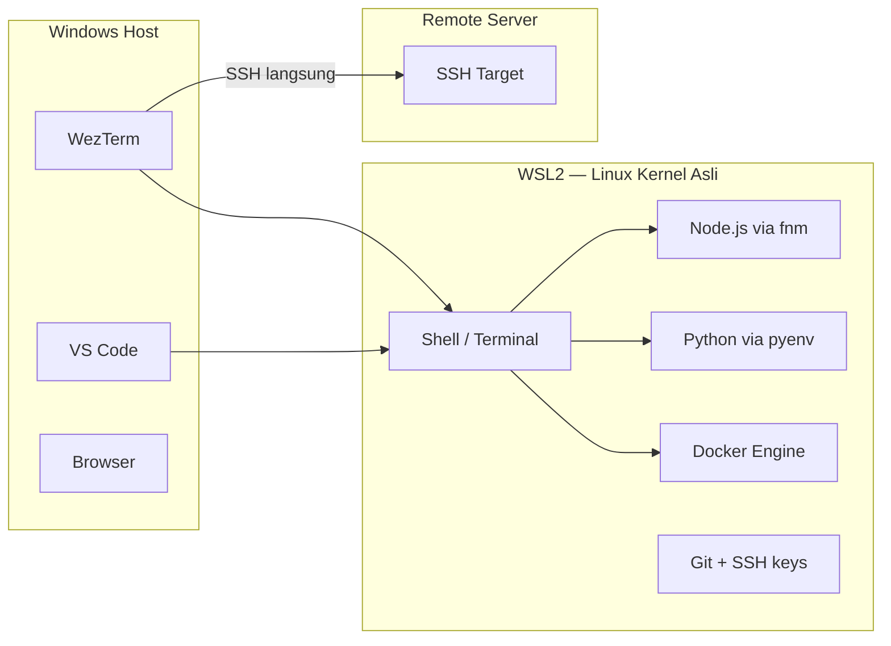
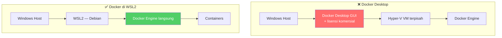

_Ini adalah Part 2 dari series [Windows untuk Developer](/blog/windows-developer-setup-series-gateway)._

---

## WSL2 Bukan Emulasi

Ini hal pertama yang perlu diluruskan, karena banyak yang masih salah paham.

WSL1 memang emulasi — ia menerjemahkan syscall Linux ke syscall Windows, yang artinya ada overhead dan ada hal-hal yang tidak bisa berjalan dengan benar. **WSL2 berbeda fundamental**: ia menjalankan Linux kernel sungguhan di dalam Hyper-V lightweight VM. Bukan compatibility layer, bukan terjemahan syscall — kernel Linux asli yang berjalan di sebelah Windows.

Artinya apa? Artinya ini:

```bash
# Di dalam WSL2 — ini Linux asli, bukan simulasi
uname -r
# 5.15.167.4-microsoft-standard-WSL2

# File system Linux yang proper
ls /etc/
# apt  bash.bashrc  environment  fstab  hosts  passwd  ...

# Package manager Linux yang sesungguhnya
sudo apt install ripgrep fzf tmux neovim
```

Filosofi "everything is a file" yang kita bahas di Part 1 tetap berlaku penuh di dalam WSL2. Kamu mendapat semua keindahan Linux — tapi tetap bisa buka browser Windows, pakai aplikasi GUI Windows, dan file Windows bisa diakses dari `/mnt/c/`.



---

## Pilih Distro yang Tepat

Kebanyakan tutorial WSL2 hanya bilang "install Ubuntu" lalu selesai. Padahal WSL2 support banyak distro, dan pilihan distro itu penting.

```powershell
# Lihat semua distro yang tersedia
wsl --list --online

# Install distro spesifik
wsl --install -d Debian
wsl --install -d Ubuntu-24.04
wsl --install -d openSUSE-Leap-15.6

# Lihat yang sudah terinstall
wsl --list --verbose
# NAME              STATE           VERSION
# Debian            Running         2
# Ubuntu-24.04      Stopped         2
```

Saya personally pakai **Debian** untuk development, bukan Ubuntu. Alasannya sederhana: Debian lebih minimal — tidak ada snap packages yang tidak diminta, tidak ada telemetry Ubuntu yang berjalan di background. Yang paling penting, Debian adalah distro yang paling dekat dengan production server yang biasanya juga Debian atau Ubuntu LTS, sehingga paritas antara development environment dan production environment itu mengurangi kejutan saat deploy.

Kamu bisa punya beberapa distro sekaligus untuk tujuan berbeda — tidak ada yang melarang.

---

## Export/Import: Backup dan Replicate Environment

Ini fitur WSL2 yang paling underrated, dan saya tidak mengerti kenapa jarang dibahas.

```powershell
# Export WSL instance sebagai file tar
wsl --export Debian D:\backups\debian-dev-2026.tar

# Import di mesin lain atau restore setelah reinstall Windows
wsl --import Debian-restored C:\WSL\Debian D:\backups\debian-dev-2026.tar
```

Bayangkan skenario ini: kita setup WSL2 dengan semua tools yang kita butuhkan — neovim dengan semua plugin, tmux dengan konfigurasi yang sudah kita tuning berbulan-bulan, semua CLI tools, semua SSH keys. Lalu kita ganti laptop.

Tanpa export/import: setup ulang dari nol, berjam-jam, sambil mencoba mengingat-ingat "dulu install apa saja dan konfigurasinya bagaimana".

Dengan export/import: copy file tar ke mesin baru, satu command, dan environment yang identik sudah siap — termasuk semua konfigurasi yang sudah kita tuning berbulan-bulan.

Ini adalah **"replicated environment"** yang sesungguhnya. Simpan file tar-nya di external drive atau cloud storage, dan kita punya backup yang bisa di-restore kapanpun.

---

## systemd: WSL2 yang Lebih "Linux"

Sejak WSL2 versi terbaru, `systemd` sudah didukung secara native. Ini mengubah segalanya.

```bash
# /etc/wsl.conf — aktifkan systemd
[boot]
systemd=true
```

Restart WSL2, dan sekarang kita bisa:

```bash
# Jalankan service seperti di Linux sungguhan
sudo systemctl start postgresql
sudo systemctl enable redis-server
sudo systemctl status nginx

# Lihat semua service yang berjalan
systemctl list-units --type=service --state=running
```

Sebelum ada systemd support, WSL2 terasa seperti "Linux yang setengah-setengah" — kita bisa install nginx, tapi tidak bisa `systemctl start nginx`, jadi harus jalankan binary-nya langsung dengan cara yang tidak natural. Sekarang batasan itu sudah tidak ada. WSL2 dengan systemd adalah Linux yang hampir production-equivalent.

---

## WSLg: GUI Apps Linux di Windows

Ini yang bikin saya masih kagum setiap kali menggunakannya.

WSL2 sekarang support GUI applications Linux secara native via **WSLg** (WSL GUI). Bukan X11 forwarding yang lambat dan laggy — WSLg menggunakan Wayland + RDP untuk rendering yang smooth.

```bash
# Install aplikasi GUI Linux
sudo apt install gedit gimp inkscape

# Jalankan — muncul sebagai window Windows biasa
gedit &
# Window gedit muncul di taskbar Windows, berjalan smooth
```

Artinya kita bisa pakai **Neovide** (Neovim dengan GPU rendering) langsung dari WSL2, atau bahkan aplikasi GTK/Qt Linux lainnya, tanpa setup X server terpisah.

---

## Kali Linux di WSL: Ada, Tapi Bukan untuk Sembarangan

Tim Kali Linux sudah melakukan porting resmi ke WSL. Kamu bisa `wsl --install -d kali-linux` dan dalam hitungan menit punya akses ke ratusan tools penetration testing langsung dari Windows.

Tapi saya perlu bicara jujur di sini.

**Kali Linux lebih tepat berjalan di mesin virtual yang benar-benar terisolasi**, bukan di WSL yang berbagi kernel dengan host Windows. Ini bukan soal teknis semata — ini soal **etika dan konsekuensi**:

Tools di Kali dirancang untuk pengujian keamanan yang _authorized_ — artinya ada asumsi bahwa penggunanya tahu apa yang mereka lakukan dan punya izin untuk melakukannya. Menjalankannya di WSL yang terintegrasi dengan host Windows meningkatkan risiko "kecelakaan" yang berdampak ke sistem utama, karena batas antara environment pengujian dan sistem kerja sehari-hari menjadi kabur. Isolasi yang proper bukan paranoia — itu adalah bentuk tanggung jawab.

Untuk VM yang benar-benar terisolasi, ada beberapa pilihan:

| Hypervisor         | Lisensi                       | Performa | Catatan                                           |
| ------------------ | ----------------------------- | -------- | ------------------------------------------------- |
| Hyper-V            | Gratis (built-in Windows Pro) | Baik     | Enable via "Turn Windows features on or off"      |
| VMware Workstation | Berbayar                      | Terbaik  | Paling mature untuk enterprise                    |
| VirtualBox         | Open source, gratis           | Laggy    | Cocok untuk belajar, kurang ideal untuk daily use |

Pilih sesuai kebutuhan dan trade-off yang kamu pahami sepenuhnya. "Kok ribet?" — tidak ribet. Wisdom knowledge memang aslinya sekompleks itu. Karena pada intinya ini bukan hanya soal pragmatis, tapi soal **etis, memahami konsekuensi, dan bertanggung jawab**.

---

## Nix di WSL2: Reproducibility Level Dewa

Ini adalah rabbit hole terbaik untuk developer yang peduli dengan reproducibility — dan saya tidak menyesal masuk ke dalamnya.

**Nix** adalah package manager yang berbeda dari semua yang pernah kita kenal. Bukan apt, bukan brew, bukan winget. Nix adalah **functional package manager** — setiap package di-hash berdasarkan semua dependency-nya, sehingga dua instalasi yang sama _selalu_ menghasilkan environment yang identik, di mesin manapun.

```bash
# Install Nix di WSL2
curl -L https://nixos.org/nix/install | sh

# Install package tanpa "mengotori" system
nix-shell -p nodejs_20 python311 rustc cargo
# Kamu masuk ke shell dengan semua tools tersedia
# Keluar dari shell → tools hilang, system bersih kembali
```

Tapi yang benar-benar powerful adalah **Home Manager** — cara mendefinisikan seluruh environment kita sebagai kode:

```nix
# ~/.config/home-manager/home.nix
{ config, pkgs, ... }:
{
  home.packages = with pkgs; [
    ripgrep
    fzf
    bat
    eza
    tmux
    neovim
  ];

  programs.git = {
    enable = true;
    userName = "Sandikodev";
    userEmail = "dev@sandikodev.com";
    extraConfig.commit.gpgsign = true;
  };

  programs.zsh = {
    enable = true;
    autosuggestions.enable = true;
  };
}
```

Jalankan `home-manager switch` dan seluruh environment kamu terkonfigurasi. Commit `home.nix` ke Git, dan kita punya **dotfiles yang truly reproducible** — bukan hanya symlink ke config files, tapi deklarasi penuh tentang seperti apa environment kita seharusnya.

Ini adalah level tertinggi dari "clean and isolated": bukan hanya environment yang bersih, tapi environment yang **deklaratif, reproducible, dan bisa di-version control**.

### Nix untuk Use Case yang Lebih Dalam

Kebanyakan orang mengenal Nix hanya untuk mengelola dotfiles atau menggantikan `apt`. Tapi kekuatan Nix yang sesungguhnya justru muncul di use case yang lebih spesifik dan lebih demanding — tempat di mana "works on my machine" bukan sekadar menyebalkan, tapi bisa berarti jam debugging yang sia-sia atau firmware yang tidak bisa di-reproduce.

**Reverse Engineering dan Security Research**

Reverse engineering membutuhkan toolchain yang sangat spesifik — versi tertentu dari `radare2`, `ghidra`, `gdb` dengan patch tertentu, `pwndbg` atau `peda` sebagai GDB extension, `pwntools`, `ROPgadget`, dan seterusnya. Masalahnya, versi yang berbeda dari tools ini sering tidak kompatibel satu sama lain, dan environment yang "kotor" bisa menghasilkan false positive atau false negative saat analisis.

```nix
# shell.nix untuk reverse engineering environment
{ pkgs ? import <nixpkgs> {} }:
pkgs.mkShell {
  buildInputs = with pkgs; [
    radare2
    ghidra
    gdb
    pwndbg
    python3
    python3Packages.pwntools
    python3Packages.capstone
    binutils
    file
    xxd
    strace
    ltrace
  ];

  # Pastikan environment bersih dari variabel yang bisa mempengaruhi analisis
  shellHook = ''
    echo "RE environment ready"
    export PYTHONDONTWRITEBYTECODE=1
  '';
}
```

Setiap sesi analisis dimulai dari environment yang identik. Tidak ada "kemarin bisa, sekarang tidak bisa" karena ada update library yang tidak disengaja.

**Low-Level Programming: OS Development dan Memory Management**

Kalau kamu sedang menulis kernel module, mengerjakan OS dari scratch, atau bereksperimen dengan memory allocator, kita butuh toolchain yang sangat presisi — versi GCC atau Clang yang spesifik, linker script yang tepat, QEMU untuk emulasi, dan cross-compiler untuk target arsitektur yang berbeda.

```nix
# shell.nix untuk OS/kernel development
{ pkgs ? import <nixpkgs> {} }:
pkgs.mkShell {
  buildInputs = with pkgs; [
    # Cross-compiler untuk x86_64 bare metal
    pkgsCross.x86_64-embedded.buildPackages.gcc
    pkgsCross.x86_64-embedded.buildPackages.binutils

    # Emulasi
    qemu

    # Debugging
    gdb

    # Build tools
    gnumake
    nasm
    grub2

    # Analisis binary
    binutils
    objdump
  ];

  # Pastikan tidak ada library host yang "bocor" ke build environment
  hardeningDisable = [ "all" ];
}
```

Yang penting di sini bukan hanya tools-nya, tapi juga **isolasi dari library host**. Saat membangun bare-metal binary, kamu tidak ingin ada header atau library dari sistem host yang secara tidak sengaja ikut ter-link. Nix shell memastikan environment benar-benar bersih dari kontaminasi semacam itu.

**IoT dan Embedded: ESP-IDF, RTOS, dan SDK Management**

Ini adalah use case yang paling sering diabaikan tapi paling menyakitkan kalau tidak ditangani dengan benar. Development untuk ESP32 dengan ESP-IDF, STM32 dengan ARM toolchain, atau RTOS seperti Zephyr atau FreeRTOS membutuhkan:

- Versi toolchain yang sangat spesifik (ESP-IDF v5.x butuh Python versi tertentu, xtensa-gcc versi tertentu)
- Environment variable yang tepat (`IDF_PATH`, `IDF_TOOLS_PATH`, dll)
- Python virtual environment yang terisolasi untuk tools ESP-IDF
- USB device access yang proper

Tanpa Nix, setup ini biasanya berakhir dengan script `install.sh` yang harus dijalankan manual, environment variable yang harus di-export setiap sesi, dan konflik antara proyek ESP32 dan proyek Python lain yang kebetulan butuh versi Python berbeda.

```nix
# shell.nix untuk ESP32 development dengan ESP-IDF
{ pkgs ? import <nixpkgs> {} }:
let
  # Pin versi ESP-IDF yang spesifik
  esp-idf = pkgs.esp-idf-full;
in
pkgs.mkShell {
  buildInputs = with pkgs; [
    esp-idf
    python3
    python3Packages.pip
    cmake
    ninja
    ccache
    # USB flashing
    esptool
  ];

  shellHook = ''
    export IDF_PATH=${esp-idf}
    export IDF_TOOLS_PATH=$HOME/.espressif
    source ${esp-idf}/export.sh 2>/dev/null
    echo "ESP-IDF environment ready: $(idf.py --version)"
  '';
}
```

Setiap developer di tim mendapat environment yang identik. Tidak ada lagi "di laptop saya bisa flash, di laptop kamu tidak bisa" karena versi xtensa-gcc yang berbeda.

**Cross-Compilation untuk Berbagai Target**

Nix punya `pkgsCross` — kumpulan toolchain untuk cross-compilation ke berbagai arsitektur yang sudah dikonfigurasi dengan benar:

```nix
{ pkgs ? import <nixpkgs> {} }:
{
  # Build untuk ARM (Raspberry Pi)
  armBuild = pkgs.pkgsCross.raspberryPi.buildPackages.gcc;

  # Build untuk RISC-V
  riscvBuild = pkgs.pkgsCross.riscv64.buildPackages.gcc;

  # Build untuk AVR (Arduino)
  avrBuild = pkgs.pkgsCross.avr.buildPackages.gcc;

  # Build untuk WebAssembly
  wasmBuild = pkgs.pkgsCross.wasi32.buildPackages.clang;
}
```

Ini adalah sesuatu yang di luar Nix biasanya membutuhkan jam setup manual — download toolchain, extract, set PATH, pastikan tidak konflik dengan toolchain lain. Dengan Nix, semua itu menjadi deklaratif.

**Reproducible Research dan Eksperimen**

Untuk penelitian yang butuh reproducibility — benchmark performa, eksperimen compiler, atau analisis binary — Nix memungkinkan kita mendefinisikan environment eksperimen secara eksplisit dan menyimpannya bersama kode:

```nix
# flake.nix — environment yang di-pin ke commit nixpkgs tertentu
{
  inputs.nixpkgs.url = "github:NixOS/nixpkgs/23.11";

  outputs = { self, nixpkgs }: {
    devShells.x86_64-linux.default = nixpkgs.legacyPackages.x86_64-linux.mkShell {
      buildInputs = with nixpkgs.legacyPackages.x86_64-linux; [
        # Versi compiler yang di-pin, tidak akan berubah
        gcc13
        clang_17
        valgrind
        perf-tools
        hyperfine  # benchmarking tool
      ];
    };
  };
}
```

Dengan `flake.nix`, environment di-pin ke commit nixpkgs yang spesifik. Artinya enam bulan kemudian, atau di mesin orang lain, `nix develop` akan menghasilkan environment yang **byte-for-byte identik** — termasuk versi compiler yang sama, versi library yang sama, bahkan versi linker yang sama.

---

## Docker di WSL2: Tanpa Docker Desktop

Docker Desktop untuk Windows adalah aplikasi yang berat. Sejak 2022, ia juga membutuhkan lisensi untuk penggunaan komersial. Dan sebenarnya, kita tidak membutuhkannya.

Docker Engine bisa diinstall langsung di dalam WSL2:

```bash
# Install Docker Engine di WSL2 Debian
sudo apt update
sudo apt install ca-certificates curl
sudo install -m 0755 -d /etc/apt/keyrings
sudo curl -fsSL https://download.docker.com/linux/debian/gpg \
  -o /etc/apt/keyrings/docker.asc
echo "deb [arch=$(dpkg --print-architecture) \
  signed-by=/etc/apt/keyrings/docker.asc] \
  https://download.docker.com/linux/debian \
  $(. /etc/os-release && echo "$VERSION_CODENAME") stable" | \
  sudo tee /etc/apt/sources.list.d/docker.list
sudo apt install docker-ce docker-ce-cli containerd.io docker-compose-plugin

# Tambahkan user ke group docker
sudo usermod -aG docker $USER
```

Hasilnya: Docker Engine yang berjalan langsung di dalam WSL2, tanpa Docker Desktop, tanpa lisensi fee, tanpa overhead GUI yang memakan RAM bahkan saat kita tidak sedang menggunakannya. Karena WSL2 sudah punya Linux kernel sungguhan, Docker berjalan dengan performa yang hampir identik dengan Linux native — tidak ada lapisan virtualisasi tambahan yang perlu dilalui.



---

## Interoperabilitas: Akses Localhost Lintas Environment

Salah satu hal yang sering membingungkan: bagaimana dev server yang berjalan di WSL2 bisa diakses dari browser Windows?

Jawabannya: **WSL2 melakukan localhost mirroring secara otomatis**. Dev server yang berjalan di `0.0.0.0:3000` di dalam WSL2 bisa langsung diakses dari `localhost:3000` di browser Windows.

Untuk remote server via SSH, ada **SSH Local Port Forwarding**:

```bash
# Akses port 3000 di remote server seolah-olah berjalan di localhost
ssh -L 8080:localhost:3000 user@remote-server

# Sekarang buka browser Windows: http://localhost:8080
# Traffic diteruskan melalui tunnel SSH ke remote:3000
```

Keuntungannya: kita tidak perlu membuka port firewall di server publik, karena semua traffic lewat jalur SSH yang sudah aman.

Kebanyakan IDE modern dengan fitur Remote SSH (VS Code, JetBrains) sudah melakukan port forwarding ini secara otomatis — kita tidak perlu setup manual.

---

## Setup WSL2 yang Minimal tapi Serius

Ini urutan yang saya rekomendasikan untuk setup WSL2 dari nol:

```powershell
# 1. Install WSL2 dengan Debian
wsl --install -d Debian

# 2. Masuk ke Debian
wsl -d Debian
```

```bash
# 3. Update dan install essentials
sudo apt update && sudo apt upgrade -y
sudo apt install -y git curl wget build-essential

# 4. Aktifkan systemd
echo "[boot]
systemd=true" | sudo tee /etc/wsl.conf

# 5. Install tools yang sering dipakai
sudo apt install -y ripgrep fzf bat tmux neovim

# 6. Setup Git dengan GPG signing
git config --global user.name "Namamu"
git config --global user.email "email@kamu.com"
git config --global commit.gpgsign true
```

```powershell
# 7. Export sebagai backup awal
wsl --export Debian D:\backups\debian-fresh.tar
```

Dari sini, kita bisa tambahkan Nix untuk reproducibility, atau langsung install Docker Engine untuk container workflow.

---

_Lanjut ke [Part 3: Language Ecosystems](/blog/windows-developer-setup-part3-language-ecosystems) untuk strategi isolasi per bahasa pemrograman._

_Atau kembali ke [Series Gateway](/blog/windows-developer-setup-series-gateway)._
