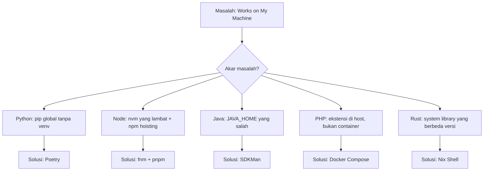

_Ini adalah Part 3 dari series [Windows untuk Developer](/blog/windows-developer-setup-series-gateway)._

---

## Akar dari "Works on My Machine"

Hampir setiap kasus "works on my machine" yang pernah saya temui berakar dari satu hal: **salah memilih strategi isolasi untuk ekosistem bahasa yang dipakai**.

Bukan karena developernya tidak kompeten. Tapi karena setiap ekosistem bahasa punya cara isolasi yang berbeda-beda, dan kalau kita pakai cara yang salah — atau tidak pakai sama sekali — akumulasi masalahnya tidak langsung terasa. Ia menumpuk diam-diam, dan baru meledak berbulan-bulan kemudian, biasanya di saat yang paling tidak tepat: menjelang deadline, atau saat onboarding developer baru yang laptopnya berbeda.



Mari kita bahas satu per satu.

---

## Python: Poetry, Bukan pip Biasa

`pip install` global adalah jebakan yang terlihat tidak berbahaya sampai kita kena masalahnya.

Tanpa virtual environment yang proper, semua proyek Python kita berbagi satu environment yang sama. Django 3.2 dan Django 4.2 tidak bisa hidup berdampingan. Upgrade satu library untuk satu proyek bisa merusak proyek lain yang bergantung pada versi lama. Dan yang paling menyebalkan: masalahnya tidak langsung terlihat — ia muncul perlahan, dalam bentuk error yang tidak jelas.

```bash
# ❌ Cara yang akan menyusahkan kita nanti
pip install django
pip install flask
pip install requests
# Semua berbagi environment yang sama
# Satu upgrade = potensi kerusakan di semua proyek
```

**Poetry** menyelesaikan ini dengan cara yang elegan:

```bash
# Install Poetry
curl -sSL https://install.python-poetry.org | python3 -

# Buat project baru
poetry new my-project
cd my-project

# Tambah dependency
poetry add django
poetry add --group dev pytest black

# Jalankan dalam environment yang terisolasi
poetry run python manage.py runserver

# Atau masuk ke shell environment-nya
poetry shell
```

Tapi yang benar-benar membuat Poetry berbeda adalah `poetry.lock`. File ini bukan hanya daftar dependency — ia adalah **snapshot kriptografis** dari seluruh dependency tree, hingga ke hash file dari setiap package. Artinya:

```bash
# Di mesin kamu
poetry install
# Menginstall persis versi yang sama dengan yang ada di poetry.lock

# Di mesin rekan kerja kamu, seminggu kemudian
poetry install
# Menginstall persis versi yang sama
# Tidak ada "oh di mesin saya versinya beda"
```

Ini bukan sekadar kenyamanan. Ini adalah **deterministic builds** — jaminan bahwa apa yang berjalan di mesin kita akan identik di mesin orang lain, di CI/CD, dan di production.

---

## Node.js: fnm + pnpm, Bukan nvm + npm

`nvm` adalah tool yang bagus, tapi ia punya satu masalah yang mengganggu: ia ditulis dalam bash script. Setiap kali terminal dibuka, `nvm` menjalankan script yang menambahkan sekitar 0.5-1 detik ke shell startup time.

Kecil? Mungkin. Tapi kalikan dengan ratusan kali sehari, dan kita mulai merasakan friction yang tidak perlu.

**fnm** (Fast Node Manager) ditulis dengan Rust. Startup-nya instan — tidak ada delay yang terasa.

```bash
# Install fnm
curl -fsSL https://fnm.vercel.app/install | bash

# Tambahkan ke shell config (~/.zshrc atau ~/.bashrc)
eval "$(fnm env --use-on-cd)"

# Ganti versi Node dalam milliseconds
fnm install 20
fnm install 18
fnm use 20

# .nvmrc juga didukung — fnm otomatis switch versi saat masuk direktori
echo "20" > .nvmrc
cd my-project  # fnm otomatis switch ke Node 20
```

Untuk package manager, **pnpm** adalah pilihan yang lebih cerdas dari npm atau yarn untuk alasan yang sangat konkret:

```bash
# npm: setiap proyek punya node_modules sendiri
# 10 proyek dengan React 18 = React 18 tersimpan 10 kali di disk

# pnpm: content-addressable store
# 10 proyek dengan React 18 = React 18 tersimpan 1 kali
# Setiap proyek dihubungkan via hard link

pnpm install  # Jauh lebih cepat dari npm install
pnpm add react
pnpm add -D typescript
```

Tapi ada keunggulan pnpm yang lebih penting dari sekadar hemat disk: **strict hoisting**. npm dan yarn meletakkan semua dependency di `node_modules` root, yang artinya kita bisa mengimport library yang tidak ada di `package.json` kamu — karena library itu ada di sana sebagai dependency dari dependency lain.

Ini yang disebut **phantom dependencies** — bug yang hanya muncul di production ketika versi dependency berubah dan library yang kita "pinjam" tiba-tiba tidak ada lagi. pnpm mencegah ini dengan strict hoisting: kita hanya bisa mengimport apa yang ada di `package.json` sendiri.

---

## Java: SDKMan untuk Versioning

Java punya masalah versioning yang unik: ekosistemnya sangat luas, dan berbeda proyek sering butuh versi Java yang berbeda. Legacy project mungkin butuh Java 8. Spring Boot modern butuh Java 21. Android butuh versi tertentu.

**SDKMan** menyelesaikan ini dengan cara yang mirip dengan nvm untuk Node:

```bash
# Install SDKMan di WSL2
curl -s "https://get.sdkman.io" | bash
source ~/.sdkman/bin/sdkman-init.sh

# Install berbagai versi Java
sdk install java 21.0.2-tem    # Temurin 21 (LTS)
sdk install java 17.0.9-tem    # Temurin 17 (LTS)
sdk install java 8.0.392-amzn  # Amazon Corretto 8 (untuk legacy)

# Switch versi
sdk use java 21.0.2-tem

# Set default
sdk default java 21.0.2-tem

# SDKMan juga manage Gradle, Maven, Kotlin, Scala
sdk install gradle 8.5
sdk install maven 3.9.6
sdk install kotlin 1.9.22
```

Untuk IDE, saya sudah bahas lebih detail di Part 4 — tapi singkatnya: **NetBeans** untuk desktop app Java (JavaFX, Swing) adalah alternatif gratis yang benar-benar layak dibanding IntelliJ IDEA Ultimate yang berbayar. Untuk server-side (Spring Boot, Quarkus), IDE apapun bisa — yang penting environment-nya di Linux.

---

## PHP: Container-First, Laragon sebagai Pengecualian

Filosofi untuk PHP modern adalah **container-first**. Menginstall ekstensi PHP langsung di host, atau menggunakan XAMPP, adalah cara lama yang membawa masalah lama.

```yaml
# docker-compose.yml untuk PHP project modern
services:
  app:
    image: php:8.3-fpm
    volumes:
      - .:/var/www/html
    environment:
      - APP_ENV=local

  nginx:
    image: nginx:alpine
    ports:
      - "8080:80"
    volumes:
      - .:/var/www/html
      - ./nginx.conf:/etc/nginx/conf.d/default.conf

  db:
    image: mysql:8.0
    environment:
      MYSQL_ROOT_PASSWORD: secret
      MYSQL_DATABASE: myapp

  redis:
    image: redis:alpine
```

```bash
docker compose up -d
# Semua service berjalan, terisolasi, tidak mengotori host
```

Tapi ada pengecualian yang justified: **Laragon** untuk Windows.

XAMPP adalah produk jamannya — ia lahir ketika developer PHP butuh cara cepat untuk setup Apache + MySQL + PHP di Windows, dan ia melakukan tugasnya dengan baik untuk eranya. Tapi XAMPP membawa masalah yang familiar: versi PHP terkunci, ekstensi harus manual edit `php.ini`, multiple PHP version adalah mimpi buruk.

Laragon mengubah semua itu:

```
Laragon Features:
├── PHP versioning    → klik, pilih versi, selesai
├── Node.js           → terintegrasi, tidak polusi PATH Windows
├── MySQL / MariaDB   → isolated, tidak konflik dengan instalasi lain
├── Pretty URLs       → myproject.test otomatis, tanpa edit hosts file
├── Quick App         → init Laravel, WordPress, Symfony dalam 1 klik
└── Extensions        → enable/disable ekstensi PHP via GUI
```

Untuk **quick prototyping dan client work PHP**, Laragon masih juara. Untuk **project serius yang butuh production parity**, Docker di WSL2 adalah pilihan yang lebih tepat.

Perbandingan lengkapnya:

```
Laragon (Windows)
├── ✅ Gratis
├── ✅ GUI yang intuitif
├── ✅ Pretty URLs otomatis (*.test)
├── ✅ Multiple PHP version
├── ✅ Tidak butuh WSL
└── ⚠️  Windows-only

Laravel Herd (Windows/Mac)
├── ✅ Dari tim Laravel sendiri
├── ✅ Sangat cepat (native binary)
├── ✅ Terintegrasi dengan Laravel ecosystem
├── 💰 Versi Pro berbayar
└── ⚠️  Lebih opinionated (Laravel-centric)

PHP di WSL2 + Docker
├── ✅ Paling flexible
├── ✅ Production-identical
├── ✅ Bisa pakai docker-compose
└── ⚠️  Setup lebih kompleks
```

---

## Rust & Systems: Nix Shell

Rust punya masalah yang spesifik: ia sering membutuhkan system library level OS — `openssl`, `pkg-config`, `gcc`, `libssl-dev` — yang versinya bisa berbeda antar mesin. `cargo build` yang berjalan di mesin kita bisa gagal di mesin orang lain karena versi `openssl` yang berbeda.

**Nix Shell** menyelesaikan ini dengan cara yang elegan:

```nix
# shell.nix di root project
{ pkgs ? import <nixpkgs> {} }:
pkgs.mkShell {
  buildInputs = with pkgs; [
    rustc
    cargo
    rust-analyzer
    openssl
    pkg-config
    # Semua system library yang dibutuhkan, versi yang tepat
  ];

  # Environment variables yang dibutuhkan
  PKG_CONFIG_PATH = "${pkgs.openssl.dev}/lib/pkgconfig";
}
```

```bash
# Masuk ke environment dengan semua dependency
nix-shell

# Build dengan library yang tepat, versi yang tepat
cargo build

# Keluar dari shell
exit
# Sistem kembali bersih, tidak ada sisa
```

Dengan `direnv`, ini bisa otomatis:

```bash
# .envrc di root project
use nix

# Setiap kali masuk direktori, environment otomatis aktif
# Keluar direktori, environment otomatis nonaktif
```

Ini adalah solusi untuk masalah yang sering membuat frustrasi developer Rust: "cargo build berjalan di mesin saya, tapi gagal di CI karena library yang berbeda". Dengan Nix, environment didefinisikan secara deklaratif dan reproducible — di mesin manapun yang punya Nix.

---

## Trade-off Summary

Sebelum menutup, ini ringkasan trade-off dari semua pilihan yang kita bahas:

| Ekosistem    | Tool           | Pro                                         | Kontra                         |
| ------------ | -------------- | ------------------------------------------- | ------------------------------ |
| Python       | Poetry         | Deterministic, auto venv                    | Resolver lebih lambat dari uv  |
| Node         | fnm + pnpm     | Cepat, hemat disk, strict hoisting          | Dokumentasi fnm kurang lengkap |
| Java         | SDKMan         | Multi-version mudah, manage semua JVM tools | Bash-based, sedikit lambat     |
| PHP          | Docker Compose | Production-identical, flexible              | Setup lebih kompleks           |
| PHP (quick)  | Laragon        | Cepat, GUI intuitif                         | Windows-only                   |
| Rust/Systems | Nix Shell      | Reproducible, bersih                        | Kurva belajar Nix cukup curam  |

Tidak ada pilihan yang sempurna untuk semua situasi — setiap tool punya trade-off yang perlu kita pahami sebelum memilihnya. Yang penting bukan memilih yang paling populer atau yang paling sering disebut di Twitter, tapi **memilih dengan sadar**: tahu apa yang kita pilih, tahu konsekuensinya, dan konsisten menjalankannya.

---

_Lanjut ke [Part 4: Windows Native](/blog/windows-developer-setup-part4-windows-native) untuk ekosistem .NET, package managers Windows, registry, dan posisi AI dalam workflow._

_Atau kembali ke [Series Gateway](/blog/windows-developer-setup-series-gateway)._
