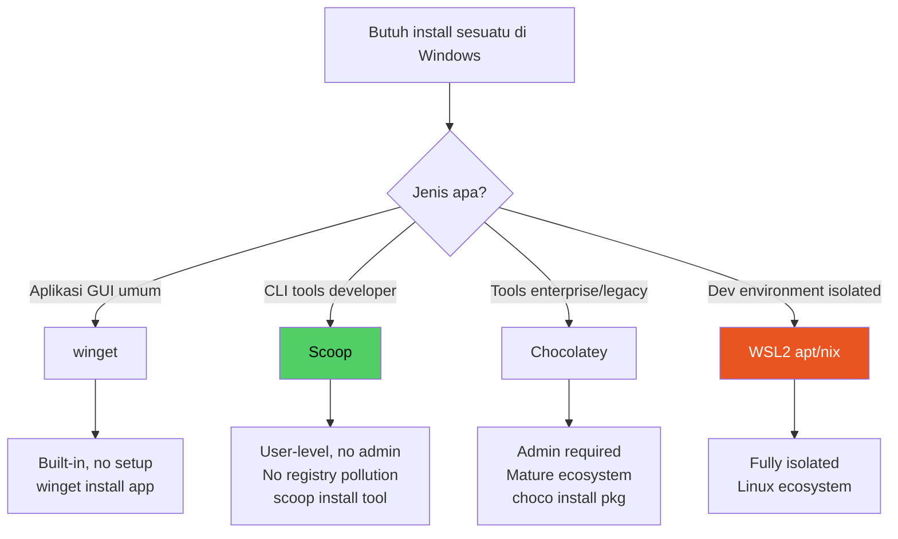
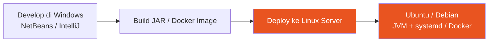
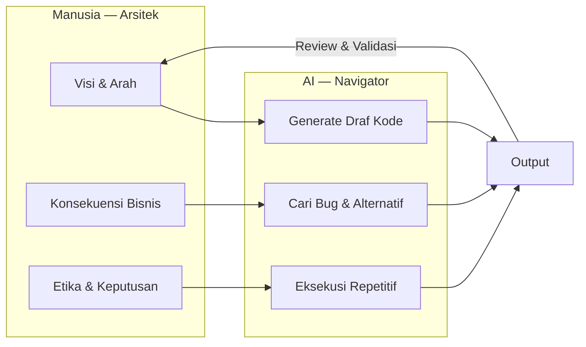

_Ini adalah Part 4 dari series [Windows untuk Developer](/blog/windows-developer-setup-series-gateway)._

---

## Windows adalah Platform yang Valid — untuk Ekosistem Windows

Ini yang sering dilupakan dalam perdebatan "Windows vs Linux untuk developer": **Windows adalah platform terbaik untuk membangun sesuatu yang memang ditujukan untuk Windows**.

Bukan karena Windows lebih baik dari Linux secara umum. Tapi karena tooling yang dibangun khusus untuk ekosistem tertentu selalu menang dalam hal integrasi, debugging experience, dan kemudahan deployment.

Kalau kamu membangun aplikasi .NET, WinForms, WPF, atau MAUI — kamu seharusnya di Windows, dengan Visual Studio, mengikuti konvensi yang Microsoft arahkan. Melawan arus di sini bukan tanda kreativitas, hanya akan menghasilkan friction yang tidak perlu dan debugging yang lebih menyakitkan.

---

## Visual Studio: Bukan VS Code

Ini perbedaan yang penting dan sering membingungkan orang baru.

**Visual Studio** (bukan VS Code) adalah IDE full-featured untuk ekosistem Microsoft. Ia berat, ia membutuhkan disk space yang besar, tapi ia memberikan sesuatu yang tidak bisa ditandingi oleh VS Code + extension:

- IntelliSense yang benar-benar paham .NET internals, bukan hanya syntax highlighting
- Debugger yang terintegrasi sempurna dengan runtime — breakpoint, watch variables, call stack, memory profiler
- NuGet package manager yang seamless
- Designer visual untuk WinForms, WPF, dan MAUI
- Hot Reload yang benar-benar bekerja untuk .NET

**VS Code** adalah editor yang sangat baik untuk hampir semua hal — tapi untuk .NET development yang serius, Visual Studio masih menang dalam hal integrasi.

Aturan sederhananya: **ikuti konvensi yang Visual Studio arahkan**. Kalau Visual Studio menyarankan struktur project tertentu, ada alasan arsitektural di baliknya. Jangan melawan arus hanya karena ingin terlihat berbeda.

---

## Package Managers Windows: Pilih yang Tepat

Windows sekarang punya beberapa package manager, dan masing-masing punya peran yang berbeda:

```powershell
# winget — built-in sejak Windows 10/11, untuk aplikasi GUI umum
winget install wez.wezterm.nightly
winget install Git.Git
winget install Microsoft.VisualStudioCode
winget install Google.Chrome

# Scoop — untuk CLI tools developer, install ke user directory
scoop install ripgrep
scoop install fzf
scoop install neovim
scoop install bat

# Chocolatey — lebih mature, lebih banyak package, butuh admin
choco install everything
choco install sysinternals
choco install 7zip
```



Filosofi saya: **winget untuk aplikasi GUI umum, Scoop untuk CLI tools developer**.

Kenapa Scoop untuk CLI tools? Karena Scoop install ke `~/scoop/` di user directory — tidak butuh admin, tidak menulis ke registry, dan kalau mau dihapus bersih tinggal hapus folder-nya. Ini adalah pendekatan yang paling dekat dengan filosofi "sanitized host" untuk Windows native tools.

### Winget: Lebih Powerful dari yang Kamu Kira

```powershell
# Export semua aplikasi yang terinstall sebagai JSON
winget export -o apps.json

# Import di mesin baru — install semua sekaligus
winget import -i apps.json

# Update semua aplikasi sekaligus
winget upgrade --all

# Cari package
winget search "terminal"
```

`winget export` + `winget import` adalah cara paling clean untuk **replicate Windows setup** di mesin baru. Simpan `apps.json` di Git repository, dan setup Windows baru kita bisa selesai dalam satu command. Tidak perlu ingat-ingat "dulu install apa saja".

---

## Registry: Memahami Musuh untuk Mengalahkannya

Daripada hanya menghindari registry, lebih baik memahami strukturnya — karena pemahaman ini yang memungkinkan kita membuat keputusan instalasi yang lebih cerdas.

```
Registry Hive Structure:
├── HKEY_LOCAL_MACHINE (HKLM)  → System-wide, butuh admin
│   ├── SOFTWARE               → Installed applications
│   ├── SYSTEM                 → Hardware & driver config
│   └── SECURITY               → Security policies
├── HKEY_CURRENT_USER (HKCU)   → Per-user, tidak butuh admin
│   ├── SOFTWARE               → User-specific app settings
│   └── Environment            → User PATH variables
├── HKEY_CLASSES_ROOT (HKCR)   → File associations
└── HKEY_USERS (HKU)           → All user profiles
```

Implikasinya untuk pilihan package manager:

- **Scoop** install ke `HKCU` → tidak butuh admin, mudah di-cleanup, tidak mempengaruhi user lain di mesin yang sama
- **Chocolatey** install ke `HKLM` → butuh admin, lebih "dalam" ke sistem, dan residunya lebih susah dibersihkan
- **winget** bervariasi tergantung package — beberapa ke HKCU, beberapa ke HKLM, tergantung bagaimana si developer package menulisnya

Tools untuk menjaga registry tetap bersih:

- **Autoruns** (Sysinternals) — lihat semua yang autostart, nonaktifkan yang tidak perlu
- **Process Monitor** (Sysinternals) — lihat apa yang ditulis ke registry secara real-time
- **Bulk Crap Uninstaller (BCUninstaller)** — uninstall yang benar-benar bersih, termasuk registry leftovers

---

## ASP.NET di Linux: Paradoks yang Masuk Akal

Ini yang sering mengejutkan developer .NET tradisional: untuk server-side ASP.NET Core, saya lebih memilih Linux.

Bukan karena Linux lebih baik dari Windows secara umum. Tapi karena ada alasan yang sangat konkret:

**1. .NET Core sudah cross-platform sejak 2016.** Tidak ada alasan teknis untuk terikat Windows di server.

**2. Ukuran Docker image berbicara sendiri:**

```
Docker image size (ASP.NET Core 8):
├── aspnet:8.0-windowsservercore  → ~5.5 GB 😱
├── aspnet:8.0-nanoserver         → ~350 MB
└── aspnet:8.0 (Linux/Alpine)     → ~220 MB ✅
```

Untuk production di cloud, perbedaan ini berdampak langsung ke biaya storage, transfer time, dan startup time container.

**3. Ekosistem DevOps lebih natural di Linux** — Kubernetes, Nginx, systemd, semua tool monitoring dan observability — semuanya first-class citizen di Linux.

```bash
# ASP.NET Core di Ubuntu — perfectly valid
dotnet new webapi -n MyApi
cd MyApi
dotnet run
# Now listening on: http://localhost:5000
```

Paradoksnya: kita bisa develop di Visual Studio Windows, tapi deploy ke Linux server. Dan itu bukan kompromi — itu adalah best of both worlds.

### Minimal API: .NET yang Terasa Modern

.NET 6+ memperkenalkan Minimal API yang jauh lebih ringan dari MVC tradisional:

```csharp
// Program.cs — tidak ada Controller, tidak ada Startup class
var builder = WebApplication.CreateBuilder(args);
var app = builder.Build();

app.MapGet("/", () => "Hello from Linux!");
app.MapGet("/health", () => Results.Ok(new { status = "healthy" }));
app.MapGet("/users/{id}", async (int id, IUserService svc) =>
    await svc.GetByIdAsync(id) is User user
        ? Results.Ok(user)
        : Results.NotFound());

app.Run();
```

Ini adalah .NET yang terasa seperti Express.js atau Fastify — minimal, fast, dan sangat cocok untuk microservices di Linux container.

Untuk **Blazor** (frontend)? Ikuti konvensi Visual Studio. Blazor sangat terintegrasi dengan tooling Microsoft, dan melawan itu hanya akan menyusahkan diri sendiri.

---

## Java: NetBeans, IntelliJ, Eclipse — dan Mengapa Server Tetap Linux

Saya akan jujur: **IntelliJ IDEA adalah IDE Java terbaik yang pernah ada**. Tapi ia berbayar untuk edisi Ultimate, dan untuk banyak use case, ada alternatif yang benar-benar layak.

**NetBeans** (Apache NetBeans) untuk desktop app Java:

- GUI Designer yang mature untuk JavaFX dan Swing
- Maven/Gradle integration yang solid
- Gratis dan open source
- Lebih ringan dari IntelliJ
- Perfect untuk JavaFX development

**Eclipse** untuk enterprise Java:

- Jakarta EE / Java EE support yang sangat mature
- Plugin ecosystem yang sangat luas
- Gratis dan open source
- Sangat customizable

**Android Studio** untuk Android:

- Satu-satunya pilihan yang masuk akal
- Berbasis IntelliJ, dioptimalkan untuk Android
- Tidak ada kompromi di sini

Tapi untuk **Java server-side** (Spring Boot, Quarkus, Micronaut) — IDE apapun bisa dipakai untuk development, tapi **deploy ke Linux**:



### GraalVM: Java yang Tidak Lagi "Berat"

Kritik klasik Java untuk server adalah startup time yang lambat dan memory footprint yang besar. **GraalVM Native Image** mengubah itu secara dramatis:

```bash
# Compile Spring Boot app ke native binary
./mvnw -Pnative native:compile

# Hasilnya: binary yang startup dalam milliseconds
./target/myapp
# Started MyApplication in 0.065 seconds
# Bukan 3-5 detik seperti JVM biasa
```

Dengan GraalVM, Java server-side di Linux container menjadi sangat kompetitif dengan Go atau Rust dalam hal startup time dan memory usage. Framework seperti **Quarkus** dan **Micronaut** didesain dari awal untuk GraalVM native compilation.

---

## Mobile Development: Windows Tetap Relevan

Untuk **Android development**, Windows bekerja dengan baik:

```powershell
# Flutter di Windows
winget install Google.Flutter
flutter doctor
# [✓] Windows Version
# [✓] Android toolchain
# [✓] Visual Studio
```

Untuk **React Native** juga sama — Android development bisa dilakukan sepenuhnya di Windows.

Tapi untuk **iOS development**, tidak ada jalan lain: kita butuh Mac. Xcode hanya ada di macOS, App Store submission membutuhkan macOS, dan tidak ada workaround yang benar-benar bisa menggantikan itu — bukan karena Apple tidak mau, tapi karena mereka memang sengaja merancangnya seperti itu.

---

## Windows Sandbox: Isolasi untuk Testing

Untuk testing aplikasi yang tidak kita percaya sepenuhnya, Windows punya **Windows Sandbox** — VM yang disposable:

```powershell
# Enable Windows Sandbox (Windows 10/11 Pro)
Enable-WindowsOptionalFeature -FeatureName "Containers-DisposableClientVM" -Online

# Buka Windows Sandbox
WindowsSandbox
```

Setiap kali dibuka, Windows Sandbox adalah Windows yang fresh dan bersih — tidak ada aplikasi yang terinstall, tidak ada konfigurasi yang tersisa dari sesi sebelumnya. Tutup windownya, semua hilang sepenuhnya tanpa meninggalkan jejak di host system.

---

## AI: Exoskeleton, Bukan Pengganti

Tidak bisa bicara tentang setup developer modern tanpa menyentuh posisi AI dalam workflow.

Saya tidak melihat AI sebagai ancaman atau pengganti. Saya melihatnya sebagai **exoskeleton** — alat yang memperkuat kemampuan manusia, bukan menggantikannya.



**Manusia = Arsitek & Nahkoda**: menentukan arah, struktur, dan konsekuensi jangka panjang.
**AI = Mesin & Navigator**: menghasilkan draf, mencari bug, memberikan alternatif.

Yang berbahaya adalah developer yang menerima output AI secara buta — tanpa review, tanpa pemahaman, tanpa akuntabilitas. Setiap baris kode yang di-generate AI harus di-review seolah-olah kamu sedang me-review pekerjaan junior developer.

Justru di sinilah **fundamental yang kuat** menjadi semakin penting, bukan semakin tidak relevan. Kamu tidak bisa me-review kode yang kamu sendiri tidak paham. Kamu tidak bisa mendeteksi halusinasi AI tentang API yang tidak ada kalau kita tidak tahu API tersebut seharusnya seperti apa.

> "Developer yang paham fundamental ditambah kecanggihan AI akan memiliki ambang produktivitas yang mustahil dicapai di masa lalu."

---

## Setup Akhir: Gambaran Lengkap

Setelah empat part, ini gambaran besar dari setup yang kita bangun:

```
Windows Host (Keep It Clean)
├── WezTerm (nightly) ──────────────── SSH ke Linux server
├── winget apps (apps.json di Git)
│   └── Hanya aplikasi GUI umum
├── Scoop (user-level, no registry chaos)
│   └── CLI tools: ripgrep, fzf, bat, dll
├── Visual Studio
│   └── .NET / C# / Blazor / WinForms
├── Laragon (isolated PHP environment)
│   └── PHP quick prototyping
├── Windows Sandbox
│   └── Testing aplikasi tidak dikenal
└── WSL2 - Debian (systemd enabled)
    ├── Node.js (via fnm)
    ├── Python (via Poetry)
    ├── Java (via SDKMan)
    ├── Docker Engine (tanpa Docker Desktop)
    ├── Nix (untuk reproducibility)
    └── Semua web development toolchain

Linux Server (via SSH / WezTerm)
├── Production environment
├── Debian / Ubuntu
├── Docker + Traefik
└── Server-side: .NET, Java, Node, PHP
```

---

## Penutup Series

Empat part, satu filosofi yang sama di balik semuanya: **setiap keputusan teknis adalah keputusan etis juga**.

Memilih sanitized host bukan hanya soal laptop yang bersih — ini soal disiplin dan tanggung jawab terhadap sistem yang kita kelola. Memilih CLI bukan soal gaya — ini soal transparansi dan kontrol. Memilih tool isolasi yang tepat bukan soal mengikuti tren — ini soal reproducibility dan akuntabilitas.

Pada akhirnya, semua ini kembali ke satu kalimat sederhana:

> **Sebaik-baik teknologi, semua kembali pada SDM itu sendiri.**

---

_Kembali ke [Series Gateway](/blog/windows-developer-setup-series-gateway) untuk overview lengkap._

_Semua filosofi di balik series ini juga terdokumentasi di [ShowMyGear](https://github.com/sandikodev/showmygear)._
