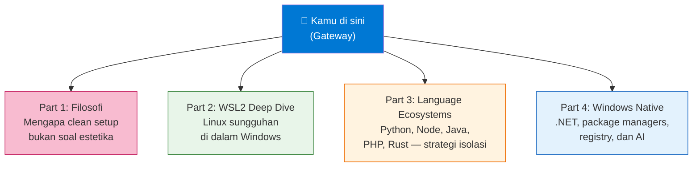

Saya mau jujur dulu sebelum kita mulai.

Saya pakai Windows. Setiap hari. Sebagai daily driver utama. Dan saya tidak malu mengatakannya — meskipun saya juga yang dulu menghabiskan waktu bertahun-tahun di Arch Linux, Gentoo, bahkan pernah iseng membangun sistem operasi dari source code lewat Linux From Scratch.

Justru karena latar belakang itu, saya bisa bilang dengan yakin: **pilihan Windows saya bukan karena tidak tahu yang lain** — saya sudah merasakan sendiri bagaimana rasanya membangun sistem dari nol, dan saya tetap memilih Windows untuk alasan yang sangat spesifik.

Tapi ada syaratnya. Windows yang saya maksud bukan Windows yang penuh sesak dengan Node.js terinstall langsung di host, XAMPP berjalan di background, Python 2 dan Python 3 saling bertabrakan di PATH, dan registry yang sudah jadi kuburan konfigurasi sejak hari pertama. Itu bukan Windows — itu Windows yang disiksa.

Yang saya maksud adalah Windows dengan satu filosofi: **Keep It Clean, Keep It Simple.**

---

## Kenapa Ini Jadi Series?

Awalnya ini satu artikel. Tapi ternyata topiknya terlalu luas untuk dipaksakan jadi satu tulisan — ada filosofi, ada teknis WSL2 yang dalam, ada strategi per bahasa pemrograman, ada diskusi tentang ekosistem Windows native, bahkan ada refleksi tentang etika digital yang tidak bisa dipisahkan dari semua ini.

Jadi saya pecah. Bukan supaya terlihat produktif, tapi supaya kita bisa masuk dari pintu yang paling relevan dengan kebutuhanmu sekarang.

---

## Peta Series

### [Part 1: Filosofi — Sanitized Host, CLI-First, dan Etika Digital](/blog/windows-developer-setup-part1-filosofi)

Ini fondasi dari segalanya. Kenapa "dirty host" adalah masalah yang lebih dalam dari sekadar laptop yang lemot. Kenapa CLI bukan soal gaya tapi soal transparansi. Dan kenapa diskusi tentang setup developer pada akhirnya harus menyentuh pertanyaan tentang etika — dari Richard Stallman sampai brainrot TikTok.

Baca ini kalau kita ingin memahami _mengapa_, bukan hanya _bagaimana_.

---

### [Part 2: WSL2 Deep Dive — Linux Sungguhan di Dalam Windows](/blog/windows-developer-setup-part2-wsl2)

WSL2 bukan sekadar "Linux di Windows". Ini adalah Linux kernel sungguhan dengan systemd, GUI apps via WSLg, multiple distro, export/import untuk backup environment, Nix untuk reproducibility level dewa, dan Docker Engine tanpa Docker Desktop.

Ada juga pembahasan tentang Kali Linux di WSL — kenapa ia ada, dan kenapa menjalankannya di WSL bukan pilihan yang etis tanpa pemahaman konsekuensi yang penuh.

Baca ini kalau kita mau setup WSL2 yang benar-benar serius.

---

### [Part 3: Language Ecosystems — Setiap Bahasa, Strategi Isolasinya Sendiri](/blog/windows-developer-setup-part3-language-ecosystems)

"Works on my machine" syndrome hampir selalu berakar dari satu hal: salah memilih strategi isolasi untuk ekosistem bahasa yang dipakai. Poetry untuk Python, fnm+pnpm untuk Node, SDKMan untuk Java, container-first untuk PHP, Nix shell untuk Rust.

Baca ini kalau kamu sering mengalami dependency hell atau environment yang tidak konsisten antar mesin.

---

### [Part 4: Windows Native — .NET, Package Managers, Registry, dan AI](/blog/windows-developer-setup-part4-windows-native)

Windows adalah platform yang valid untuk ekosistem Windows itu sendiri. Visual Studio untuk .NET, Scoop+winget untuk package management yang bersih, memahami registry untuk mengalahkannya, ASP.NET di Linux sebagai paradoks yang masuk akal, dan posisi AI sebagai exoskeleton — bukan pengganti.

Baca ini kalau kamu develop untuk ekosistem Microsoft atau ingin memahami Windows lebih dalam.

---

## Titik Masuk yang Disarankan

Kalau kamu bingung mulai dari mana, ini panduan singkatnya:

| Situasimu                                         | Mulai dari               |
| ------------------------------------------------- | ------------------------ |
| "Laptop Windows saya berantakan, entah kenapa"    | Part 1                   |
| "Mau setup WSL2 yang proper"                      | Part 2                   |
| "Dependency hell di Python/Node/Java"             | Part 3                   |
| "Develop .NET atau butuh package manager Windows" | Part 4                   |
| "Mau baca semuanya"                               | Part 1, lanjut berurutan |

---

Semua konten di series ini juga terdokumentasi lebih lengkap di [ShowMyGear](https://github.com/sandikodev/showmygear) — repo yang saya buat sebagai "otopsi isi pikiran" tentang development environment, bukan sekadar daftar tools.

Selamat membaca.
